# 计算模型：06：上下文无关文法与语法分析树 📚

在本节课中，我们将要学习**上下文无关文法**。这是一种描述语言的形式，类似于正则表达式，但它拥有自己的一套规则。我们将学习其基本构成、如何设计文法，以及如何通过推导和语法分析树来表示字符串的生成过程。

## 概述 📖

上下文无关文法包含四个核心组成部分：**终结符**、**非终结符**、**开始符号**和**产生式**。

*   **终结符**是构成语言字母表的符号，例如小写字母 `a, b, c` 或数字 `0, 1`。它们通常出现在产生式的右侧。
*   **非终结符**是一个有限的符号集合，每个符号代表一个语言。它们通常出现在产生式的左侧。
*   **开始符号**是一个特殊的非终结符，语言的所有推导都从这里开始。
*   **产生式**是描述语言的规则。其形式为 `变量 -> 符号串`，表示左侧的变量可以被右侧的符号串替换。

识别它们最简单的方法是观察产生式：**左侧的符号是非终结符，右侧出现的、且不出现在任何产生式左侧的符号是终结符**。在题目中，这些通常会被明确指出。

## 文法设计示例 ✍️

上一节我们介绍了上下文无关文法的基本构成，本节中我们来看看如何为特定的语言设计文法。

以下是几个常见语言的设计示例：

**1. 设计一个包含子串“101”的文法**

我们要求生成的字符串必须包含子串“101”，但子串前后可以有任何数量的0或1。
我们可以定义开始符号 `S`，并确保“101”出现在中间。子串前后的部分可以用一个变量 `E` 来生成任意数量的0或1（包括空串 `ε`）。

产生式设计如下：
```
S -> E 1 0 1 E
E -> 0E | 1E | ε
```
*测试*：要生成字符串“11010”，推导过程为：`S => E101E => 1E101E => 11E101E => 11ε1010E => 11ε1010ε = 11010`。该字符串包含“101”，文法接受。

**2. 设计一个至少包含三个0的文法**

我们要求字符串中0的数量至少为3个，但这些0不需要连续。字符串的开头、中间和结尾都可以有任意数量的1。
我们可以先强制生成三个0，并在每个0之间和整个字符串的首尾，用变量 `E` 来填充任意数量的1。

产生式设计如下：
```
S -> E 0 E 0 E 0 E
E -> 0E | 1E | ε
```
*注意*：这里 `E` 的产生式也允许生成0，但这不会影响“至少三个0”的条件，只会增加0的数量。

**3. 设计一个最多包含三个0的文法**

我们要求字符串中0的数量不能超过3个。我们可以枚举所有可能的情况：0个0、1个0、2个0、3个0。同时，在任何位置都可以插入任意数量的1。
我们可以定义不同的路径来生成0，并用变量来生成1。

产生式设计如下：
```
S -> A | B | C | D
A -> 1A | ε          // 0个0的情况
B -> 0B1 | 1B | ε    // 恰好1个0的情况（但此写法会生成多个0，需要修正）
```
更清晰的设计是分别考虑0的个数，并在其间填充1：
```
S -> E               // 0个0
S -> E 0 E           // 1个0
S -> E 0 E 0 E       // 2个0
S -> E 0 E 0 E 0 E   // 3个0
E -> 1E | ε          // 生成任意数量的1（不含0）
```

**4. 设计生成 a^x b^y 的文法**

这个语言要求所有 `a` 在前，所有 `b` 在后，但 `a` 和 `b` 的数量 `x` 和 `y` 是独立且任意的。
我们可以递归地生成 `a` 和 `b`。

产生式设计如下：
```
S -> A S B | ε
A -> a
B -> b
```
或者更直接地：
```
S -> aS | T
T -> bT | ε
```

## 推导：最左与最右 🔄

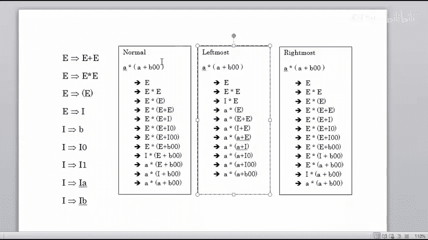

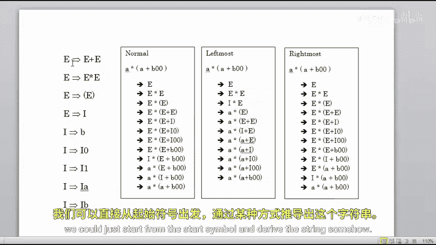

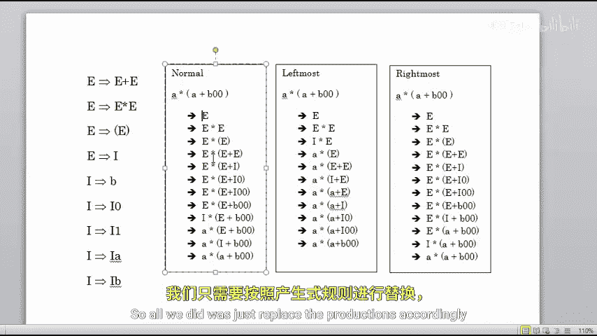

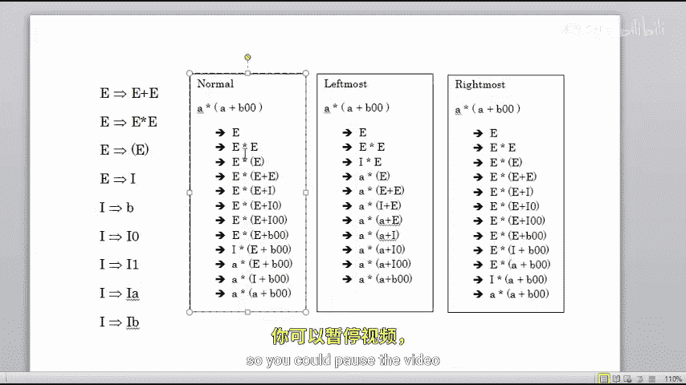

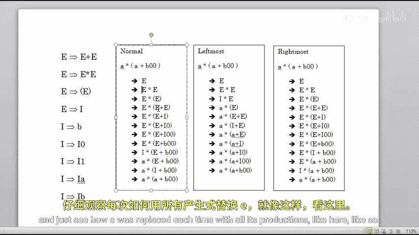

当我们有了文法和一个目标字符串时，我们可以通过应用产生式从开始符号推导出该字符串。推导方式主要有两种：**最左推导**和**最右推导**。

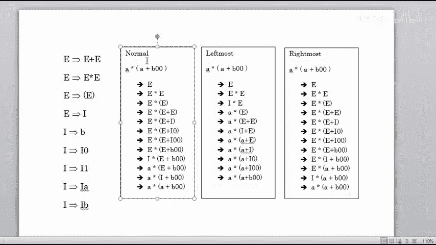

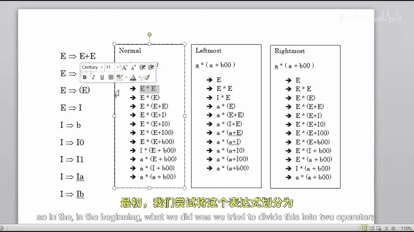

*   **最左推导**：在每一步推导中，总是优先替换当前字符串中最左边的非终结符。
*   **最右推导**：在每一步推导中，总是优先替换当前字符串中最右边的非终结符。

以表达式 `a + (b * c)` 的以下文法为例：
```
E -> E + E | E * E | (E) | I
I -> a | b | c
```
其最左推导的一个步骤示例如下：
`E => E + E => I + E => a + E => a + (E) => a + (E * E) => ...`
其最右推导的一个步骤示例如下：
`E => E + E => E + (E) => E + (E * E) => E + (E * I) => ...`

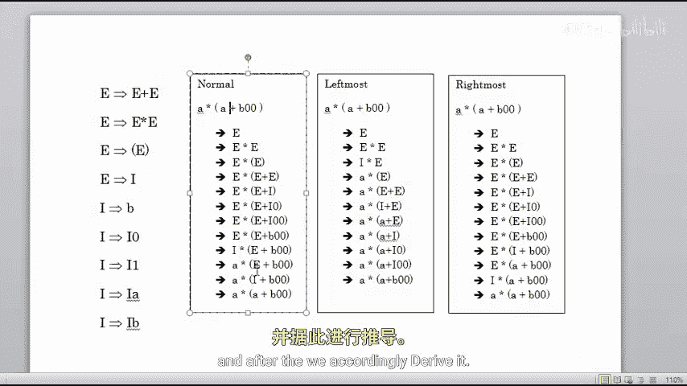

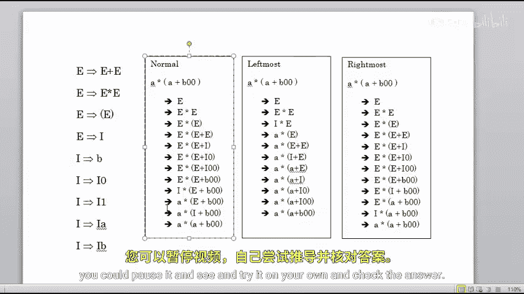

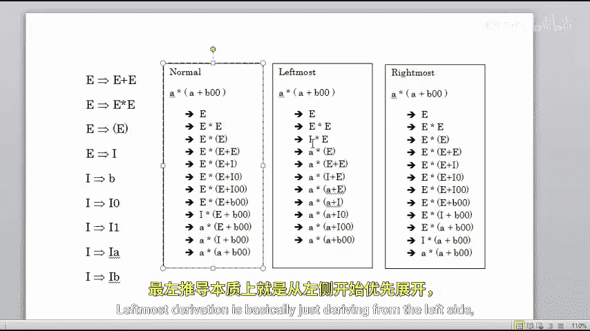

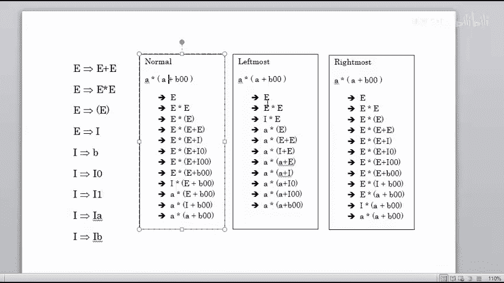

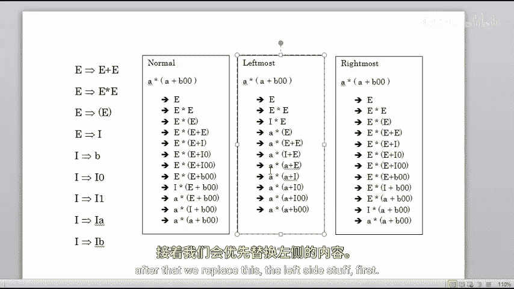

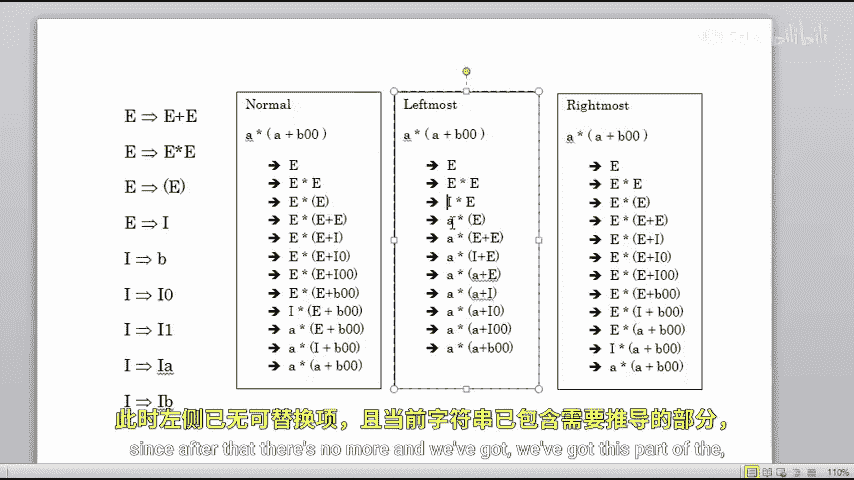

两种方式都能生成同一个字符串，但替换的顺序不同。

## 语法分析树 🌳

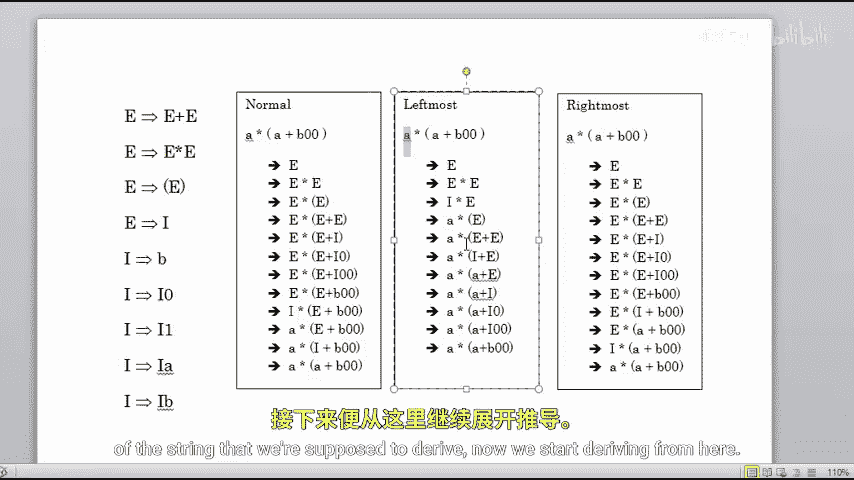

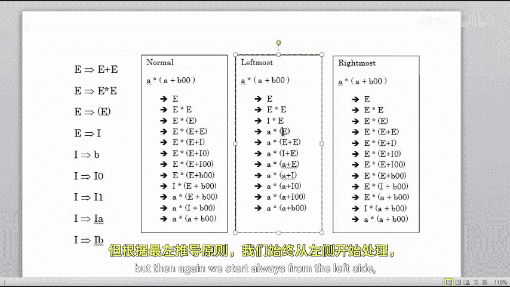

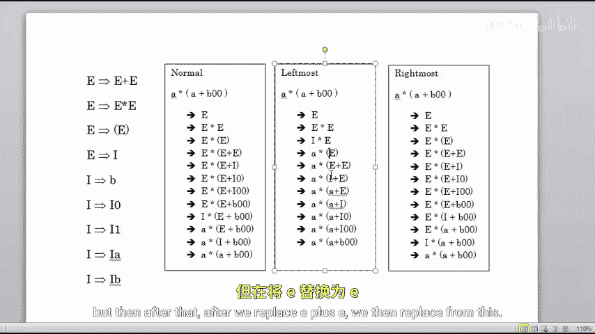

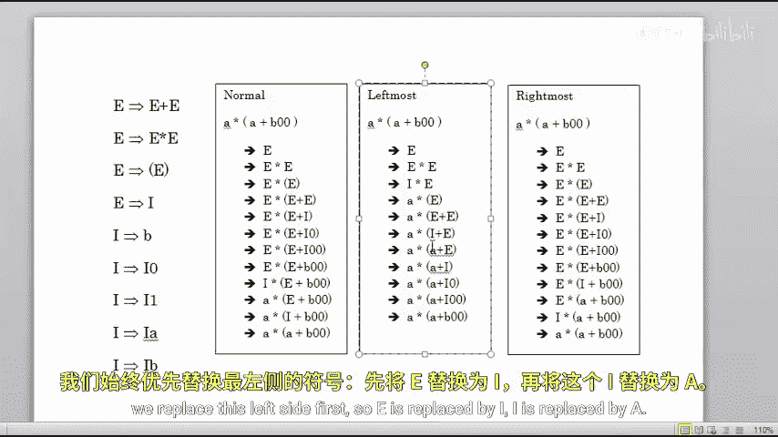

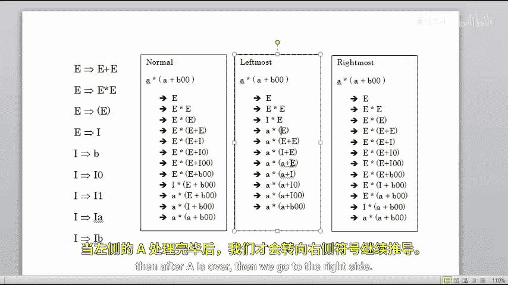

语法分析树是表示上下文无关文法推导过程的图形化方法。它将推导的层次结构清晰地展现出来。

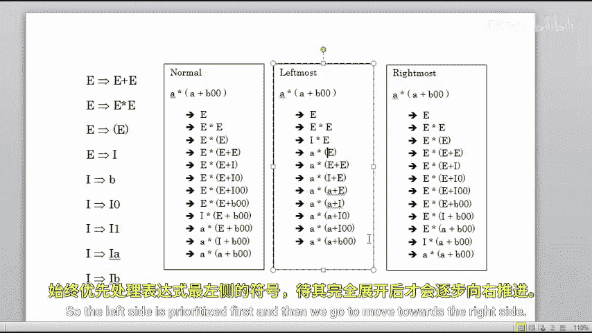

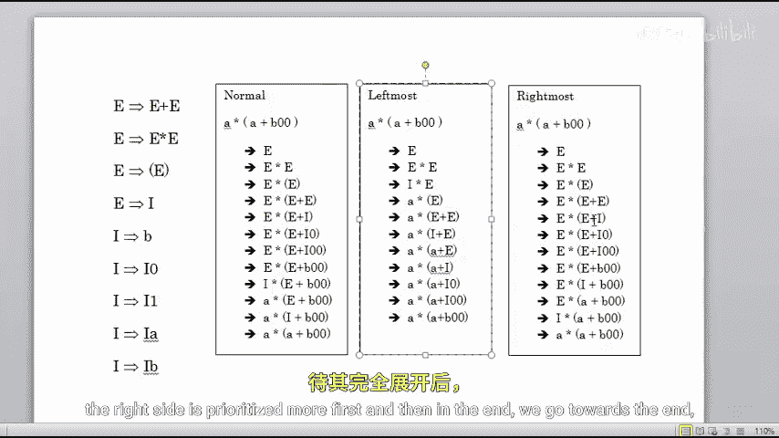

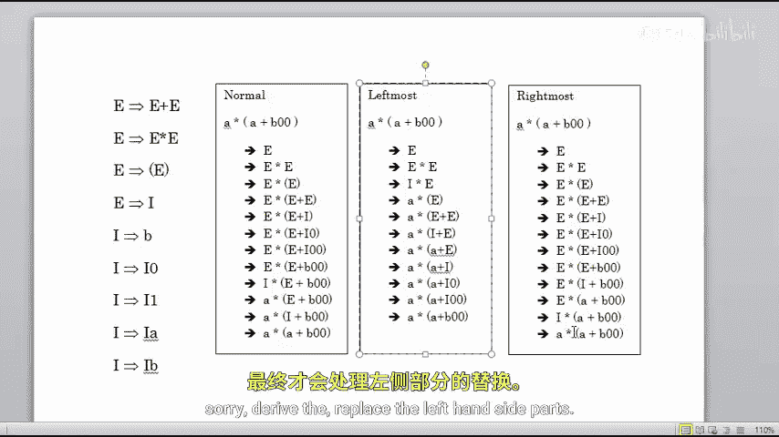

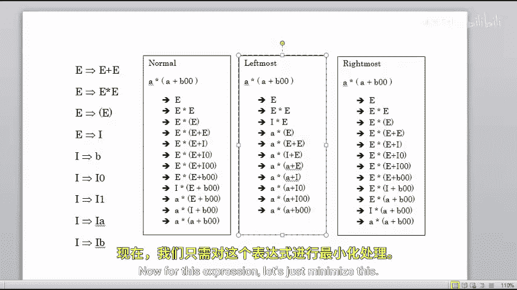

树的定义如下：
*   **根节点**是文法的开始符号。
*   **内部节点**是非终结符。
*   **叶节点**是终结符（或空串 `ε`）。
*   每个内部节点及其子节点对应一个产生式。例如，如果有一个产生式 `A -> B C D`，那么节点 `A` 就会有三个子节点 `B`、`C`、`D`。

对于同一个字符串和文法，不同的推导（最左/最右）可能对应**同一棵语法分析树**。这棵树直观地展示了表达式的语法结构，在编译原理中用于分析程序代码的语法。

## 总结 🎯

本节课中我们一起学习了上下文无关文法。我们首先了解了它的四个基本组成部分：**终结符**、**非终结符**、**开始符号**和**产生式**。接着，我们通过多个例子练习了如何为不同的语言描述设计文法。然后，我们探讨了如何通过**最左推导**和**最右推导**从文法生成特定字符串。最后，我们介绍了**语法分析树**，这是一种能直观展示推导过程的树形结构。掌握这些概念是理解形式语言和编译器前端工作的重要基础。