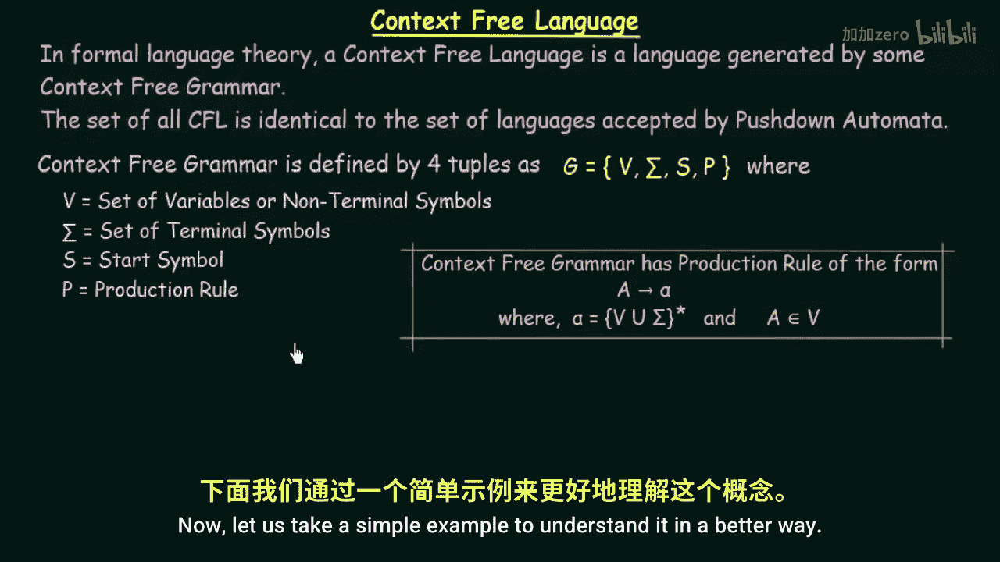
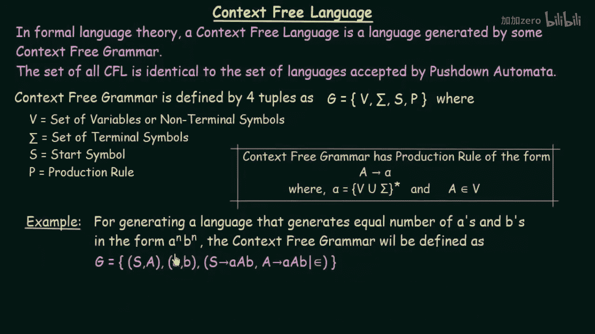
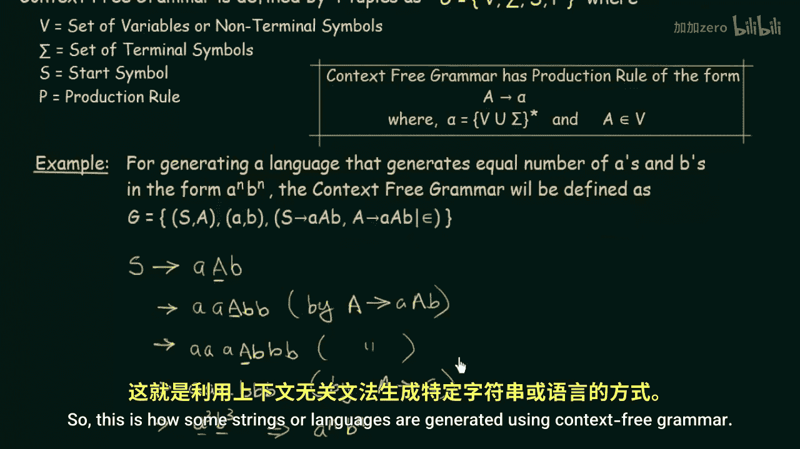

# 悉尼大学【中英⚡计算模型｜COMP2022 Models of Computation】 p07 P8 Context Free Grammar & Context Free Language -BV1vTe6zzENb_p7-

In this lecture， we will be studying about context free languages。

So till now we have studied about regular languages and we also studied about regular grammars and we saw what they can be used for and we also saw their limitations now we come to the next level of languages which are context free languages。

 so let's first see what are context free languages。In formal language theory。

 a context free language is a language generated by some context free grammar。

 so just like regular languages were generated using a regular grammar。

 the languages that are generated using context free grammar are known as context free languages。

And the set of all context free language is identical to the set of languages accepted by push down automata。

 so if you remember the table of Chomsky's classification of grammars that we saw in a couple of lectures back。

 you must remember that the automata that is used for designing context free languages。

A pushed down automata， just like in our regular languages we used finite state automatta for designing them。

 So in case of context free languages， push down automata is used。

 so we know that context free languages are considered to be a higher level language as compared to regular languages。

 so we are also understand that pushed down automata are more powerful than the finite state automata Okay so now let us see how our context free grabs formally defined。

So contextfr grammar is defined by four doubles as G equal to v sigma S and p。

 so if you remember even regular grammar was defined using fours as VtSNP and even contextfr grammar are also defined using fours which are v sigma S and p and let's see what the tus mean the tus actually they mean the same as in the case of regular languages where v is the set of variables or non-terminal symbols and sigma is the set of terminal symbols and S is a start symbol and p is a production rule so what is the difference between regular grammar and contextfr grammar actually the difference lies in the production rule so in context free grammar it has a production rule of the form。

A tends to alpha or a gives alpha where alpha is the union of v and sigma closure。

 so that means that alpha can be a nonterminal symbol or a terminal symbol and here we notice that it is a closure so that means that it could also be empty。

 it could also be an empty symbol or anything from a nonterminal symbols or a terminal symbol and then a it belongs to v that means a belongs to the set of nontermin symbols so this is how we formally define a contextfr grammar Now let us take a simple example to understand it in a better way Allright so here we have an example for generating a language that generates equal number of A's and Bs in the form a power and B power n the contextfr grammar will be defined as G equal to S。

AB and this is a production rule so if you remember we have taken this example a few times when we discuss regular languages and we already saw that this language a language that generate strings of this form A power and B power and where the number of A's should be exactly equal to the number of bs is not a regular language and we already saw why it is not a regular language because this cannot be designed using a finite state machine since this could not be designed using a finite state machine we are studying about contextfr language now and context free language as I told you is a higher level of language as compared to regular languages and context free languages will be able to generate strings of this form okay so we will see how this will be generated using context free language so the grammar that will be used for generating this is defined like this G。

al to S and a， which are the set of non terminalminal symbols and A and B are the set of terminal symbols and we have a production rule of the form S gives A A B and A gives A A B and also it gives epsilon or the empty symbol Okay so here actually the start symbol is not given so we should know that the start symbol is S so even if its not given let's understand that the start symbol is S over here Okay now let us see。

If this production rule is going to produce the strings of this form， Okay。

 so let me start with my start symbol that is s and s gives。A， a。B。

 so using this production I have written this as gives a A B。

 Okay now we have another production rule which says a gives a A B， So this a over here。

 I will replace it to it A A B so this a will come down as it is and this cap a will be replaced by A A B。

A， A B， and this B over here comes down as it is。 So this is by the production， which says a gives。

AA笔。Alright， and now let's try to expand this further here we have A A， A BB。

 Now this a using the same production rule， I will expand it again。

 so these two a's will come down as they are。 and instead of this A I will write A A B。A， A， B。

 and these two bees are remaining。 They will come down as they are。

 So this is also using the same production rule as above。Okay。

 now I still have a which is a nontriminal symbol here and now what I will do is I will replace this a with epsilon that is the empty symbol because we see that the production rule says a gives aAB and also it can give epsilon or the empty symbol so I can write a A A and instead of a I will put epsilon so eilon actually needs the empty symbol so I can just leave it blank and then this 3 bs b b B so this is by the production rule which says that。

A gives upsider， Okay， so。We see that we finally， we get this string， A A A， B， B， B。

 So this is of the form。A power 3， B power3。 So we see that the number of A's is equal to the number of bs。

 So how much ever you expand， you will always get strings of this form where the number of a's will be equal to the number of bs that means you can generalize and write that A power N B power N so we see that this is generated using the contextfree grammar which is defined like this and which has a production rule of this form So this is how some strings all languages are generated using contextfree grammar Okay so I hope this was helpful to you。

 Thank you for watching and see the next one。

