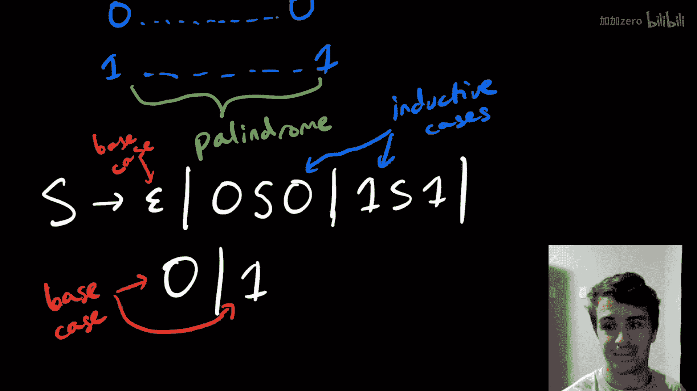

# 悉尼大学【中英⚡计算模型｜COMP2022 Models of Computation】 p09 P10 Context-Free Grammars (CFG) and Context-Free Languages (CFL) - what are they -BV1vTe6zzENb_p9-

🎼。If you subscribe to the channel， you'll get lots of interesting videos like this one and if you like the video it'll really help us out。

 please comment down below for any other interesting things that also really helps us out as well。

Hi， welcome to another edition of easyas theory， so we're going to continue our grammar stuff with regard to theory。

 so we were talking about these things called grammars。

And what they are are a bunch of rules where we have something on the left side of an arrow。

 an arrow， and things on the right side of an arrow。

 and what this means is that anytime we are applying rules that we see something that involves an A。

 then we can replace that A with a B。And here what that means is any occurrence of a we can replace with B now this a here could actually be anything in the most general sense of a grammar。

 it could be a whole bunch of terminals or variables or a combination thereof and so can be。

 and so that's the most general case。And then we talked about these things called regular grammars。

Which are are grammars that have a particular form， which are a variable can make the empty string。

 a variable can make a single character， a variable can make another variable or a variable can make one terminal and then a variable in that order I mentioned in the problem set。

That you can actually replace this role right here with a goes to a variable then the terminal the order doesn't really matter here。

You will still get the regular languages， it involves proving some things about the grammar。

 but you still get the same things。Okay， but what if we say I'm not going to forbid that rule right there？

I'm going to say， yeah， I could have this type of rule and this type of rule。

 does that actually change anything？So let me show you an example。So let me use purple for this。

So let's look at this grammar， so where S is going to make0 a or empty and then a is going to make one。

I know wrong one it has to be s1 in that order okay so this is the grammar and S is the start variable。

 so this is the start variable。So the question is， what is the language of this grammar？

So let's start and see Well， if we look at S right here， we could make the empty strings。

 so let's just make a list of strings we can make so empty we can make what else can we make Well。

 if we apply this zero to a rule， then that means we're going to have S。

Producing0 a because we replace the S with the right hand side。

 which is0 a here the0 is a terminal by the way， and so is one so then we can the only thing we can do with the a variable is to replace it with S1 so therefore we're going to have zero S1。

And then the same rule applies， so maybe we can replace the s with the empty string again。

 so that means if we replace it with the empty string we get01 there。

 so the other string another string we can get as01。And if we notice right here， this S right here。

 we can apply the same two rules over and over and over and over， so that means we can get 0011。0ero。

 zero zero， one， one， one， and et cetera。Wait， can't we get any other string。

 well no because at every point any other string of terminals I mean。

And I claim we can't well once we have the a variable。

 we can only replace it with S1 because that's the only rule that's defined for it and if we have S defined at some point。

 then all we can do is replace it with0A or make it go away and there's no rule here that replaces one variable and with a rule that involves two variable。

 it's either that it replace one variable and makes a variable。

same thing here or it has one variable being replaced with no variables at all。

 so we always will have one variable hitching along for the ride and then it either eventually drops out or we just keep going with that with it with one variable。

 so I claim then therefore that given that these are the only possible strings etc。

 if we apply those same ruless over and over I mean。

The language of this grammar is going to be zero to the n， ones the n。

Or n is at least zero and recall from several videos ago that this is not regular。And so。

There's some things I should say about this， This is obviously not a regular grammar because this says we have the definition of a regular grammar has a terminal only on the left side and this rule obviously breaks it but based on this result this tells us that there is no possible regular grammar you could ever create that will get this language because regular grammars only get the regular languages to start with and this one isn't regular so that tells us that by changing this one allowing that extra type of rule in there that that actually really does make a difference here so that actually tells us something important that the definitions that we make for certain things are really rigid and that they cannot be modified to add more stuff but in some other cases。

We might be able to， such as when we talked about NFAs， we could have any number of final states。

 but we could assume that we can make an NFA with one final state by epsilon transitioning to a single final state。

And so there are some things that we can do， but this is an example where the definition of a regular grammar really it needs to be rigid。

 you can either pick one of these two， but you can't pick both。Okay。And bearingearing that in mind。

 well， what type of grammar should we actually call this type of thing。

 what should we even allow here？Well let's actually just go for broke and say any you can put anything that you want on the right side。

 it doesn't have to be one terminal and one variable or something。

 you can put anything you want in any order on the right side so that's what we're going to look at here so something called a context free grammar and I'll explain where that comes from。

😡，Which is abbreviated CFG naturally， it is a grammar。Where。All rules。Yeah。

Where all rules are of the form a goes to X where the A right here， that's a single variable。

 so it's always going to have a single variable on the left side。

 so it's not like we're replacing multiple things with multiple things。

 we're always replacing one variable， no terminals at all。

 and the X on the right hand side can be any combo of variables and terminals。

Any the empty string of course so so this is saying that you can have anything you want on the right hand side so every grammar we've ever talked about every explicit example of a grammar is already a context for grammar so this tells us that every regular grammar。

😡，Is already。Of CFfG。Okay。Because CFG says you can have anything you want on the right hand side whereas regular grammar restricts what you can have。

 so it's already a context for your grammar。And there's one more definition， which is a context。Free。

Language。Which is abbreviated CFL is。The language language。Of some CG。

So it's the analogous thing like regular language was for DFA context free language is for context free grammar。

 so in this case， for example， this language right here is a CFL it's a context free language because I just exhibited a grammar for you。

 a context free grammar for you that has that language。And another thing we should note from this。

Based on this previous statement right here， every regular grammar is already a context for grammar。

 This tells us that every。Regular。Language。Is a C。But not the other way。

Why not the other way because zero to the n one to the n that language is not regular so there are some context free languages that are not regular but every regular language is a context free language Okay because every regular grammar regular grammar is a context free grammar Okay。

 so let's do a quick example so let's do this one I call it PAal。So what is this。

 so this is the set of all palindromes。Over。01 star。I sure I'll do it this way。Okay。

 and if you happen to not know， a palindrome is a string。W such that it is。Equal。

To its reverse so I can read the string W backwards and forwards and it's exactly the same string So as an example0110 is a palindrome and so this string would be would belong in there the empty strings in there。

Individual characters are in there， zero and one， zero， zeros in there， et ceter。

So there are a lot of strengths in here and I claim and I want you to be able to prove it in the comments。

That this language is not regular。Not really important for our purposes right now。

 but it is just not regular Okay so how do we I claim here that PAL is a context free language so that means that I can make a context free grammar for you for this language so let's actually think about what this language is well let's say that W is a string in the palundros language。

So then that means well it either starts with the zero or it starts with the one I don't know which but it starts with one of them so let's say it starts with a zero well if it starts with a zero。

 then what happens is that at the other end because it's equal to its own reverse。

 the last character of it， well it even might be the same character but the last character must also be a zero because it's the same backwards and forwards。

And if it started with a one is exactly the same principle， it also ends with a one so。

 but the key here that you should notice when you're making context for grammars is what happens in the middle。

Because。The way that context for grammars are usually made is a very recursive like structure in that you try to solve a small。

 suppose that you can solve the smaller problem， then how can you solve the bigger string， well。

 what is happening in the middle， well because the string is the same backwards and forwards。

 then that means that the stuff in between the zeros or between the ones， that must also be a palro？

Because the string is exactly the same backwards and forwards so this is a prime example of using the definition of the language in a recursive way so how can we actually make a grammar for this well let's just take this into account。

In every grammar， even in context free grammar， we must have a start variable somewhere。

 so let's call it S。So S is going to make， well， what are the things it can make。

 it either can make the empty string because the empty string is a palindrome by a definition。

 or so this is you can actually think of this as being a base case。So a base case。

And then what are the inductive cases？So the inductive cases are when you have the zeros on the end。

And then we're going to assume by recursion that S could make all the palindrorummes。

 so by putting an S right here， that saying， assume that I can make a palindrome。

 then that means I'm allowed to put zeros on either side and that's also a palindrome and the same logic applies if I want to do this with the ones。

This is almost correct though， but we notice that we have the individual characters being zeros and ones and in fact we could have any string of odd length also being a palindrome so if you actually look at this we always will generate two terminals in every role or zero which is in the case here so then that means that whatever this makes is all the even length palindromes so to get this to work with odd length。

 all we need to do is to handle the other two base cases which are the individual characters。

So these two right here are also base cases。And the ones here， these two。

 these are the inductive cases。Okay， so this was a and and you can actually prove via induction that this is correct because。

Apart from the middle everything else has there's an even number of characters other than either the middle character or the middle two characters so everything else there's an even number of characters which means we apply these two rules over and over as needed and if are if the string length we want is even then we apply this role and if the string length is odd we apply one of these to whichever one is the one that works for the string so if the zero is the middle we apply this one and if the ones the middle we apply this one so hopefully that was interesting we other interesting ideas about contextread grammars into the comments as always please like and subscribe to the channel really helps us out there are a lot of links in the video description if you want to support us even further and as always I'll see you next time。

🎼う。

