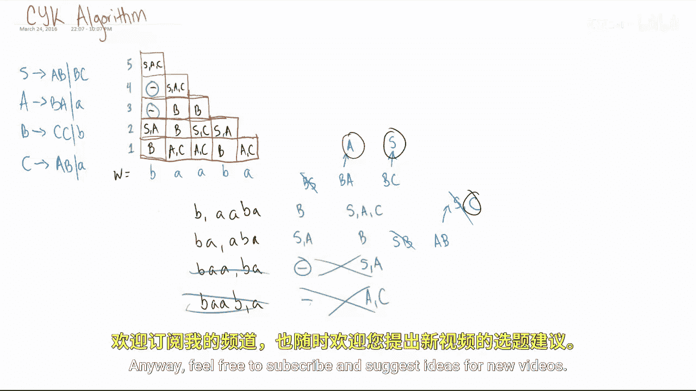

# 悉尼大学【中英⚡计算模型｜COMP2022 Models of Computation】 p11 P12 CYK Algorithm Made Easy (Parsing) -BV1vTe6zzENb_p11-

What's up， everyone， this is。Education about stuff。I'm going to be showing the CYK algorithm today。

And what the CYK algorithm is。Is。Whenever you have a string， W。Let's say。This is your string W。

It looks at what kind of derivations you can obtain。um。While referencing a grammar that we have here。

Four different substrs of that larger string。We look at derivations of just B。

Look at derivations of just a and so on， and then we look at BA and then BA。BAB等BAABA。At the end。

Okay， so let's get started， it's pretty basic to start out， it's very intuitive。

 but it gets a little tricky。So first off， we look at。a letter。So if we look at the letter B。

 B is a terminal value in our grammar。Here for the state B， for the label B and only B。

 so we look at the letter and the string， let we say where can we obtain B？

And we can only obtain B in state capital B， So we put capital B。And here。Where can we obtain a。

 we can obtain a in state capital A and state capital C。So we write in。He。And see。

And then it's just A and C again here， it's just B again here。And see you again here。So。Now。

 this is when things get a little trick here。Let's take out。I was here。

This is one of things people check， by the way， sorry about my voice。

 I got a bit of a head cold right now。嗯。Instead of looking at the actual string。

 we want to start looking at substrs。So we're going to be looking at B and A first。

 which is why we are our graph here。our table was reduced by a square。

 is because we're going to be looking at combinations of two letters in our string now。

So if we take a look here。😔，We're going to be looking at。String B， A。So， when we look at。

How B and A are produced。We can take the。Yeah， the Cartesian product essentially。

Of these two production rules。So we end up with。BA。In B， so let let me look into our grammar again。

Where do we obtain PA？We obtain B and state capital A。Where do we obtain B。

 We only obtain it in state S。So。We write SA up here。Now。

This is a new version of OneNote that I'm really not used to yet。No。Look at a and a。

We do the Cartesian product of A and C。A and C， So we end up with a。诶。A。end up。CA， we end up with C。

So where do we get AA， We don't get AA， Where do we get A， We don't。We you get CA。

We don't where we get C， we get it in B。Put me up here。Okay。So。Whenna be looking。Ba。So， we have。

And see。B for those two letters。In the Cartesian products。 So we have a B。C B。

 So where do we obtain A B， We obtain it in both S and。C， where we obtain C， B， we don't。So， this is。

Let see。And then finally。BA at the end here， so。We have B， we have A。 We take the Cartesian product。

With B。BC。Where we get B， we get it in state capital A。😔，Where do we get BC， we get it in S。So。

Do essay here。Okay， so things get a little harder here。Basically。Basically。

 we're going to be looking at three letters at a time now， so we're going to be looking at BAA。Now。

 because we have three letters， we have different combinations of substratestrs。So， we have B。

And then， we have A A。We have B and then A。 so those are just different combinations。

 the two different combinations of substratestrs that we can have for that beginning string there of three letters。

So， let's take a look。We have。比。Here。Which is taken care of by state capital B。So we have B。

 and then we have double A。We already took care of AA。Here。When we were doing two letters at a time。

So ready to take care of AA there， that is also B。Then we have B A， and then A。

So we already took care of B again。SA。Which is here。So again， when we took care of two letters。

We did B A。 We did it in this cell here。So we have essay。

 and then when we did just one letter at a time， we did A。 so that's AC。

Now we take the Cartesian product of what we obtain from your substratestr， so here we end up with。

Just BB， and here we end up with。S and a。And then we end up with Sn。To see。

And then A and A and then A and the C。No， this is interesting because none of these。

All right in our grammar。 We can't obtain any of these in our grammar。When that happens。

 we just put a little dash in there。Okay， so next。Take。AAB。

So our different substrs are A and then a B。Or a。B。So we already did A， which。Which is here。

 It's just A C。So， we have a C。And then A B， we already did as well。I see。And then here， AA。

 we already did that， ends up with B。And then just B， we already did as well， heads up with just B。

 so Cartesian product here again， it's just B B。And then， here。It's。A。し。And C， S。试试。

So just taking a look at this again， we only have CC once and that's on state capital B。

If you can see here。So， we just put。六十三。We' just put capital B here。So just to go over that again。

 we have C only once in our grammar。And this is the Cartesian product of a couple production rules from our substr AA。

So since this is the only result that we have。We put it here。Okay， now our last substr， A B。

 so we can have a。Or B A or A B or A。And we end up with。A and B。A then A。Let see。A。

 so if we do the carteian products， we end up。A。诶哎。C， S。Let see。See。CA。试试。

So it looks like CCs are only one again。Which is present in state capital E。

 which means that we put a capital B。Okay， so now it's getting to my Lee favorite。

APart where we start doing four letters。So our substrs。BAAB。B。Maybe。BA A。嗯。操逼。It's just B。

 and then AAB， we already did。BB，A。Here he did， That's S。AB， we already did。 Let's see。BAA。

 we already did。That's。Nothing。人币。so this one is canceled out because we have nothing here。

So we don't have to do that one， so here we end up with just BB as our Cartesian product。

We end up with SS。With SC。Up with A。See。So again， none of these are in our grammar。

 so we just put a dash。Okay。So now we're going to look at A A BA。Yeah。え。诶。The A we have。Right。

 so A is just。Soir， I'm kind of changing colors a lot here。 Not really keep in track。系 a b a。AA is B。

And B。I say。So I know I'm going kind of quick here， but just to show you again。For like string AA。

 we already did it。It's the string here。😔，And we did it in the second row。 So let's just B。

And then SA is for the substream BA， which is this one here。Which we already did as well。

 it's in row two here， so that's just where I'm getting those values from。KAAB。B a。Its。A C。

 so now we do the Cartesian product。So， we have。MaybeBe here。CB。Yes。DA。Yeah。Bc， so here， a B。

You have A P in。State S， we have A B and state C。CB， we don't have。B， S， we don't have。BA we。Stay a。

Andて。And BC， we have in state。so because we have repeated states here， we only have to say them once。

So we。Just do S。See。Because we have S C here， we have an A here we have an。And like I repeated SEOA。

 we have repeated A here， we don't need to include these twice， we just do SCA。SAC。

 whatever I like doing this order just because it's the order。In which the grammars lists the states。

So。Yes。See。So I'm going to write out the substrings and just prep the last step here。

I'll cut out for a sec。Okay， so here we have two blanks， so we have BAA。

Which is this one here and then we have B AAB， which is this one here。

 so these two we don't have to do so are these are just done we forget about those。Alright， so。

We have for Cartesian products we have。B， S， yeah。B。B。This one we have。SB。Okay， so BS。

 we don't have BS， BA。Is in state capital A。BC is in state capital S。😔，SB， we don't have a B。

Is in states。S and capital C。 So again， we have a repeated S， so it's just S。Because S A。See。Okay。

 so that that's it again， sorry for my voice and I'm kind of whispering here。

But I hope that clears things up， I honestly I watched a few videos on。Let's seeY K algorithm on2。

And none of them explain this properly， so I hope this helps。Anyway。

 feel free to subscribe and suggest ideas for videos and happy studying。

