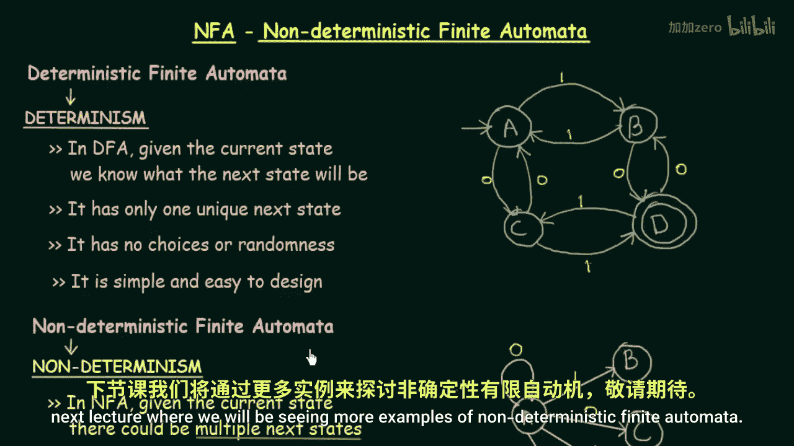

# 悉尼大学【中英⚡计算模型｜COMP2022 Models of Computation】 p12 P13 Non-Deterministic Finite Automata -BV1vTe6zzENb_p12-

Hello everyone， welcome to the next lecture in The of Comput and in this lecture we will be starting with our next topic that is NFA or non deterterministic finite Automata。

Alright， so let's get started。So in order to understand NFA。

 let us first recall what were the properties of DFA or deterministic finite automata。

 which will help us to differentiate between NFA and DFA。

Okay so here we have our deterministic finite automata which we have already studied before and also discussed many examples of this before。

 so here I have taken a diagram of a DfaA which we have already discussed before and we will be using this diagram as a reference so deterministic finite automata the word deterministic it comes from the word determinism so from the word yourself we should understand that。

It is already determined or we have an assurance and of what do we have an assurance so in a DfaA given the current state we know what the next state will be all right so what does it mean suppose we have a DfaA here and suppose we are focusing on this state that is state A and it says that given the current state that is the state A we know what the next state will be in if I am in this state a and if I get input1 I know that I will go to state B and no other states and if I get input zero I know that I will go to state C and no other state so。

Given the current state， we are sure about what is the next state on getting particular inputs。

Alright， and then it has only one unique next state。 So suppose again， I'm seeing for state A。

 I'm in state A。And if I get input1， it goes only to state B and not to any other states， right。

 So it has a unique next state on getting input1， it goes。

To the next state that is B it does not go to any other state so on getting certain inputs each state has a unique next state right so if I even if I take for state C for example if I get input0 it goes to state a and only to state a on getting input0 it does not go to any other state other than state a so it has a unique next state and it has no choices or randomness right。

Suppose I am in state A and I get input1， it has no other choice than to go to state B。

 it does not go to any other choice other than state。B。

 there are no other choices that it has to make， it is sure and it knows that it has to go to state B。

And it is simple and easy to design， why is it simple and easy to design because we know that on getting certain inputs。

We know to which state we have to send it so we just have to design it。

 showing the transition from one state to another on getting certain inputs。

 so that was about deterministic finite automata and that explain the determinism to us now what is not deterministic finite automata。

Okay， so non deterministic finite automata。It comes from the word non determinism， so。

It comes from the word non deterterminism and what does this mean so here I have a diagram of nfa which is non deterterministic finite automata so in nfa given the current state there could be multiple next states。

 we know that in dfa given one state there is only，One unique next state。

 but in N determinative finite Automata， as I have shown here。

Given the current state there could be multiple next states now look at this we have a state a here and a on getting input0。

 let's see how it behaves a on getting input0， it could stay either in a itself or it could even go to state C it can have multiple next states on getting input0。

 it could either stay in a or。Go to C。 And let's see on in getting input1。

 What happens on getting input 1， A could either go to B or a could also go to D。

 So it has multiple next states。 Now the question is。

 how do you choose to which state it goes on getting a certain input Because it has multiple next states so。

It says here that the next state may be chosen at random。

 we may choose the next state at random just randomly。

 you can choose it or all the next states may be chosen in parallel。

 you can either choose the next state in random or you can choose all the next state in parallel that means you could simultaneously choose all the next state for a particular input。

 So that is about nondeterministic fan and automata and here you see some thing different which we have not seen in DfaA that is a edge that is labeled by eilon So what is this epsilon I already taught in the previous lectures that epsilon actually means the empty string。

 So this means that this state could also accept an empty string or an empty input and on taking that empty input it can go to another state which I call state E So this concept of。

Eppsilent。It comes only in non deterministic automateta。 It is not there in our DFA。

 So if you see an epsilon or if you see。That a state is。

Going to multiple states on getting the same input then you should understand that it is a nondeterministic finite automata So when we take more examples in the next lectures it will become more clear to you so I hope this made the concept of nondeterministic finite automata and you could also see the difference between deterterministic finite automata and nondeterministic finite automata Thank you for watching and see you in the next lecture where we will be seeing more examples of non-deterministic finite automata。

