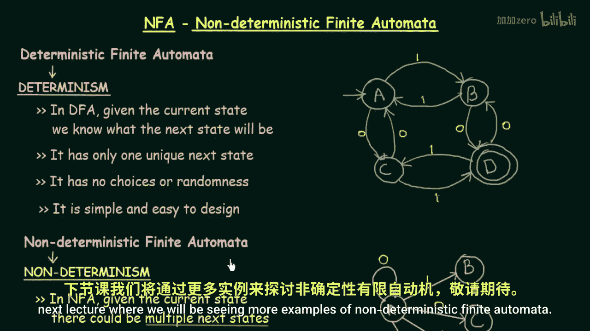

# 计算模型：第12讲：非确定性有限自动机 (NFA) 🧠

在本节课中，我们将开始学习一个新的主题：**非确定性有限自动机**，简称 NFA。我们将通过对比之前学过的确定性有限自动机来理解 NFA 的核心概念和特点。

## 回顾：确定性有限自动机 (DFA)

为了理解 NFA，我们首先需要回顾一下 DFA 的特性，这将帮助我们区分两者。

确定性有限自动机中的“确定性”一词源于“决定论”。这意味着，在 DFA 中，给定当前状态，我们可以**确定地知道**下一个状态是什么。

让我们参考一个之前讨论过的 DFA 图例。假设我们关注状态 **A**。在 DFA 中：
*   如果状态 A 收到输入 `1`，它**必定**会转移到状态 B，而不会去任何其他状态。
*   如果状态 A 收到输入 `0`，它**必定**会转移到状态 C。

**公式化描述**：对于 DFA 中的任意状态 `q` 和任意输入符号 `a`，转移函数 `δ(q, a)` **唯一确定**一个下一个状态。

因此，在 DFA 中，每个状态对于每个可能的输入，都只有一个**唯一且确定**的下一状态。没有其他选择或随机性。这种特性使得 DFA 的设计相对简单直观，因为我们只需明确指定每个状态在每种输入下的唯一转移目标。

## 引入：非确定性有限自动机 (NFA)

现在，让我们来看看**非确定性有限自动机**。顾名思义，它的核心在于“非确定性”。

在 NFA 中，情况有所不同。给定当前状态，对于同一个输入，**可能存在多个下一状态**。

观察提供的 NFA 图例，我们关注状态 **A**：
*   当状态 A 收到输入 `0` 时，它可以**选择**保持在状态 A **或者**转移到状态 C。
*   当状态 A 收到输入 `1` 时，它可以**选择**转移到状态 B **或者**转移到状态 D。

**核心概念**：在 NFA 中，转移函数 `δ(q, a)` 的结果是一个**状态的集合**，而不仅仅是单个状态。这意味着存在多个可能的选择。

那么，当存在多个选择时，机器如何决定去往哪个状态呢？NFA 的定义允许两种理解方式：
1.  **随机选择**：下一个状态可以从可能的状态集合中随机选取。
2.  **并行计算**：机器可以同时“分裂”并探索所有可能的下一状态路径。

此外，NFA 引入了一个 DFA 中没有的新概念：**ε-转移**。在图中，从状态 D 到状态 E 的边上标有 **ε**。

**代码/公式描述**：`ε` 代表空字符串。`δ(q, ε)` 表示状态 `q` 可以在**不消耗任何输入符号**的情况下，直接转移到另一个状态。

以下是 NFA 与 DFA 的关键区别总结：

*   **状态转移**：DFA 是确定性的（唯一下一状态）；NFA 是非确定性的（多个可能下一状态）。
*   **ε-转移**：DFA 不允许；NFA 允许。
*   **设计复杂性**：通常，描述同一种语言时，NFA 的设计可能比 DFA 更简单、更紧凑。

## 总结

本节课中，我们一起学习了非确定性有限自动机的基本概念。我们首先回顾了 DFA 的确定性特性，然后通过与 DFA 对比，引出了 NFA 的非确定性特性，即一个状态对同一输入可以有多个转移目标。我们还介绍了 NFA 特有的 **ε-转移**，它允许在不读取输入的情况下进行状态转换。理解 NFA 是学习计算理论中更复杂模型的重要一步。在接下来的课程中，我们将通过更多例子来加深对 NFA 的理解。