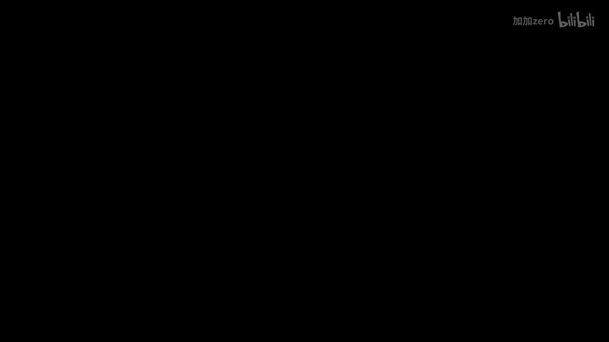
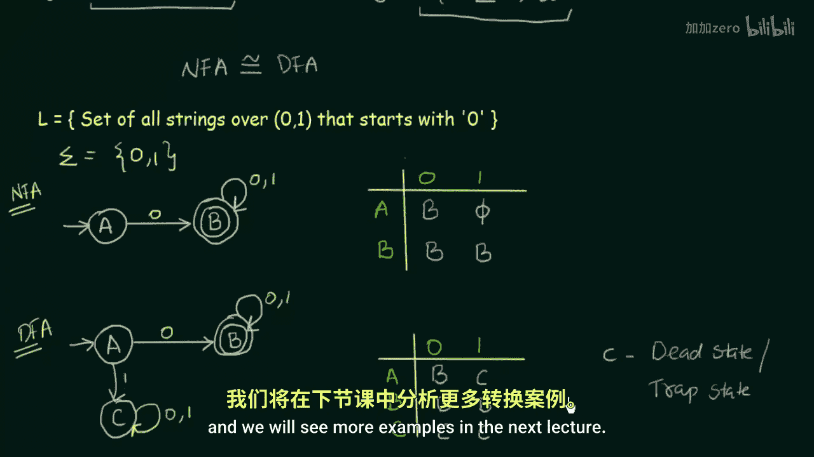

# 悉尼大学【中英⚡计算模型｜COMP2022 Models of Computation】 p13 P14 Conversion of NFA to DFA -BV1vTe6zzENb_p13-

Hello everyone， in the previous lectures we have studied about DFAs and NFs。

 so in this lecture we will be studying about how to convert NFs to DFs alright so let's get started。

Okay， so we say that every DFA is an NFA， but not vice versa， that means that every DFA is an NFA。

 but every NFA is not a DFA， all right。But there is an equivalent DfaA for every NFA that means every NFA can be converted to an equivalent DfaA。

Okay， so we have two statements here， but how do I justify this in order to justify this。

 let us do it this way。When we studied about DFA and NFA。

 we studied that DFA is defined using five tus， NFA also is defined using five tus and all the tuples in DFA and NFA were same except for one of the tuples and which was that if you remember it was the transition function Dell。

In case of DFA。In case of DFA， what was the value of Dell。

 Dell was a transition function that maps Q cross sigma2。Q， right？

 This was the transition function for DfaA。 And in case of NFA。

 what was the transition function in case of。NFA。The value for dell was。Q cross sigma 2。😮，2 power Q。

 So this was the only tu that was different in D f in andF all the other couples were same。

 Now let'll just observe these two equations and try to figure out how can we justify this statement。

 So if you look carefully you can see that。Q cross sigma to Q， this。😮，Part。

 it is contained in this part。Q cross sigma 22 power Q Q is also a part of2 power Q。

 I hope you' are getting what Im saying， but2 power Q is not a part of Q。So this。

 it is already contained in this， so we can look at these two equations and say that every DFA is an NfaA。

 but every NFA is not a DfaA。All right， but there is an equivalent DFA for every N。

 but there is a way we can convert every。😊，NFA。Tour。😮，DFA， that means we can make。

The equivalent there is a way to convert every NfaA to DfaA and that is what we are going to see in this lecture alright so to demonstrate this let us take a simple example。

Okay， so we have an example language here L， which is a set of all strings over 01 that starts with 0。

 so let us design an nfaA for the language which accepts the set of all strings over01 that starts with0。

 so here our input symbols sigma is 0 and1。So let me design the NFA for this。 So in order to do that。

We have a starting state， which is state a。And。え？On getting input。Zero。

I will send it to the next state， which is state B。

And my condition is that it should start with0 so a on this is the first input I get A on getting input0 goes to B and we should be my final state or day accepting state。

And in B， after that， whatever I get， I don't care whether it is 0 or 1。 it stays in B itself。

 So this is the N。 This is the。NFA。4。😊，Ill。Alright。

 so how do we know it is an nfa a on getting input1。

 I did not mention where it goes it goes to the that configuration。

 so that is not mentioned means it is a nfa okay now before proceeding let us just draw the state transition diagram for this I am trying to draw the state transition diagram for this。

NFA and finger state transition diagram。I will have。My inputs here0 and  one。

 And here I will have my states A and B。 Okay， now let us fill up this table。A on getting input0。

 where does it go， it goes to be。And a on getting input1 where does it go， it goes nowhere。

Goes to phi right phi is a debt configuration so remember that this debt configuration in NFA will be what will be its equivalent in DfaA in DfaA the equivalent of debt configuration will be a debt state or a trap state so keep that in mind and let's come to state B be on getting input0 where does it go it goes to B itself and B on getting input 1 where does it go it goes to B itself。

O。No。Let us try to convert this state transition diagram for this NfaA to its equivalent DfaA Okay。

 so what we are trying to do is。Make the。DFA。So。Its the straight transition diagram for DFA。

 how would it look like， I'll again draw a table here。Okay。And in my table。

 what will be the things I have， I'll have 01， which are my inputs， and I have my states A and B。

 Okay， now let's see， let's look at this table and try to convert it into a DfaA。

 So a on getting input0。 Where does it go， it goes to。

State B and A on getting input1 where does it go it goes to phi phi is a that configuration in NF。

 but in case of DfaA we cannot have a debt configuration this should be replaced by some kind of state and what is that state I will call it state C and state C is my。

Dead state。It is the。Dead state， also known as the。Trap state。Okay， and B on getting input0。

 where does it go， it goes to be itself。And beyond getting input1 it goes to be itself。

Okay now is it complete it is not complete why this is a DfaA and I should mention clearly about each and every state where it goes on getting particular inputs Ive mentioned about A and B but here I have a new state in this dfaA and that is state C so I need to mention about state C as well and if you remember whenever any input comes to the dead state it stays in the dead state itself and it does not go out of that so C on getting input0 should stay in C itself let's you on getting input1 it should stay in C itself because C is my dead state or trap state now this is a complete state transition diagram for my dfaA now let me draw the diagram state diagram for this。

Here I should have。え？😮，And then。B。My final stage should also be B。

And in here I have an extra state that is state C。Okay， so a is my starting state。A on getting。

Input0， it goes to be， right？And。A on getting input1， it goes to。See。

Should go to C on getting input1， al right， and B on getting input0 and one， it stays in B itself。

Stcing B itself on getting input 01， and let's come to state C C on getting input0 and1。

 it stayscing C itself。ok。So here I have the complete D， let us check if it is complete。

In a I have mentioned what happens when it gets0 and1 Yeah A is complete B also I have mentioned what happens when it gets0 and 1 B is complete C also I have mentioned what happens on getting input0 and 1 So C is also complete so now we have made the equivalent DFA for this above NFA and this is how you convert the NFA to its equivalent DfaA so I hope this was clear to you and thank you for watching and we will see more examples in the next lecture。

🎼。