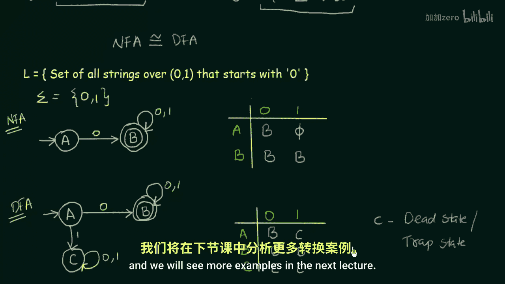

# 计算模型：第13讲：从NFA到DFA的转换


在本节课中，我们将学习如何将非确定性有限自动机转换为等价的确定性有限自动机。我们将通过一个具体的例子，详细讲解转换的步骤和原理。

## 概述

在之前的课程中，我们学习了确定性有限自动机和NFA。本节课我们将探讨两者之间的关系，并学习如何将任何一个NFA转换为一个等价的DFA。

## NFA与DFA的关系

上一节我们介绍了DFA和NFA的定义。本节中我们来看看它们之间的核心联系。

每个DFA都是一个NFA，但反之则不成立。这意味着DFA是NFA的一个子集。然而，对于每一个NFA，都存在一个等价的DFA。也就是说，我们可以将任何NFA转换为一个接受相同语言的DFA。

如何证明这一点呢？关键在于对比两者的形式化定义。DFA和NFA都由一个五元组定义，其中只有一个元组不同，即状态转移函数 δ。

*   对于DFA，转移函数是：**δ: Q × Σ → Q**
*   对于NFA，转移函数是：**δ: Q × Σ → P(Q)** （其中P(Q)是Q的幂集）

观察这两个公式，可以发现DFA的转移结果（Q中的单个状态）包含在NFA的转移结果（Q的子集，即P(Q)的元素）之中。因此，每个DFA都可以被视为一个特殊的NFA。但反过来，一个能将状态转移到多个可能状态的NFA，并不直接符合DFA的定义。这就是我们需要进行转换的原因。

## 转换示例：设计一个NFA

为了演示转换过程，我们首先需要有一个NFA。让我们来设计一个。

假设语言 L 是**所有以0开头的、由{0,1}组成的字符串的集合**。其输入字母表 Σ 为 {0, 1}。

以下是该语言的一个NFA设计：
*   起始状态为 A。
*   在状态 A 读取输入 `0` 时，转移到状态 B。
*   状态 B 是接受状态。
*   在状态 B，无论读取 `0` 还是 `1`，都保持在状态 B。
*   在状态 A 读取输入 `1` 时，转移未定义（进入“死亡”配置）。

我们可以用下面的状态转移表来描述这个NFA：

| 状态 | 输入 0 | 输入 1 |
| :--- | :----- | :----- |
| A    | B      | φ      |
| B    | B      | B      |

（注：φ 表示空集，即没有定义转移，这是一个“死亡”配置。）

## 将NFA转换为DFA

现在，我们将上一步得到的NFA状态转移表转换为等价的DFA状态转移表。

在DFA中，每个状态对每个输入符号都必须有且仅有一个转移。因此，我们需要处理NFA表中的“死亡”配置（φ）。

以下是转换步骤：
1.  **处理未定义转移**：在NFA中，状态A在输入`1`时转到φ。在DFA中，这需要被替换为一个明确的“死亡状态”（或称“陷阱状态”），我们称之为状态C。一旦进入状态C，无论输入什么符号，都将停留在C。
2.  **复制确定转移**：状态A在输入`0`时转到B，状态B在输入`0`和`1`时都转到B自身。这些转移在DFA中保持不变。
3.  **补充死亡状态转移**：我们需要明确定义新状态C的转移：在输入`0`和`1`时，都停留在C。

应用这些规则后，我们得到以下DFA状态转移表：

| 状态 | 输入 0 | 输入 1 |
| :--- | :----- | :----- |
| A    | B      | C      |
| B    | B      | B      |
| C    | C      | C      |

## 绘制DFA状态图

根据上面的DFA状态转移表，我们可以绘制出其状态转移图。

```
     0,1
    ┌───┐
    │   ▼
┌───┐  0   ┌───┐
│ A │ ───> │ B │
└───┘      └───┘
  │          ^
  │ 1        │
  ▼          │
┌───┐      │
│ C │ <────┘
└───┘      0,1
```

*   **A** 是起始状态。
*   **B** 是接受状态（用双圈表示）。
*   **C** 是死亡状态。
*   从A出发，输入`0`则进入B，输入`1`则进入C。
*   从B出发，输入`0`或`1`都保持在B。
*   从C出发，输入`0`或`1`都保持在C。

检查此DFA：每个状态（A, B, C）对于每个输入符号（0, 1）都有明确定义的转移，因此它是一个完整的DFA。它所接受的语言正是“所有以0开头的01字符串”，与最初的NFA等价。

## 总结



本节课中我们一起学习了从NFA到DFA的转换。我们首先回顾了NFA与DFA在定义上的核心区别在于转移函数。然后，我们通过一个具体例子，演示了转换的三个关键步骤：处理未定义转移（引入死亡状态）、复制确定转移、以及补全新状态的转移规则。最终，我们成功地将一个NFA转换成了一个接受相同语言的、完整的DFA。