# 悉尼大学【中英⚡计算模型｜COMP2022 Models of Computation】 p14 P15 CYK Algorithm by Deeba Kannan -BV1vTe6zzENb_p14-

Hello everyone， this session will see CYK algorithm。

CYK algorithm is a membership algorithm that is used to check whether some input belongs to a grammar or not。

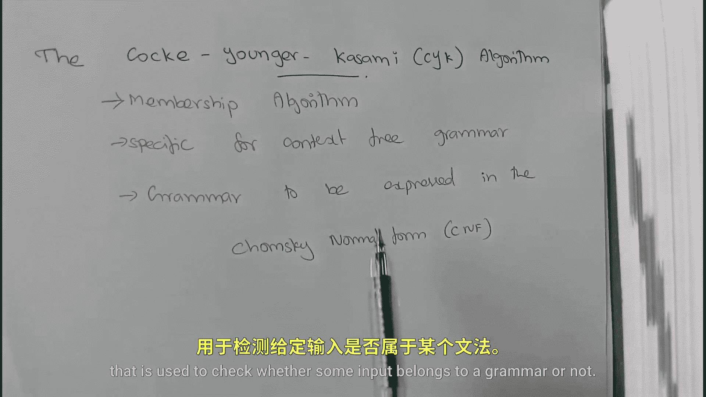

Okay and this is specific for a context pre grammar okay so whenever a grammar is given and some input is given the CYK algorithm is to verify whether that input belongs to the grammar or not。

 that is why we call it as a，Membership algorithm and the grammar。

 the contextory grammar we take over here should be expressed in the form of Chomsky normal form。

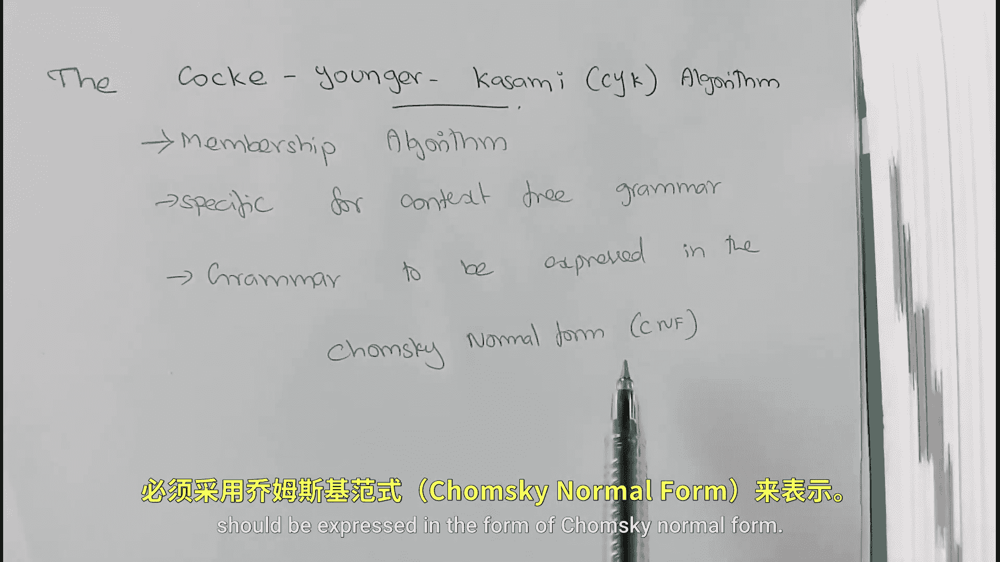

You know， what is a chomsky normal form like usually a grammar consists of variables and terminal symbols in Chomsky normal form。

 the general format for it is。

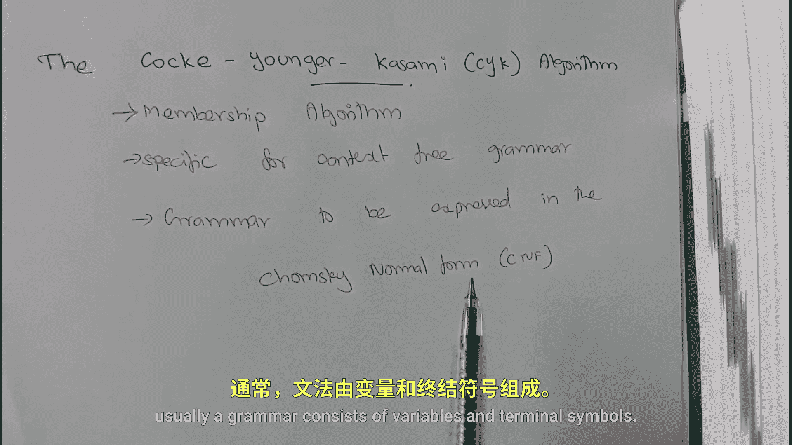

It all all the productions of a context programmemar should be of the form a variable times2。

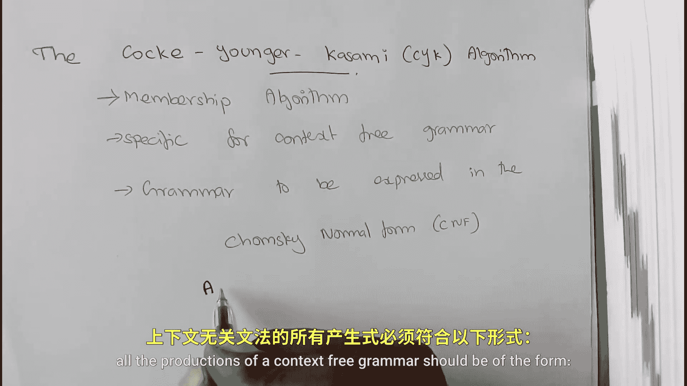

2 variable or a variable tend to a single terminal symbol。

 so this is a general format for a Chomsky normal form whenever a grammar is expressed in this case the CYK algorithm is to verify whether the input belongs to the grammar or not。

Okay， so。The input to the system like input to the system is a grammar will be given to you and will just have an input like input for this contextory grammar are taken as W in general and that is made up of some set of terminal symbols。

Okay， where this X all this x value x1 x to x n and all it belongs to some set of terminal symbols and n value represents the length of input okay so n equal to length of input。

So these are all the general consideration that we are going to take so input will be given to you and a grammar will be given to you so we are going to verify whether the input belongs to the grammar or not okay so whether we can derive the input from the given grammar that is the。

Gsses。Now， the CCK algorithm will just have a table structure based on the number sorry graph structure。

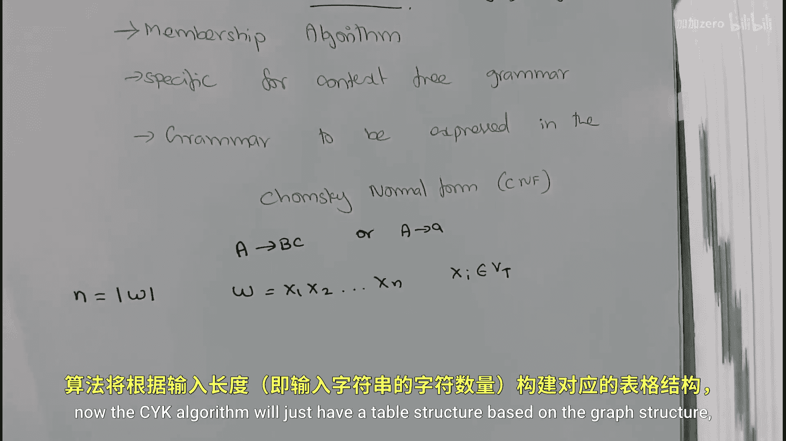

Based on the number of inputs like the length of the input。 Okay。

 so if n is equal to some random value 4。We are going to construct a table where the x axis。

Will be i value and y axis will be j value Okay， so based on the n value。

 you are going to have this type of structure over here。

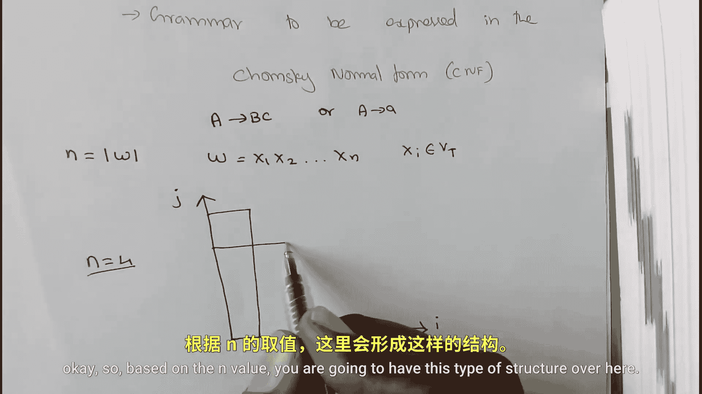

When n value is equal to 4， you can take i value as 4， j value as 4。

 and we are going to create a table structure like this。Okay， so here I is one，2，3， and4。

 and J is one，2， three，4。Okay， so each individual cell of this table we used used to represent it as Tj。

 okay individual cell of each and every table is represented as Tj and。

As for this table the value for T Ij is t 11 i is equal to 1 j is equal to 1 and here it is i 1 js sorry I is 2 j is 1。

Here it is 31 and 41， so I value varies as 1，2，3，4 J reminds one in all the columns and similarly here it is one。

2。

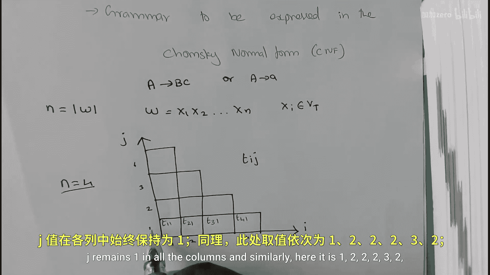

Do嘟。最度。And here it is  one，3。

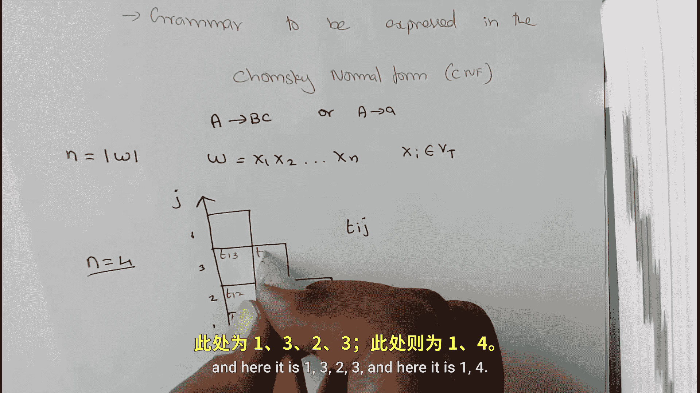

2，3。 And here is one4。Okay， so these are all the cell description for each and every cell Okay like the this t value has to be filled now we are going to fill the t values and the table consists of all a set of variables。

 Okay， I'll say you what it is。

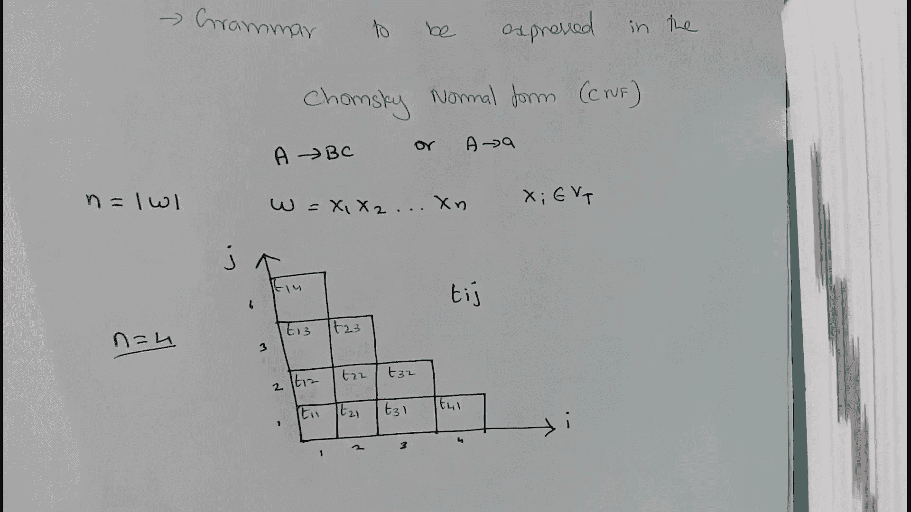

Consider some random inputs， like usually inputs are made up of some set of terminal symbols。

 Let us consider A B is the input。 So randomly， I just take a a。

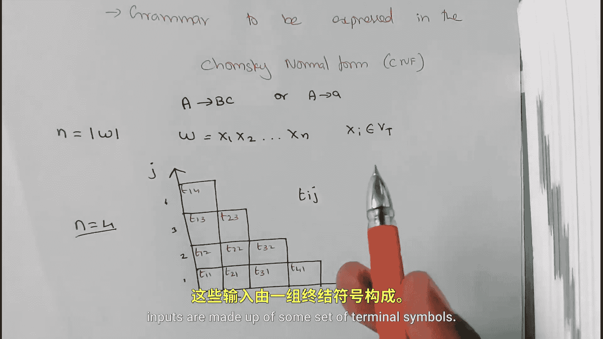

AAB something like this Okay so this is an input Ill just explain you with grammar and example next Okay so now as of now Ill just say what it is what values to be filled over here Okay so here we consider this A AAB is the input so the length of the input is four so we make a table with four cross4。

Okay， so now this t11 represents a direct derivation of this input a。Okay。

 so here the ST11 contains the direct description like in the production in the given grammar。

 wherever if you have a production like some xs to a， you can fill x inside。Okay。

 a direct derivation of in the in the given grammar。

 if you have a direct derivation of this variable， you can include that over here。Okay。

 so you can have some two or three production that derives to the same variable。

 so again again you can include both the variables over here。

If two or three variables derives to the same terminal symbols for that terminal symbol you can include both the things okay sometimes you may not have a derivation to that variable in that case you can have a hyphen also or an null symbol also either hyphen or null can be used to represent the nullness of it okay so this when J equal to1 that describes the direct derivation of the variable a single step derivation of this terminal symbol by some variables these t values all the tables that inside over here should takes the variables alone only variables will be filled inside so here when J is equal to1 that represents the direct derivation。

A single step derivation of it and when j is equal to2 we are going to take two inputs at a time deriving this aa is done in this t12 deriving a this2 aA is done in T22 and deriving this aB the sequence should not be changed first we take this to a。

These two a and then these two a and then this aB Okay so this a is done in this t12。

 so we are going to club these two things together so we can have a diagram like this。

Okay and for these two a t22 is used to represent it so we can have the combination of these two and this t32 used to represent the combination of aB。

 these two columns so we can have the combination like this。

Okay so here when when j value equal to2 we are going to make the input derivation of input in two state derivation or we are going to have the input derivation for length equal to 2 andsimilarly for three length equal to3 unsilarly for four length equal to 4 okay so this final box indicates the derivation of the entire input length4 means we already have the length of the input as4 so entire input like this aa。

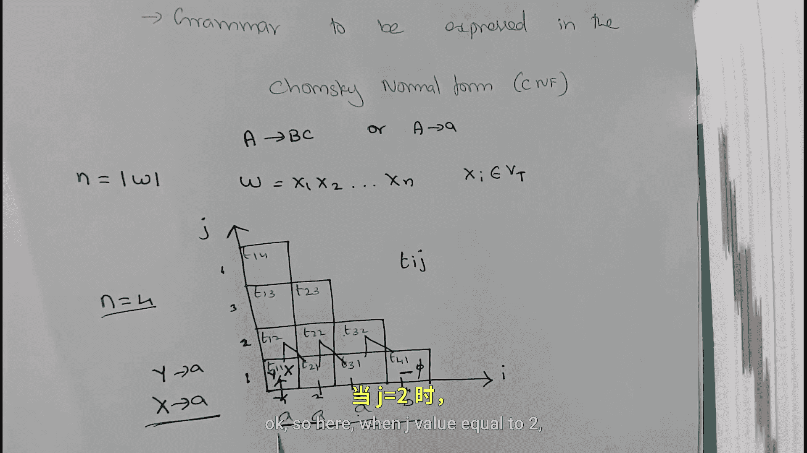

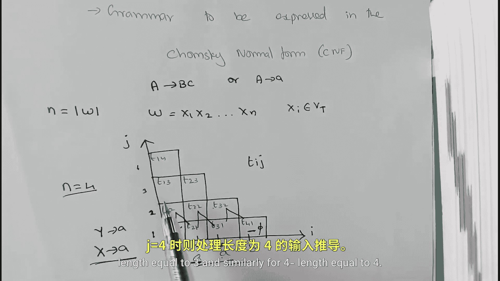

AB， so the entire input derivation is done in the t14 and t13 is to represent these three things altogether first three input。

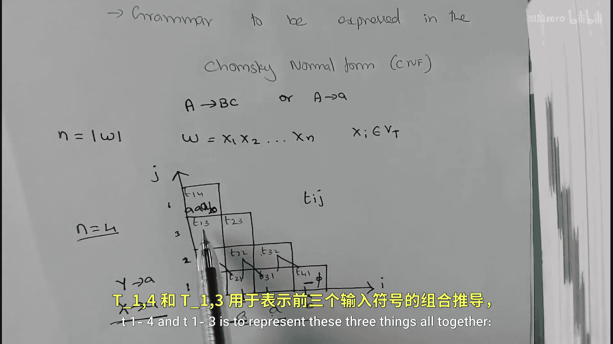

And T23 is to represent the next three inputs， so it is AA B。

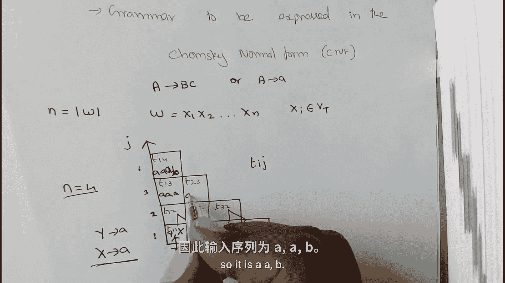

Okay so now you are going to fill the variable that derives these inputs okay so finally this t14 will consist of some set of variable that actually derives the input AAB okay so this is a bottom approach we start with the down with in each and every variable separately and we move up to this place okay so now this t14 is a column that represents deriving of input AAabB okay so that is the input that is needed if you have this starting symbol over here。

In this place if the starting symbol is expressed， it actually means that from starting symbol we can derive the input AAB。

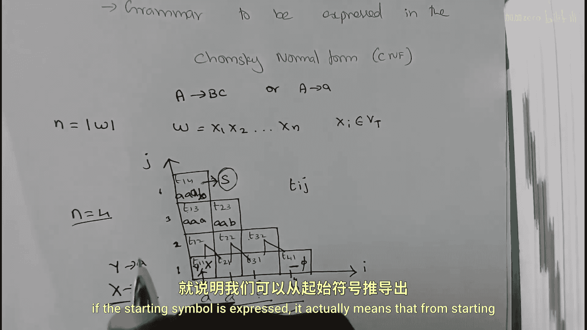

Okay so in in context free grammar generally when you are deriving an input we start the transition with starting symbol from startinging symbol if you can derive any input we say that the input belongs to the language okay so the stockmost column if it contains starting symbol we can say that it is a member of the given input is a member of the given grammar okay so now I will just give you an example and I will show you how to solve it。

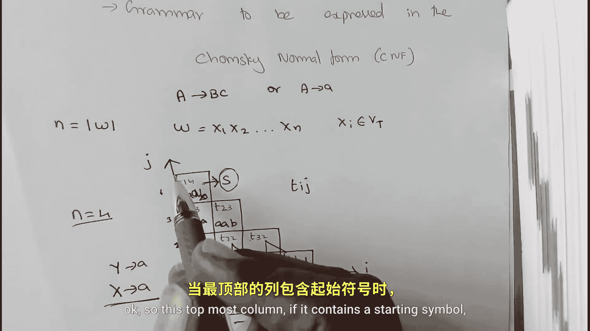

Now let us consider this example， see here a grammar is given over here。

 a context re grammar is given over here in each place we have a production of the form a variable tends to two variable。

Or a variable tends to a single terminal symbol so we say the grammar is in Chomsky normal form so the grammar can be like the membership of the algorithm can be tested using cYK algorithm and the input is given here we consider an input as AAB of length4 n value is equal to4。

So we can construct a table with i is equal to 4 and j is equal to 4 okay like a table structure like this which I have given already have given the description of it okay and the input is written at the bottom okay I over this i I have written this input okay so now we are going to fill the table as I told you like here this in when j value equal to1 that describes the direct derivation of this。

Input。Each cell takes each and every cell takes the corresponding input over here so here we are going to fill all the variable that have a production that derives to this terminal A and again here also terminal A and here we are going to fill the variable that have or that derives the terminal B and here also terminal B okay so now look at here。

In the given grammar we have only one derivation to small a and that is a capital a tenses to small a a variable tends to a terminal symbol a okay so here as I told you this is a direct derivation we can directly fill the values inside okay a is the only variable that directly derives to a so I fill a over here。

Variable A over here。Okay， the entire content of the table should be a variables okay。

 so again for a， the direct derivation is done through this a。Okay， n for B。

 see here there are gram two productions that derives to B。This terminal symbol B in the grammar。

 so here we have capital B tends to small B and capital C tends to B variable B and C derives to B in a single step a direct derivation so here we have to fill both B and C。

And here also since it is also a direct derivation of B we can fill B and C altogether over here okay so this is a very easy step a direct derivation we can directly look into the look into the grammar and we can fill the table okay so now we will go to the next place where fulfilling this J equal to2。

Okay， this is a two step derivation I told you now like we have to combine the input and we have to consider over here。

 so one to represent combination of AA okay so to derive the input AA T。

12 that is used to check for the derivation of aa so deriving this a in a single step this a is done over here and this a is done over here okay so it is already there in t11 and t21 we are going to cl both the things together okay since this is a sequential values okay this comes in sequence we have to take the values over here the variables over here in sequence okay so t11 column contains a。

And t to1 column contains a so we have to write AA al okay so to derive this input AA in the given parametermar we have to check a production that derives to AA al here it is A B B b c A B B b C see here we have a production C variable C that derives to AA。

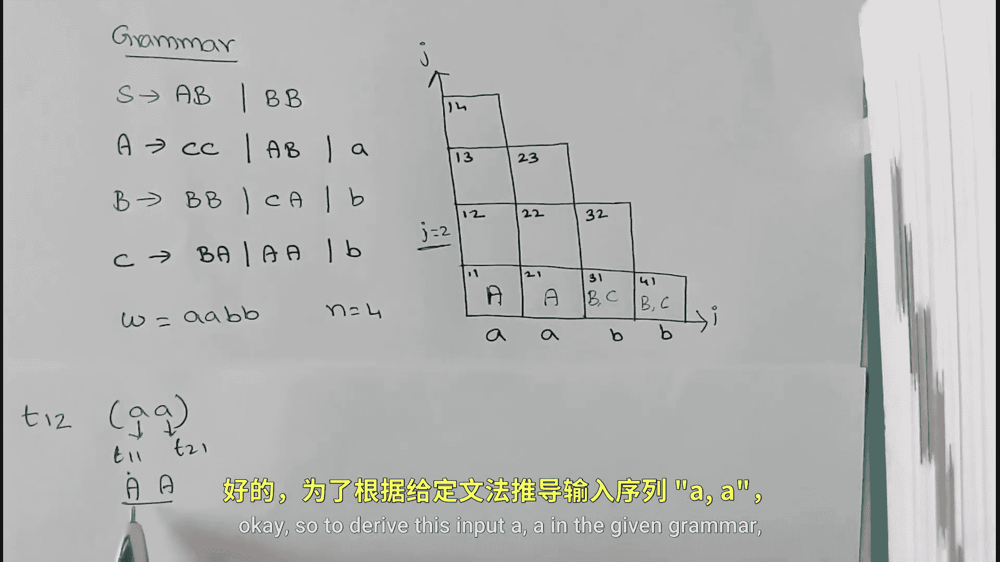

Okay， so we want a variable that derives to this AA and that is done in this C。

 so here directly we fill。Variable C。Okay a variable C derives AA derives aA so we are going to fill that inside two step derivation okay now we will check for this cell T22 T22 is to represent the next two input symbols AB so the derivation that are derivation for this a is done in 21。

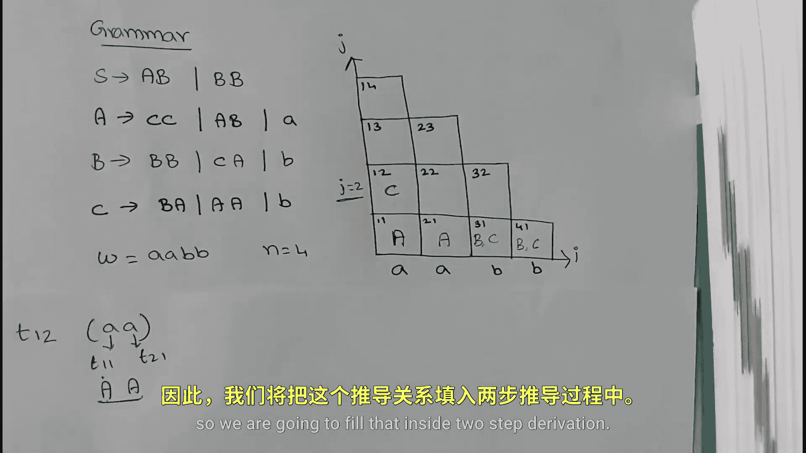

21 t21 and for this B it is done in t31 okay listen carefully here for a we have only one variable a direct variable alone okay but here for B we have two variables that derives to be。

Okay so while writing the combination we have to write both the combination A combined with B and a combined with C so you have A B and A alator now in the given grammar we have to check for the variable that derives to this AB and AC alator not alator either AB or A and we have to fill all the variables okay for AB derivation we have variable a and A derives to AB s comma a derives to AB and for A。

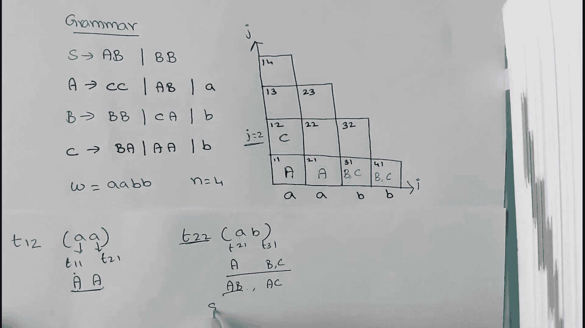

There is no production that its to AC okay， so we have two variables S and a to be filled at this phase as comma a。

Okay and one more information like when there is a null production okay if this a is not derived at all if you have a null over here null cannot be sequentially combined with anything okay so the entire production will become null okay so make a note of it sometimes some you may have some grammars that have null productions in the case you have to be in careful okay so now t22 is filled now the last one is t。

32， T32 describes the direct derivation of this input BB。Okay。

 so this B is derived the single step erivation of this B is done in t31 and single step erivation of this B is done in。

D，4，1。Okay， so now we are going to。So t31 contains become a C and t 41 contains become a C Now we have to write a combination combination this should come first。

 so this be be。And this B combined with this C。And this C combined with this B and this C with C。

BB B， ccc， okay， always this value should come first and then this value Okay so now in the given grammar。

 we have to check with the variable that derives to this B， B， c B orcc Okay。

 so we'll check it off for B B。Actuallyly， there are two predictions that derives to BB。

1 S and one b。Okay， and for BC there is no production and for CB also there is no production that derives to CB and for C there is a production or the variable a derives2。

C， okay， so we can include S A B， So in the table， we can include S A B in the place of。第一子一度。Okay。

 so now this is your against derivation， okay， similarly you have to do fourth third and fourth step also。

No。呃。When J values is equal to3。When J values is equal to 3， we have to fill two columns。

 two cells altogether。 So one is t。

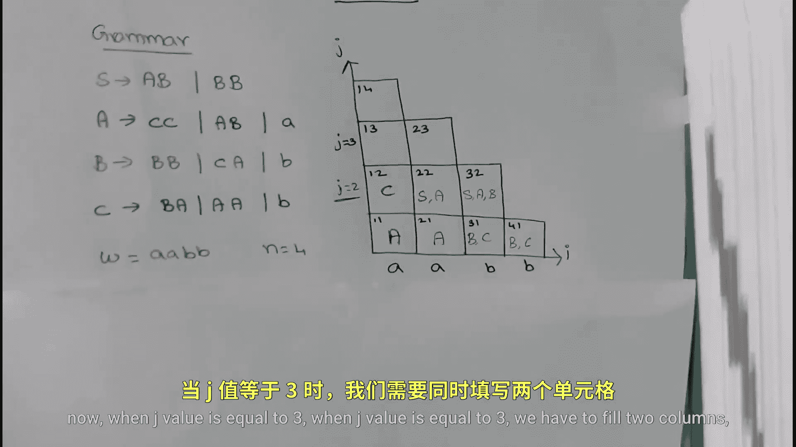

1，3， and one is T。都嘴。Okay so we have to fill this t13 and t23 over here。

 so t13 describes the inputs three combination of the input so this AAB is derived over here AAB and here t23 represents the next three inputs so A BB。

This formation。Okay， so as a whole， T1，3 describes three3。

Input of length3 description Okay so now to derive this input AAB using this cells there are two ways to do it okay one is either we can have a single combination of a combined with two combination of B。

Okay， a single variable A is derived over here and two variable A B is derived over here。

 We can combine these two columns， or we can have a。Two combination。

 two derivation of this AA combined with a single combination of B。 Okay。

 so we have to include all possibilities。Okay so here these are all the possibility from the table we want to make the derivation so to derive a three variable we can either have a single combination of a combined with two combination of aB or a two combination of a combined with a single combination of B okay so now we will check in the table for a single combination of this a the first a single step derivation is done in this t11。

And two step variationrivation of this AB， this AB combined done in this T22。Okay。

 either we can have this combination or when you want to have two combination of AA。

 this two combination of AA input is done in this。T1，2。

 and a single combination of this B is done in T31。Okay， so either we can have this or this。

 so we have to write all possibility and we have to include all the variables inside Okay。

 so now we will check it off。

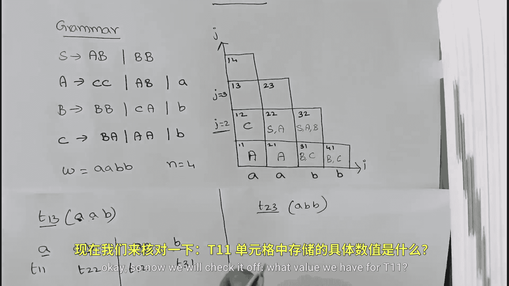

What value we have for t11， t11， we have a T22， we have eschema a。Okay。

 I told you this is a sequential combination。 We have to write the combination in sequence Okay。

 and t12。Contains C and T 3，1。31 contains B ki。Okay。

 so now write all the combinations of this so we can have ASSA combined with this or AA and here C with B or C。

Okay so these are all the possible combinations that we got over here now in the given grammar we are going to verify whether we have this ASs A or C or C the derivation for these variables okay so we will check it off A actually there is no production that derives to ASS and for AA we have a variable C that derives to AA。

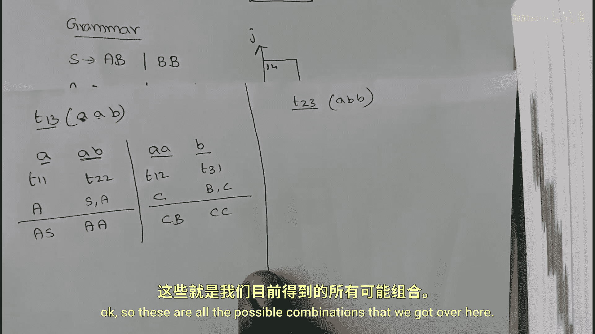

And for C， there is no production， and for C， we have a variable A。That derives to C。Okay。

 so there are two variables that that we got over here so we can include both the variables。

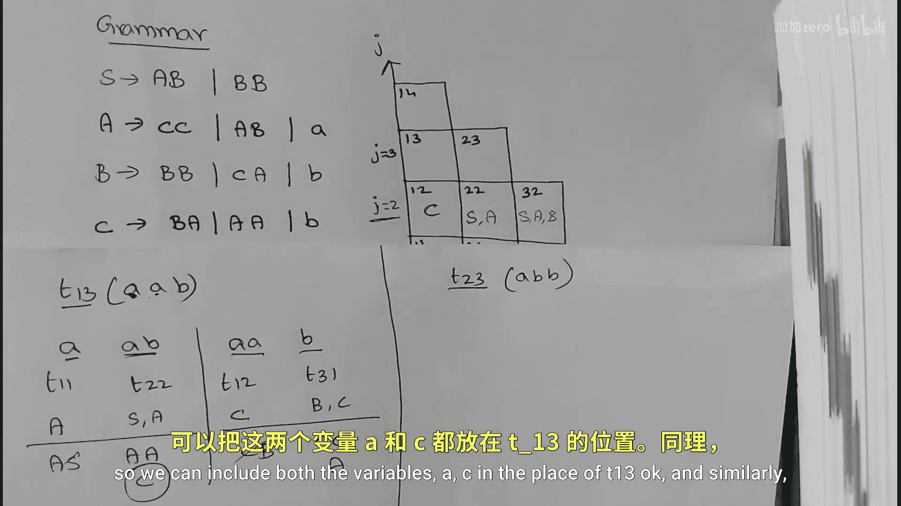

え化麻水。In the place of。Be one。Okay， and similarly， we have to check for three combination of the input A A B for de this AB again。

 we have two possibility one， we can have this。Two combination a single combination of a combined with two combination of B B or。

2 combination of A B， combined with single combination of B。 Okay， a single combination of A with B。

 B or A B with B。Okay， so now a single combination of this a actually this A BB represents this AbbB。

 the single combination of this a is represented in T to1 and two combination of this B is done in this T。

这一度。

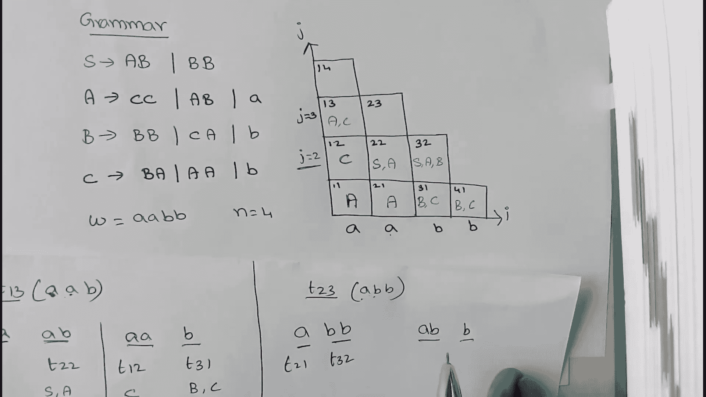

And there two combination of this AB， this AB2 combination is done in。

T22 and a single combination of this B the last B is done in T41。Okay。

 the values that are there in this t to1 is t to1， you have a。3，2， we have S， A B。

And tutu is commma a。For one， it is be ki。Okay。Now， as I told you。

 these are all the sequential combination that we have first this and then this。

 first this and then this， so we have to write the possible combination here it is aS。Or E。Or A B。

And here it is SB。Or SC C？Or A B。Or AC。Okay so these are all the possible variable combination that we got over here now in the grammar we again have to check for the variable that derives to the set of input A is not derived at all for AA we have the variable C that derives to AA and for AB。

We have S and A。S derives a B and a derives a B， so we can have a and S and A over here Sb is not derived right。

S C is also not the right for a B， we have already written isscoma a derives aB and for AC。

There is no production that derives to A。 Okay， so now we have to fill。S A in this place Okay。

 so in this T23， we have to fill S AC， So these are all the variable that grabs to the input A A B in。

Three step。Okay and similarly one only thing that left out is now j is equal to 4。

 the final column that needed to be4 filled is when j value equal to4 that represents the the input derivation for four variables。

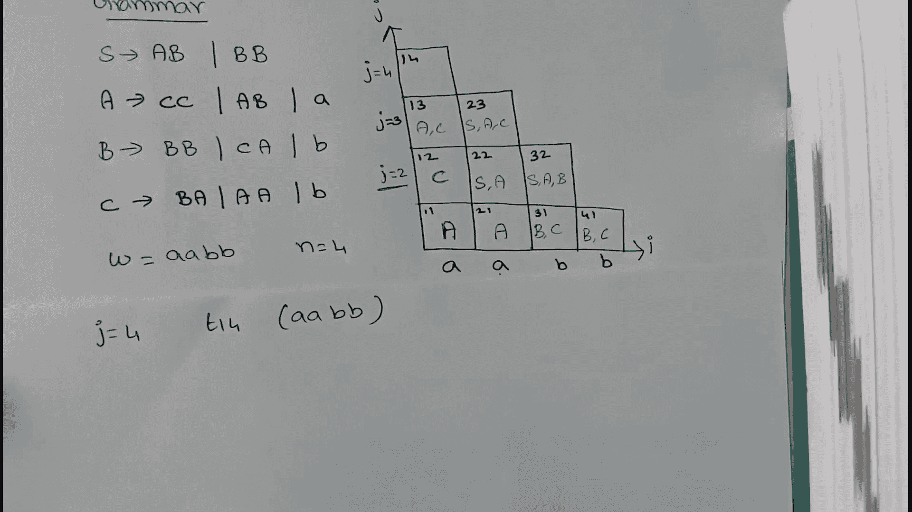

Now the four combination of this AABB。From this table we have to extract all those things。

 Okay we already have the maximum three combination and two combinations so but this will derive this four combination Okay。

 there are three possibilities to derive it one we can have。Two combination of this A A and BB。

This A2 combination， we two combination， and we can combine both two combination of this A is donenell。

T12 and two combination of this baby is done in。T32， so this is one possibility。

 or we can have three combination of this AAB combined with B。Okay。

 so the three combination of AA B is done in AA B， three combination is done in t1，3。

 and the single combination of this loss B is done in t41。哦。😮，We gain hope。

A single combination of A combined with A， B， B，3 combination of A BB。

So this a combined with this A BP， the single combination of this a is done in T 11 and A B P3 combination of A B B is done in T。

Do嘴。Okay so now we have to look at the table and we have to fill this content and again like the same we have to sequentially combine all the variables and find the variable that derives through the set of inputs okay so t12 contents c。

3，2 contains S A B。T 1，3 contains，1，3 contains a comm C。And 41 contains B comm a C， T 1。

1 contains a and 2，3， it contains A S A C。So these are all the combinations that we got over here。

Now we have to sequentially combine the things so C combined with S， C， S， C with a。C。

 A and C with B。And this。Aービエース。C， B andCC， A， B， A， C BCC， okay。

 this sequence should not be changed this combined with this， not this combined with this， Okay。

 so now here it is S A S， E A and AC C。Okay so these are all the combination of variables that that we got over here now we have to check in the given grammar whichever variable derives to these set of inputs okay so C there is no variable that drives CS C A C here we have B derives to CA。

And for a C。There is no derivation to CB， and for AB， we have a and a variable derives to AB。

And for AC， there is no variable that drives to AC。And for C。

There is no variable that drives C for C， we have a production Atains to C variable A derives to C and AS no variables derives AS for AA C derives to AA。

Okay， and A C， there is no variable that derives to A。 Okay， so as a whole， we can have S， A，BC。

 So all the variable derives the input A A B B， Okay。

 in four steps so we can fill in the table in the。In this place， N T1，4 became fill yes， A， B C。Okay。

So now the table is filled entirely， the given table is filled。

And the table is filled as I told you the topmost cell contains as the starting symbol so this means that from this starting symbol we can derive to this input AAB so which actually says that we can derive the input using this grammar which charts the starting symbol s so we can say that this input is a member of this given grammar and that is that is verified using this CYK algorithm。

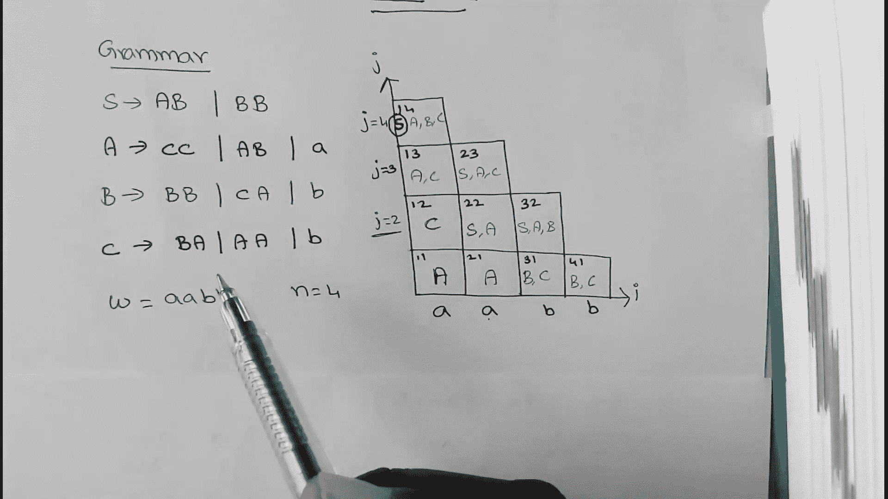

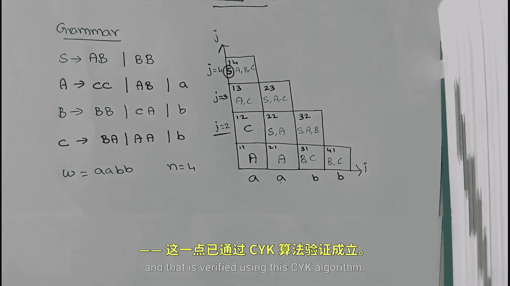

Thank you。