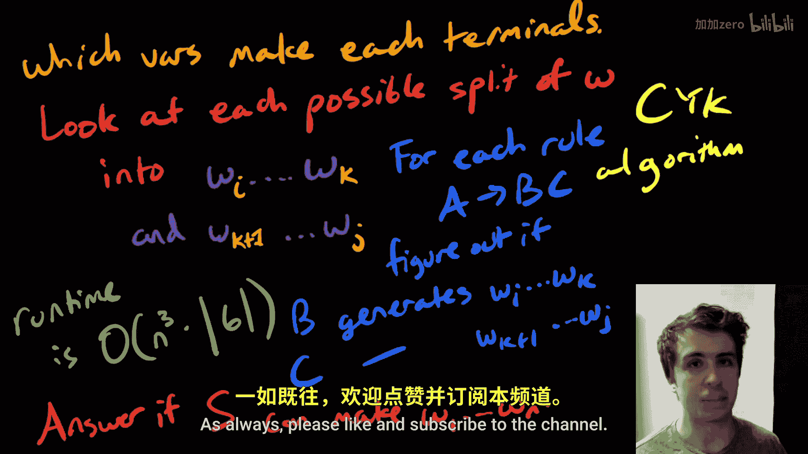

# 悉尼大学【中英⚡计算模型｜COMP2022 Models of Computation】 p15 P16 The CYK Algorithm： How does it work？ Dynamic Programming! -BV1vTe6zzENb_p15-

🎼The。If you subscribe to the channel， you'll get lots of interesting videos like this one and if you like the video it'll really help us out。

 please comment down below for any other interesting things that also really helps us out as well。

Hi welcome to another edition of basic theory so today we're going to have a little crossover between algorithms and theory of computation we've been talking about dynamic programming in the algorithms series and in fact there's a nice crossover between what we're doing right now in theory as well as dynamic programming with something called a context re grammar so I have links in the video description if you want to learn about what a context re grammar is but the basic idea is that we have four things in a context re grammar。

So we have V， which is something called variables。Sigma right here is what we call terminals。

You can think of it as just a set of letters that the strings that we're actually interested in so we're we're interested in。

Seets of strings called languages and grammars will be generating strings in a particular language。

And the R right here stands for rules and I'll explain what that is。

 and S is what is called the start variable。So the idea behind this is that we let's just say we wanted to make a string W1W2 up to WM。

 so this is I should actually say each WI right here is in this alphabet sigma so each of these is just a set of characters from this set of terminals right here and what we do is we start with S。

 which is the start variable right here and we apply a rule。

 so we're going to apply a rule right here and then we're going to get something then apply another rule。

 then get something， apply a rule and then hopefully get the string at the end。So when this happens。

 if there is any way to get from S to get the string that we want。

 then we will call this process yields。So the grammar yields this string or actually a better name because yields is really for each of the rule applications。

I'll actually change this， a better name is generates。

So string the grammar here from S generates this string W1 through WN。

So what do these rules look like， well， what they are are going to be some variable A and with an x on the right hand side and I can have as many of these as I want and any rules of these type so what is this form so a right here is a single variable and the X on the right hand side is any mix of terminals。

Terminals and variables so any anything on the right hand side of this arrow right here and what happens is whenever I have a variable S sorry。

 whenever I have a variable， I look at the corresponding rules where it appears on the left side and I am allowed to replace it with the thing on the right side。

So for example， if we had a actually I'll interchan changege it to be S so S。

 let's say has a role of the form a which is a terminal capital A which is a variable B。

 which is a terminal then what I can do here for example is to replace this s entirely with its right hand side。

 which is this okay so we're always replacing the variable with one of its right hand sides now the variable S can have other things on its right hand side too。

 so these vertical bars mean that there are other rules with s。

 but this is one option that we're allowed to choose so the question here is given a grammar。

 is it possible to determine whether or not S actually generates this particular string。So。

One thing that we'll actually need that will make this significantly easier and that we've shown in the theory series。

 all of a video and a link in the video description is something called Chomsky normal form。So。

What we showed before in that series is that we can convert any context free grammar into Chomsky normal form and the form says that the only rule types that are allowed are one of three types。

 so this is one。Two and three， so two says we can have any variable produce a single terminal or any variable making two variables and one thing I should note here is that a is a single terminal。

And capital A is any variable at all， and B and C are any variable， but not the start variable。

So so B and C are not the start variable A can be， and the only rule that can actually make the empty string is the variable S。

 so the only variable that can make the empty string directly is the variable S。Okay。

 and the two on the right hand side here， the B and the C can't be the star variable。

 so one logical consequence of this based on these two。

Is that actually from all three is that any non start。Variable must。Make。A non empty string。Okay。

 that's just a logical consequence of this because the only variable that can make the empty string is the start variable and when I make when I apply some rule like this。

Then I then these two can't be the start variable， which means they must make a non empty string and。

Yeah and actually this role plays a part in this， but the two main ones are these two so that's actually kind of important because if I apply one of these rules right here。

 then if I want to actually make the string， then each of these two variables must make a non empty string。

 which is kind of nice。Okay。One other thing that you can prove and we may do on the channel at some point is but I'm not going to do it here is if the string。

 which I'm going to call W， so remember it was W1 through WN。

 so here I'm saying that the length of W is equal to M。Then。If the grammar。

 I'm going to call it G generates。W， then it takes。Exactly。

Two times and minus one rules to do so and I should actually。

Make a clarification that G has to be in Chomsky normal form for this to actually work if it's not in Chomsky normal form。

 then I can't actually prove this， but it must be in Chomsky normal form。

 but we can always convert any grammar into Chomsky normal form so it's not actually a big deal here。

Okay， so what are we going to actually do here， so how do we actually figure out whether the grammar actually generates the string？

So this is where the dynamic programming idea comes into play。

So how would dynamic programming actually help us here？

So let's just actually blow up this string a little bit to make it a little larger。

 so let's say we have W1， W2， W3， W4 up to W and， let's say。

And I'm going to put some intermediate characters here， so let's put。

 let's say W I WI plus one somewhere in there。So I is just some arbitrary index in between one and m。

Okay， so how are we going to figure out whether the grammar can actually make this guy well。

 we saw that。Let's suppose that n is at least one so the string is not empty， if it was empty。

 then we just check if the starting variable can make it。

 assuming that the grammars in Ch's gen form because that's the only way that it could be made。

 but assuming is not empty， let's say， then what we have to note and actually one thing we could make a note of is if n is at least if n is equal to one。

 then we just check if the start variable can make it directly。

which is pretty easy to do so that doesn't require dynamic programming at all。

 but assuming that the string length is at least two。

 then you can actually see from the definition right here that we need to apply this rule right here。

W， because if I applied one of these two up here， then I'm going to be stuck with a terminal or with the empty string and I can only replace a single variable and nothing else with stuff。

So if I only have the empty string or a single terminal then I'm stuck so I have to apply one of these rules right here so let's just see what happens。

 so if I say well if I have two variables right here well since they must make a non empty portion of the string。

Then that means that the first variable must make some part of the beginning of the string。

 and the second variable must make some part of the end。

 So that means that let's say this part right here。

Is generated by the variable B remember a goes to B C is a rule and this one over here。

Is generated by the second variable C and then what we want to do then is just to figure out can B make this part。

 this beginning part and can C make this ending part right here。And yeah。

 so that's what we're reducing to so the question of whether S can generate。The whole string W。

Is equivalent to saying。That these two variables make their respective parts。

 so B can generate W1 through WI and C can generate WI plus one all the way to WN okay。

 and those are questions。And you can think of this as like a recursive problem because we're solving smaller versions of the same problem and then what we do is we keep drilling down。

 drilling down， drilling down until we get to the very bottom and we notice that once we get down to a single character and we have a certain variable we're looking at。

 we just ask whether or not that variable can make that single terminal and that's easy to do because we just look at the rules and see if it's actually one of them。

Because the only rule that can actually make a terminal at all is where it makes a single one。

 so if we just keep drilling down recursive cases down， down， down， down。

 down into smaller versions of this problem， until we get to single terminals。

 then we can just ask whether that the corresponding variable can actually make that one terminal or not。

But the quandary is we don't know。If this is the split。Right？

Because it could be that the variable B right here only makes one character and C makes all of the other ones。

 or it could be that it's right in the middle or completely in the other direction that B makes most of it and C only makes a small portion。

So we actually and in fact， if we just implement this recursively。

 we don't have a fast algorithm because none of the subpro are actually related to each other so how do we use dynamic programming here well what we're going to do is we're going to figure out which variables make。

Each of the terminals。And we're going to store that into a list so I'm not going to actually detail exactly everything here because we've done some dynamic programming and you should be able to figure out how to actually implement this。

 but what we do is we see which variables make each of the terminals。

And what we do is we try to work our way up from the bottom。

So instead of thinking about generating the whole string and dividing those into subcases。

 we start from the bottom and work our way up。So then what we want to do is we look at each。

So we look at each possible split。Each possible split of W。Into two parts。

 So into let's write this as W1 through W I。And WI plus one all the way to WN。Okay。

So then what we what we see is in fact， what we should do here and what I'm going to do here is I'm going to split this make this even more general。

 I'm actually going to not have one。In the index right here。What I'm going to do instead。Oh。

 I delete it to W oops。What I'm going to do is I'm going to have it be through some arbitrary indices I and J and K being some index in between them。

 so the original problem is equivalent to saying I is equal to1 and J is equal to n。

 which is the whole string。So what we're saying here is that if we handle this generalized problem then I can handle the original one obviously。

 and this one is better to think about because each variable might not make the whole thing。

 so if I focus on a variable making a small portion and then I relate the variables together。

 then we're all good。So what we figure out is for。Each rule。Of the form A goes to B C。We figure out。

 yeah， so we figure out。If B generates。WI through WK and C generates WK plus1 all the way to WJ。

And in fact， what we do is we just repeatedly go through the rules and update which variables can actually generate what okay and this is good because what we're doing here is we're storing that a certain portion of the string can be made by one a set of variables or we can actually maintain which variables can make each of the segments right here Well let's see let's think how many possible cases there are here so the I and the J can be any index in general so that let's say they're n characters in total so I can be order n and size j is order n and size and the K can be any index between I and J and that's certainly order n。

So there are order n cubed different possibilities here。For I and J and K， and for each one of them。

 we're going to scan through the rules and update which of the variables can make this piece right here。

And what we do is we start with small choices of where I and J are very very close together。

 so starting at one， which is what we did。Right here。

 then we look at where I and J are a distance two apart then three apart then four apart， et cetera。

 we keep going further and further until we get where I is equal to1 and j is equal to n and by starting with smaller pieces。

 then we're building up which variables can make bigger and bigger portions of the string。So in fact。

 all we need to do is to scan through the set of rules exactly once through each of these possible cases。

Its because we're starting from the bottom working our way up and that's the only way that this works so therefore that the run time based off of this。

😡，Is in fact， order of n cubed because that's the number of cases for ij and K times the size of the grammar right here and because the string's length has nothing to do with the size of the grammar so the grammar could be actually really big compared to the string and usually we say that the grammar is of constant size relative to the input but yeah。

 so it's n cubed for the number of possible cases and we have to scan through the rules once to be able to update which variables can actually make this because we're starting with small portions and then working our way up to bigger portions。

And the only thing we need to do at the very end is answer。If the start variable can make。

W1 through WN。And therefore， because we worked our way up from the bottom with small portions of the string。

 we're going to be able to answer just by storing the variables which can make certain portions of the string into a table of some kind。

 then we can answer whether the start variable can make the whole thing and's how that's basically how this algorithm works。

 this is actually what is called the CY K algorithm。

And basically those are the initials of the authors who created the algorithm。

 which is pretty cool and so there's a whole set of videos on YouTube about how to fill a table of some kind and that's basically what this is but just looking at it at a high level we're filling a table in some sense determining which variables can make which portions of the string starting from small portions and working our way up to bigger ones so hopefully that was interesting leave your comments below about the CYK algorithm or anything about contextory grams as always please like and subscribe to the channel it really helps us out and I'll see you next time。

🎼うん。

