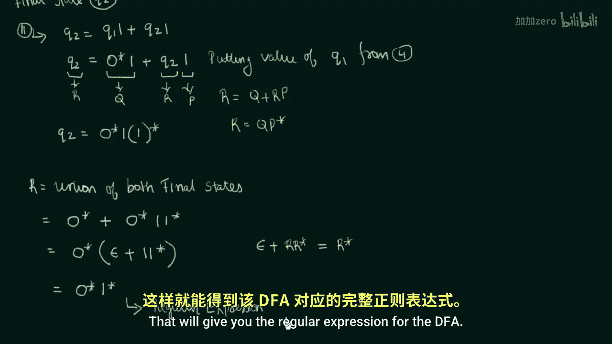
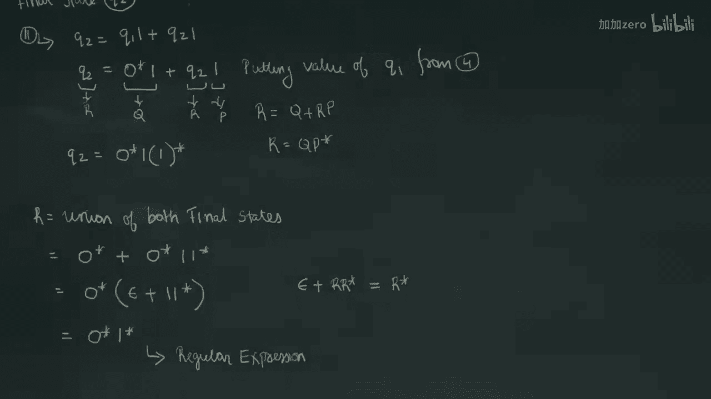

# 悉尼大学【中英⚡计算模型｜COMP2022 Models of Computation】 p16 P17 DFA to Regular Expression Conversion (when the DFA has Multiple Final States -BV1vTe6zzENb_p16-

In this lecture， we will be seeing another example of designing regular respirations for the given DFA when there are multiple final states till now。

 we have seen how to design the regular respirations when there are only one final states in the DFA。

 But here we see that in this DFA， there are two final states。

 So we'll see how will we find the regular respirations for this kind of DF where there are multiple final states。

 So the process is very simple。 we have to find the regular respirations for all the final states that we have。

 And at the end， we have to just do the union of them。

So let us proceed as we use to normally do first we'll find the equations for the states that we have here。

 so here we have states Q1 Q2 Q3 and Q1 and Q2 are the final states so let's first start with state Q1 and maybe the equation for Q1。

 Q1 can be written as see the incoming transitions we have one incoming transition coming from nowhere which can be represented by apsilon plus there is incoming transition from Q1 itself with input 0。

So Q10 and there are no other incoming transitions to Q1。

 so this is the equation for Q1 and let this be equation number1。

 and lets do the same thing for Q2 in Q2 you see that there is an incoming transition from Q1 with input1。

 so Q11 plus there is an incoming transition from Q2 itself with input 1。So we'll write Q21。

 and then there are no more， so this will be equation number 2 that is for Q2。

 Now let'll do the same thing for Q3 for Q3， we see that there are incoming transitions from。

Q 2 as well as from Q3。 So from Q2 it is coming within input 0， so Q20 plus from  Q3。

 it is coming within inputs both 0 and 1， so。Q3 is0 plus。Q 3，1。 So that's solve for Q3。

 Let this be patient number。3， okay， so now we have made the。

Equations for all the states that we have。 So now we see that Q1 and Q2 are both final states。

 So first of all， let's take one of the final states and find the regular expression for that。

 So let me start with。Final state。😔，Q1。First， let me start with this so that I will take equation number one。

 That is for the equation for Q1。 So Q1 equals to epsilon plus。Q10。 So this is my equation。

 And if you see this equation， we see that this is of the form。R equal to Q plus。Rp， where。

This Q1 is my R。And this epsilon is Q。 And this Q1 right here， this is also R， as we said。

 And this 0 is the。P， so whenever you have an equation of the form are equal to Q plus Rp。

 it can be written as r equal to Qp star from Arrden theorem。I is from our St。

And so let me write it in this form， so this is equal to Q plus Rp， so I can write it in this form。

 so I'll write R， which is Q1， equal to Q P star， Q is epsilon and P star， what is P0。0 star。

And also we know from our identities that eilon into r is equal to r itself。

 so here we have epsilon into0 star， so here my zero star is the R， so epsilon into0 star will be。

0 star itself。 So here I get the regular expression for my final state Q1。

 So let me just call this equation number4。Alright， now we have finished solving for final state Q1。

 but we know that we have one more final state， which is。Final state。Q2。So Q2 is also a final state。

 so we have to find the review resolution for Q2 as well for that values equation number 2。

 which is the equation for Q2， so Q2 is equal to this one。Q，1，1 plus。Q21， al right。

Now we see that we already found the value of Q1 to be 0 star。

 so I will substitute this value of Q1 in this equation。

 so this will be equal to Q2 and Q1 can be replaced with0 star and this one can be treated as  one itself plus。

You too。1， and how did we get this lease by。Putting。Value。😔，Of。Q1。From equation number，4。Okay。

 now we see that this equation is also of the form R equal to。Q plus R p， how this Q2 will be R。

 and this whole term，0 star 1 will be Q。😔，And this Q to right here， This is my R， as I said。

 and this one over here， this will be。😔，P， so this。Can be written as R equal to Q P star by an theem。

 So let me write that So R that is Q2 equal to Qp star。

 So what is Q0 star1 and P star So what is P P 1。So， one。Star， so we are getting this。

 So this is the regular expressionspiration for the final state Q2。 So we have two final states。

 Q1 and Q2。 So when we have two final states， the regular expressionspiration will be the。Union of。

Both the。Final states。So how do we write this， This can be written as。The first final state was。Q1。

 whose expression we got to be0 star。 So let me write 0 star。Union means plus。

The second final state was Q2 and we got the expression as 0 star 1，1 star。

So this can be written as zero star。😔，1，1。Star， allright。

 now let us just further simplify this from here。 I see that0 star and0 star is common。

 So let me take zero star command from this expression。 and so I'll get here I'll get eilon plus1，1。

Star， okay， and also in our identities， we study that epsilon plus。R R star is equal to r star。

 we studied this in our identities if you remember， so here we see that epsilon plus 11 star。

 so if you treat 1 as regular expression R， so this whole thing can be written as1 star。

 so0 star and this whole thing can be written as。One star from this identity that we have already studied。

 so now when we perform the union of both the final states。

 the resulting regular expression that we get is the required regular expression for the DfaA。

So whenever you have more than one final states， find the regular expressions for all the final states and perform the Union of them that will give you the regular expression for the DFA。

 so I hope this was great to you， thank you for watching and see you in the next one。

