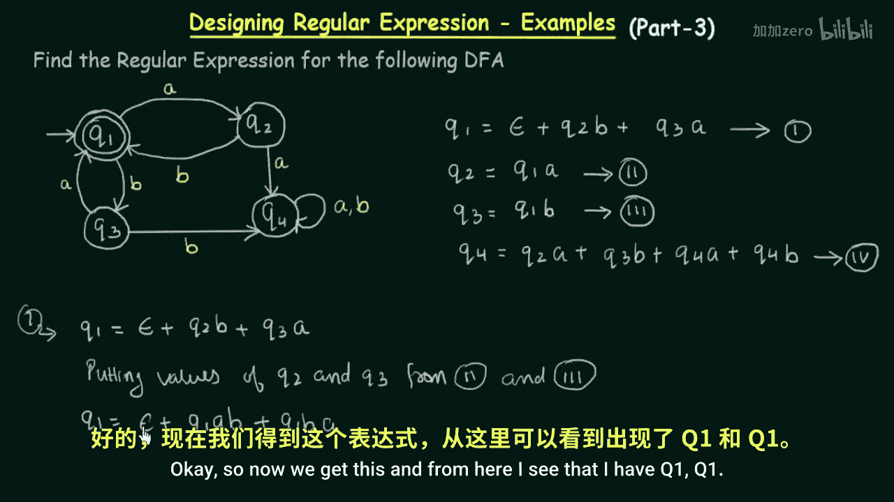
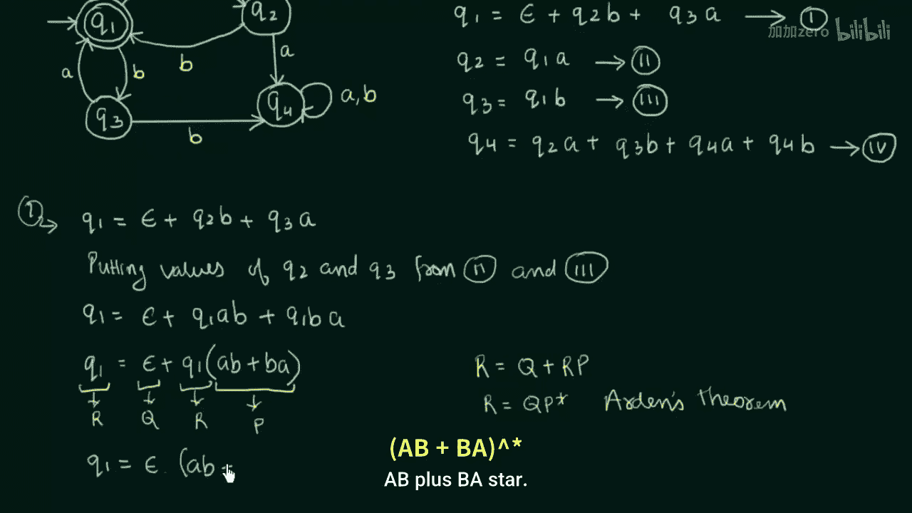
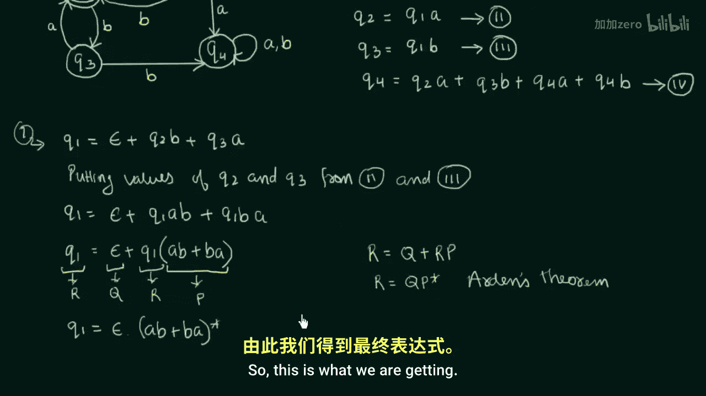
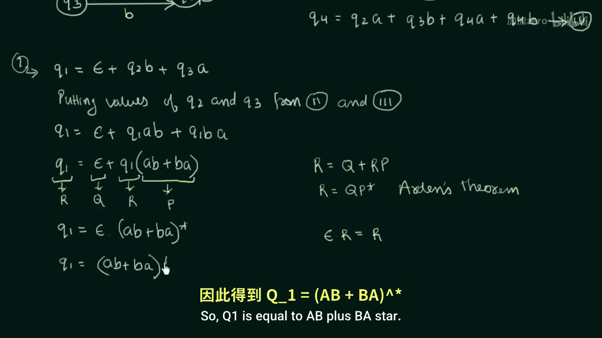
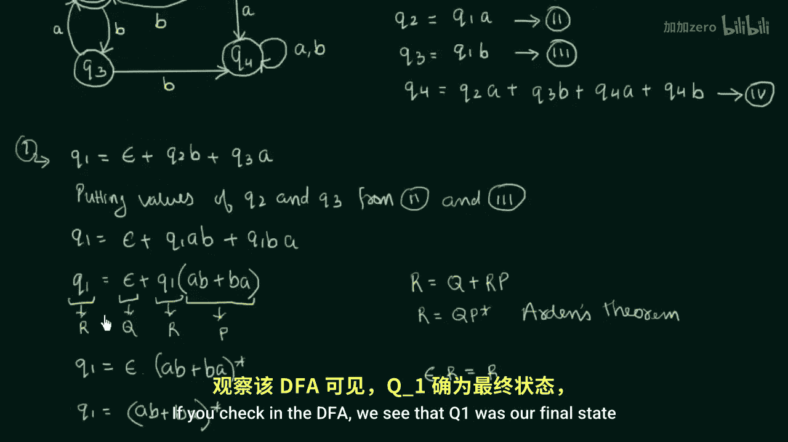
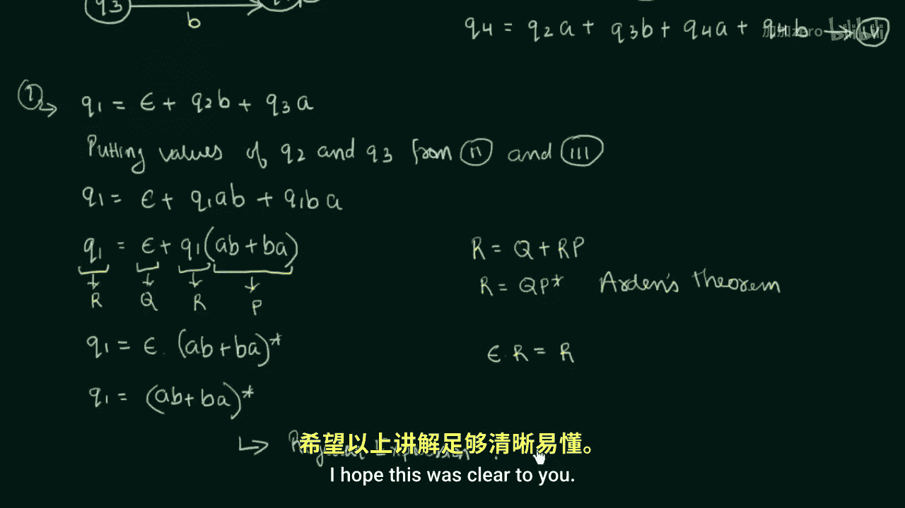

# 悉尼大学【中英⚡计算模型｜COMP2022 Models of Computation】 p17 P18 DFA to Regular Expression Conversion -BV1vTe6zzENb_p17-

In this lecture we will be seeing another example of finding the regular expression for the given DfaA so here we have another DfaA given and then we have to find the regular expression for this Dfa so here we see that we have states Q1 Q2 Q3 and Q4 where Q1 is the initial as well as the final state and then we have inputs A and B so I' alreadyend the steps to find the regular expressions from DfaA in the previous lecture so here we will just solve it so first of all what we have to do is we have to write the equations for each of the states so let's start with Q1 which is our initial as well as final state so how do we write first check what are the incoming transitions to Q1 so this is an incoming transition coming from nowhere so this can be written as epsilon。

Plus， and here we see that from Q2， there is an incoming transition with input B。

 so we can write Q2 B。Plus， and then from Q3， also there is incoming transition to Q1 with input a。

 So I have to write Q 3。A and then there are no incoming transitions。

 So this is the equation for Q1 and let me call it equation number one。

 Now let's do the same thing for equation number 2。That is for Q2。

 so in Q2 we see that there is only one incoming transition that is from Q1 with input a。

 so we can write it as Q1 with input a and there are no more incoming transitions too。Q 2。

 So this is equation number 2。Now let's do the same thing for Q3。So for Q3 also。

 we see that there is only one incoming transition that is from Q1 to Q3 with input B。

 so since it is coming from Q1， I will write  Q1 and input is B。So this one。

 let me call it equation number。3。And let's do the same thing for Q4。

So in Q4 we see that there are incoming transitions from Q2， Q3 and also from Q4。

 so let me first write the one for Q2， Q2， it comes with input a。Plus。

 from Q3 this coming we in would be。Q 3 B。And for Q4， it is coming。 We both input A and B。

 So we have to write。Q 4 with input a plus。Q 4 will input B。 So this is equation number。4。Okay。

 so now we have written the equations for all the states now let us try to take this final state and try to simplify it。

 The final state is Q1， so that is equation number1 I take and that is Q1 and what is Q1 epsilon plus。

Q2 B。Plus。Q3，8。 Now we see there we have Q2 and Q3 over here。

 And this Q2 and Q3s values can be substituted from equations 2 and 3。 So let me put the values。

 So Ill be right here putting。Values。哦。Q to and。😔，Q3 from equations。2。And3。

So how can we write this Q1 equal to this epsilon will be as it is epsilon plus now Q2 can be written as Q1 A。

 Q1 A and this B can be written as B itself。Plus， Q3， Q3 can be S Q1 B。Q1， B。

 and this arights itself。Okay， so now we get this。 And from here I see that I have Q1， Q1。

 so I can take out Q1 common。 So Epsilon plus， let me take out Q1 common。 So what do I get。

 I get A B plus。

B a。Now， if you observe this equation，  Q1 equal to epsilon plus Q1， ab plus B。

 we can see that this equation is of the form r equal to Q plus RPp where this Q1 is R and this epsilon is。

Q and Q1 is R， as we said。 And this whole term over here， this is。😔，P。

 so this can be written as r equal to Q P start by。Ardens。Purim。😔。

So whenever you have an equation of the form r equal to q plus Rp。

 it can be written as r equal to  Q p star by R theem， So this is of that form。

 So let me write it in this form， So R is  Q1 and  Q P star Q is epsilon and p star this whole term is。

B。A B plus。

B a。St， so this is what we are getting and here we see that epsilon into this term。

 so we have also studied from our identities that eilon into any regular expression r is equal to r itself。

 So if you treat this whole thing as r so this can be written as this term itself by that identity so Q1 is equal to。

A B plus。B A。star。

So here this Q1 is my final state， if you check in the DfaA we see that Q1 was our final state and we already got the expression for the final state in terms of the inputs A and B。

 so this is the required regular expression。

This is a require regular expression。For the given DFA， So this is how you solve this。

 I hope so clear to you。 Thank you for watching and see you in the next one。

