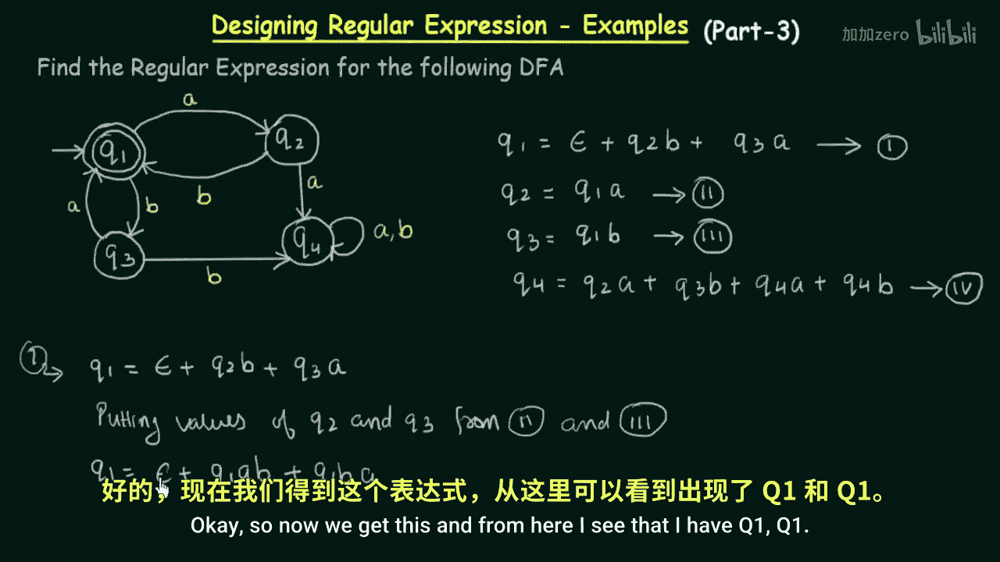
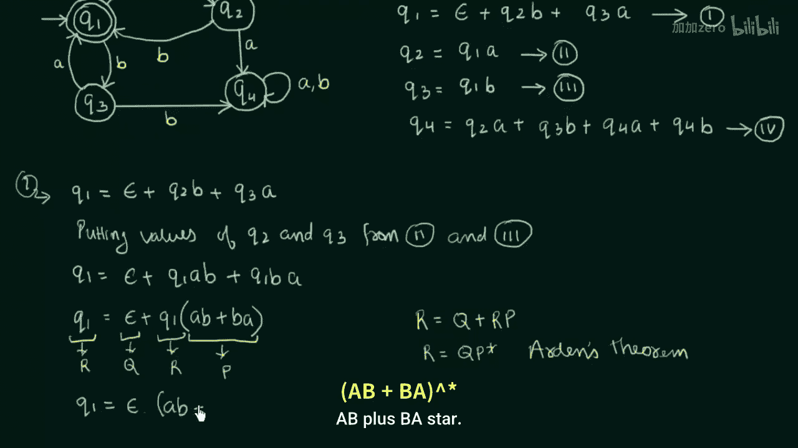
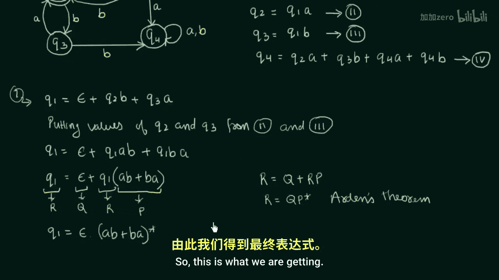
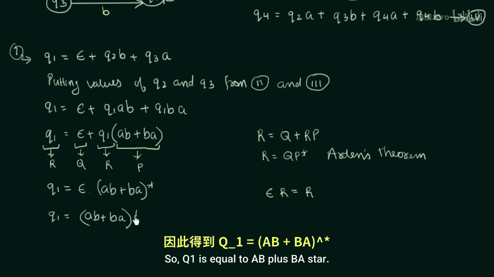
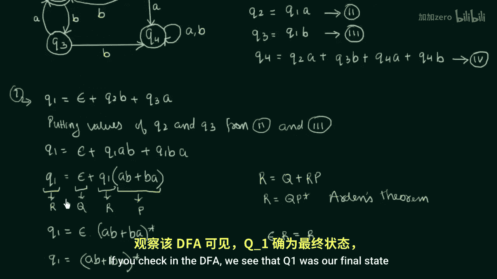
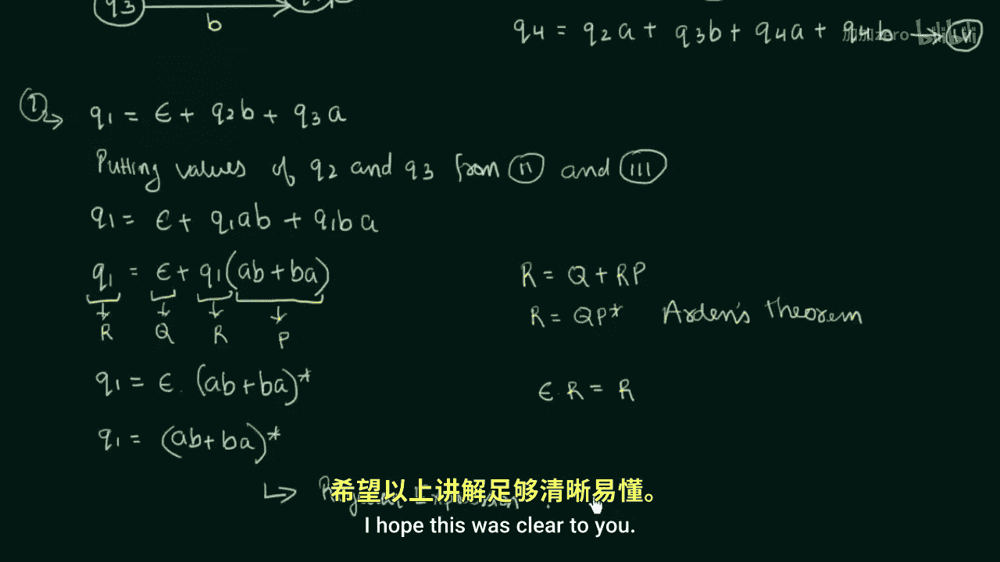

# 计算模型：第17讲：从DFA到正则表达式的转换 🔄

在本节课中，我们将学习如何为一个给定的确定有限自动机（DFA）找到对应的正则表达式。我们将通过一个具体的例子，逐步演示转换过程。

## 概述

我们将分析一个包含四个状态（Q1, Q2, Q3, Q4）的DFA，其中Q1既是初始状态也是最终状态。输入字母表为 {a, b}。我们的目标是为这个DFA推导出等价的正则表达式。

上一节我们介绍了从DFA构建方程的基本思想，本节中我们来看看如何具体应用这些步骤来求解。

## 步骤一：为每个状态建立方程

首先，我们需要为DFA中的每一个状态写出一个方程。方程描述了到达该状态的所有可能路径。

以下是建立方程的过程：

1.  **状态 Q1 的方程**：Q1是初始状态和最终状态。到达Q1的路径包括：从“无”状态（即初始状态本身）的ε转移、从Q2通过输入b的转移，以及从Q3通过输入a的转移。
    *   `Q1 = ε + Q2·b + Q3·a` （方程1）

2.  **状态 Q2 的方程**：到达Q2的唯一路径是从Q1通过输入a。
    *   `Q2 = Q1·a` （方程2）

3.  **状态 Q3 的方程**：到达Q3的唯一路径是从Q1通过输入b。
    *   `Q3 = Q1·b` （方程3）

4.  **状态 Q4 的方程**：到达Q4的路径包括：从Q2通过输入a、从Q3通过输入b，以及从Q4自身通过输入a或b。
    *   `Q4 = Q2·a + Q3·b + Q4·a + Q4·b` （方程4）

## 步骤二：代入与简化方程

由于我们的最终目标是得到代表最终状态Q1的正则表达式，我们将把其他状态的表达式代入方程1。

首先，将方程2和方程3代入方程1中的Q2和Q3：
`Q1 = ε + (Q1·a)·b + (Q1·b)·a`

简化后得到：
`Q1 = ε + Q1·(ab + ba)`

现在，我们得到了一个关于Q1的递归方程。这个方程符合一个标准形式。

## 步骤三：应用阿登引理

我们得到的方程 `Q1 = ε + Q1·(ab + ba)` 符合 **阿登引理** 的标准形式：
`R = Q + R·P`

其中：
*   `R` 对应 `Q1`
*   `Q` 对应 `ε`
*   `P` 对应 `(ab + ba)`

根据阿登引理，该方程的解为：
`R = Q·P*`

将我们的变量代入，得到：
`Q1 = ε·(ab + ba)*`

## 步骤四：应用恒等律得到最终表达式

根据正则表达式的恒等律，`ε·R = R`。因此，我们可以进一步简化：
`Q1 = (ab + ba)*`

## 总结

本节课中我们一起学习了如何为一个给定的DFA推导正则表达式。我们回顾了关键步骤：为每个状态建立方程，将非最终状态的表达式代入最终状态的方程，利用阿登引理解递归方程，并最终应用恒等律进行简化。对于本例中的DFA，我们得到的等价正则表达式是 `(ab + ba)*`。这个表达式描述了所有由交替的 `ab` 和 `ba` 对组成的字符串（包括空串ε）。