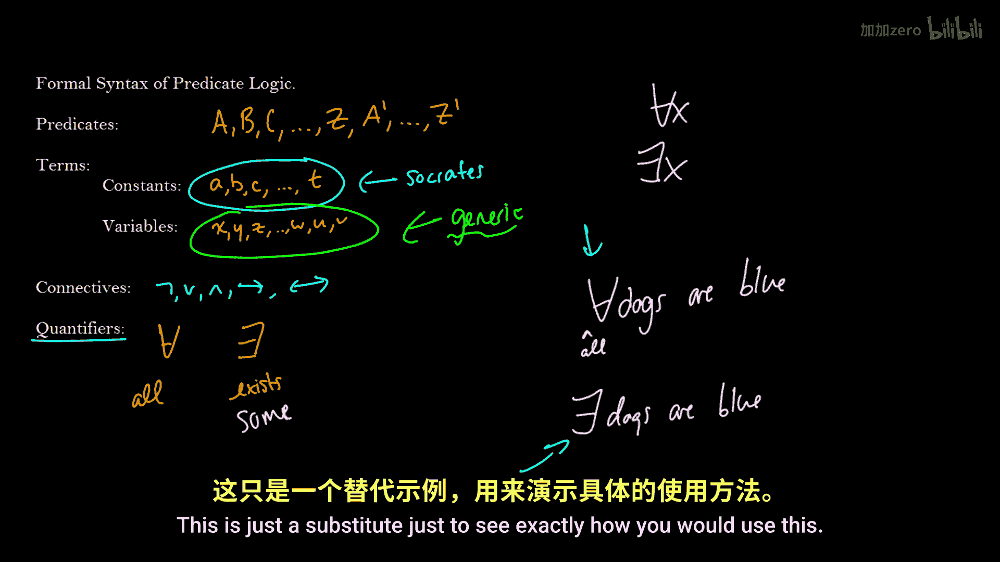
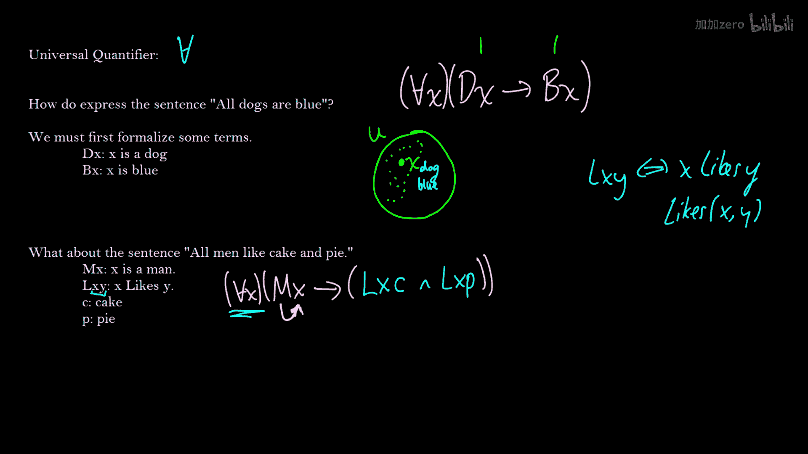
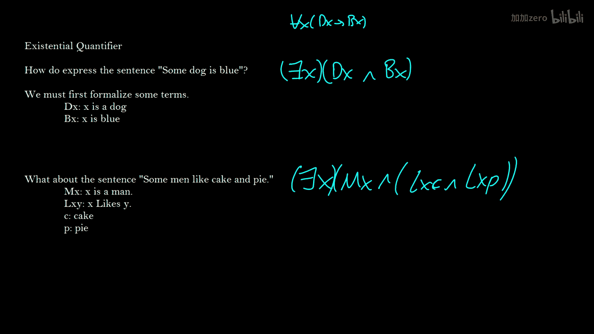
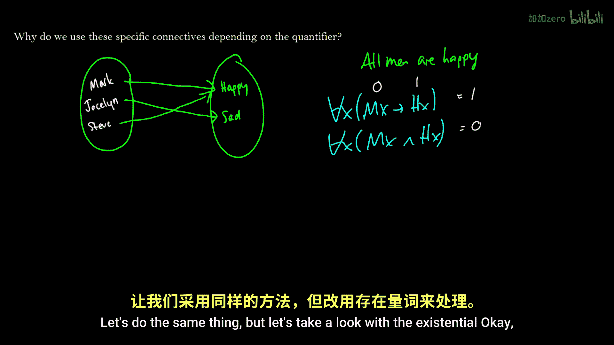
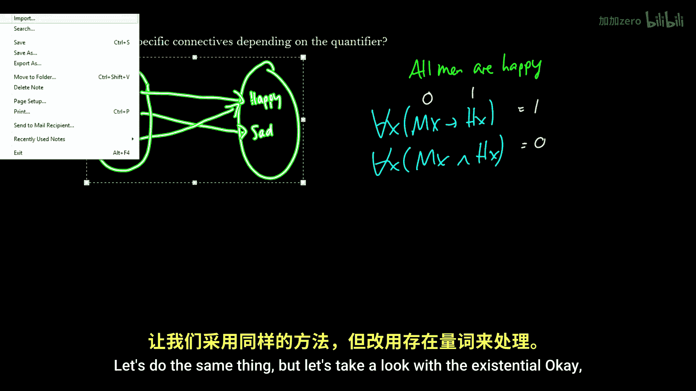
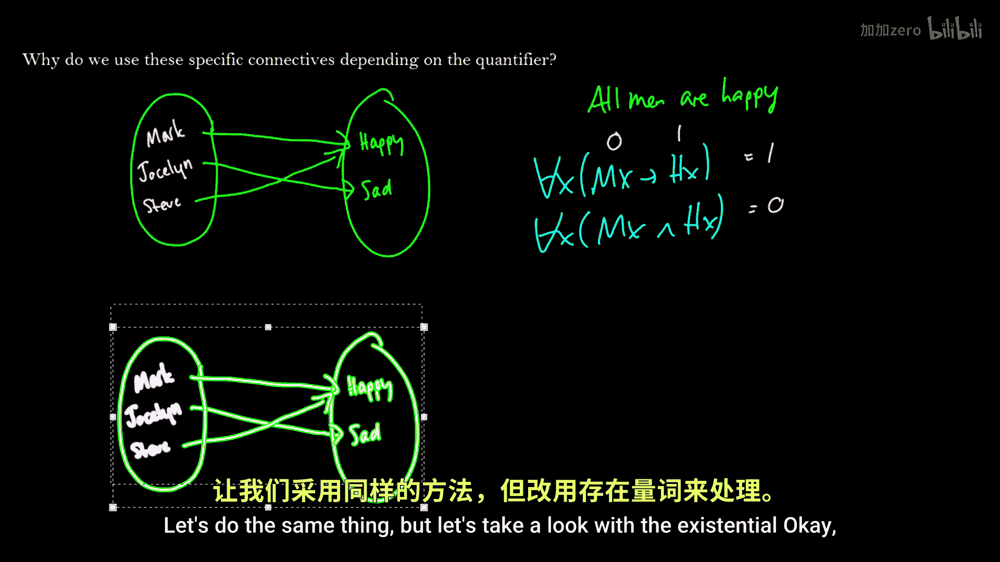
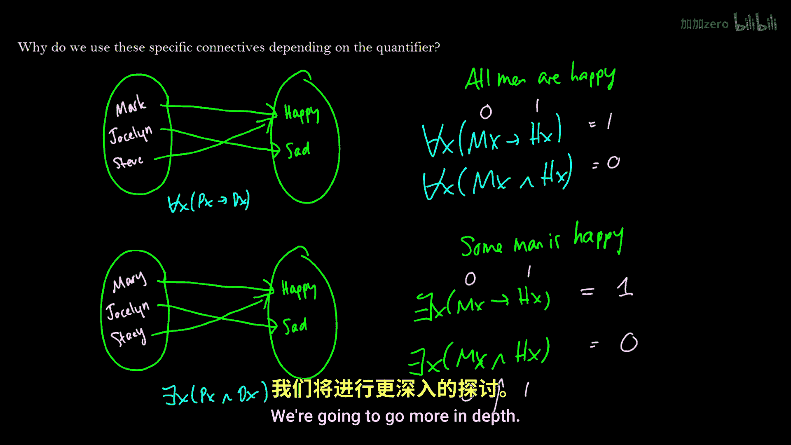

# 悉尼大学【中英⚡计算模型｜COMP2022 Models of Computation】 p18 P19 -Logic- Predicate Logic -BV1vTe6zzENb_p18-

To day is an introduction to predicate logic， also called quantificational logic。

 And we can now explain things we couldn't explain before。 For instance。

 here is a nice classic of proof。All men。Are mortal。Socrates is a man。Therefore。We want to claim。

That Socrates is immortal。Now。There are some problems in propositional logic。With this proof。

Because what we have to say， all men are mortal。This is a single proposition。

 which we would probably call M。And now we want to say Socrates is a man， which is S。

And we want to prove Socrates is immortal， which I guess we could call I。

 but there's no relationship。Between M and S that gets to I。So what do we do。

 We we introduce these things called predicates， and predicates are properties。

 That is what they are。 So if we pick an object， let's call our object X。 It's some random object。

 we don't know。And we're going to have this sentence here。 Dogs are blue。Now。If we take an object。

And we want to in like capture the fact that dogs are blue with object。

 This object is going to have the property of being a dog。

And it's also going to have the property of being blue。So we can say that this X is a blue dog。So。

This is what we mean by predicates。 So when we take。This example。All men are mortal。

 Socrates is a man。 Therefore， Socrates is immtal。 What we can say is that we have this random object X that has the property of being a man and has the property of being。

Amortal。I totally wrote Socrates is immortal。Therefore， Socrates is imm mortal。 That's great。

I wonder if anyone caught that。So now what we have is we say， O， well。Socrates is a man。

 so we can write S。Which is a man。Now what I should write his brackets here， that if。X is a man。

 then。X is moralt。 So we have this concept here that S is a man。 Therefore， we can also claim。

That S is mortal。I didn't write this out properly yet because Id want to introduce the syntax first before writing out formal equations。

 But this is the main idea。 We can now break this argument up our propositions into arguments about properties。

And we can extend properties。So let's talk about the syntax of formal logic。For predicates。

Which are our properties。 We will use capital letters。 So AB， C all the way to Z。

 And we might even use a prime all the way to Z prime。

This is why I don't like using capitals letters for sentences， because in predicates。

 that's what we use for predicates universally。 This is a universal thing。As far as terms。

Terms are our。Abstract idea of an object。So we have constants。Which will be A， B， C。

All the way up to。Probably T， I would say up to T is good。And our variables are going to be X， Y， Z。

 And occasionally， we use W， U and V。So it。When we talk about specific properties。

 like when we said Socrates， for example。He would be a term。 He would be a constant。

 He is not going to change。But when we talk about our variables here。

What we just mean is some generic object。 We don't know which one it is。 It's just some。

Generic object that we haven't assigned any specifics to。We also have some connectives in our logic。

 which are the same as before。 We have a negation or and。A conditional。In fact。

 we also have the bi conditional in here if we want to include it。

 and now we have something new called quantifiers。And these are this upside down a。

Which stands for all。And we have this backwards E。Which means。Exists。So。If we want to say。

All x will be right upside down a with an x。 if we want to say there exists in x。

Can write backwards E of an X。If we want to say all dogs are blue， this is not correct logic。

 but if we want to understand how to use this new notation and what it means as an example。All dogs。

And say。All dogs。 That's what the upside down means。R blue。

And if you wanted to say some dogs are blue， you can write this backwards， E。Dogs are blue。

So I guess a good thing would be some。Thats a， very good。Description of the existential。 Of course。

 this is not right。 This is just a substitute to see exactly how you would use this。

All right。Let's talk about the universal quantifier， the upside down a。Now。

 how do we talk about the sentence all dogs are blue in our syntax？Well。

We have to formalize some terms。So each predicate is going to be paired up with a variable。

Kind of like an argument structure。 how you would say， oh， F of x is equal to y in math。

 You plug some x into F， and then it spits out some value y。This is sort of what we're doing in here。

So。We say D X means x is a dog， so。D X means that some variable X is a dog。 If we said， okay。

 what about D and phdo。Then what that is saying is that Fido is a dog。

Because Fido has the property of being a dog where D here is the property。

 And X is the thing that has that property。Now， what about x is blue if we put。B of phdo in here。

 Then we'd have phdo。 is blue。So that's cool。 What we do is we assign this variable to a property。

Now， how do we write the sentence all dogs are blue？Well， we're not talking about anything specific。

 so we need to use variables here。So， first of all， we have all。

 So we need to write this upside down a。 But what we want to say is all of some random or generic variable X。

And now we want to say for all X。If X is a dog。Then。X is blue。

So this might be a little bit confusing。But we're taking an abstraction here。

 We're seeing in this universe。If we pick a point x。So this is our lovely little universe right here。

If we pick a point X。And this X happens to be a dog。Then， we also know。That is going to be blue。

 as well。And it doesn't matter which x you pick in here。If it is a dog， then it's going to be blue。

 And this means that all dogs are blue， because if you picked an X and it was a dog and it wasn't blue。

Then it would be false because we would have the antecedent being true and。

The consequent being false。 And we can't have that。 So if the antecedent is true， then we guarantee。

That。This consequent is true。And that's what it means。

So let's do a little bit more complicated The example。 All men like cake and pie。 Well。

 the first part is fairly straightforward。For all X。If x is a man。

And then we always use the arrow when we do universal quantifiers。

 I will explain this in a couple slides。 don't worry。All men like cake。And pie。Well。

 we have this new。Verb here。 that takes。Two variables。So when we write L X， Y。

 this translate as X likes Y。 In fact， you can kind of write this as a function。Of likes comma， X， Y。

So， we can think of。Men like cake。 Well， X is a man， so。For liking， X is going to like cake。

 which we've listed as C。 We don't need the property of X being a cake here。

Because we're talking about one specific thing。 So we don't need to write in C X where X is a cake。

 We just take it as， oh， this occurrence is just cake。 It is a constant。So we have all X。

 If X is a man， then X。 this man likes cake and。X also likes P。So we can write a sentence like this。

For all X， if x is a man， then x likes cake and X likes P。

So this notation is something you have to get used to but。Remember。Where assigning property。

2 these variables。 and these properties will stick with the variable until the variable gets outside the scope。

Of this quantifier。Which we'll talk about a little bit later。

Now we're going to do the same sentences with the existential quantifier。

So before we had all dogs are blue。Which was for all x， if x is a dog， then x is blue。Now。

 we want to say some dog is blue。So we say。There exists in X。Such that X is a dog。

But here's the thing that's different with existential quantifiers we use and。

So X is a dog and X is blue。We're going to go over this in the next slide。

But we use an and because there are some things that are just blue。

 and there are some things that are just dogs。 And there are also things that are dogs that are blue。

So we don't want to say that if x is a dog， then x is blue。

Because that would mean you can't have a dog that isn't blue。 But if we say some dog is blue。

 there' is also clearly going to be dogs that are black dogs that are red， dogs that are gray。

 and we don't want to have to capture all of those and have contradictions with our logic。

So let's try some men like cake and pie。 Okay， this is the same thing as before。

 We say there exists in X， such that X is a man， O。And。This X likes cake， and this X likes pie。

So it's not too bad and kind of makes sense， hopefully。

Now let's talk about why we use these specific connectives。

 and I'm going to use some pictures here because I think pictures help a lot。So。Here's the thing。

 we have。This universe。And I'm going to write some names of people。Mary， John and Steve。

And we're going to assign these properties of being happy。And being sad。

So here's what we're going to say。We're going to say Mary is happy。John is sad。And， Steve is happy。

I'm going to make Mary a。Dude， so we're going to call him Mark。For the sake of example。Now。

 what we want to say is。All men。Are happy。So there's two ways we can write this。All X。M X， arrow H X。

 and for all X， M X。And Hx。Okay， so。First of all。Well， every one here is an X。

 or every one here is a man。 so we can write this antecedent true。Now， are all of them happy。 Well。

 there's one case where John isn't happy。 So this will be false。 And in the second one。

 there is a case where X is also not happy。 So this is false。 So in both cases。

 these are going to be false， which is fine。However。Let's consider。Something a little bit different。

What if we change Mark back to a woman。Mary。Well。Mary's happy。 I actually shouldn't change this 1。

 I want to put this one back to Mark。 I'm going to change Steve to a woman。

 We're gonna make him Stacy。Okay。Do I want Stacy changed。 No， I don't want Stacy changed。

 Why do I keep changing their wrong one。This is Steve。 John is going to be。Jocelyn。

That's the best ja name I can do。Okay。Now in this case。Not all x's are men so。

This first part is's going to be false。Because we have Jostle in here， who is a woman。But。

Are all men happy， yes。All men are happy。So。This first part's going to be true。 however。

 in the second part。It is true that all men are happy in this example。

 but is every element that we're looking at a man。And the answer is， no， they're not all men。

Therefore， this second one we have is false， but。We know intuitively that all the men here are happy because Mark is happy and Steve is happy。

 But the way that quantificational logic works is that when we have all X， M， X and H X。

 we need to check。 O， is every one a man。 And if the answer is no。

 then it's going to be false because of the acquire of the and。😊，So this is why we use the arrow for。

Are universal quantifiers。Let's do the same thing。But， let's take a look。

With。Zi。Existential。

Okay， let's copy and paste that。

And we want to write。We want to write a sentence， like。Some man。Is happy。Okay。

 so we have their exist in x， such that M X。Arrow， H X， and there exist in x， such that M， X and H X。

Okay。Well。In our second example， it's clear that， yes， there is some person who's a man。

 and there is some person。That is a man that is happy， O。Perfect。The bottom one。Is fine。However。

 the top one。K， X is a man。 Yes， there is some person whos a man and happy。 So this also equals one。

 So both of them are good。Now what we can do。Is we can say， okay， well。Let's make。Mark to Mary。

 And let's make Steve into Stacy。Now we have a problem here。Now。

 what do you think the problem is going to be。For their existence ex。There is no X。That is a man。

So this first part。X is a man is going to be false。 Now， in the first case here。

 this means automatically。That this first formalization we have is going to be true。

But we know this is wrong。 This can't be true。Because there is no happy man in our world here。

But what we're saying is that there is some happy man。

 And we have a formal proof here that says there is some happy man， even though we know for sure。

 Based on this picture and the world we have to find that there is no happy man。

So does this bottom one do it right？ And while they says， is there an X that is happy， Of course。

 there's an X that's happy。 That's fine。But because of the requirements of the and operator here。

 we know that this sentence is false。And that's what we want。 We want this to match our intuition。So。

 we have now。Explained why， for all X。We use the arrow。And for the existential。

We use the and operator when linking the first and subsequent。Terms。So that was intro。

To predicate logic， next time， we're going to。Talk a little bit more about the formal system。And。

Believe we're going to cover a couple more translations。Get ready to talk about variables。

 we're going to go more in depth。

