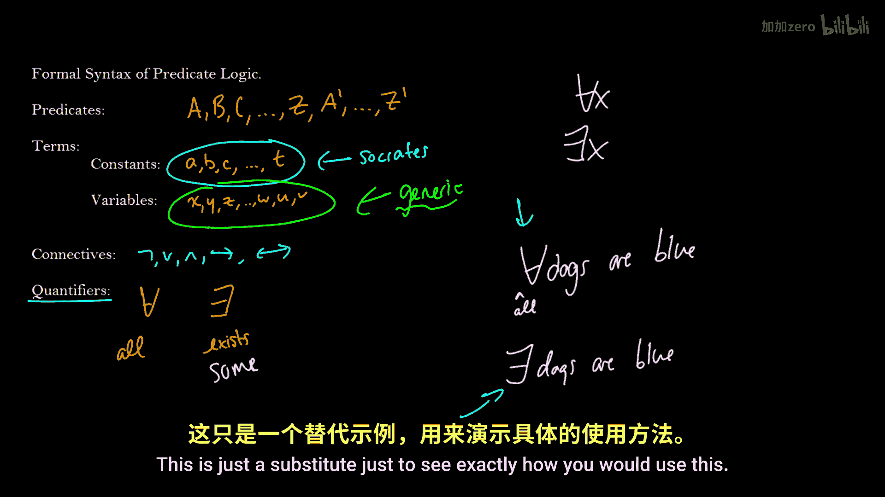
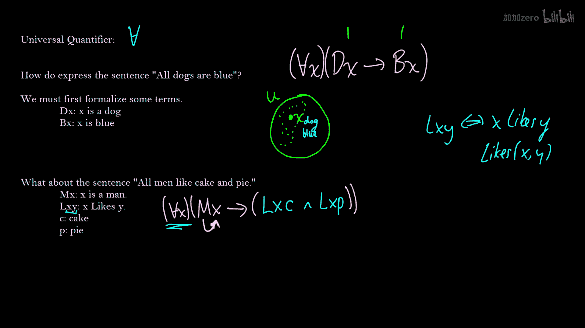
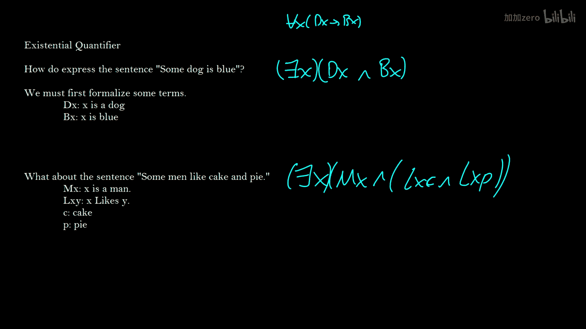
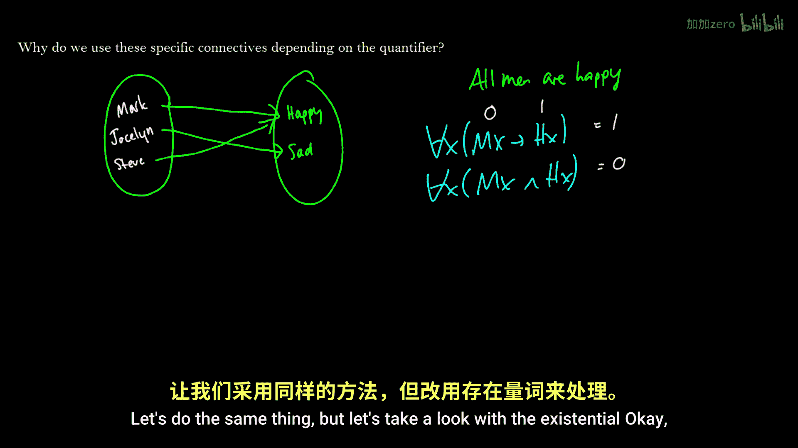
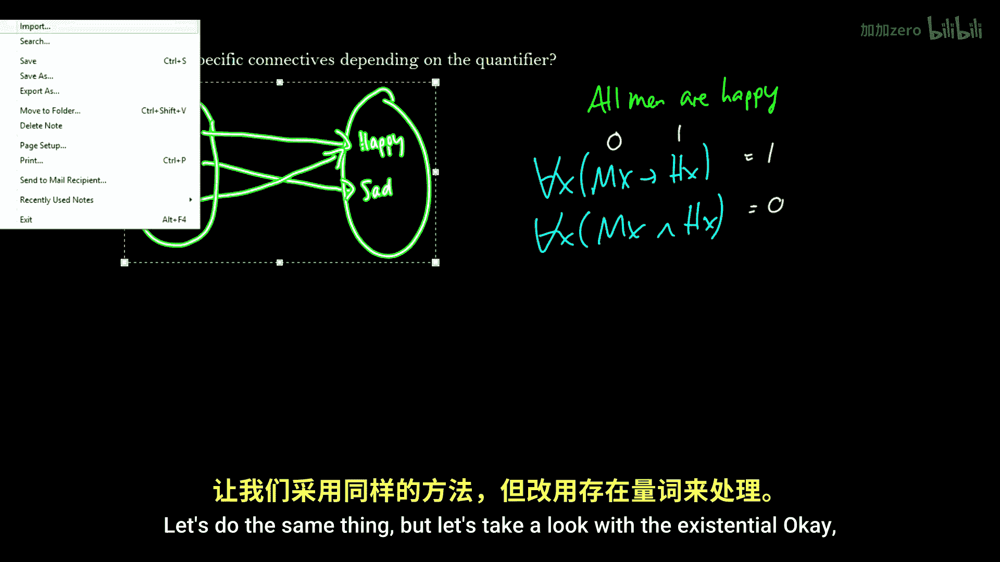
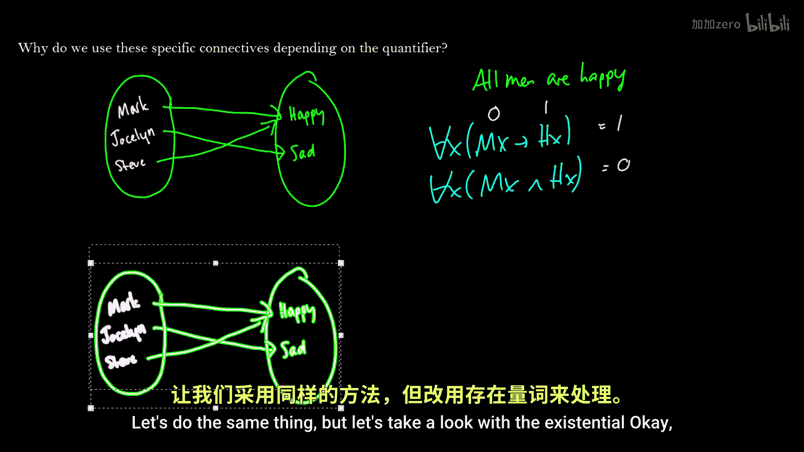
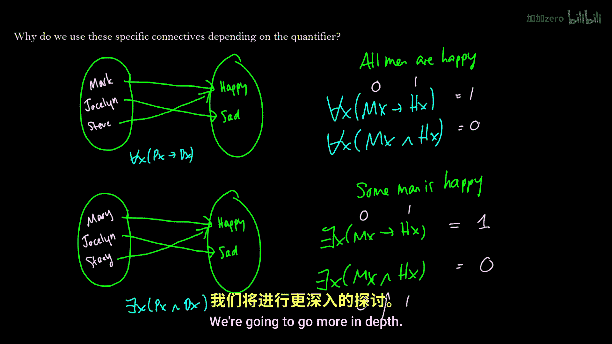

# 计算模型：第18讲：谓词逻辑入门 🧠

在本节课中，我们将要学习**谓词逻辑**，也称为**量化逻辑**。这是一种比命题逻辑更强大的逻辑系统，它允许我们表达和推理关于对象及其属性的陈述。我们将学习其基本语法、核心概念（量词）以及如何用形式化的方式表达日常论证。

## 概述：为什么需要谓词逻辑？

在命题逻辑中，每个陈述（如“所有人都是会死的”）被视为一个不可分割的整体（一个命题）。这使得我们无法分析其内部结构，从而无法形式化某些推理。

例如，考虑经典的“苏格拉底论证”：
1.  所有人都是会死的。
2.  苏格拉底是人。
3.  因此，苏格拉底是会死的。

在命题逻辑中，我们只能将其表示为 `M`（所有人都是会死的），`S`（苏格拉底是人），并试图推导出 `I`（苏格拉底是会死的）。但 `M`、`S` 和 `I` 之间没有逻辑联系，因此无法进行有效推理。

谓词逻辑通过引入**谓词**（描述对象属性的符号）和**量词**（描述属性适用范围的符号）来解决这个问题，使我们能够拆解和分析陈述的内部结构。

## 谓词逻辑的语法

上一节我们看到了命题逻辑的局限性，本节中我们来看看谓词逻辑的基本构建块。

以下是谓词逻辑的核心语法元素：

*   **谓词**：表示对象属性的符号。我们使用大写字母 `A, B, C, ..., Z` 来表示。例如，`D(x)` 可以表示“x 是一只狗”，`B(x)` 表示“x 是蓝色的”。
*   **项**：指代对象的符号。
    *   **常量**：指代特定、不变的对象，用小写字母 `a, b, c, ..., t` 表示。例如，`s` 可以代表“苏格拉底”。
    *   **变量**：指代泛型或未知的对象，用 `x, y, z, u, v, w` 表示。例如，在“对于所有 x...”中，`x` 就是一个变量。
*   **连接词**：与命题逻辑相同，包括否定 `¬`、合取 `∧`、析取 `∨`、蕴含 `→` 和双蕴含 `↔`。
*   **量词**：这是谓词逻辑新增的核心概念。
    *   **全称量词** `∀`：读作“对于所有...”。`∀x` 表示“对于论域中的所有对象 x”。
    *   **存在量词** `∃`：读作“存在...”。`∃x` 表示“在论域中存在至少一个对象 x”。

## 如何使用量词：全称量词 `∀`

理解了基本语法后，我们来看看如何用全称量词 `∀` 来表达“所有...都...”这类陈述。

核心规则是：**当使用全称量词 `∀` 时，我们通常使用蕴含 `→` 来连接前提和结论**。

**公式**：`∀x (P(x) → Q(x))`

这个公式的意思是：“对于论域中的每一个对象 x，如果 x 具有属性 P，那么 x 也具有属性 Q。” 这精确地捕捉了“所有 P 都是 Q”的含义。

让我们用例子来说明：

*   **陈述**：所有狗都是蓝色的。
*   **形式化**：
    *   令 `D(x)` 表示“x 是一只狗”。
    *   令 `B(x)` 表示“x 是蓝色的”。
    *   形式化为：`∀x (D(x) → B(x))`。
*   **解释**：我们在论域中任意选取一个对象 x。**如果**它碰巧是一只狗（`D(x)` 为真），那么根据这个陈述，我们**保证**它一定是蓝色的（`B(x)` 也为真）。如果 x 不是狗，则这个陈述对 x 没有要求。

再看一个更复杂的例子：

*   **陈述**：所有男人都喜欢蛋糕和派。
*   **形式化**：
    *   令 `M(x)` 表示“x 是一个男人”。
    *   令 `L(x, y)` 表示“x 喜欢 y”。
    *   令 `c` 代表“蛋糕”，`p` 代表“派”（它们是常量）。
    *   形式化为：`∀x (M(x) → (L(x, c) ∧ L(x, p)))`。
*   **解释**：对于任何对象 x，如果 x 是一个男人，那么 x 喜欢蛋糕 **并且** x 喜欢派。

## 如何使用量词：存在量词 `∃`

上一节我们介绍了全称量词，本节中我们来看看存在量词 `∃` 的用法。

核心规则是：**当使用存在量词 `∃` 时，我们通常使用合取 `∧` 来连接各个属性**。

**公式**：`∃x (P(x) ∧ Q(x))`

这个公式的意思是：“在论域中，存在至少一个对象 x，使得 x 具有属性 P **并且** x 具有属性 Q。” 这精确地捕捉了“有些 P 是 Q”的含义。

让我们用例子来说明：

*   **陈述**：有些狗是蓝色的。
*   **形式化**：`∃x (D(x) ∧ B(x))`
*   **解释**：我们声称在世界上**存在**那么一只（或多只）狗，它**同时**满足“是狗”和“是蓝色”这两个属性。注意，这并不排除存在非蓝色的狗。

为什么这里用 `∧` 而不是 `→`？如果用 `∃x (D(x) → B(x))`，只要找到一个不是狗的对象（使得 `D(x)` 为假），整个蕴含式就为真，这会导致“有些狗是蓝色的”这个陈述在“存在不是狗的东西”的世界里被误判为真，这显然不符合直觉。

再看一个例子：

*   **陈述**：有些男人喜欢蛋糕和派。
*   **形式化**：`∃x (M(x) ∧ L(x, c) ∧ L(x, p))`
*   **解释**：存在至少一个对象 x，x 是一个男人，并且 x 喜欢蛋糕，并且 x 喜欢派。

## 为什么选择特定的连接词？ 🤔

我们知道了全称量词搭配 `→`，存在量词搭配 `∧` 的规则，现在我们来深入理解其背后的原因。通过分析具体场景，可以更清楚地看到为什么这些搭配是必要的。

考虑一个小型“世界”，其中有三个个体：Mark（男，开心）、Jocelyn（女，悲伤）、Steve（男，开心）。我们想评估关于“所有男人都开心”这个陈述的不同形式化方式。

1.  **正确形式**：`∀x (M(x) → H(x))`
    *   检查：对于 Mark（男，开心），`M(Mark) → H(Mark)` 为真。对于 Jocelyn（女，悲伤），`M(Jocelyn)` 为假，所以 `M(Jocelyn) → H(Jocelyn)` 为真（假前提使蕴含为真）。对于 Steve（男，开心），同样为真。**所有个体都使蕴含式为真，所以整个全称陈述为真**。这符合“所有男人都开心”的直观事实。

2.  **错误形式**：`∀x (M(x) ∧ H(x))`
    *   检查：这个陈述要求**每一个** x **都同时是男人且开心**。对于 Jocelyn，`M(Jocelyn) ∧ H(Jocelyn)` 为假（因为她不是男人）。因此，**整个全称陈述为假**。但这歪曲了原意，原意只关心“男人”这个子集是否都开心，并不要求所有人都是男人。

这个例子表明，使用 `∧` 会错误地要求论域中**所有**对象都必须满足前提条件。而使用 `→` 则能精准地表达：**只要**是男人，**就**一定开心；对于不是男人的对象，不做要求。

现在考虑存在量词。假设同一个世界，我们想表达“有些男人开心”。

1.  **正确形式**：`∃x (M(x) ∧ H(x))`
    *   检查：是否存在一个 x，使得 `M(x)` 和 `H(x)` 同时为真？是的，Mark 和 Steve 都满足。所以陈述为真。符合直觉。

2.  **错误形式**：`∃x (M(x) → H(x))`
    *   检查：我们需要找到一个 x 使得 `M(x) → H(x)` 为真。对于 Jocelyn（女，悲伤），`M(Jocelyn)` 为假，所以 `M(Jocelyn) → H(Jocelyn)` 为真（假前提）。**因此，这个陈述在存在非男人的个体（如 Jocelyn）的世界里，竟然被判定为真**。但这明显违背了“存在开心的男人”的原意，因为实际上并没有开心的男人（Mark 和 Steve 是开心的，但 Jocelyn 的“贡献”使陈述为真是一种逻辑上的意外）。

这个例子表明，对存在量词使用 `→` 会导致陈述过于宽松，只要存在不满足前提的对象，就可能使整个存在陈述为真，从而无法准确捕捉“存在同时满足多个属性的对象”这一含义。

## 总结

本节课中我们一起学习了谓词逻辑的基础知识：

1.  **动机**：谓词逻辑通过引入**谓词**（描述属性）和**量词**，克服了命题逻辑无法分析陈述内部结构的局限，使得像“苏格拉底论证”这样的推理得以形式化。
2.  **核心语法**：包括谓词（大写字母）、项（常量、变量）、连接词和两个新的量词——全称量词 `∀` 和存在量词 `∃`。
3.  **量词的使用规则**：
    *   表达“所有 P 都是 Q”时，使用 **`∀x (P(x) → Q(x))`**。
    *   表达“有些 P 是 Q”时，使用 **`∃x (P(x) ∧ Q(x))`**。
4.  **规则背后的逻辑**：我们通过具体的世界模型分析了为何全称量词通常搭配蕴含 `→`（只对满足前提的对象施加结论），而存在量词搭配合取 `∧`（要求找到的对象同时满足所有条件）。这是确保形式化表达与直观含义一致的关键。

下一讲，我们将继续深入谓词逻辑的形式系统，学习更多的翻译技巧，并更详细地讨论变量的作用域等问题。