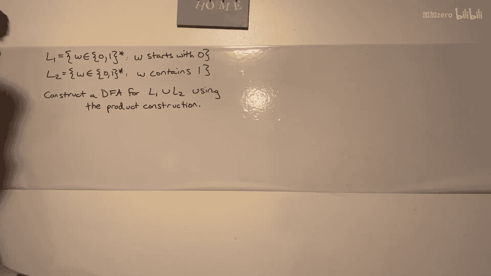

# 悉尼大学【中英⚡计算模型｜COMP2022 Models of Computation】 p19 P20 How to Union two Regular Languages with the Product Construction - Easy Theo -BV1vTe6zzENb_p19-

I'm sad， guys。We have a problem here。😔，We need to make a DFA using the dreaded product construction。

But fortunately， we could make it easy。Want to see how I think you do， don't you？All right。

 so how do we do this here？So we got two languages， L1， where all the strings in 01 star start with0。

 L2， all the strings contain a1， and we are destined to make a DFA for the union of the two using the product construction。

So how do we do this？So here is Ryan's two step technique to use the product construction。

So the first step is make。ADFA。For L1 and L2。So how do we make a DFA for L1 and L2？

So L2 is pretty easy， so let's put L2 right here。And I'm going to have it states Q0。 Well。

 if it's just a string of zeroes， well， we should never accept it because it must contain a one。

So I'm going to have a self loop here on zero， and if it has a one。

 I'm going to go to a state where I will always accept。So no matter what the rest of the string is。

 I'm going to accept it。And then for L1， well， if it starts with a one， we should never accept。

So for L1。I'm going to call it states R0 and so forth。 So if it starts with a zero。

Then we should always accept。And if it starts with a one。Then we should always not accept the string。

So we have a dead state here。Okay， so how can we use the product construction easily。

Without having to think too hard。So notice that we have a DFA on two states right here and a DFA on three states right here。

So whenever you using the product construction is always the product of the number of states。

 hence where the name comes from。 So there are two states here， three states here。 So in the end。

Last I checked， I think two times3 is equal to six。 So in the end， I'm going to have six states。

And what are those six states， they're going to correspond to the pairers？Hence， again， product。

 Cartesian product。So I'm going to have the pairs Q0， R 0。

 So that's going to be the name of the state Q0， R 0， Q0 R 1， Q0， R2。Q1， r 0， Q1 R 1， Q1 R2。

 every pair of states。 So let's write out what those states are。

So Q zero are zero is going to be a state。So then I'm going to have Q0， R1 as a state。Q0， R 2。

If I can draw two。As a state， then I'm going to have a Q1 column。Then Q1， R 1。And Q1， R 2。

So those are my states。So now weve got to think， what does the DFA need， It means a start state。

 Well， what's the start state here， I think it's going to be Q0 R 0， Y。

 Because those are the start states in the original ones。 So this is going to be my start state。

We'll deal with final states later。 So let's do the transition function。

 So how would you actually use the transition function between all of these states。Well。

 all you have to do is from each of these pairs， figure out what the DFAs originally did。

 So let's look at this state Q0 R0。So this corresponds to state Q0 in the first。

In the first DFA and R0 in the second DFA。Well， Q0， what does it do on0。

 It goes to Q0 because of the cell flu。And R 0， what does it do， It goes to R 1。So in my mind。

 I'm thinking Q0 R1。Or with just this stick right here。

So I'm going to have a transition on zero to that。Okay。Now， let's do one from the same state。 Well。

 one from the Q machine goes to Q1。So I'm thinking Q1 so the right column。R0 on one that goes to R2。

 so I'm thinking Q1， R 2。Which is this bottom state way down here。So now let's do another repair。

Q0 R1。 Well， no matter what I do in。This left column on 0。

 I'm going to stay in the left column because of the self loop here。

So Q0 R1 I'm going to be Q0 no matter what， So what does R1 do on0 well it stays where it is because R1 self loops on0。

So that means I need to self loop here。And then what does it do on one， Well Q0 always goes to Q1。

 the right column And R 1 stays。Where it is， because again， it has another self loop on one。

 So I'm going to have a one transition over to here。Now let's do this bottom  one，2，0 again。

 stays in 2，0。R2 is going to have a self loop on zero and one， so this is going to self loop on0。

All right， MLlS do transition on one Q0 goes to the right column we again R2 stays with R2。

 so like with the other state with R1， I'm going to have a transition that just goes right。Cool。

So let's look at this state now，  Q1 r0。Well， Q1 well， it cell loops on everything。

 So no matter what， if I'm in the Q1 column， I'm going to stay there。 So Q1。

 I'm saying in the Q1 column， R 0 on 0 goes to R 1。So I'm going to go here on zero。Let's see。

 where do I go on1， I go to R2。From that same state。Q1 R1， where do I go？So Q1， I stay in Q1， R 1。

 I stay in the same state。 And if we look at this pair， actually， it's self lu on 0 and1。

 So here I'm going to self loop on 0 and1。Okay。So then we handle that pair， let's do this pair。

 We again， both stay self loop on 0 and1。So what's solve loop on 0 and1？Pretty easy。Well。

 the only thing that's left is to do of course， the final states。

 well what are the final states here？Well'll notice we're doing y yin of the two languages。

 but what does that correspond to？Well， if let's look at， say， Q1， if we happen to be in Q1， well。

 because we're doing union， I don't care what the other machine was in。As long as I'm in Q1。

 that is a final state。 So these three states on the right。Are going to be。Final states。

And a similar argument for R1， If I'm in R1， I don't care what the other machines in because it's in the union。

So every state with an R1 in it is a final state， which the only one left is this one。Okay。

 let's actually check to make sure that this is actually right。I guarantee it is right。

 but let's actually just look at the DFA。Well， we can notice several things。

 we can notice several things， well this state and this state are completely unreachable。

 so we might as well just imagine that they're not there。

Is good for practice with the product construction to always put them in。

 because sometimes you actually do meet them all。But let's see， let's see what happens well。

 suppose I come down the one route from the start state。

Well here in this state I self loop on everything， so if it starts with the one。

Then it clearly is accepted。Well， let's see if it starts with the zero， well。

 I fulfilled the L1 condition， so I don't even need to look at the L2 condition。

 So that means that if it starts with the0， it's always going to be accepted and if it starts with the1。

 it's going to always be accepted because it satisfies the L2 condition。

So that means the only string that doesn't satisfy both of those conditions is the empty string。

 Well， let's look。The state that is only reachable from the start state that is not accepting。

Is the start one。And。😊，Consequently， I don't accept the empty string。

 so I can actually verify that this is actually correct。

So this is a nice short example of how to use the product construction。🎼。🎼う。

