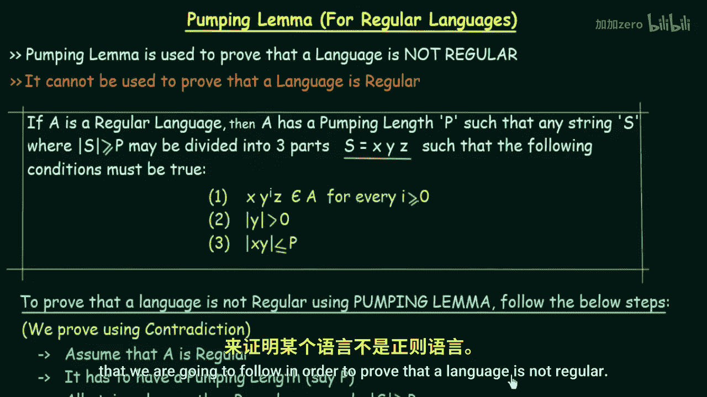
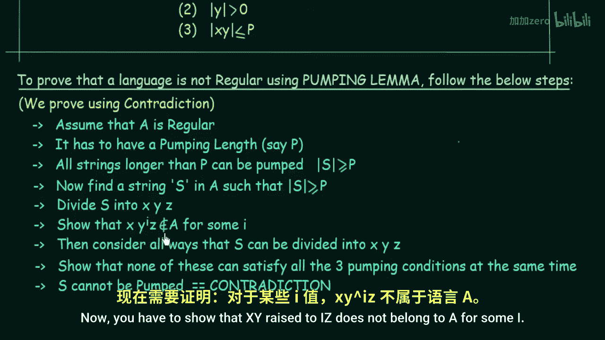
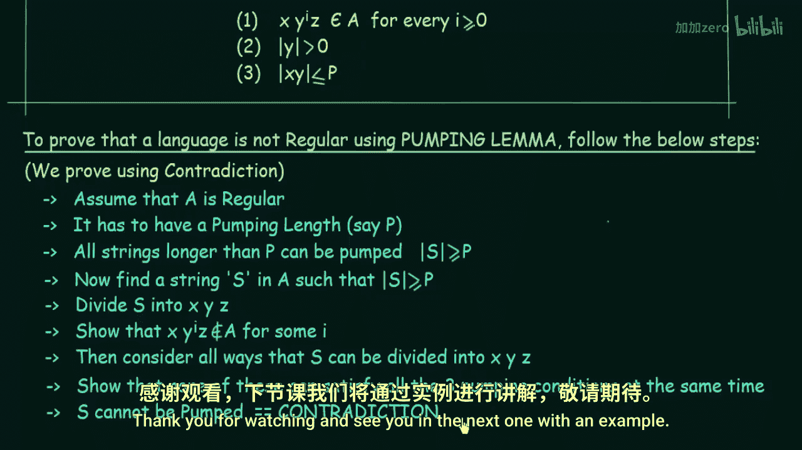

# 悉尼大学【中英⚡计算模型｜COMP2022 Models of Computation】 p20 P21 Pumping Lemma (For Regular Languages) -BV1vTe6zzENb_p20-

In this lecture we will be studying about pumping lemma for regular languages so what is a pumping lemma pumping lemma is used to prove that a language is not regular so I've already taught you in previous lectures what are regular languages and what are non-regular languages so regular languages are the languages that can be represented or designed using a finite state machine。

 so all regular languages can be designed using finite state machines and we know the properties of finite state machines and we also know their limitations and due to their limitations there are some languages that cannot be designed using finite state machines and those languages are known as non-regular languages so how can we prove that language is not regular so for that we will be using this pumping lemma so a pumping lemma is used to prove that a languages not regular but you should keep in mind that pumping。

maCan be used to prove that a language is not regular。

 but it cannot be used to prove that a language is regular。

 It can only be used to prove that a language is not regular。 Okay。

 so now we'll see what does the pumping lemma state and how can it be used to prove that a language is not regular。

 So here。This is the statement of the pumping lemma given and it says that if a is a regular language。

Then a has a pumping length P， such that any string as where the length of s is greater than or equal to p may be divided into three parts S equal to X。

 Y and Z， such that the following conditions must be true。 Okay。

 so let's try to understand this statement before we come to the conditions。

 So it states that if a is a regular language， supposeupp we have a language which is a。

 and we assume that it is a regular language。 So if a is a regular language。

 then a must have a pumping length P， itll have a pumping length P， such that。

Any string S where the length of s greater than or equal to P may be divided into three parts。

 So if you take any string S。Where the length of this。

String S that you take out from this language A is greater than or equal to the pumping length， then。

This string S can be divided into three parts， which is x Y and Z， that means we take a string S。

 which belongs to the language A， and we divide that string S into three parts X Y and Z。

 So you have to decide how you have to divide the string into three parts and you have to divide in such a way that the following conditions must be true and what are the conditions X Y is to I Z belongs to a for every I greater than or equal to0 That means you have this string S and now you have it divided into three parts X Y and Z。

 and let's say that the first part X and the last part Z we keep it as it is and this middle part of the string that is Y the middle part of the string Y may be anything it may be some sequence of some kind of symbols So this middle part Y if you。

Increase it。 If you increase it any number of times。I greater than equal to 0。

 That means if you increase this middle part any number of times and then the string that you obtain after increasing this y part any number of times must also belong to a that is the language Allright。

 and the second condition says that the length of y should be greater than 0 and the third conditions says that the length of X and y together must be less than or equal to p and what is B which is the pumping length。

 So for the language to be regular this three conditions must be true。

 So this is what we get from the pumping lemma and how are we going to prove that a language is not regular using this statement that we have here。

 let's see that。To prove that a language is not regular using pumping lemma。

 follow the below steps and these are the steps that we are going to follow in order to prove that a language is not regular and proof that we are going to do is using contradiction Okay so first of all lets say that we have a language which we call a and we are going to prove that a is not regular for that what we do since it is going to be proved by contradiction we first assume that a is regular So after we assume that a is regular we already read in the statement of pumping lemma that if a is regular then it has to have a pumping length so let's say that it has a pumping length and we call it P。

Now all strings longer than p can be pumped That means all the strings whose length is greater than or equal to p can be pumped that we already saw in the statement of pumping lemma now what we have to do is we have to find a string S in the language a such that the length of s is greater than or equal to P。

 now we are going to take a string s， you have to choose a string s from the language a such that its length is greater than or equal to the pumping length after that what you have to do is you have to divide s into three parts X Y and z like we already saw in the pumping lemma statement。

 so you divide the s that you chose from the language a into three parts X Y and Z now you have to show that X Y is to I Z does not belong to a for some I so in the statement for pumping。

lemma we saw that if x y raised to I that means this middle part y， how many time。

 how many of a time you increase it， the resulting string that you obtain x y raised to Iz must belong to a if the language is regular so we will show that when you increase the number of this Y part the middle part and the string that you obtain as a result of x Y raised to I Z does not belong to a。

 the resulting string that you obtain does not belong to the language a okay and then you consider all ways that S can be divided into x Y and Z。

 so you have to find out all the ways in which you can divide this string x into three parts X Y and Z。

 and you show that none of these can satisfy all the three pumping conditions at the same time so these three conditions that we saw here we should show that it cannot be satisfied all at the same time so。

To show that these three conditions cannot be satisfied all at the same time。

 then it shows that S cannot be pumped， which is a contradiction， because if a is regular。

 then it should be able to be pumped now， since it cannot satisfy all the three conditions。

 It is a contradiction to the statement that a is a regular so we prove that a is not regular and using pumping lemma。

 we have proved that a is not a regular language So I hope this was clear to you。

 don't worry even if it seems a little confusing right now。

 just try to understand the theoretical portion in this lecture we will take an example in the next lecture where we will be following all these steps and we will try to prove that a language is not regular。

 So once we take that example it will become more clear to you。

 So this is a theoretical part of pumping lemma that you need to understand。

 I hope this was clear to you。 Thank you for watching and see you in the next one with an example。

