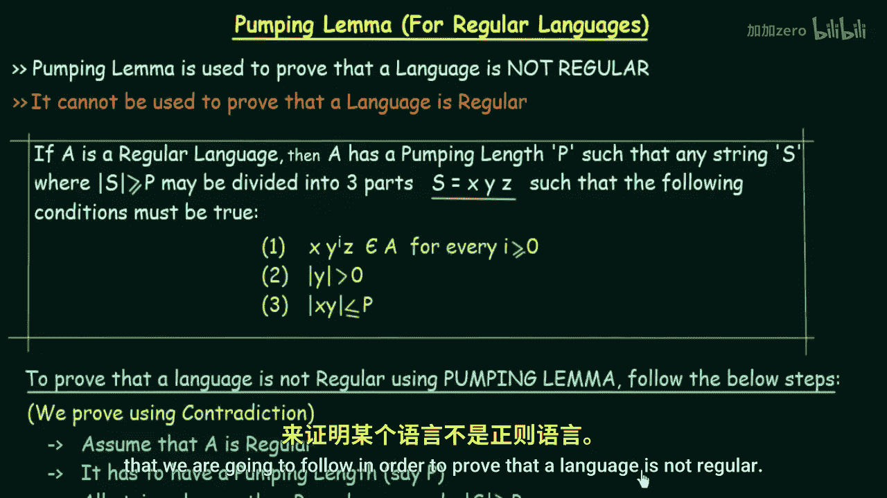
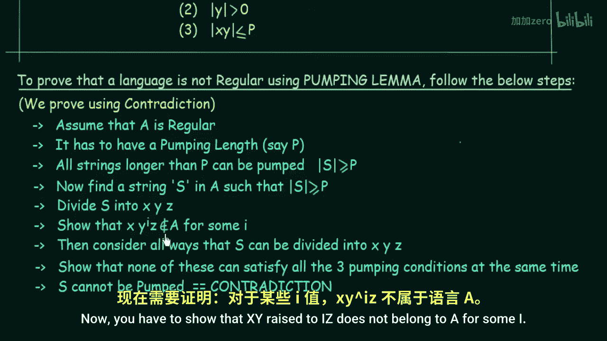
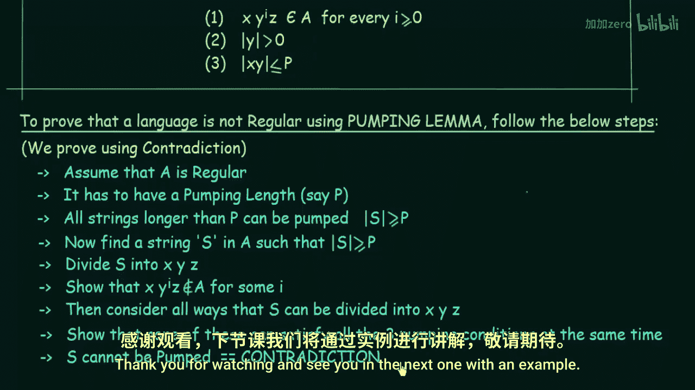

# 计算模型：20：泵引理（针对正则语言）💧

在本节课中，我们将学习用于证明语言**非正则**的泵引理。泵引理是形式语言理论中的一个重要工具，它利用有限状态机的局限性来揭示某些语言无法被其描述。

## 概述

我们已经知道，**正则语言**是那些可以用**有限状态机**（Finite State Machine）表示或设计的语言。然而，由于有限状态机存在固有的限制（例如有限的内存），存在一些语言无法用其描述，这些语言被称为**非正则语言**。泵引理正是用来形式化地证明一个语言是非正则的有力工具。

需要特别注意的是：**泵引理只能用于证明一个语言不是正则的，而不能用于证明一个语言是正则的**。

## 泵引理陈述

如果语言 **A** 是一个正则语言，那么存在一个**泵长度** **P**，使得对于 **A** 中任何长度不小于 **P** 的字符串 **s**，都可以被分割成三个子串 **s = xyz**，并且满足以下三个条件：

1.  对于每一个 **i ≥ 0**，字符串 **xyⁱz** 仍然属于语言 **A**。
2.  中间部分 **y** 的长度大于 **0**，即 **|y| > 0**。
3.  前两部分 **x** 和 **y** 的总长度不超过泵长度 **P**，即 **|xy| ≤ P**。

用公式总结如下：
**若 A 正则，则 ∃ P > 0，使得 ∀ s ∈ A 且 |s| ≥ P，∃ 分割 s = xyz 满足：**
1.  **∀ i ≥ 0， xyⁱz ∈ A**
2.  **|y| > 0**
3.  **|xy| ≤ P**

这个引理的核心思想是：在一个足够长的正则语言字符串中，总能找到一个非空的、可重复（“泵送”）的子串 **y**，重复任意多次（包括零次）后，生成的新字符串仍然在原语言中。

## 如何使用泵引理证明语言非正则

上一节我们介绍了泵引理的内容，本节中我们来看看如何利用它进行证明。证明通常采用**反证法**，遵循以下步骤：

以下是使用泵引理证明语言 **A** 非正则的标准步骤：

1.  **假设**：首先假设语言 **A** 是正则的。
2.  **选取泵长度**：根据泵引理，如果 **A** 正则，则存在一个泵长度 **P**。
3.  **构造挑战字符串**：精心构造一个属于 **A** 的字符串 **s**，并确保其长度 **|s| ≥ P**。
4.  **枚举所有可能分割**：考虑将 **s** 分割成 **xyz** 的所有可能方式，且必须满足泵引理的条件2和3（即 **|y| > 0** 且 **|xy| ≤ P**）。
5.  **导出矛盾**：对于每一种合法的分割，证明都存在某个 **i ≥ 0**，使得泵送后的字符串 **xyⁱz** **不属于** 语言 **A**。这与泵引理的条件1相矛盾。
6.  **得出结论**：由于假设（A是正则的）导致了矛盾，因此原假设不成立，从而证明 **A** 不是正则语言。

关键在于第4步和第5步：你必须考虑**所有**满足条件（|y|>0 且 |xy|≤P）的分割方式，并对每一种方式都找到矛盾。仅仅对一种分割找到矛盾是不够的。

## 总结

本节课我们一起学习了泵引理。泵引理为证明语言的非正则性提供了一个清晰的理论框架。其核心是，假设语言正则，则长字符串中必存在一个可重复而不影响语言成员资格的子串。通过构造一个特殊的字符串，并证明其无法满足泵引理的所有条件，我们就能推翻“语言正则”的假设。

理解其陈述和证明步骤是关键。在下一讲中，我们将通过一个具体的例子来演练这些步骤，届时这个概念会更加清晰。