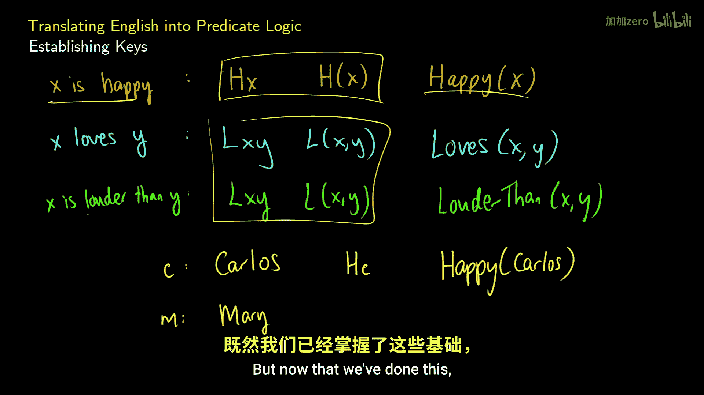
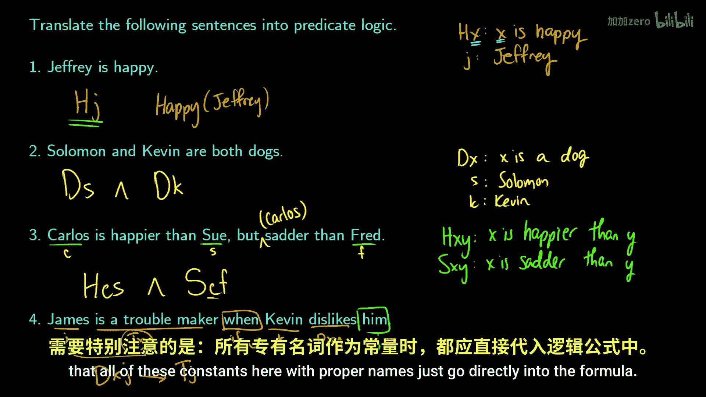
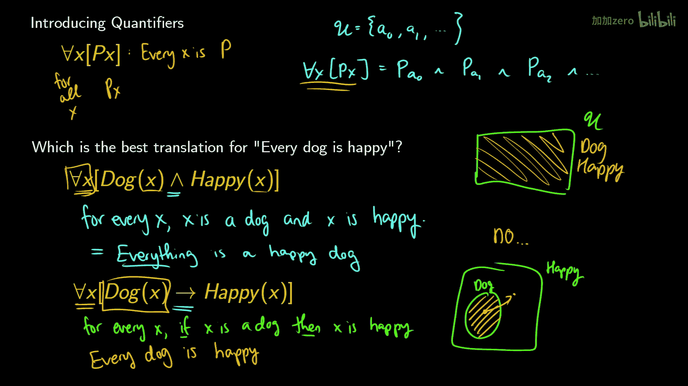
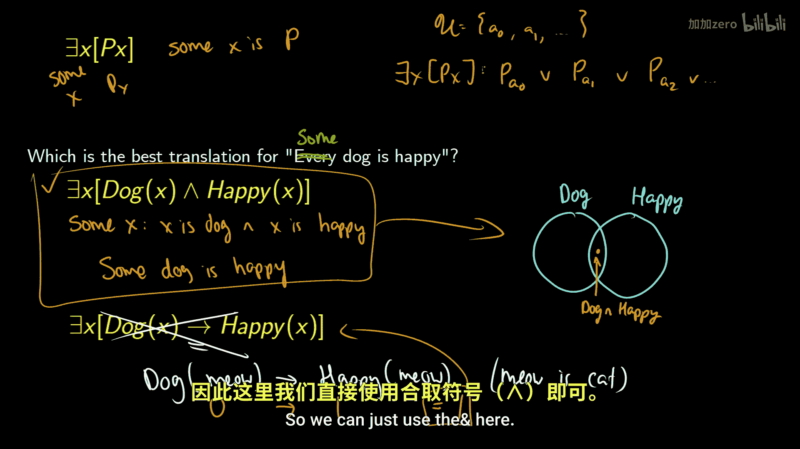
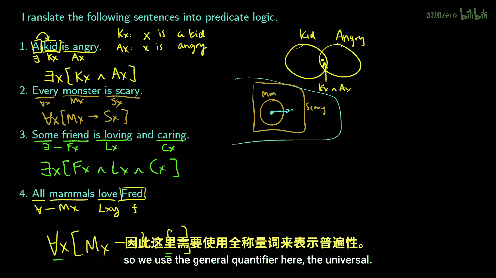
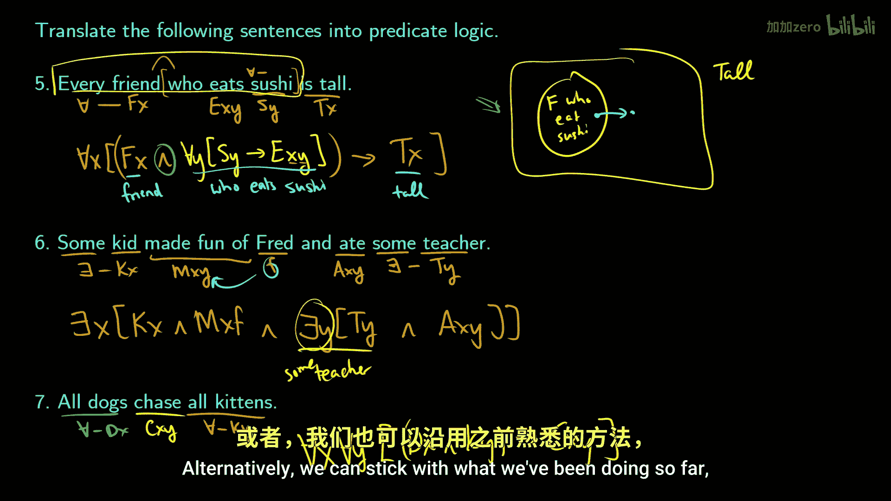
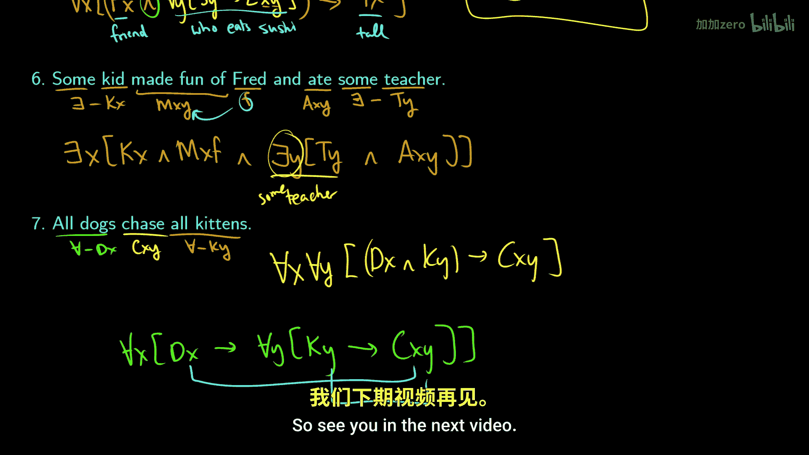

# 悉尼大学【中英⚡计算模型｜COMP2022 Models of Computation】 p21 P22 Translating ENGLISH into PREDICATE LOGIC -BV1vTe6zzENb_p21-

We're going to cover translating English into predicate logic when we talk about sentences with only Constance like Jeff and Fred。

 as well as how to do basic translations with all and some。

 the existential and universal quantifiers in another video we'll talk about how to do negated quantifiers like no and not all。

First， we need to talk about establishing keys。 Now。

 there are several ways that you can write a predicate logic formula。 For example。

 if I want to give a frame for a sentence like X is happy。

 there are really three ways that are commonly done。 The first one is to do something like H X。

 So this is what we've seen in other videos， you could also write H with the little brackets around it to say that。

 okay， there's only one argument here。 and it's clear that the predicate is separate from the term。

But you could also just write it out in English， something like happy X。

 and if you do something like this， you don't really have to establish what it means because we know it means x is happy compared to something like one of these two。

 where you very clearly have to write out that X is happy is what H X means。

So usually with predicates， this is how we do it。 Sometimes we have something called binary predicates or。

You can call these transitive verbs and linguistics。 So for example， if you want to say x loves Y。

 there are two things。In this predicate， X and Y， And there's a specific direction。

 So we could establish this to say L， X， Y， or we could use the notation where we separate X and Y with commas in the brackets。

 So we know very clearly what the arguments are， or we could just write this out in plain English loves with X and Y。

So pick whichever is your favorites， but I'm sure your course。

 if you take one out of university or college， they're going to have a very specific specific one that they want you to do。

But this is how we establish predicates For completion。

 we can also do a comparison like X is louder than。Y， and again， we might also choose， say L X。

 Y for this case， because louder starts with an L。 So it might be pretty obvious now why we need to define what our keys are for this case。

 But over on the right， if we do say a predicate， like louder then and write X， Y。

 it's very clear what this means。And the direction will always tell you。How x is related to Y？Okay。

So the last thing when we you define find keys are your constants since you don't know what the constants are for the same reason。

 So let's say you could write C as being Carlos。 So these would always be proper names or things in the world。

 and in this case， these are lowercase letters。 So maybe M is Mary。So if you wanted to write。

 say Carlos is happy。Then you could write H for happy and then little C to mean Carllos says happy。

 You're basically putting this constant into this variable here x。Now。

 you can see that if we choose one of the other notations。Like if you chose， say happy。

You could write just C in there， or you could just write Carlos's whole name。

 And now it's very clear what this means。 Carlos is happy。So again。

 I'll pick the notation that you want to use， but now that we've done this。

 let's see how we can just translate some basic sentences。

Into predicate logic。 So no quantifiers here， just with predicates and proper names。

Was something like Jeffrey is happy again， we could establish our keys and we could say， okay。

 lowercase J is Jeffrey。And we could also establish that H X could be X is happy。 Now。

 it's important that you put the variable there that tells us basically what we're substituting in。

 So whatever we put in this X is going to be in that frame， or X is happy。So for this one。

 Jeffrey is happy， this could just be HJ。And that would symbolize Gerey as happy。Alternatively。

 we could write this out in a more。AClear notation， happy defy。And this would mean the same thing。

 But from now on in the video， I am going to use this notation because this is what you see in most logic books。

Okay。Solomon and Kevin are both dogs。 This one's a little bit more complicated。

 We should establish something like D， X is X is a dog。 So we're assigning the property to something。

And then we have two names， S and K， though S would be Solomon and K would be Kevin。

So now we have to figure out how we can translate Solomon and Kevin are both dogs into predcate logic。

 So my recommendation here is to break this part into two little clauses。 So Solomon is a dog。

 and Kevin is a dog。So we have DS or Solomon as a dog， and we have DK or Kevin as a dog。

And this is a fine translation， at this point。Okay。3， Carlos is happier than Sue。

 but sadder than Fred。Okay， so here we have this framework where someone is compared to something else。

 and then that someone is， again， compared to something else。

Though we need like a happier then and a sadder then。So we could do H X， Y， the mean x is happier。

Then why？And we could do S X Y。The mean that x is Sader。Then why。

And then we're going to give lower case letters to these three names。

 And I'm just going to write them right underneath what's in the sentence for。Some speed。

 So Carlos can be C。 S can be Sue， and F can stand in for Fred。Okay。

 so we need to do two comparisons here。A one。Carloos is happier than Sue。

 So we happier then and who is happier than who will see is happier than us。 So H。 C。

 S would mean Carlos is happier than Sue。😊，But。Is an and and then sadder than Fred。

 He is sadder then。And sadder than Fred。 So we know that F is the second thing。

 But what goes in this position， Who is sadder than Fred， Well， Carlos is the one Sader than Fred。

 It's not directly in there， But we know that in the comparison， using English。

Carloos can be omitted from that position when we speak。

 So this really means Carlos is happier than Sue。 and Carlos is sadder than Bread。

So HCS and SCF would be good for this。Okay， James is a troublemaker when Kevin dislikes him， so。

In the sake of time again， we're going to abbreviate James as J is a troublemaker。

 so we're going to say this is Tx for x is a troublemaker。And then Kevin dislikes him。

 So Kevin will be K， and dislikes will be a pair。 D， X， Y。 We'll have two arguments， X and Y。Okay。

 now what is when？Well， remember when is equivalent to if and the thing after when is the antecedent。

So， first of all， we're going to have if D A， well， who is him， This is the question。

 Who is him when Kevin dislikes him， But we can assume from the context that him in this case is J。

So this will be if。Kevin dislikes James。Then James is a troublemaker。 So that would be T J。

 But again， we took our frame T X， and we put J into that X position to make James is a troublemaker。

Okay， so looking at these sort of translations is important and I want you to remember that all of these constants here with proper names just go directly into the formula。

At this point we're going to switch over to quantifiers， so this is the first one we'll look at。

 and this is the for all X， So this says for all X px。

 which basically means every X is P and whatever P is is just a property。

So I want you to think about this。Is if we have a universe。

 let's say there's a bunch of objects in there。 We're just going to call them a 0， a 1 and so on。

 So these can be people。 These can be objects。 These can be whatever。When we say。For all X， Px。

What we're really saying for its truth。Is that。呃。P with a 0 in it is true and P with a 1 in it is true。

 and P with a 2 in it is true and so on。 So this。Universal quantifier is running through everything in the universe and assigning at that property。

If we say for all X Px。So let's think about this in terms of English translation。

So if we want to say something like every dog is happy。

 and you can see here I'm using full prediccateates。 so that way。

 I don't have to define keys and we can really think about the content。For every dog is happy。

 should we be saying for all X， dog X and happy X， or we should be saying for all X， dog X。

 then happy X。😊，But we have to think about this first one。 What is this first one actually saying。

 This is saying。In English， well， if we take the predicate logic and translate it into an English equivalent。

 what will simplify this further into natural English， we could say for every X， X is a dog。And。

X is happy。But what is this saying about everything in the universe。

 Is this talking about only dogs or is this assigning the property of dog and happiness to literally everything out there。

It's assigning it to literally everything in our universe。

 This is basically saying that everything in our universe。Everything is a happy dog。

Or is a dog and is happy， because this isn't putting a restriction on what we're talking about。

 We're just saying for all X out there， X is a dog， and X is happy。有。

This is not the translation that we want。 So I'm going to put a little no here， because it's。

Not the best translation。But what are we doing here for all X。Though we can say for every X if。

X is a dog。Then。X is happy。So I want to think about sets for just a second here。

 Let's say we have a bunch of dogs。If we say every dog is happy。

 what we're really saying is that all of these dogs should be in the set of things that are happy。

 So what this translation says is， okay， if we have something in this set dog， then， of course。

 it's also going to be in the set of things that are happy。

 So this is a much better translation of every dog is happy because what we're doing is we're restricting what we're talking about to just dogs。

😊，So for every X， we want to restrict what we're talking about first。 So if X is a dog。

 then X is happy， means that every dog is happy because all of the dogs in this set must be in the larger set of things that are happy compared to what we're saying up top here with dog X and happy X。

 which basically what we're saying is that in the universe。Everything in here。

Happens to be a dog and happens to be happy。 But basically。

 the universe is equivalent to the dog set and the happy set， which isn't really what we want。

Okay， so now let's do the same thing for the existential and figure out what this means。

So this is sum X Px。 So this would be saying that some X。Is Pete。So again。

 if we have a universe of objects， let's say this is a 0 and a1 and so on。

 Who knows what those objects are When we say exists in X， E X。

 What we're really saying is that either a 0 is P or A1 is P or A2 is P and so on。

Because we just have to have at least one of those having the property of peak。So in this one。

 and we're not going to be translating every dog is happy。

 we're going to be translating some dog is happy。 okay。Let's think about this in sets first， why not？

So when we say some dog is happy。What we're really just saying is that there's something in the intersection of these two sets dog and happy。

 There's at least one thing in there that is both a dog and happy。

So if we take a look at exist in X dog X and happyapp X， or exist in X if dog X then happy X。

 which one is best going to represent what we're looking for in the diagram to the right？Well。

 the first one。There is some dog X， and X is happy。So。

This is not establishing something for everything。 We're just saying there's some X in our universe where X is a dog。

And。X is happy。Okay， so this is really just saying that some dog。Is happy。Alternatively。

 you can think of this as something is a dog and is happy， which is the same in English。

So this with the arrow is not what we want to use。 And for true value reasons。

 it is something that we don't want to use。 and that' will be covered in a later video。

 But essentially the cliff notes of it is that let's say we have something like dog and we have。

I don't know。 Let's name a cat Miow。 And then we say happy。Miao， so呃。Now is cat。Okay。

 so what's going to happen here if we put a cat into this equation。 Well， basically。

 we're going to get Miaow is not a dog。 It doesn't matter if Mio is happy or not。

 But remember with the conditional， if we have 0 arrow 1， it comes out to true。

 So if there was no happy dog。We would still get a situation where the formula is true。

As the clip notes of it， that'll be explained in a later video。

 But that is why we do not use the arrow， And that is why we use the ant。

 So the simple way you can understand it is trying to get this picture。 Some dog is happy。

 There's something that is both a dog and happy so we can just use the andt here。

So let's do some practice。 I have two slides of practice questions。 If you can beat me to it。

 that's great。So I'm not going to use the long form predcateates。

 I'm just going to use short form here。Let's say is angry is going to be A X for angry。

And when we say kid， this is a property of something。

 so something is a kid that we can say Kx X is a kid， so I'll write this out for the first one。O。

 X is X is a kid。And A X is going to be X is angry。Now。

 the quantifier is the same thing as the existential。

 and it's going to be the same variable as whatever is coming after it。 Some kid。

 So we can say there exists in X， such that X is a kid， K， X and X is angry。

So we don't know who this is， that's why there's no constants there。

 but we can say there's some kid out there and that kid is angry。So， there's at least one kid。

That is angry。 So there's something in this intersection here， which， of course。

 is the Kx and AX intersection。Okay， let's say the next one。 every monster is scary。

 so monster will be M X， is scary， will be Sx， and every will use for all X。

So we're going to say for all X。 And because we're talking about every something is something else。

 we'll use the arrow here。 So for all X， if x is a monster， then x is scary。 And again。

 for this picture。We want all of the monsters to be in a larger set of scary things。

But we also want to know that there's other things in the universe。 So basically， we're saying。

 if something is a monster， then it's scary。Get rid of these two。But get rid of the。

Little lines here。Just so that way， they're not too obnoxious。Okay。

 now we're going to do a compound sentence。 So a little bit more involved here。

 Some friend is loving and caring。 So we're going to say that。X is loving as L X。

 X is caring is going to be C X。 and we have some friend。 So we're going to say friend is Fx。

Property of being a friend。 and some will be the existential that takes the same variable as friend。

So we're going to say there exists in x such that x is a friend and x is loving and X is caring。

I was fairly straightforward。 We just chain all of the properties together。Now， this last one。

A little bit different。So we have mammals。 So X is a mammal。 We have love。

 which is a transitive verb， which means there's two arguments here， L， X， Y。

All is going to be the universal that takes the same quantifier takes the same variable as mammals。

And what about Fred？Remember， we don't want the property of being a Fred because Fred is a constant。

 We want to use that letter F。So we can use this the same way as before， though for all x。If。

X is a mammal。Then。X loves bread。So we know specifically who's being loved here。

 so we can just put the。Constant right in there。With all mammals。

 we don't know specifically which mammals we're talking about。 So we use the general quantifier here。

 the universal。

Okay， let's do two more that are a little bit more complicated。 And actually， we have a。

A seventh one at the bottom。 So there were three more。And this is more complicated。

Every friend who eats sushi。Is tall。Okay， this is a very complicated sentence。Because we have。

Someone eating sushi， a friend who's eating sushi。 So this is F X and all is going to take that quantifier。

嗯。Who eats sushi。So here's Es。 X is going to eat Y， whatever X and Y are as a frame。

 Sushi is going to be Sushi X。But there's also another quantifier attached to it。

 There's like this hidden for all。 You can say who eats all sushi。Not just some sushi。

 This it just a standard whenever we see a noun on its own。 Typ， we think that implies for all。

But we already have an X being used。So actually， what I'm going to do is I'm going to pick why here for sushi just so I know it's different。

And then is tall。So that could be Tx for x is tall。Okay， so this is a little bit difficult。

So let's say were all X。If X is a friend。And。Okay， so why are we doing an and here？

Mean to say every friend who eats sushi。 So this is sort of a unit。

 This is what we're limiting in our diagram here。 So this is the set of all tall people。

 And these are friends。ho eat。Uhi。So I need to say that if someone is in this set。

Then they're going to be in the tall set。So for all x， if x is a friend。And。

Let's just introduce something。Or who eats sushi。 So we have to talk about the sushi。 We have to say。

 for oh， why。If why is sushi。Then。X eats y。So we know who X is， X is the friend。 Y is the sushi。

 So this is how we're figuring out who x and Y are， as we've established them before。

So if you have a friend who eats all of the sushi。Then。That friend is tall。Okay。

 so then we can just say x is top on that case。So this one is a little bit more complicated because we have to essentially modify the friend that we're talking about。

 We're saying that we have a friend。 So this is the friend part。

And this part inside is basically who eats sushi。 So we're saying there's sushi out there。

 And that friend X eats sushi。 And then we give him the property of saying that friend is tall。

So a little bit more complicated。 But this is how you deal with words like every friend who does blank or everything that does blank。

 We just put them together with the and。In little restriction here。 So if everything on the left。

 then on the right， in order to get this beautiful picture that we have。Okay。

6 is going to be a little bit simpler， comparatively。So we'll say some kid。So x is a kid。

 we're going to use the existential with that。Made fun of some else。

 So we can say X made fun of Y with M X， Y。 Fred is going to be lowercase F。And8， okay。

 we can do a X， Y for x8， y。And then， for some teacher。Well， teacher will be T。

And some will be the existential， but they're going to be different variables in this case。

 so we're going to use Y for teacher because we're using X for kid。Okay。

So some kid made fun of Fred and ate some teacher。 So there is some X such that X is a kid and X made fun of Fred。

 So we can put Fred directly into who is being made fun of in the Y position。

And we want to say that kid ate some teacher。So， and there was some why， that' that why is a teacher。

 So now what we're doing is we're establishing the fact that there is。Some teacher out there。And。

X 8 y。 So A X Y， because x is the student。 Y is the teacher。

 and we know that the student ate the teacher。Though a little bit more straightforward。 Again。

 we're introducing something else in here。 But the exists of why， but we need it to say some teacher。

Finally， all dogs chase all kittens。So we have all dogs。

 so we're going to use all and then D X here or all kittens。 Let's use for all。

 and let's do K Y here。 Let's use Y for kittens， and then Chase is going to be C， X， Y。Now。

 why I'm putting this exercise in here is to show you that sometimes if the formula is very simple。

 we can just do for all X all y out front。So for all X， for all Y， if X is a dog and。Y is a kitten。

 then X chases Y。 So that would be a fine translation。Alternatively。

 we can stick with what we've been doing so far。 something that's familiar for us。

 and we could just do it piece by piece。 We could say， okay， for all X， if X is a dog。

 then for all Y， if Y is a kitten， I should be using K for this。

Then。We're going to have that X chases y， because X is the dog， and y is the cat as we've。

Established here。Okay， so this is it for translating English sentences into predicate logic。

 the basic edition without quantifiers like no and not all if you have any questions。

 I'm sure someone below will be able to comment or maybe I will so。

See you in the next video。