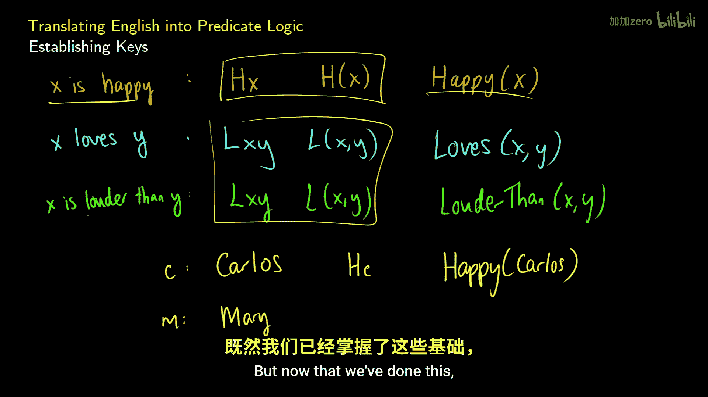
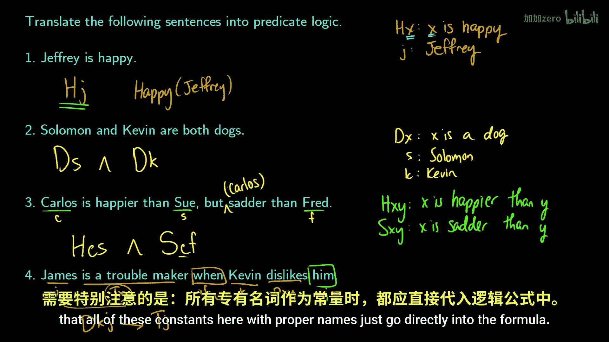
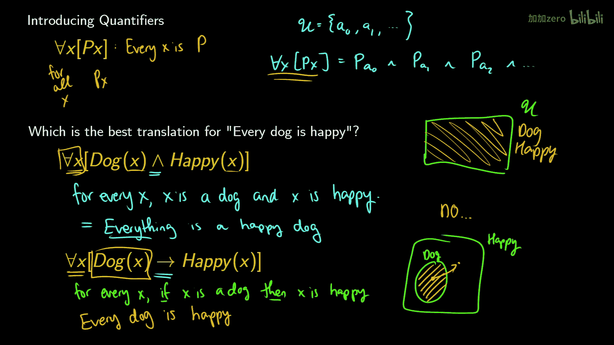
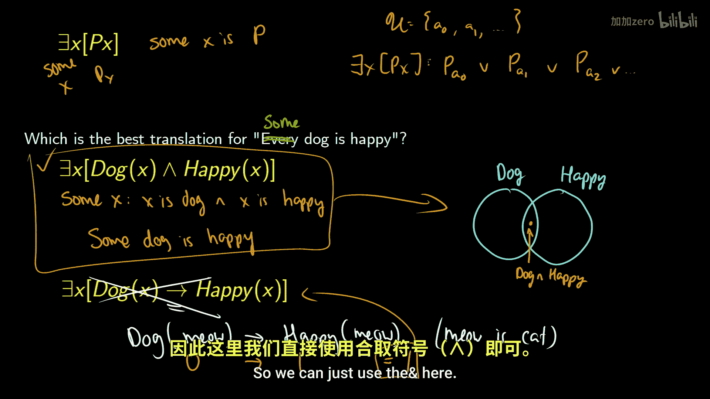
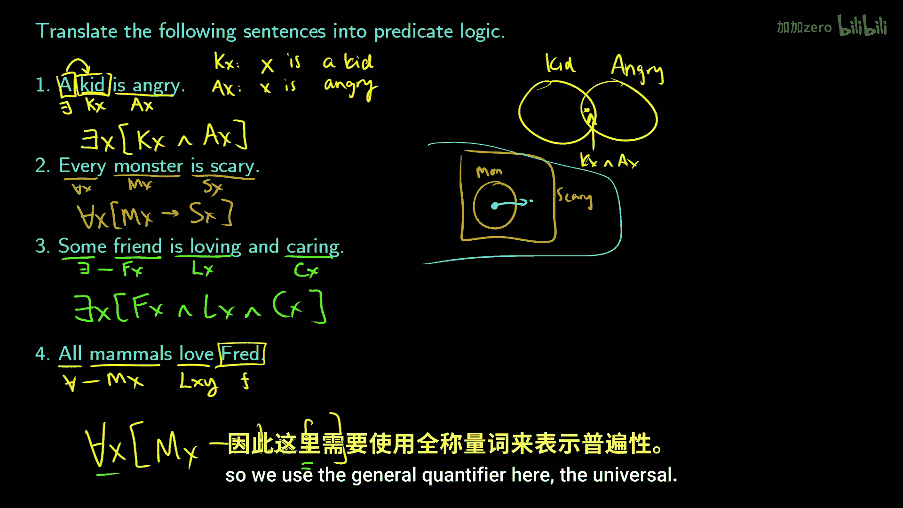
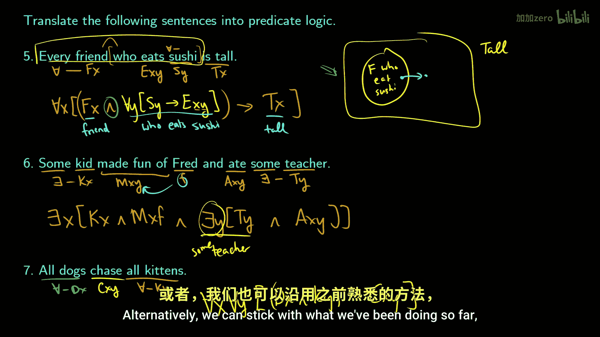

# 计算模型：第21-22讲：将英语翻译为谓词逻辑 🔍

在本节课中，我们将学习如何将英语句子翻译成谓词逻辑。我们将从只涉及常量的句子（如“Jeff”和“Fred”）开始，然后学习如何使用“所有”和“一些”这类量词进行基本翻译。在另一个视频中，我们将讨论如何处理像“没有”和“并非所有”这样的否定量词。

## 建立符号对应关系 🔑

首先，我们需要讨论如何建立符号对应关系。书写谓词逻辑公式有几种方式。例如，如果我想为“X is happy”这样的句子建立一个框架，通常有三种常见做法。

以下是几种表示“X is happy”的方式：
*   **H(x)**：这是我们在其他视频中见过的形式。
*   **H(x)**：你也可以用括号将参数括起来，以明确谓词与项是分开的。
*   **happy(x)**：或者直接用英语写出，例如 `happy(x)`。

如果你使用像 `happy(x)` 这样的写法，你不需要特别说明它的含义，因为我们知道它表示“x是快乐的”。相比之下，前两种写法则需要明确写出 `H(x)` 表示“x是快乐的”。

通常，我们就是这样处理谓词的。有时我们会有所谓的二元谓词，或者在语言学中称为及物动词。例如，如果你想表达“x爱y”，这个谓词涉及两个事物：x和y，并且有特定的方向。

以下是几种表示“x爱y”的方式：
*   **L(x, y)**：我们可以这样建立对应关系。
*   **L(x, y)**：或者使用括号内用逗号分隔x和y的记法。
*   **loves(x, y)**：或者直接用英语写出 `loves(x, y)`。

选择你最喜欢的记法，但如果你在大学里学习相关课程，他们可能会要求你使用一种非常特定的记法。这就是我们建立谓词对应关系的方法。

为了完整起见，我们还可以处理比较关系，比如“x比y声音大”。同样，我们也可以选择 `L(x, y)` 来表示这种情况，因为“louder”以L开头。这就是为什么我们需要为这种情况定义符号对应关系的原因。但如果我们写成 `louder_than(x, y)`，它的含义就非常清晰了，方向总是告诉你x如何与y相关。

最后，在定义符号时，还需要定义常量，原因相同。例如，你可以用 `c` 代表Carlos。这些通常是专有名词或世界中的事物，并且用小写字母表示。例如，`m` 可以代表Mary。

如果你想表达“Carlos是快乐的”，你可以写 `H(c)`，意思是“Carlos是快乐的”。你基本上是把常量 `c` 放到了变量 `x` 的位置上。如果你选择其他记法，比如 `happy(c)`，或者直接写上Carlos的全名，含义同样清晰。再次强调，选择你想使用的记法。

现在我们已经完成了符号对应关系的建立，接下来看看如何翻译一些基本句子。

## 翻译不含量词的基本句子 📝

上一节我们介绍了如何建立符号对应关系，本节中我们来看看如何翻译只包含谓词和专有名词、不含量词的句子。

以下是几个翻译示例：
*   **Jeffrey是快乐的**：我们可以建立符号：`j` 代表Jeffrey，`H(x)` 代表“x是快乐的”。那么翻译就是 `H(j)`。或者，我们可以写成更清晰的记法 `happy(j)`。从现在开始，视频中将使用 `H(j)` 这种记法，因为这是大多数逻辑书中常见的。
*   **Solomon和Kevin都是狗**：这稍微复杂一些。我们建立：`D(x)` 代表“x是狗”，`s` 代表Solomon，`k` 代表Kevin。我的建议是将这个句子分解为两个小句：“Solomon是狗”和“Kevin是狗”。所以翻译是 `D(s) ∧ D(k)`。
*   **Carlos比Sue快乐，但比Fred悲伤**：这里我们需要“比…快乐”和“比…悲伤”的比较关系。我们建立：`H(x, y)` 代表“x比y快乐”，`S(x, y)` 代表“x比y悲伤”。常量：`c` 代表Carlos，`s` 代表Sue，`f` 代表Fred。这个句子包含两个比较：“Carlos比Sue快乐”和“Carlos比Fred悲伤”。所以翻译是 `H(c, s) ∧ S(c, f)`。
*   **当Kevin不喜欢James时，James是个捣蛋鬼**：我们建立：`T(x)` 代表“x是捣蛋鬼”，`D(x, y)` 代表“x不喜欢y”，`j` 代表James，`k` 代表Kevin。“当…时”等同于“如果…那么…”，并且“当”后面的部分是条件。所以翻译是 `D(k, j) → T(j)`。

记住，所有这些专有名词常量都直接代入公式中相应的变量位置。

## 理解全称量词 ∀ 🌐

上一节我们处理了不含量词的句子，本节中我们来看看如何使用量词。首先看全称量词 `∀`。

`∀x P(x)` 基本上意味着“每个x都具有属性P”。我们可以这样理解：假设我们有一个包含许多对象（如a0, a1, a2…）的论域。当我们说 `∀x P(x)` 为真时，我们实际上是在说 `P(a0)` 为真，`P(a1)` 为真，`P(a2)` 为真，依此类推。这个全称量词遍历论域中的每个对象，并赋予其属性P。

现在，让我们思考如何将英语句子“每只狗都是快乐的”翻译成谓词逻辑。我们有两种可能的翻译：
1.  `∀x (dog(x) ∧ happy(x))`
2.  `∀x (dog(x) → happy(x))`

我们需要分析第一个翻译的含义。它用英语等价地说：“对于每个x，x是狗并且x是快乐的”。这意味着它对我们论域中的**所有事物**都赋予了“是狗”和“是快乐的”这两个属性。这基本上是在说宇宙中的一切都是快乐的狗。**这不是我们想要的翻译**。

第二个翻译 `∀x (dog(x) → happy(x))` 则说：“对于每个x，如果x是狗，那么x是快乐的”。这更好地表达了“每只狗都是快乐的”，因为它将我们讨论的范围限制在狗这个集合内。它意味着所有在“狗”这个集合中的事物，也必须在“快乐的”这个更大的集合中。这才是我们想要的翻译。

## 理解存在量词 ∃ 🔍

理解了全称量词后，我们来看看存在量词 `∃`。

`∃x P(x)` 意味着“存在某个x具有属性P”。同样，考虑一个包含对象a0, a1, a2…的论域。当我们说 `∃x P(x)` 时，我们是在说 `P(a0)` 为真，**或** `P(a1)` 为真，**或** `P(a2)` 为真，等等。我们只需要至少有一个对象具有属性P。

现在，翻译“有些狗是快乐的”。我们有两种可能：
1.  `∃x (dog(x) ∧ happy(x))`
2.  `∃x (dog(x) → happy(x))`

从集合的角度思考，“有些狗是快乐的”意味着在“狗”和“快乐的”这两个集合的交集中至少有一个事物。第一个翻译 `∃x (dog(x) ∧ happy(x))` 直接表达了这一点：“存在某个x，x是狗并且x是快乐的”。这等同于“有些狗是快乐的”。

第二个翻译使用蕴含符号 `→` 是不合适的。简单来说，如果有一个不是狗的事物（比如一只猫），无论它是否快乐，条件句 `dog(猫) → happy(猫)` 都可能为真（因为前件假时，条件句为真）。这意味着即使没有快乐的狗，整个公式也可能为真，这违背了原句的含义。因此，我们使用合取符号 `∧` 来表示存在量词下的属性组合。

## 翻译练习（含量词）✏️

现在让我们做一些翻译练习来巩固理解。以下是几个例子：

*   **有些孩子是生气的**：
    *   符号：`K(x)`：x是孩子；`A(x)`：x是生气的。
    *   翻译：`∃x (K(x) ∧ A(x))`

*   **每个怪物都是可怕的**：
    *   符号：`M(x)`：x是怪物；`S(x)`：x是可怕的。
    *   翻译：`∀x (M(x) → S(x))`

*   **有些朋友是充满爱心和关怀的**：
    *   符号：`F(x)`：x是朋友；`L(x)`：x有爱心；`C(x)`：x有关怀心。
    *   翻译：`∃x (F(x) ∧ L(x) ∧ C(x))`

*   **所有哺乳动物都爱Fred**：
    *   符号：`M(x)`：x是哺乳动物；`L(x, y)`：x爱y；`f`：Fred（常量）。
    *   翻译：`∀x (M(x) → L(x, f))`

## 处理更复杂的句子 🧩

上一节的练习相对简单，本节我们来看一些更复杂的句子。

*   **每个吃寿司的朋友都很高**：
    *   符号：`F(x)`：x是朋友；`E(x, y)`：x吃y；`Sushi(y)`：y是寿司；`T(x)`：x很高。
    *   分析：“每个吃寿司的朋友”是一个整体，作为条件的前件。我们需要表达：对于所有x，如果x是朋友**并且**x吃所有寿司，那么x很高。“吃所有寿司”需要另一个全称量词。
    *   翻译：`∀x [ (F(x) ∧ ∀y (Sushi(y) → E(x, y))) → T(x) ]`

*   **有个孩子取笑了Fred并吃了一位老师**：
    *   符号：`K(x)`：x是孩子；`M(x, y)`：x取笑y；`A(x, y)`：x吃y；`f`：Fred；`T(y)`：y是老师。
    *   分析：存在某个x（孩子），他做了两件事：取笑了Fred（常量f），并且吃了某位老师（存在某个y是老师）。
    *   翻译：`∃x [ K(x) ∧ M(x, f) ∧ ∃y (T(y) ∧ A(x, y)) ]`

*   **所有的狗都追逐所有的小猫**：
    *   符号：`D(x)`：x是狗；`K(y)`：y是小猫；`C(x, y)`：x追逐y。
    *   翻译（简洁版）：`∀x ∀y [ (D(x) ∧ K(y)) → C(x, y) ]`
    *   翻译（分步版）：`∀x [ D(x) → ∀y (K(y) → C(x, y)) ]`

## 总结 📚

本节课中，我们一起学习了将英语句子翻译成谓词逻辑的基本方法。我们首先学习了如何为谓词和常量建立符号对应关系。然后，我们深入探讨了全称量词 `∀` 和存在量词 `∃` 的核心用法：**全称量词通常与蕴含符号 `→` 搭配使用**，以限制讨论范围；**存在量词通常与合取符号 `∧` 搭配使用**，以声明某个对象同时具有多个属性。最后，我们通过一系列从简单到复杂的练习，巩固了这些翻译技巧。记住，在处理复杂句子时，仔细分析句子结构，并逐步引入量词和逻辑连接符是关键。在接下来的视频中，我们将学习如何处理包含“没有”和“并非所有”等否定量词的句子。