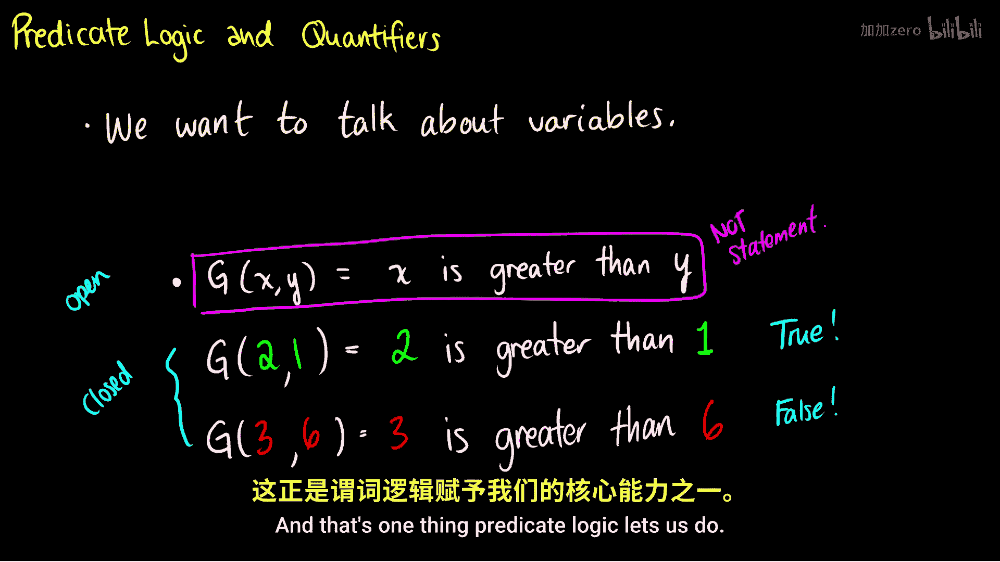
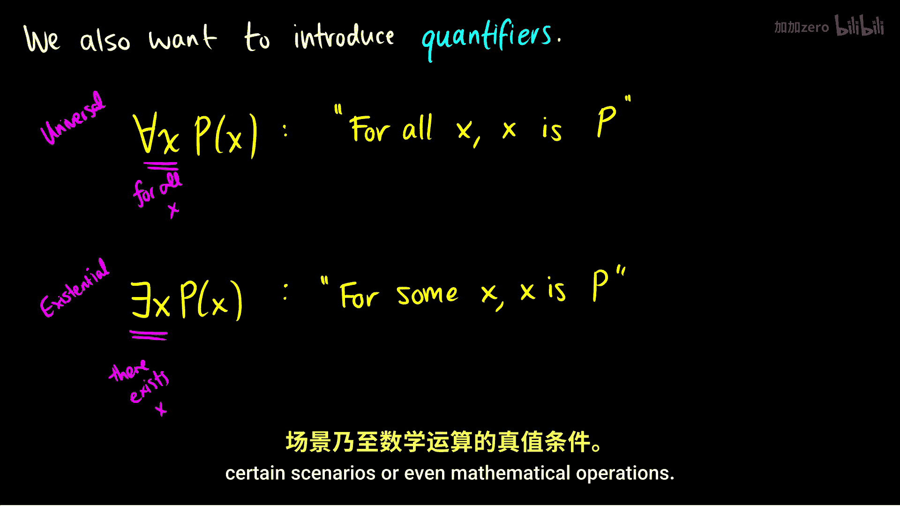
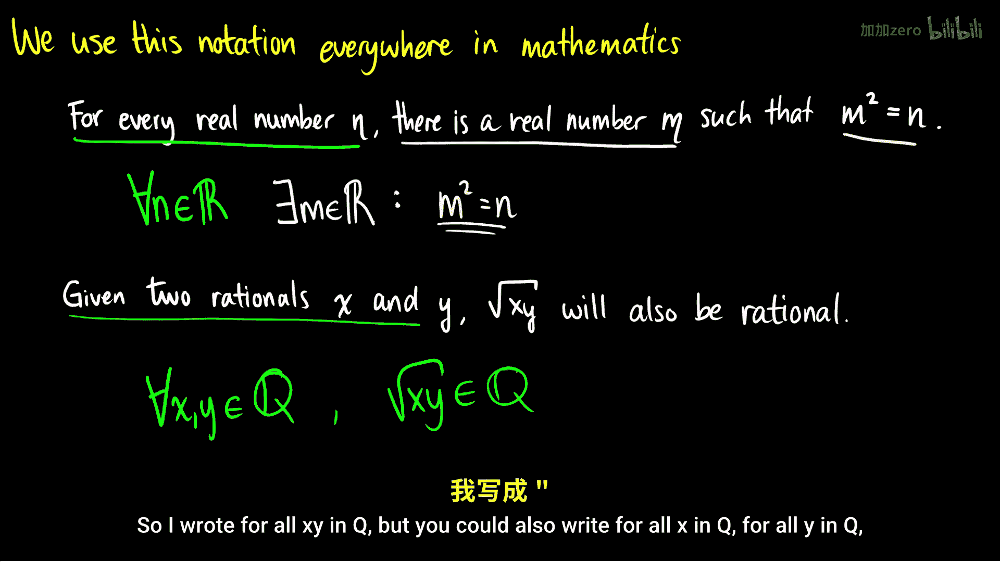
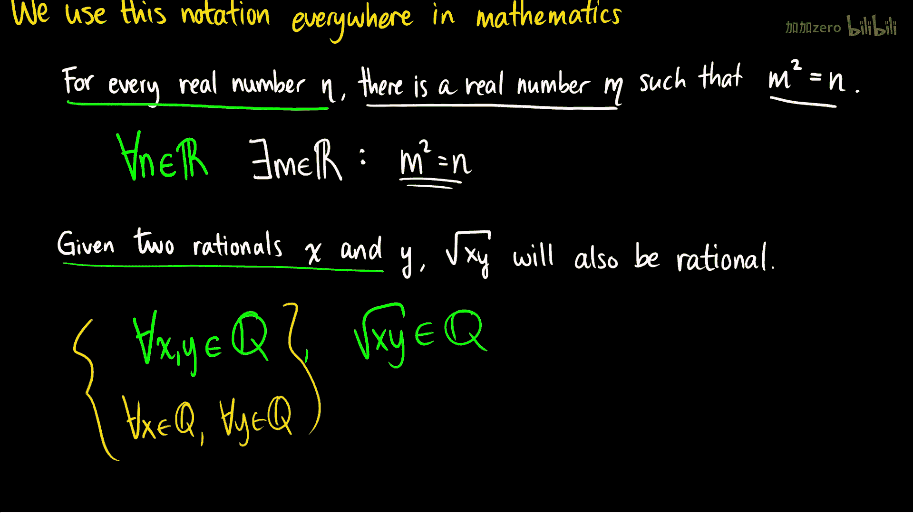
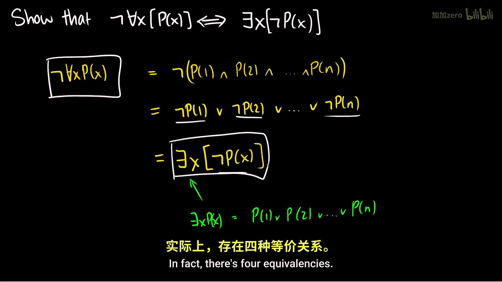
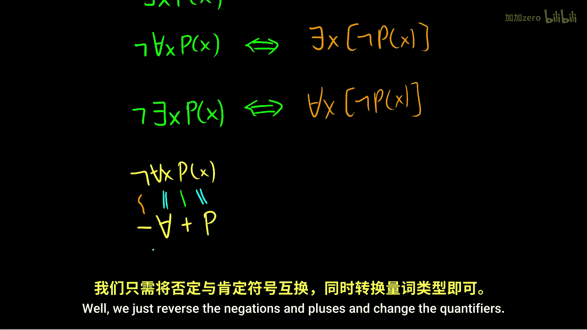
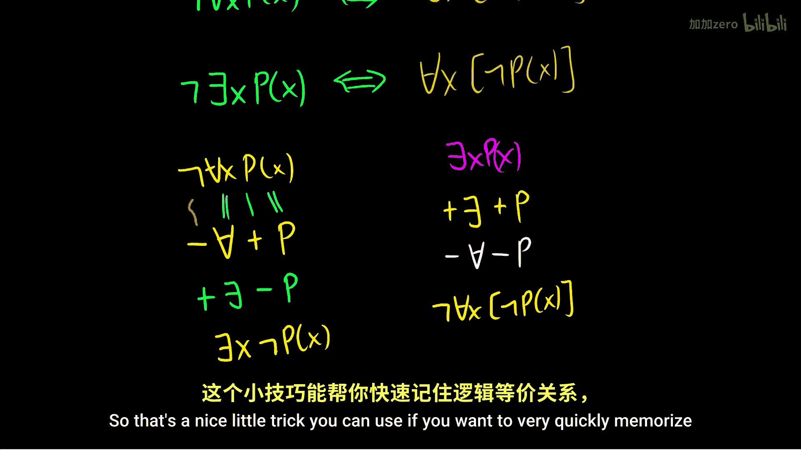
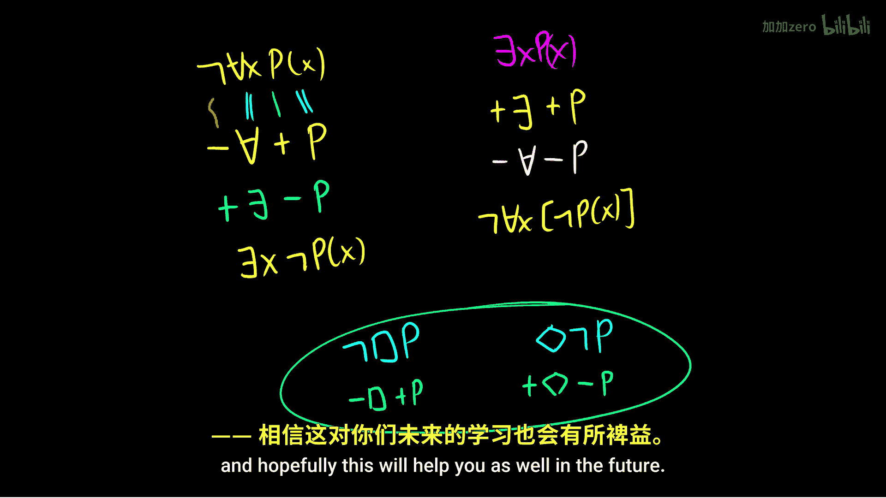
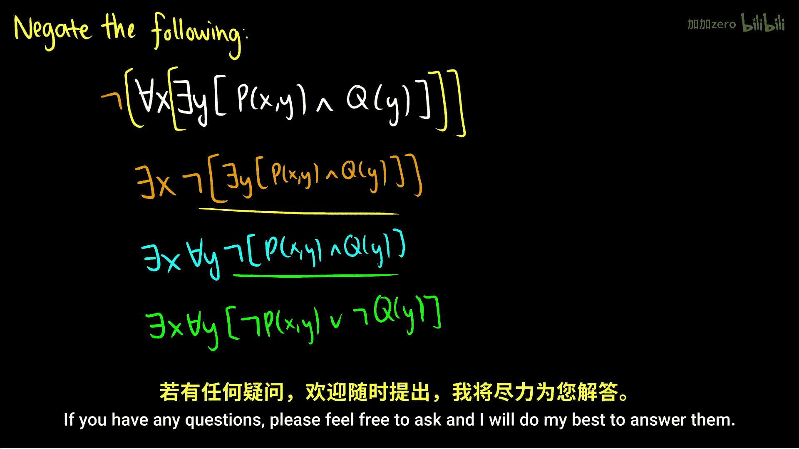

# 悉尼大学【中英⚡计算模型｜COMP2022 Models of Computation】 p22 P23 PREDICATE LOGIC and QUANTIFIER NEGATION - DISCRETE MATHEMATICS -BV1vTe6zzENb_p22-

In this video， we'll talk about predicate logic， quantifiers and negation。

So what is practical logic for， Well， we want to talk about variables。

 So before we couldn't have a statement like X is even。And then just plug something in for X。

 that wasn't possible in propositional logic。 but in predicate logic。

 it's now possible because our predicates also have terms， so a predicate looks like E X。

And this is the。Tposition or predicate X is even。Another example would be a two place predicate GxY。

 which could mean something like x is greater than y， and these are variables。Though we can stick in。

These constants as well。 So G21。If we just ignore this X is even thing here， if we have G， X， Y。

 X is greater than y， if we plug 2 and one in， that says that  two is greater than one。

 And this has a truth value。 So this statement is true。

But if we put three and 6 in there for three is greater than 6， then this predicate is false。Now。

 what's different between these closed。Formulas。And this。Open formula。 Well。

 closed formulas have truth values and open formulas do not have truth values。 Therefore， this G X。

 Y。Is not。A statement， which means we can't even have it in propositional logic at all。

 We need predicate logic in order to say something like G， X， Y， X is greater than y。

 and assign truth values to constants plugged into those variables。

And that's one thing predicate logic lets us do。

But the more important thing it does is it gives us quantifiers。

And this is the upside down a and the backwards E。 So the upside down a is known as the universal quantifier。

And for all X， Px。Its kind of red is for all X。 So this is for all X。And then px。

 so this could be for all x， x is p for all X， x is happy， something like that。Now， the backwards E。

Is known as the existential quantifier。Now this says there exists at least1 x。So we could say。

There exists。X。Or another way to say it is for some x。

 so exists x Px could be read as for some x x is p， or there exists in x such that x is p。

So there is some X such that X is happy。And quantifiers。

Really give us much more strength when translating sentences into English as well as looking at truth conditions for certain English sentences。

 certain scenarios， or even mathematical operations。

So we use this notation everywhere in mathematics， so I'm going to convert some English sentences with some mathematical statements into predicate logic。

And we're going to take it step by step。So the first step。I'll read it out for every real number N。

 there is a real number M such that M squared is equal to n。

Let's not focus on the proof for whether it's true， let's just translate this into predicate logic。

So for every real number N。For every number， this is the universal。So we're going to have for all N。

And these are real numbers。 So for all n in the set of real numbers。 So again。

 for all n in real numbers， shall'll remember this from set theory。There is a real number M。

So there is a real number M。 There is at least one。 So that's the existential。

 So there exists an M in the realels such that。And then M squared is equal to n。

 We can just leave this the same thing so we can say m squared is equal to n。Or。We could say。PM N。

 And then we could define that being M squared is equal to n。Either way it works。

 typically we would just write m squared equals n afterwards。So for all。Real numbers N。

 there is a real number M such that M squared is equal to n。Let's take a look at the second one。

Given to rationals X and Y， the square root of X， Y will also be rational。Now， this doesn't。

Look like there's any universals here， does it？But there really is one here in disguise。

 So given two rationals， X and Y。What this says is given any to rational numbers。 So this is for all。

X， Y in the set of rational numbers， which is the Q there。

The square root of xy will also be rational， so we can just say then the square root of xy is also in Q。

So this is another way of abbreviating things。 So I wrote for all x y in Q。

 but you could also write for all x in Q for all y in Q。

Either way， they're both。Exactly the same thing。One is shorter than the other。

 but there's no difference。Wen't they have the same quantifier。So that's translating。

Some mathematical statements。In to predicate logic。

And it's important to be able to go both ways to be able to translate it into creditcate logic and to be able to read it and understand it。

But。Let's talk about negating quantifiers since this is usually the tricky part。

 and I really wanted to find for all XPX and their existence in XPX。

In terms of propositional logic in a way。So we can kind of see how negation really looks like。

Under the surface， so in the deep structure what's happening？

So I'm going to have a universe with elements 1，2 all the way up to n。So for all X px。

When is this true， This is true if every X in the universe is P。 So this is like saying。

P1 and P2 and all the way up to PN。 So if all of those are true， then all X P X is true。

What about their existence in X PX？Well， that's saying at least one is true。

 So this is like saying P1 or。P2 or all the way up to PN。

So that's really what all X px and exists X PX means。Now when we negate these。

We'll be able to see how negation works using these definitions。So let's show that not for all XpX。

Is logically equivalent to exist X， not px。So first， I want to start out with all X Px。

 and I want to write the definition again。So this is like saying P1 and P2 and all the way up。2 PM。

Now， if we negate this。Then we're really negating this whole thing here。And with the Morgans law。

 we can distribute that negation。So this is like not P1。Or not P2， or dot， dot， dot。

All the way up to not PN。Now， what does this look like？Well。

 this kind of looks like there exists in X。Except instead of just having Px， we have。Not Px。Because。

 remember。The definition of existent X。So exists in X， px。Is just。Piwen。Or P2 or all the way up。

To PM。Now， these look very similar， except there's just negation in run of each term。

 which is why we have the negation in here， so not for all X Px is the same thing as there exists in X not Px。

Let's think about this in English。Not all dogs are brown。

That means there is some dog that is not brown。So all dogs are not brown。

Means that there is some dog that isn't brown。So that's a nice English way we can talk about the logical equivalence between the negation of these universals and existentials。

In fact， there's four equivalencies， I just did one and I encourage you to do the rest on your own。

But we can see that all X， P X is the same thing as not exists in X。Not Px。

Exist in X PX would be the same thing as not for all X。Not P， X。 And again， using the definitions。

 we can show these。 So I encourage you on your own to try with the definitions。

 showing that these are true。Not all XpX， we just did this one。

 this is the same thing as exististent x。Not Px。And finally not exist X px would be the same thing as for all X。

 not px。And you might be wondering。Do I have a sheet on me that tells me these equivalencies？

That I memorize these， or is there some trick for this。Well， there is kind of a trick here。And。

Let's think of for all X。 Actually let's think of。The one that we did for not all X。PX。

I'm going to rewrite this as not。Oh。Plus， P。So。Ofourse， the px I've reduced the P。

 the all X I've reduced to all the negation。I have written as a minus。

And the fact that there's no negation there， I wrote is a plus。

So how do we get the logical equivalence？Well， we just reverse the negations and pluses and change the quantifiers。

 So if we were to write this， not all plus P as plus exist minus P。

Then we can translate this back。2。Exists in x because the plus just means notation。Not。Px。

And these are logically equivalent。 Let's do the other one。

 so let's find a logical equivalent to exist in X Px。Okay first， let's rewrite that。

So that is plus exists plus P。Let's flip。The pluses to minuses。

 let's change the x essential to a universal and put a P there。And then if we rewrite this。

 this will be not for all X。Not。PX， which is indeed logically equivalent if we write out the definitions which you can check for yourself。

So that's a nice little trick you can use if you want to very quickly memorize logical equivalencies if you ever get to modal logic in the future。

You'll find that if you have something like not box P is the same thing as diamond not P。Which。

 of course， what is box and diamond， Who knows Now， you'll find out when you get some mod logic。

 But this is the same thing， not box plus P。Would just go to plus diamond minus P。

Flipping a box to a diamond and flipping the positives and negatives。

 these are also connected as well。 So these abstract connections。

Which are something that you find later in your logic here。

 I'm kind of throwing you at it right now so you can kind of see in advance what's coming and hopefully this will help you as well in the future。

Finally。Let's negate something a little bit more complicated using the rules that we just discussed。

So you might want to pause the video， work some of this stuff out。

 verify that all those equivalencies are the same。And then take a look at this。

So let's negate this entire thing。Okay， so we negate quantifier by quantifier。

So we can kind of think。Of these of having more brackets。So we can think of the brackets like this。

 So the first thing we want to do is negate not all X。 and then there's this nonsense。Right there。

So not all X blah。Is the same thing as their exist in x。Not。And then the remainder of the inside。

 so there would be X a y。P， X， Y and Q， Y。Okay。Now we need to negate。Not exist。 why。

And then the rest inside。So we can leave the existent x on the outside now togate or to negate。

 not exists y。That just becomes all why。And then we get the negation of everything on the inside。

 So P X， Y。And Q Y。And now all we do is we just do De Morgangan's law and we finish it up。

So exists in X， all y， and then de Morgan's law would be not P X， Y or not。Qai。So that is negating。

And whenever you do negation， just take it step by step like that。 negate  one quantifier at a time。

 F the quantifier， shove the negation through， Flip the quantifier， shove the negation through。

 and then do de mors on the inside propositions。So that is it for logic， if you have any questions。

Please feel free to ask， and I will do my best to answer them。

