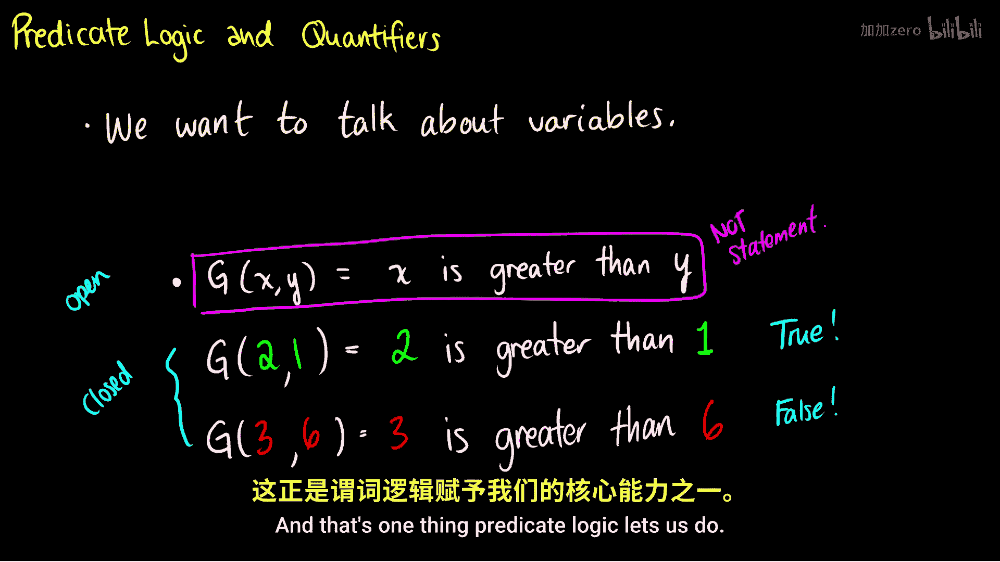
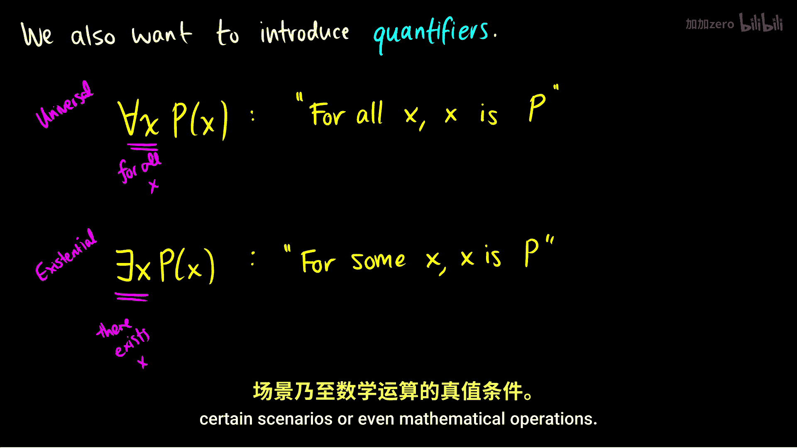
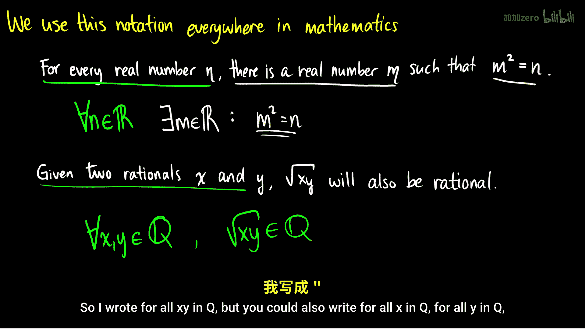
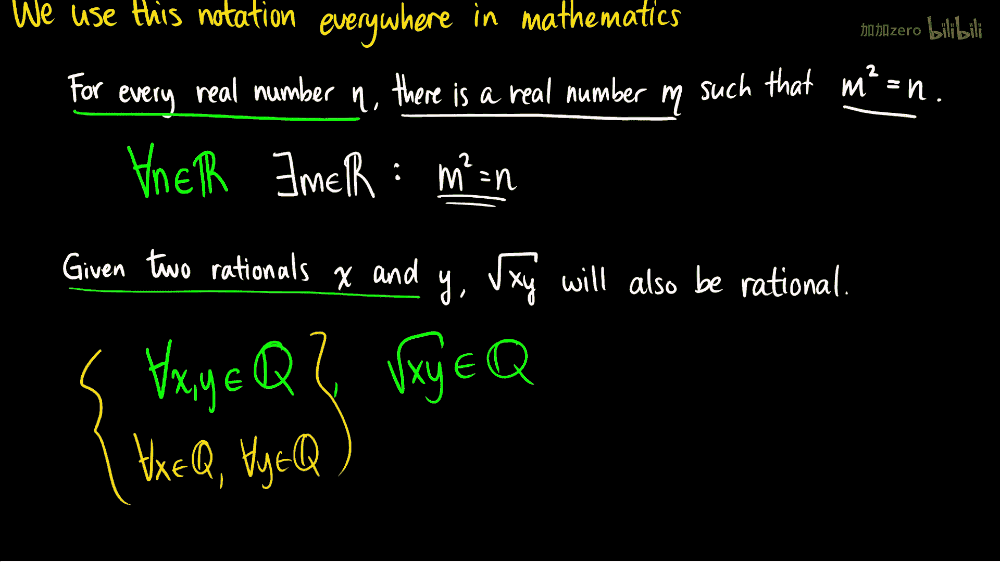
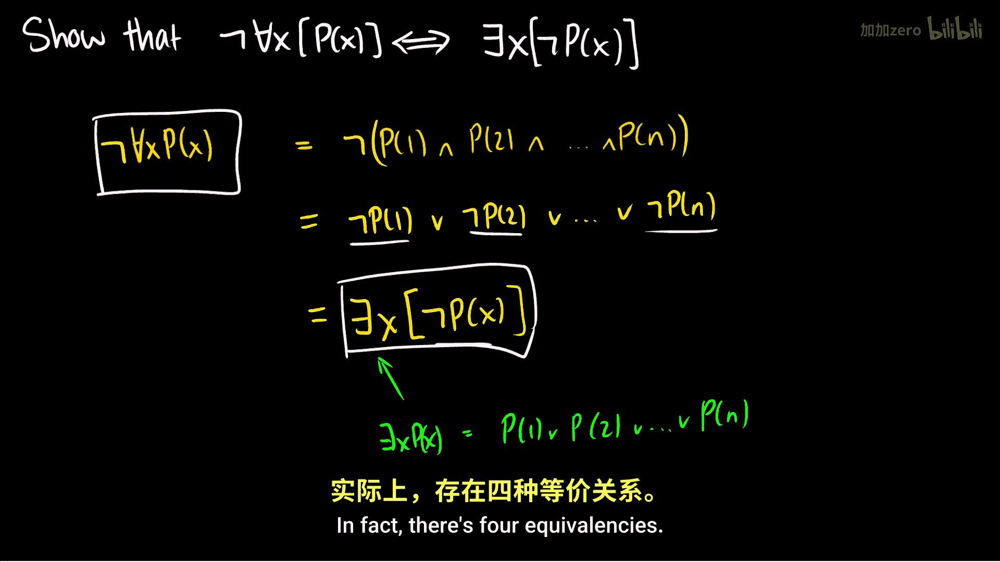
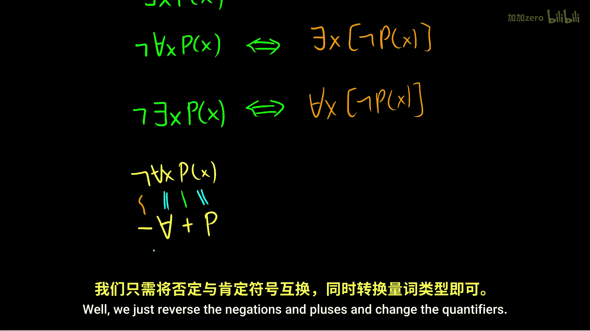
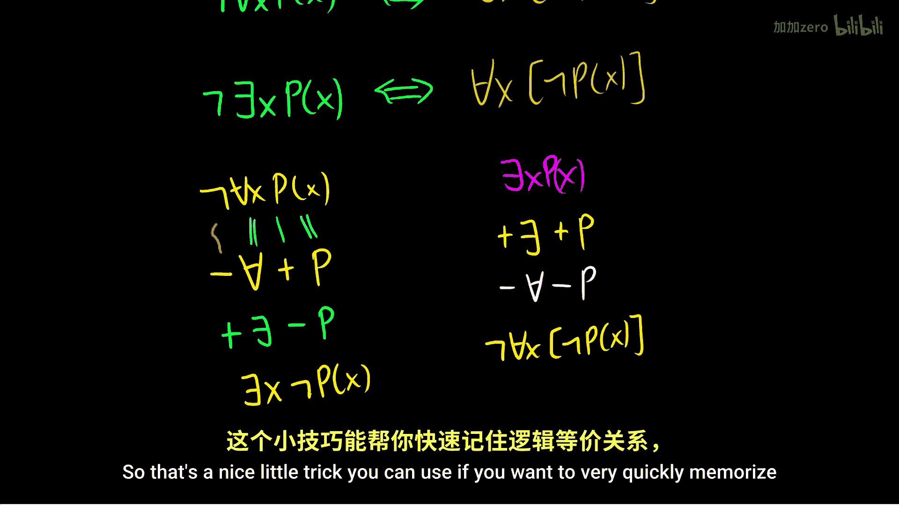
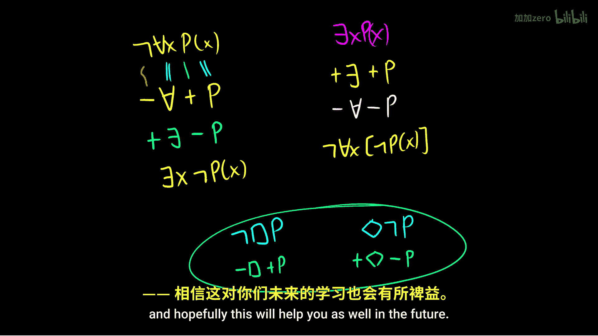
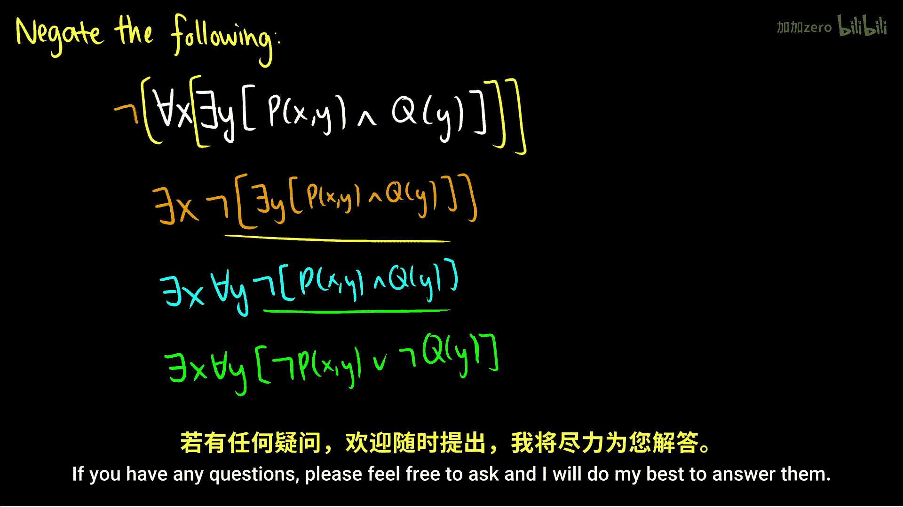

# 计算模型：第22讲：谓词逻辑与量词否定 🧮

在本节课中，我们将要学习谓词逻辑、量词以及如何对包含量词的语句进行否定。谓词逻辑扩展了命题逻辑的能力，允许我们讨论变量和对象属性，而量词则使我们能够表达“所有”或“存在”等概念。

## 什么是谓词逻辑？🔍

上一节我们回顾了命题逻辑的局限性，本节中我们来看看谓词逻辑如何解决这些问题。谓词逻辑允许我们处理包含变量的语句。

在命题逻辑中，我们无法表达像“X是偶数”这样的语句，因为我们不能为X代入具体的值。但在谓词逻辑中，这成为可能，因为谓词可以包含项。一个谓词看起来像 **E(X)**，表示“X是偶数”这个命题或谓词。

另一个例子是二元谓词 **G(X, Y)**，它可以表示“X大于Y”。这里的X和Y是变量。我们也可以代入常量。例如，**G(2, 1)** 表示“2大于1”，这是一个具有真值的语句，其值为真。而 **G(3, 6)** 表示“3大于6”，其值为假。

**封闭公式** 和 **开放公式** 的区别在于：封闭公式具有真值，而开放公式没有。因此，**G(X, Y)** 本身不是一个陈述句，这意味着它在命题逻辑中根本无法存在。我们需要谓词逻辑来表达像 **G(X, Y)** 这样的语句，并为代入变量的常量分配真值。

这是谓词逻辑让我们能够做到的一件事。

## 量词：全称量词与存在量词 📊

但谓词逻辑更重要的功能是提供了**量词**。这就是倒写的A（∀）和反写的E（∃）。

倒写的A被称为**全称量词**。**∀x P(x)** 读作“对于所有x，P(x)”。例如，∀x H(x) 可以表示“所有人都是快乐的”。

反写的E被称为**存在量词**。**∃x P(x)** 表示“至少存在一个x”。它可以读作“存在某个x使得P(x)”或“对于某个x，x是P”。例如，∃x H(x) 表示“存在一个快乐的人”。

量词极大地增强了我们将句子翻译成逻辑表达式的能力，也帮助我们分析特定英语句子、场景或数学运算的真值条件。

## 将数学语句翻译为谓词逻辑 ➡️

我们在数学中处处使用这种符号。以下是将一些包含数学陈述的英语句子翻译成谓词逻辑的步骤。

第一个例子：“对于每一个实数n，都存在一个实数m，使得m²等于n。”

我们暂时不关注这个陈述是否为真，只专注于翻译。

*   “对于每一个实数n”：这是全称量词。所以我们写作 **∀n ∈ ℝ**。
*   “存在一个实数m”：这是存在量词。所以我们写作 **∃m ∈ ℝ**。
*   “使得m²等于n”：我们可以直接写作 **m² = n**。

因此，整个语句翻译为：**∀n ∈ ℝ, ∃m ∈ ℝ (m² = n)**。

第二个例子：“给定任意两个有理数x和y，√(xy) 也是有理数。”

这个句子看起来没有明显的量词，但实际上隐藏了一个全称量词。

*   “给定任意两个有理数x和y”：这意味着“对于所有有理数x和y”。所以我们写作 **∀x, y ∈ ℚ**。
*   “√(xy) 也是有理数”：我们可以说 **√(xy) ∈ ℚ**。

因此，翻译为：**∀x, y ∈ ℚ (√(xy) ∈ ℚ)**。你也可以写成 **∀x ∈ ℚ, ∀y ∈ ℚ**，两者完全等价，只是前者更简洁。

能够双向翻译——将英语句子转化为谓词逻辑，并能阅读和理解谓词逻辑表达式——是非常重要的。

## 量词的否定 🔄

现在，让我们讨论对量词进行否定，这通常是难点。我们想从命题逻辑的角度来理解 **∀x P(x)** 和 **∃x P(x)** 的否定，以便看清其深层结构。

假设我们有一个包含元素1, 2, ..., n的论域。

*   **∀x P(x)** 何时为真？当论域中的每一个x都具有属性P时为真。这就像是说 **P(1) ∧ P(2) ∧ ... ∧ P(n)**。如果所有这些都为真，那么 ∀x P(x) 为真。
*   **∃x P(x)** 何时为真？当至少有一个x具有属性P时为真。这就像是说 **P(1) ∨ P(2) ∨ ... ∨ P(n)**。

这就是 ∀x P(x) 和 ∃x P(x) 的本质含义。现在，当我们否定它们时，利用这些定义就能看出否定是如何运作的。

让我们证明 **¬∀x P(x)** 逻辑等价于 **∃x ¬P(x)**。

首先，根据定义，∀x P(x) 等价于 **P(1) ∧ P(2) ∧ ... ∧ P(n)**。
现在，否定整个合取式：**¬(P(1) ∧ P(2) ∧ ... ∧ P(n))**。
根据德摩根定律，我们可以分配这个否定，得到：**¬P(1) ∨ ¬P(2) ∨ ... ∨ ¬P(n)**。
这看起来像什么？它看起来就像是 **∃x ¬P(x)** 的定义，因为 ∃x Q(x) 的定义正是 **Q(1) ∨ Q(2) ∨ ... ∨ Q(n)**。这里，Q(x) 就是 ¬P(x)。

用英语来思考：“并非所有的狗都是棕色”意味着“存在一些狗不是棕色”。所以，“并非所有狗都是棕色”等价于“存在狗不是棕色”。

实际上，关于量词否定有四个重要的逻辑等价式：

1.  **∀x P(x) ≡ ¬∃x ¬P(x)**
2.  **∃x P(x) ≡ ¬∀x ¬P(x)**
3.  **¬∀x P(x) ≡ ∃x ¬P(x)** （我们刚刚证明的这个）
4.  **¬∃x P(x) ≡ ∀x ¬P(x)**

你可以使用类似的定义方法自行验证其余等价式。

## 一个记忆量词否定等价式的小技巧 💡

你可能会想，是否需要死记硬背这些等价式？其实有一个小技巧。

以 **¬∀x P(x) ≡ ∃x ¬P(x)** 为例。
我们可以用符号简化：`+` 表示“无否定”，`-` 表示“有否定”。
那么 `¬∀x P(x)` 可以写成 `- ∀ + P`。
得到其等价式的规则是：**翻转量词类型（∀ 变 ∃，∃ 变 ∀），并翻转所有符号（+ 变 -，- 变 +）**。
所以，`- ∀ + P` 变成 `+ ∃ - P`。
再翻译回来：`+ ∃` 就是 `∃x`，`- P` 就是 `¬P(x)`。结果正是 `∃x ¬P(x)`。

再试一个：`∃x P(x)` 是 `+ ∃ + P`。
应用规则：翻转量词（∃ 变 ∀），翻转符号（+ 变 -）。得到 `- ∀ - P`。
翻译回来：`- ∀` 是 `¬∀x`，`- P` 是 `¬P(x)`。结果 `¬∀x ¬P(x)`，这正是第二个等价式。

这个技巧在未来学习模态逻辑（涉及“必然”□和“可能”◇算子）时也会遇到，它们的否定规则是相似的。

## 复杂语句的否定实践 🛠️

最后，让我们运用刚才讨论的规则来对一个更复杂的语句进行否定。

假设我们要否定这个语句：**∀x (∃y (P(x, y) ∧ Q(y)))**。

我们一步一步来，逐个量词进行否定。

1.  首先，否定最外层的 **∀x**。根据规则 `¬∀x ... ≡ ∃x ¬(...)`，我们得到：
    **∃x ¬(∃y (P(x, y) ∧ Q(y)))**。
2.  现在，处理内部的 **¬∃y**。根据规则 `¬∃y ... ≡ ∀y ¬(...)`，我们得到：
    **∃x ∀y ¬(P(x, y) ∧ Q(y))**。
3.  最后，对内部的合取式应用德摩根定律：**¬(A ∧ B) ≡ ¬A ∨ ¬B**。所以：
    **∃x ∀y (¬P(x, y) ∨ ¬Q(y))**。

完成。因此，**¬[∀x (∃y (P(x, y) ∧ Q(y)))] ≡ ∃x ∀y (¬P(x, y) ∨ ¬Q(y))**。

进行否定时，只需这样一步一步来：一次处理一个量词，将否定符号向内推，翻转量词，继续向内推，最后对内部的命题应用德摩根定律。

## 总结 📝

本节课中我们一起学习了谓词逻辑的核心概念。我们了解了谓词如何允许我们处理变量，并介绍了强大的**全称量词（∀）**和**存在量词（∃）**。我们练习了将数学语句翻译成谓词逻辑公式。

更重要的是，我们深入探讨了**量词的否定**，学习了四个关键的逻辑等价式，并掌握了一个通过翻转量词和否定符号来记忆它们的小技巧。最后，我们通过一个例子实践了如何对复杂的嵌套量词语句进行逐步否定。掌握这些技巧对于理解和运用谓词逻辑至关重要。