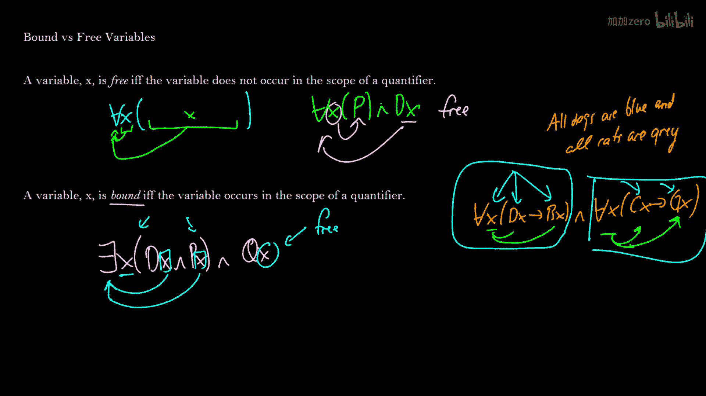
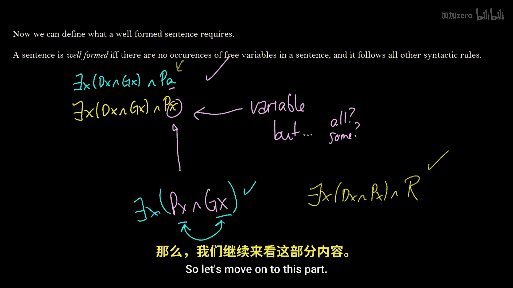
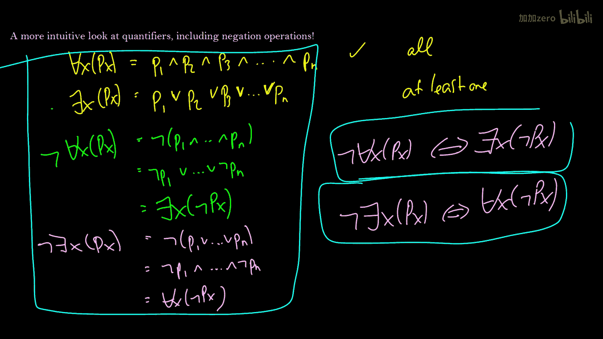
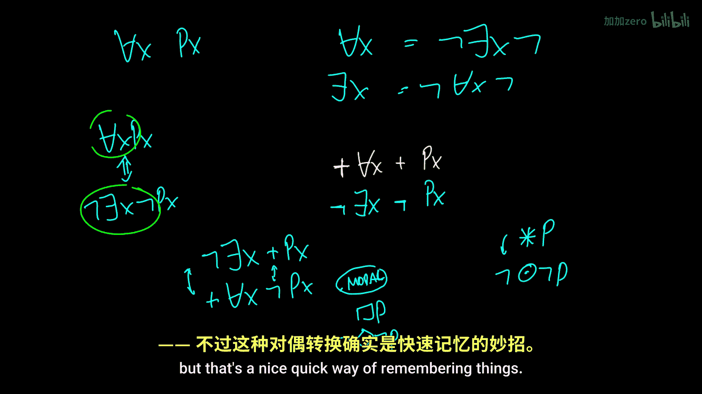
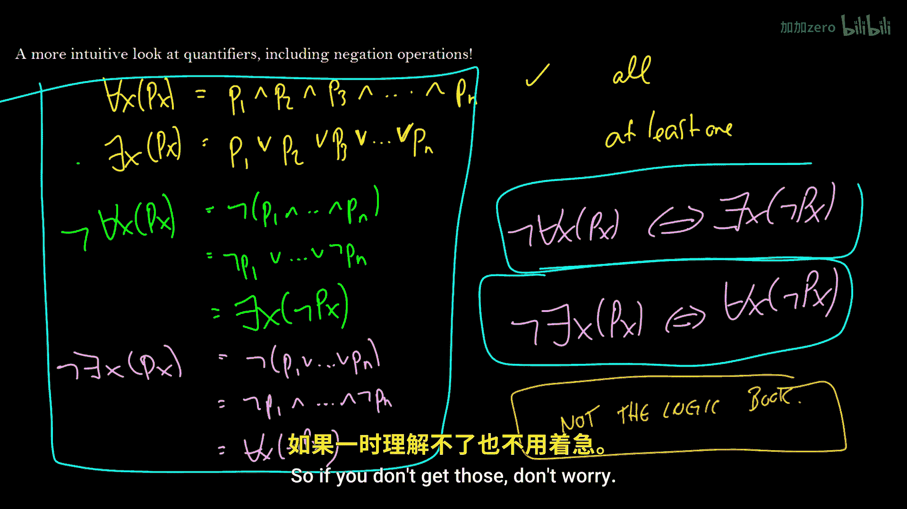

# 悉尼大学【中英⚡计算模型｜COMP2022 Models of Computation】 p23 P24 -Logic- Free and Bound Variables -BV1vTe6zzENb_p23-

All right， today day， we're going to be talking about different types of variables。

 mainly bound versus free variables。 What is acceptable in a sentence in predicate logic and what is not。

Okay， so we have free and bound variables and we say that a variable x is free。

If it does not occur in the scope of a quantifier。What this means is if we have all X。And。

Following this， theres always going to be brackets that contain。A bunch of things。

And what it means is that this X is bound to the universal quantifier in here and every occurrence of x on the inside。

Is bound to that quantifier there。So if we have a sentence， all X。Pi。😔，And then， we have。

Some and D X outside。Well， this acts here。Only binds things inside of these main brackets。

 which means that this X out here is free because it is not being bound by this X。In fact， smart me。

 I put the word the definition for bound after the word of free。

 So this will make more sentence after we talk about this。

So a variable is bound if it occurs in the scope of a quantifier。

So if we have there exist x and we have Dx and Px， and we have something after that， that is Q x。

Which ones are bound。Well。These two xes are bound， because theyre in。The scope of this quantifier E。

 because our existence。Because these main brackets here for the existential quantifier contain these x'es。

 However， this x out here。Beside Q is free because it is not contained within the brackets。So。

I'm going to show you one more thing that you can do。Let's say we want to have this sentence。

All dogs。A blue。And。哦。Cats are。Gray。I'm not going to formalize these。

 but I'll use very obvious predicates。So we can say for all X。If X is a dog， then X is blue。And。

For all why。If why is a cat。Then， why is gray。Okay， so we have one object here that talks about。

Dogs and the color blue。 And we have one object Y here that talks about cats and。Gui。What we can do。

Is we can use instead of why。We can use X again。And this talks now about a different object X。Now。

 do you do this often， No， this isn't something that you would do for your own sanity。

 but is perfectly acceptable because of the way that scope works。These x's here are only contained。

Within this little universe here， this little quantificational universe that we have。

So that X is completely separate from this X over here。

 It's just some dummy variable that gets properties from inside the bracket。That's it。

Now normally you wouldn't write X in the second one， you would write Y for your own sanity。

 but this is perfectly acceptable。

Now， let's move on to what a well formed sentence looks like。And we say。

 this sentence is well formed。If there is no occurrence of a free variable in a sentence。You see。

 we don't like free variables。They exist， but we don't like them。 We like constantss to be out there。

 not variables。So if we have there exists in X， such that D， X and G， X， and outside， we have some。A。

With some property P。This is fine。Because there's no free variables。However。If we have their exist X。

 and I'm only going to change one thing here。And we have some Px well。

This is a problem because we recognize that this is a。Variable。So we say x is a variable。But。

 our problem is。Is that is it all， I it sum。So， it's very descriptively vague。And because it's vague。

 we don't want it to be part of a well formed sentence。

 Why would we want our logic to talk about something that we don't even know。

What it could possibly be talking about。We don't know what this is。

 We don't know where its bounds are。 We don't know what it attaches to。 Is it the same X。

 Is it a different X。 What if we just have a sentence that's P， X and G， X without a quantifier。

 How do we know that these two refer to the same thing when it's just a variable， We don't。

 That's why we require that these things be bound。So that way， we know what it's referring to。

And this will make a little bit more sense when you start doing your problems。

 One thing I should note。Is that？This first scenario is O， and it's also completely O to mix。

 predicate logic and。Quantificational logic。So we can write something like this。 There exists in x。

 such that Dx， N Px and some proposition R。That's okay because it's just a proposition。

 We can have propositions in our logic。All right。 So hopefully you understand why we don't want free variables occurring in our sentences。

So let's move on。

To。This part， what if their quantifiers without their corresponding variables appearing in a sentence。

Now， what do I mean here， I mean， what if we have there exist X such that P A。

 And this is going to be a is Albert and P。X is going to be。 X is pretty。So。

 this sentence in English。Just means。Alberts。Is pretty。But we've defined it that。For some X。Alberts。

Is pretty。Now， is this okay？I want you to seriously answer this question on your own。 So like。

 make up your mind right now。 iss this O。If you said yes， O， you're right。 It is O。 Now。

 the question is， why is it O。Because。We， we have technically bound all the x's inside the bracket to that existential quantifier。

 It just happens that the amount of x's inside is 0。There are no free variables。Therefore。

 it's O because our idea of a well formed sentence isn't that there exist bound variables。

 But the fact that there does not exist any free variables， and there are no free variables。

Therefore， it's okay。I should mention， however， if you just have this sentence， there exists P of X。

 this is。Entirely wrong。Because the existential and universal quantifiers require some variable after them。

 and only one variable。Later， you can put multiple， but right now we just want one variable。

 so that right there is wrong。For our last slide here， we're going to explain。Quantifiers。

A little bit more propositionally， if this makes sense。We're also going to talk about negation。

If I say all X。Px。What I really mean here is something along the lines of， well， yes。

 P1 has the property and P2 has the property， and P3 has the property。All the way up to that last X。

 having the property。So。If all X P X， then what we're saying is that every X in the universe has the property P。

Now， if we say there exists in x， such that Px。Really。

 what we're saying is that at least one of the X's。In the world。Has that property。So。

It's basically a bunch of disjuncs。You don't make sense that there exists in X。

 That means at least one。And for all X， that just means all of them。

 So we have this conjunction and this disjunction。To represent these truth functions。

So when we negate something。Let's say。If we say not all X， P X。That means that not all X are P X。

 So there is at least one thing that is not a P of x。We can write this as not。

P1 all the way up to P N using conjunction。 and with the Morgan's law。

We know this is the same thing as not P1， or。Not P2 or not P3， so on up to n。PN。

And using this definition of existential quantifiers， we know this。

 the same thing as saying there exists in X。Such that not Px。

So we've now proven this claim that if we have not all X， Px。

This is equivalent to saying there exist in X， such that not P of x。That what happens if we have。

 there does not exist in x， such that P of x。Well， using the same reasoning here。We would get。

It is not the case that P1 or P2 or P3， so on。Which means it is not the case that P1 and it is not the case that P2 all the way up to and it is not the case that PN。

Which is the same thing as s for all X。Not P of x。So， we've also。Claimed and proven。That。

Not existential X， P， X is the same thing as saying for all X， not P X。

 So weve proven these little equivalencies with negations。Now， the cool thing about this。

Is there's actually a very easy way to remember this。 I think this was the best proof I've ever got。

In a course for this stuff。 And this was not even analog logicic course。

 This was in a discretere mathematics course where I got this description。

 And this was the one thing that tied these equivals altogether together for me。

 Since you're basically just taught that these are equivalent using some formal definition using language。

 using the English language， you are expected to intuitively understand that not all X。

 P X is the same thing as there exists in X that not P X。Now， I yearn for some mathematical proofs。

 So I think this is very， very sufficient。

But a little trick to remember some stuff here。If we have allt X。Px。What we can do。

Is we can define all X。To be equal to。Not exists in x。And exists in X is the same thing as not all X。

 not。So。When we have all X Px， this is going to be the same thing as saying not exists in x。Not Px。

Because we just substitute in。This， all X for n exists， not。So what this really is。

Think of this as kind of like。A truth。 So you have a truth。All X， truth。Px。When we switch。

To make an equivalent statement。All we do is we change the pluses to minuses。

The universals to existences。 And we leave the predicate alone。So。

We have all X px becomes not exists in x such that not px。

Now when we take a look at our equivalences last time。For not exists in X。 such that P of X。

 Let's just do some switching here。 Plus all X， not P X。 Oh， look， it's exactly the same。

 So this is a cool little trick。 You can remember that the knots changes to positives。

 the positives to knots and the existentials and universals switch。😊，If I were to give you。

Some new operators and say， okay， we have this star P here。

And I want you to write it in terms of this doughnuut pea。You can probably guess， oh。

 it's is going to fall the same thing that star P is not doughnut， not pea。So。

This is a common operation done with existentials。 In fact， you'll see it in modal logic。

 If you have box P。 the same thing as not diamond， not P。 And this is modal logic。

 I might cover it at some point if the demand is high。But。

That's a nice quick way of remembering things。 I kind of did these last two slides。

In prompts2 impromptu。I did them for fun， sort of as a extra add on， because this stuff。

You're not going to find this in the logic book。Because， for some reason。Having these intuitive。

Mathematical proofs。Of existential and universal quantifiers and their equivalence。

Earn satisfactory for a。Intro of logic book。Which doesn't make any sense， but anyways。

 I'm going off on a tangent。That was quantificational logic。Pretty soon， we're going to start proofs。

 and those are tough， so。If you don't get those。

Don't worry， I'm here to help。