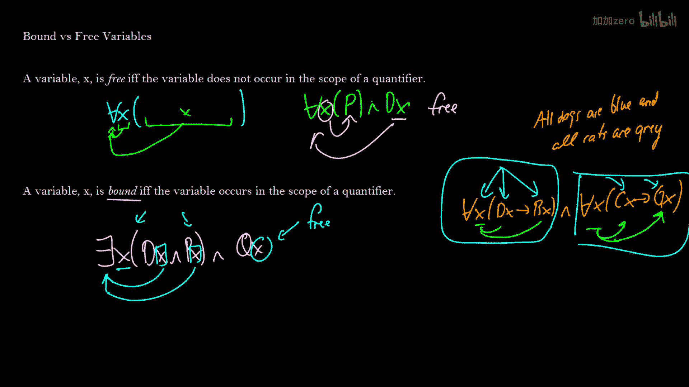
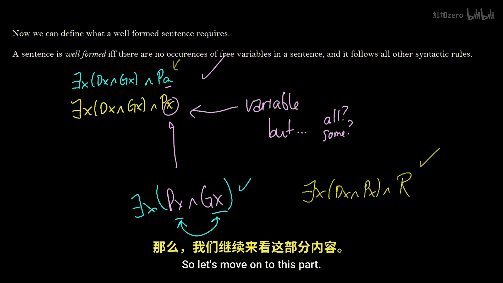
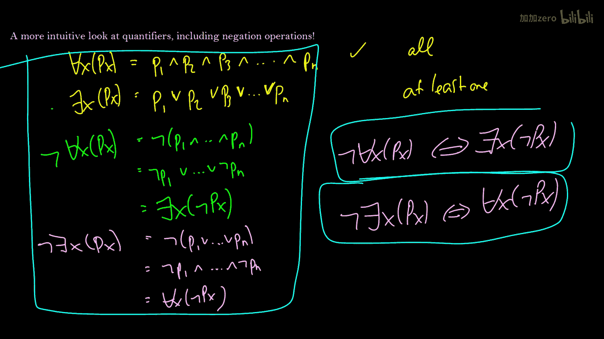
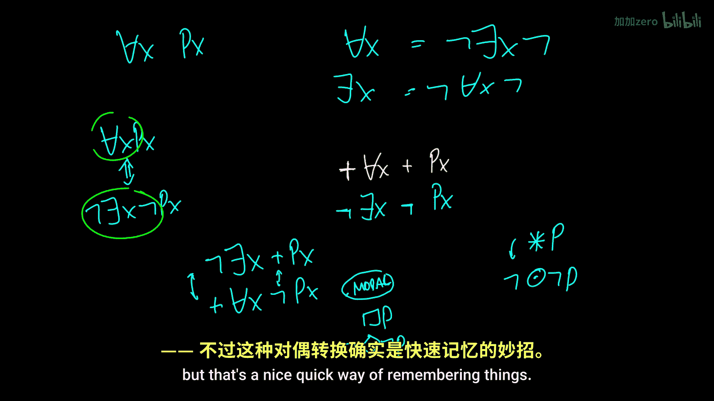
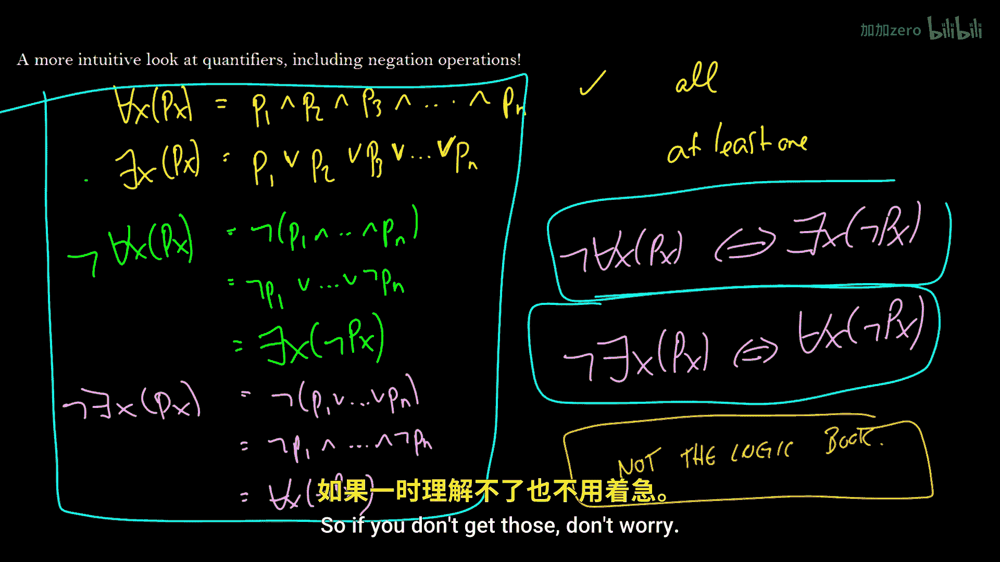

# 计算模型：第23-24讲：谓词逻辑中的自由变量与约束变量 🔍

在本节课中，我们将学习谓词逻辑中两种不同类型的变量：自由变量与约束变量。我们将明确在谓词逻辑的句子中，哪些变量形式是可接受的，哪些是不可接受的，并理解其背后的原因。

## 自由变量与约束变量的定义

上一节我们介绍了谓词逻辑的基本概念，本节中我们来看看变量的两种状态。

一个变量 **x** 是**自由**的，当它**不**出现在量词的**作用域**内。反之，一个变量是**约束**的，当它出现在某个量词的作用域内。

量词的作用域通常由紧随其后的括号界定。例如，在公式 `∀x ( ... )` 中，括号 `( ... )` 内的所有 **x** 的出现都被这个全称量词 `∀x` **约束**。

## 作用域与变量绑定示例

以下是理解变量绑定与作用域的几个关键点：

*   **约束变量示例**：考虑公式 `∃x (D(x) ∧ P(x))`。量词 `∃x` 的作用域是 `(D(x) ∧ P(x))`。因此，在这个作用域内的两个 **x** 都被约束。
*   **自由变量示例**：在公式 `∃x (D(x) ∧ P(x)) ∧ Q(x)` 中，`Q(x)` 中的 **x** 位于量词 `∃x` 的作用域之外，因此它是一个**自由变量**。
*   **变量重命名**：在公式 `∀x (Dog(x) → Blue(x)) ∧ ∀y (Cat(y) → Gray(y))` 中，第一个量词约束 **x**，第二个量词约束 **y**。实际上，第二个量词也可以使用 **x**，写作 `∀x (Cat(x) → Gray(x))`。虽然这可能会造成阅读混淆，但在逻辑上是完全允许的，因为两个量词的作用域是独立的，它们约束的是不同的“哑变量”。

## 合式公式的要求

一个谓词逻辑句子被称为**合式公式**，当且仅当其中**没有自由变量**的出现。

我们不允许自由变量出现在合式公式中，原因在于自由变量的指代是模糊且不确定的。例如，仅包含 `P(x) ∧ G(x)` 的公式无法告诉我们这两个 **x** 是否指代同一个对象。通过使用量词约束变量，我们能够精确地定义变量的取值范围和指代关系，确保逻辑表达式的清晰和无歧义。

以下是关于合式公式的几点说明：

*   **允许混合命题**：公式中可以同时包含量词约束的谓词和独立的命题常量。例如，`∃x (D(x) ∧ P(x)) ∧ R` 是合式的，其中 **R** 是一个命题。
*   **量词约束“空”变量**：公式 `∃x P(a)`（意为“存在某个x，使得a具有性质P”）是合式的。虽然量词 `∃x` 约束的变量 **x** 没有在作用域内实际出现（出现次数为0），但该公式中确实没有自由变量，因此满足合式公式的条件。
*   **量词语法错误**：单独的 `∃ P(x)` 是不正确的，因为量词（`∃` 或 `∀`）后面必须紧跟一个要约束的变量。

## 量词的命题逻辑视角与否定

理解量词的另一种方式是从命题逻辑的角度来看待它们。

*   **全称量词 `∀x P(x)`** 可以理解为对论域中所有个体 **a₁, a₂, ..., aₙ**，性质 **P** 都成立。这类似于一个**合取**：**P(a₁) ∧ P(a₂) ∧ ... ∧ P(aₙ)**。
*   **存在量词 `∃x P(x)`** 意味着论域中至少有一个个体具有性质 **P**。这类似于一个**析取**：**P(a₁) ∨ P(a₂) ∨ ... ∨ P(aₙ)**。

基于这种视角，我们可以推导出量词否定的一些重要等价关系：

1.  **¬∀x P(x) ≡ ∃x ¬P(x)**
    *   **解释**：“并非所有x都具有性质P” 等价于 “存在某个x不具有性质P”。
    *   **推导**：`¬∀x P(x)` 即 `¬(P(a₁) ∧ P(a₂) ∧ ... ∧ P(aₙ))`。根据德摩根律，这等价于 `¬P(a₁) ∨ ¬P(a₂) ∨ ... ∨ ¬P(aₙ)`，而这正是 `∃x ¬P(x)` 的含义。

2.  **¬∃x P(x) ≡ ∀x ¬P(x)**
    *   **解释**：“不存在具有性质P的x” 等价于 “所有x都不具有性质P”。
    *   **推导**：`¬∃x P(x)` 即 `¬(P(a₁) ∨ P(a₂) ∨ ... ∨ P(aₙ))`。根据德摩根律，这等价于 `¬P(a₁) ∧ ¬P(a₂) ∧ ... ∧ ¬P(aₙ)`，而这正是 `∀x ¬P(x)` 的含义。

## 记忆技巧：量词的对偶性

有一个简单的技巧可以帮助记忆上述等价关系，它体现了量词之间的“对偶性”：

*   将 `∀x` 视为 `¬∃x¬`
*   将 `∃x` 视为 `¬∀x¬`

**核心规则**：当对一个带量词的公式进行变换（如求否定或寻找等价形式）时，可以遵循一个模式：**将量词类型互换（∀↔∃），并在量词和谓词前各加一个否定（¬）**。如果原来有否定，则可能相互抵消。

例如：
*   `∀x P(x)` 等价于 `¬∃x ¬P(x)`。（`∀` 换为 `∃`，前后加 `¬`）
*   `¬∃x P(x)` 等价于 `∀x ¬P(x)`。（`∃` 换为 `∀`，去掉原有的 `¬` 并在谓词前加 `¬`）

这个模式在模态逻辑等其他逻辑系统中也有类似体现（如“必然”算子 □ 与“可能”算子 ◇ 的关系：□P ≡ ¬◇¬P）。

## 总结

本节课中我们一起学习了谓词逻辑中**自由变量**与**约束变量**的核心区别：约束变量受量词管辖，指代明确；自由变量则不然，会导致语句含义模糊。因此，**合式公式必须不含任何自由变量**。我们还从命题逻辑合取与析取的角度理解了全称量词与存在量词的含义，并掌握了它们与否定运算符交互时的关键等价规则：`¬∀x P(x) ≡ ∃x ¬P(x)` 以及 `¬∃x P(x) ≡ ∀x ¬P(x)`。最后，介绍的量词对偶性记忆技巧，能帮助我们更灵活地进行公式变换。理解这些概念是后续进行形式化推理和证明的重要基础。