# 悉尼大学【中英⚡计算模型｜COMP2022 Models of Computation】 p24 P25 Theory of Computation： Construction of CFG - Examples -BV1vTe6zzENb_p24-

Hello all in this lecture we are going to discuss about construction of CFfG for some example problems so the first one is construct CFfG for the language having any number of yearss over the set sigma is equal to E sigma the input alphabet has a single input symbol a and the language would accept all strings which consists of any number of years so what is the language of this grammar。

😊，Any number of years， so including epsilon， so zero number of y， one years，2 years， three years。

 etc。So， our CFfG should accept all these strings epsilon， single ya double years3 a，4 years。

 etc cea， so how to construct a context pre gramar for this yes starting symbol of the grammar for for example we are going to consider yes yes tense2 yes tenses to y。

😊，And we need to get recur repeated years， right any number of years， so y should be followed by yes。

😊，Right this is for recursive strip so any number of times we can replace yes by ya yes ya yes ya yes like that。

 so if we try to derive4 yes means how can we draw the parse3 we will start with the starting symbol of the grammar grammar y and yes sorry start symbol of the grammar yes and this yes can be replaced by ya yes the production ya yes and again this yes should be replaced by ya yes。

😊，예 yes。Yes， yes， so we have got four years。😊，But finally it should be stopped right because the string should consist of only the terminal symbols so it includes epsilon also right this language includes epsilon also so that it should be finally replaced by epsilon so another production is yes tends to epsilon okay so yes tends to ya yes any number of yes means we have to write yes start symbol of the grammar tends to a variable tends to y and the same variable this is the recursive step and this is the basic one so yes tends to epsilon so this is the these other two productions for getting this grammar so if we want to derive this string。

😊，Then the star symbol of the grammar should be replaced by epsilon directly so we can get。😊，Epsilon。

If we want to get single y， then yes must be replaced by y yes once。😊。

Once we have to use this production then this yes must be replaced by epsilon so if you concatetnate this we will get single y okay epsilon is an identity element during concatenation so if we concatetnate the leaves we will get single similarly double this string means yes must be replaced by yas again this yes must be replaced by ya we need to use this production as many times as we want finally it should as many years we want then finally yes must be replaced by epsilon so w similarly for three years means three times we have to use this then finally s should be replaced by epsilon so the grammar the set of productions for this grammar is e strings to yaS and e strings2 epsilon but how to write the context free grammar notation as a5tule so Cfgg is equal to Vtps v is yes here terminals are。

😊，alAlone it is given in the question then set of production P that we have written so these are the set of predictions then star symbol of the grammar is also yes so construct CFfg means we have to write this photopeial notation and set of predictions this is for your understanding we can write language and try to derive the predictions first then we can write the photoial notation then we next we will see another example。

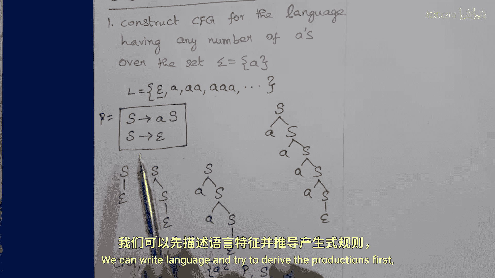

Suppose if we want to construct a language for any number of years and Bs， any number of yes and Bs。

Means what is the language。The meaning us regular expression is A or B star right here what is a corresponding regular expression is a star。

😊，So， we have got this language and any number of a's and B's means epsilon， Y， B。😊。

Epsilon Y B and any combinations of a and Bs， right So Y A， Y， B， B， A， B B。

 this is the zero lens string， one lens strings， two lens strings。

 similarly three lens strings and so on。 So any combination of yes and Bs。

 So now we need to write the set of productions for this grammar。 So yes tends to。

Any number of y means we have written like this right so y yes bar any number of bs means b is bar epsilon and one more thing if the two productions are having the same head means we can combine by using this vertical bar so this production can also be written as yes tends to y yes。

But Epsil， sorry。Because these two body are having the same left side head so yes tends to eS bar epsilon so yes tends to yaS bar bs bar epsilon so if we want to get E B A B then suppose E B AB if you want to get it then yes tends to yes can be replaced by yesS first this yes must be replaced by Bs then this yes must be replaced by yes then again bs then finally epsilon so we have we got a B A B so any number of yes and Bs means this is the grammar okay so but I am going to write the productions for all the examples。

😊，But you need to write the photo notation also。Okay， I'll write it here， so C of G G is equal to。

Variable。Terminus A and B。Set of productions P， this is the set of productions。

Then star symbol of the grammar is yes。Then write the predictions。

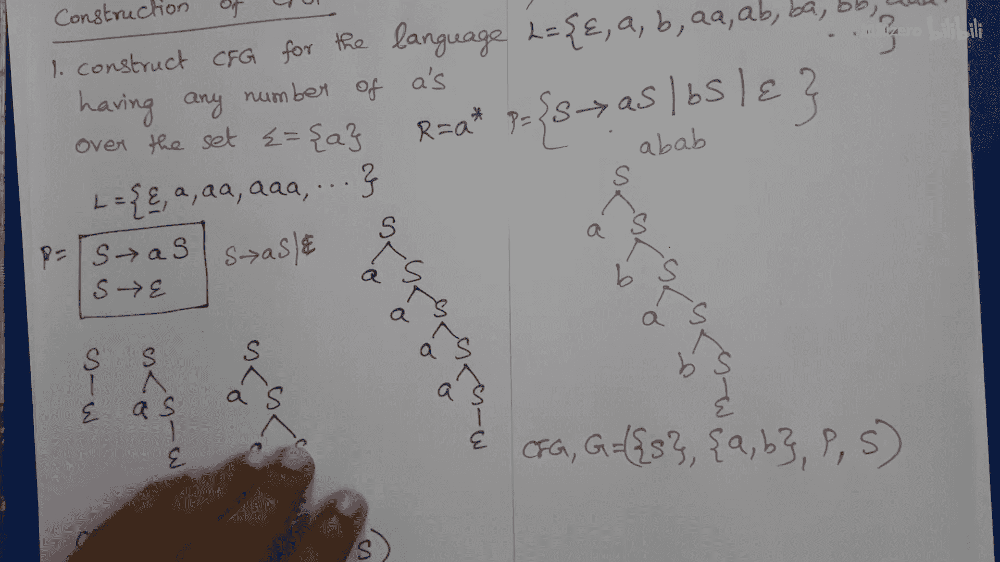

Next one， construct a CFfG for the language containing strings of at least two years so how to construct a regular expression for this at least two years means。

Two as are compulsory in each string。 Two yearss are compulsory， right。

 This a can be preceded and followed by any number of years and Bs， right。

 These two yearss must be preceded and followed by any number of E and Bs。

 So this is the corresponding regular expression for this。

Problem now we need to construct the Cg right all the strings should contain at least two years。

 so it can be preceded and followed by any number of A and Bs， so for example。😊。

Y a is a correct input string， Y， B A， ya， b， B， B。Y， B a， okay， so these type of strings。

 the string has three years， but the condition is at least2 year。

So all these strings are correct input string。 So now we will try to construct the CfG。

 so assume that。Yes， this is a start symbol of the grammar， so yes。😊，Two years right。

2 years are compulsory， it should be preceded and followed by a plus b star right so for that we are going to introduce another variable。

Capital J， Okay， so two years are compulsory this year。😊。

Should be written as a plus B star any number of A and Bs， Any number of A and Bs means what is the。

This is the production， right yes standss to E S bar B， S bar epsilon here the variable is E， So Y。

 Y bar B， A bar epsilon。 So this is the set of。😊，Productionions for this particular grammar right at least two years and it can be preceded and followed by any number of years and bes then the fourth problem is。

😊，One occurrence of triple 0， all strings the language in which all strings are having one occurrence of triple 0。

 so how to construct CFfg for this yes1s 2。Tple0， this is a sub string we need to get in the string it can be preceded and followed by any number of zero and ones right so for any number of zeros and one we need to introduce yeah non terminalminal y and this a can be expanded like this any number of zeros and ones here a and bs heres zero and one so0 y。

Any number of zeros can be retrieved from this any number of ones and epsilon okay。

 then the fifth problem。😊，E is equal to y to the poweran b to the poweran such that ya is greater than or equal to1。

 so the set of strings are yeah B because ya is greater than or equal to1 so ya B if ya is2 doublee double B etc so how to construct Cfg for this yes tends to number of yes must be followed by number of bs and its the number should be equal right So for one ya we need to get1 b right and it should be recursively retrieved so small letter ya yes B so yeah yes B a yes b repeatedly can be applied okay suppose if I want to get this string from this grammar so yes。

Can be replaced by a SB， then a S B， so ya a BB， but I have to stop this right。

 so it should be replaced by it cannot be replaced by epsilon actually okay。So。

 this is the parry for getting3 a 3 bs， okay so y B yes1s2 E B should be replaced suppose you here0 is given then we can write a1tens to epsilon so how to get double a double B yes must be replaced by ya yes B。

Then in the second step itself， yes should be replaced by EAB。 So this is the set of productions for。

😊。

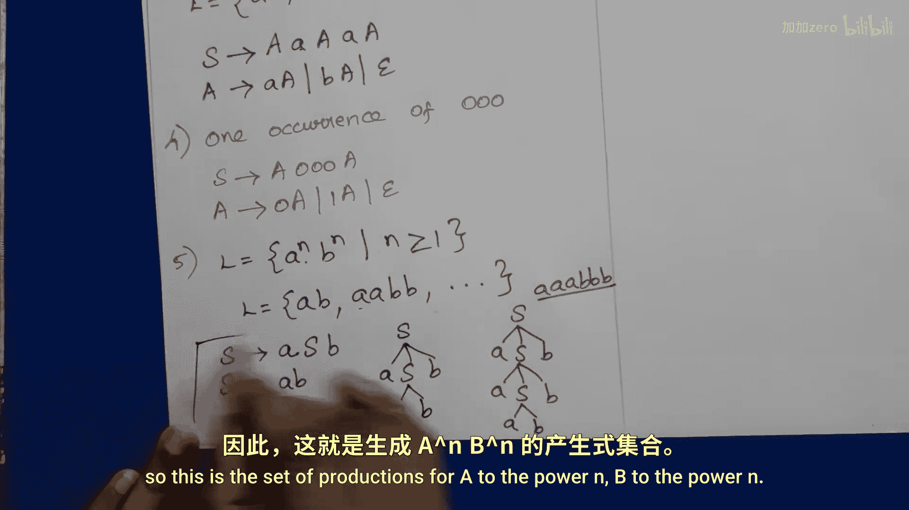

E to the power y n B to the power yen， suppose if we want to construct Cfg 4 y to the power y n。

 B to the power2 yen。Then。That grammar is similar to this， but for one year。

 we need to get two bs right， so ya yes B B。Then yes extends to E B B， Similarlyly。

 we can construct CG for this type of problems， the next one。

Another problem is a construct a CFfG for this language l is equal to wC w transpose such that w belongs to E comma B star any number of a and bs so if we have got E BB as W then it should be followed by the center C。

😊，Then w transpose this is W so transpoes BBE right so this is a palindrum string actually this one is an oddland palindrrum。

With the center mark。😊，Here palin means we know that the string if we read the string forward and backward it will give the same answer and one more thing the string palind string starting and ending with the same symbol and if you remove the starts symbol and ending symbol in the remaining string also starting and ending similar same right so if the string starts with a it should end with a if the string starts with B it should end with B right suppose if another example B in which the w is B and the center markers C means what about w reverse ya B right so if it starts with a ends with a starts with B means ends with B so how to construct context premar set of productions Y standss2 ya starting with a means ending with a for recursively we need to retrieve this so ya yes。

😊，If it starts with B， it should end with B。So if we try to construct parsory for this。This。String。

 yes， must be。Replace by B S B， then we need ya。 So yes must be replaced by ya， yes， ya。 Finally。

 it has to be stopped， right， So the center symbol as C。 So yes tends to C must be the production。

 Then only we can get B， A， C， A B。 Similarlyly， we can draw for any oddland pal。

 This is the grammar 4。

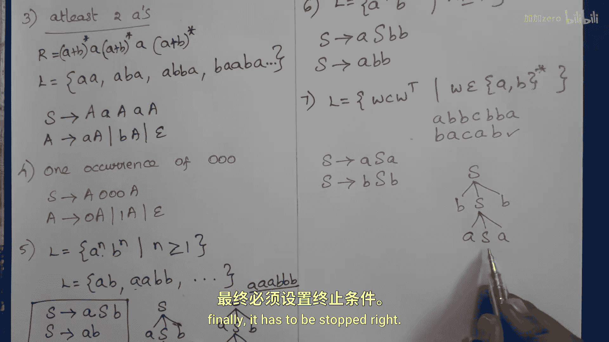

This particular problem， then。Next problem is construct CFfG for this language l is equal to a to the poweran b to the powerium c to the poweran such that yan and ym are greater than or equal to 1。

 so here number of yes and C's are equal。And in between we can have any number of b's at least1 b okay so here the number of y y n and y or greater than or equal to1 so at least1 a followed by 1 b followed by 1 c but in all the streams number of ys and C's must be equal so。

😊，Yes， tends to。For one a， we need to get 1 c， right， So y， yes C， So if we try to construct a pass3。

 yes can be replaced by a yes C。y， yes， see。

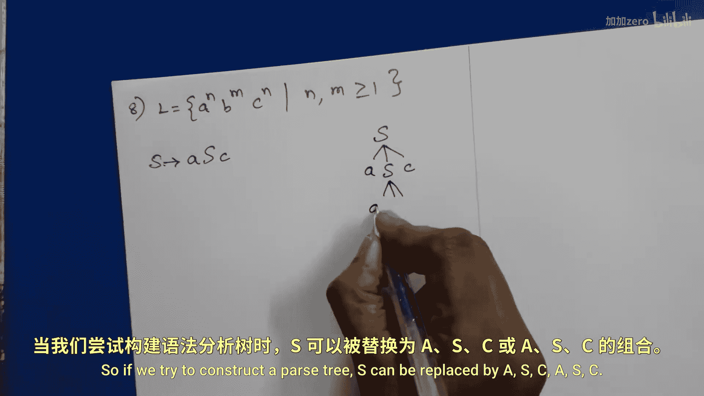

So any number of times we can apply this so in this we can get equal number of as and Cs。

 but in the middle we have to get number of B's right。😊，And。

So that we have to introduce a new non terminalminal symbol for getting the number of Bs and one more thing here a and C the number should be at least one so that we have to write ya C。

😊，Yea， ya see， so finally we need to replace this by ya ya see。😊。

Then only we can apply B here now now in the middle we need to get a number of bs right。

 so any number of bs means the production is B followed by y and。

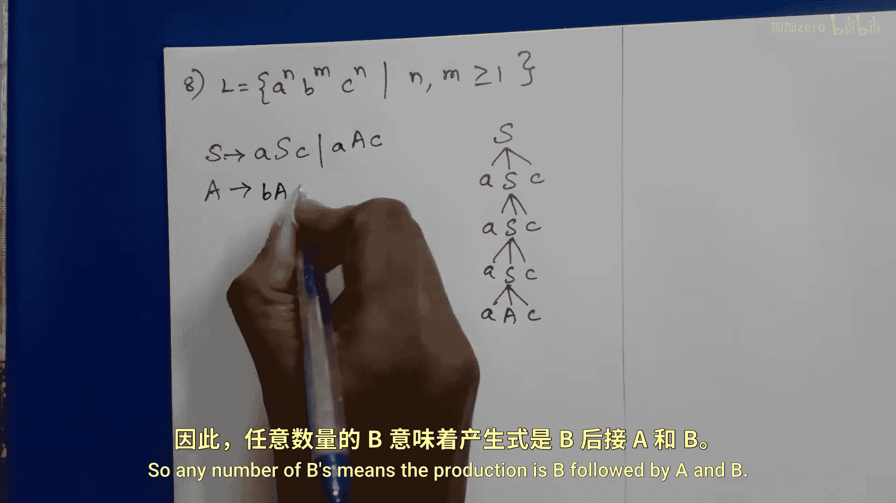

B。Okay， so here also ya is also greater than or equal to1。

 so B a B any number of b suppose if we want to get2 bs here means B a and B。

 so in this grammar we have got4 a2 bs in this example4 years2 b。

4 Cs similarly we can get so here suppose if we want to get。😊。

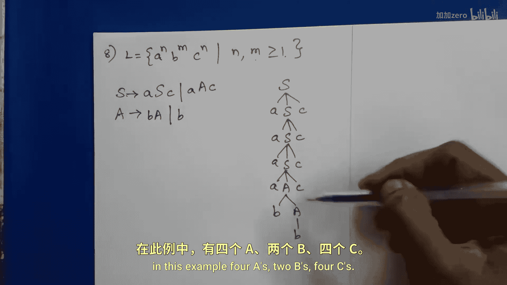

1 y2 b1 c， y is1， y is 2， then how to construct a par three yes tends to we need only one year and C so that we have to use this production directly。

Y， ya， see。 So if we don't write Y and see here， then we will write。😊。

Directly S can be replaced by a and a can be replaced by number of b's so we cannot get a and C right if we don't write a C here simply if we write a if we replace yes by a then we can get number of b's alone in this string so that this a should be precede preceded by a and it should be followed by C so now yes is replaced by a A C and two b's we need so ya must be replaced by B once then this a should be replaced by B okay。

Similarly。We can construct Cf G for this grammar。Such that ya is greater than or equal to 1 and ya is greater than or equal to 1。

Number of a and B's must be equal and B's and C's must be equal， so yes1s2。😊。

Y yes D Y and D must be equal， so any number of times we can apply this。

 but to stop this we have to introduce another non terminal symbol so ya ya。D， right， E。

 S D should be repeatedly applied at the end， we need to apply this。 So this a must be。

Replaced by4ier this year is used for retrieving equal number of B and Csar， so B A C bar B C。Okay。

So you can take a string and try to draw the pastry for this grammar。 The next one is suppose。

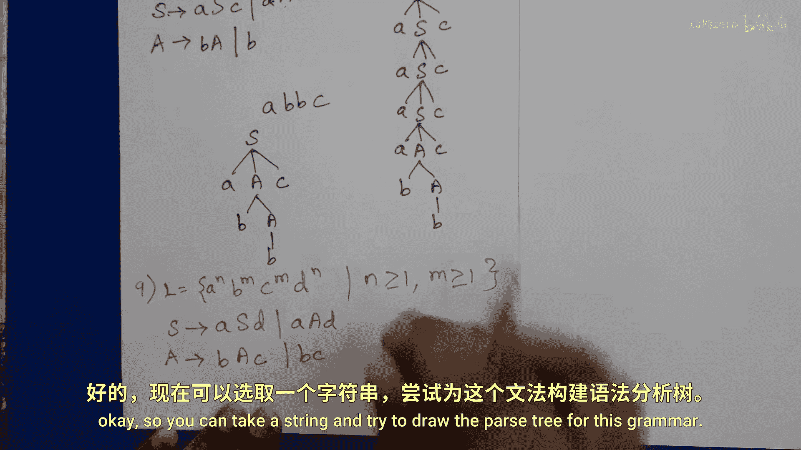

E to the power end， B to the powerium， C to the power end， D to the power。

Yum means we cannot construct par3 for sorry we cannot construct CFfg for this particular grammar because here a and C's must be equal and B' and D' are equal for this we cannot construct the par3 if we try to construct we will get aS C。

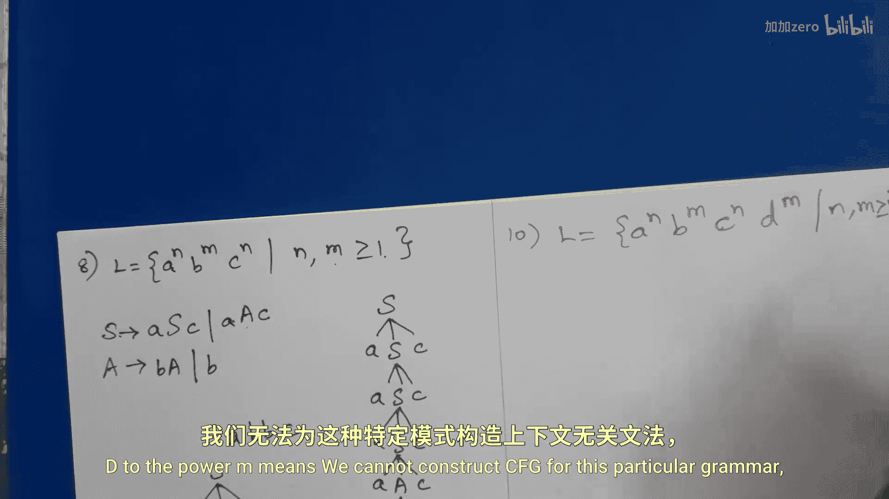

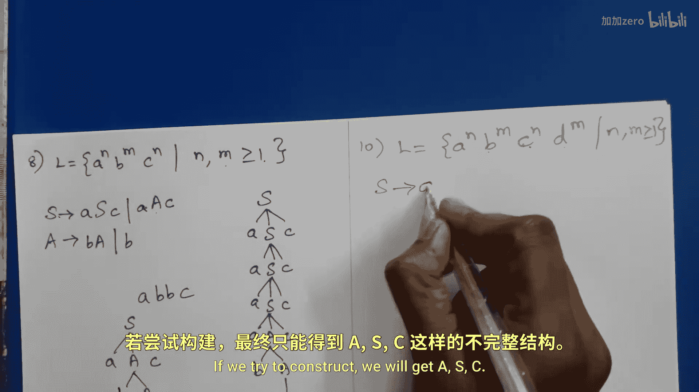

But repeatedly， we need to get this and ya ya see。Then this a for this year we have to get B and Ds must be equal so that we cannot retrieve it because in between Cs are there so that this is not a context free grammar。

😊，The next one is。E is equal to a to the poweran B to the poweran C to the poweran B to the powerium。

 So for this problem we can construct the past3 here number of as and Bs are equal and C and D are equal So the thing is we need one variable for getting retrieving this another variable for retrieving this。

 So yes can be replaced by two variable E B and for y。We need to get number of a and bs equal right。

 So E A B bar E B。Y AB should be repeatedly applied finally it should be replaced by AB。

 similarly B should be replaced by C D bar C D okay。😊，One more。Y is equal to。

E to the power ym plus yen， B to the power ym， C to the power yen。Okay。

Yan kay am greater than or equal to one。 So here。First， we rewrite this grammar， okay。

 rewrite this string because here。A numberumb of。Yea is y plusian y plusian number of ys should be followed by ym number of Bs followed by y number of Cs。

 So if this can be written like this。So y to the power y， B to the power ym， sorry。Y to the power， y。

 B to the。😊，Sorry again， a to the power E n e to the power I A to the power y plus y n can be written like this A to the power I A to the power I。

 then this B to the power E C to the power E。 So now we can get。😊，We can write the grammar like this。

 so yes sinces2 we need to get this a and C must be in equal number so that。Y， yes， C， but。Like this。

 we have to write y Y C okay， so through this we can get equal number of yes and Cs now y can be replaced by y。

 B bar y B。😊。

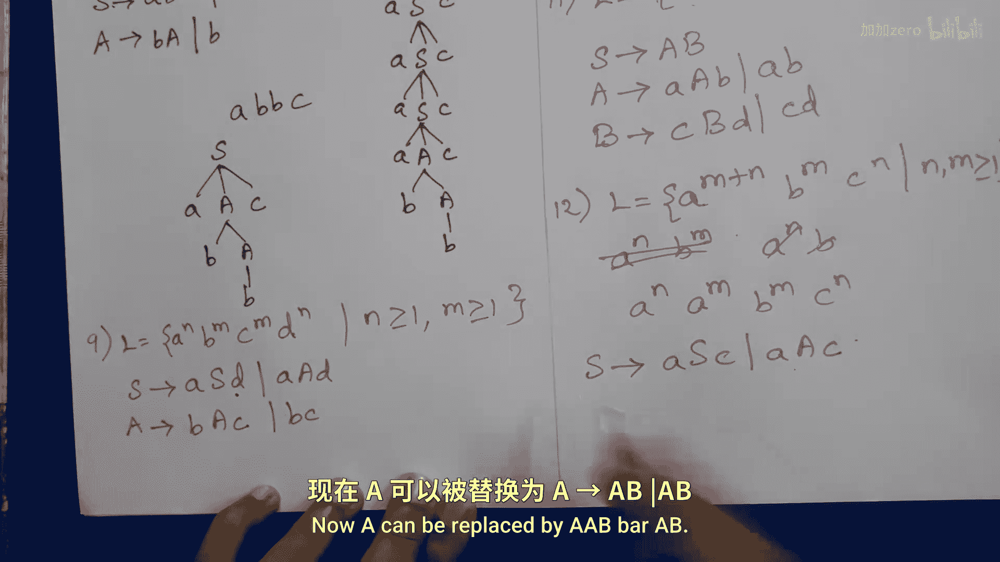

So we have discussed some problems for construction of CFfG， Thank you。

