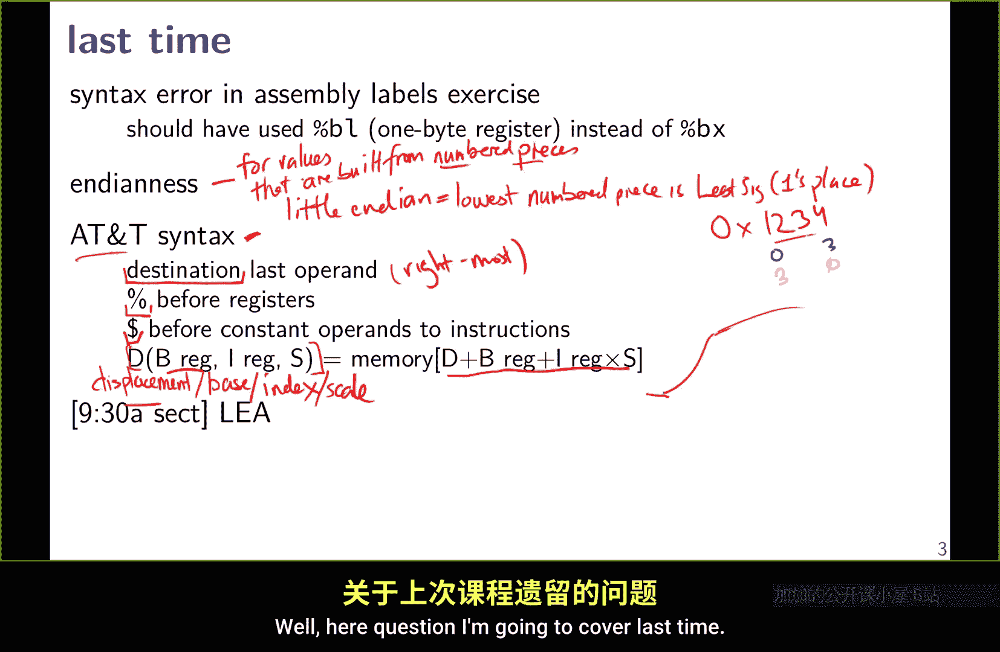
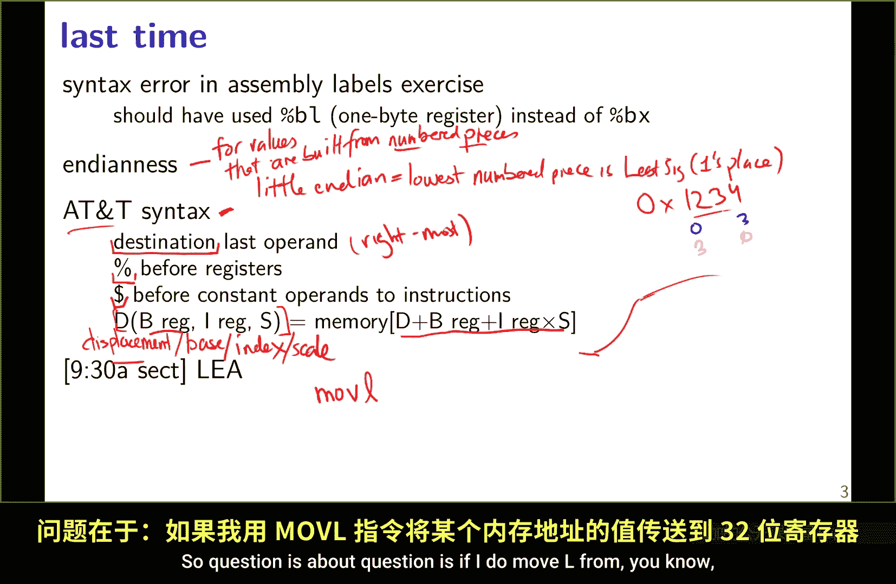
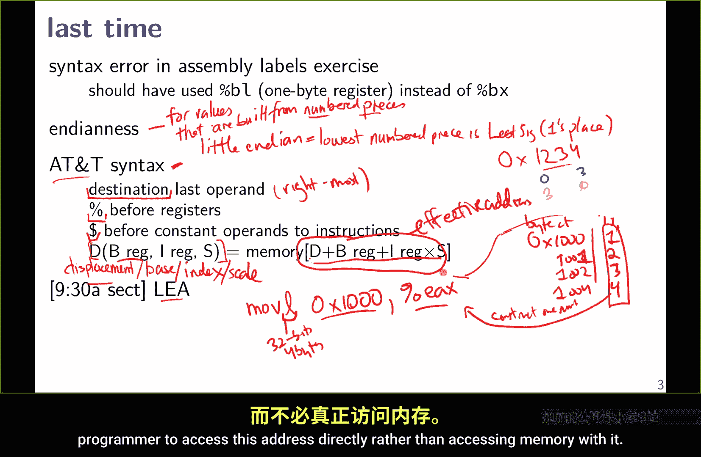
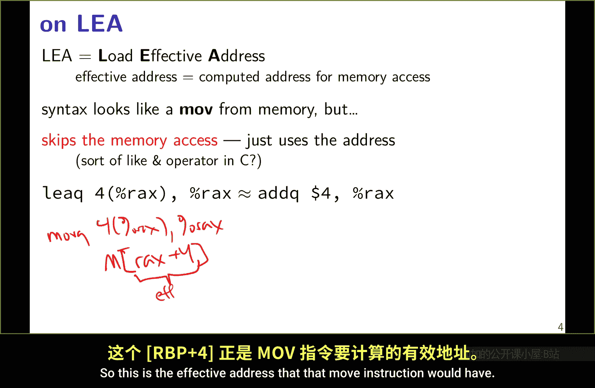
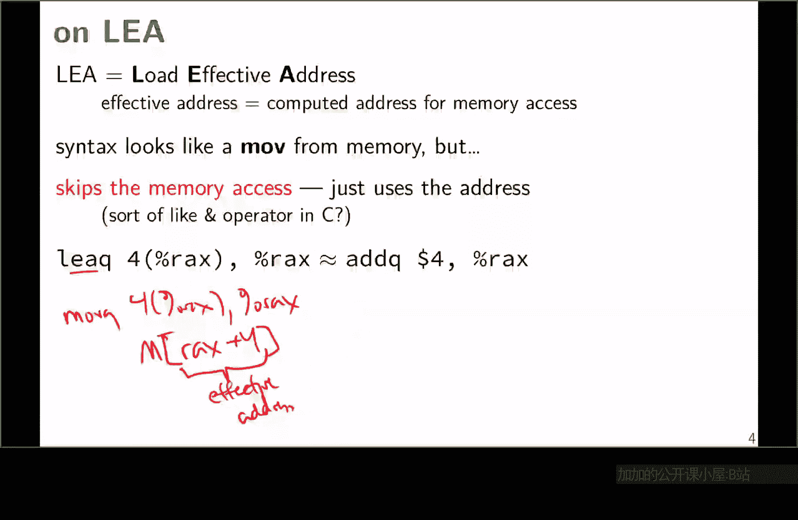
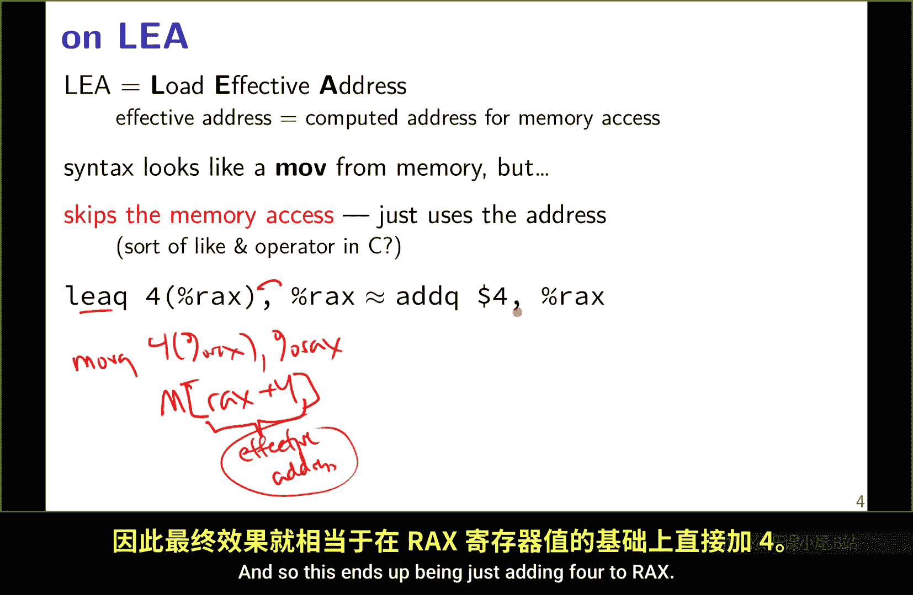
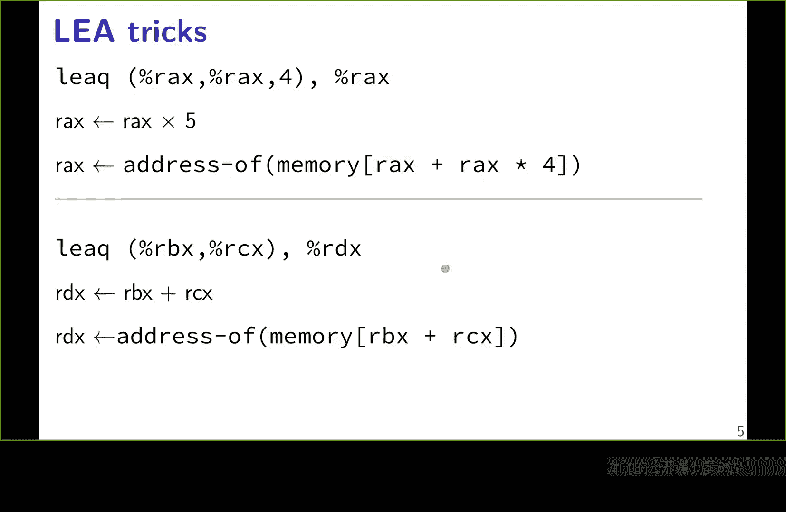
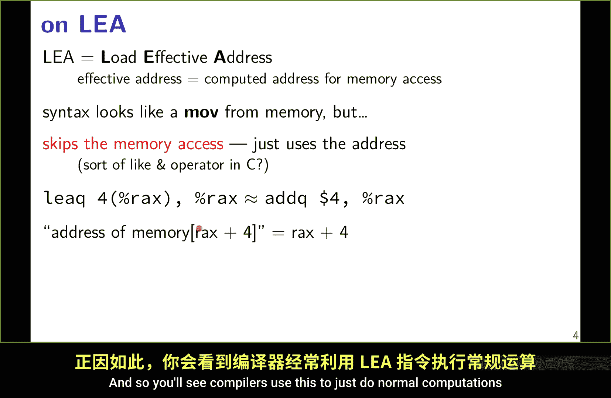
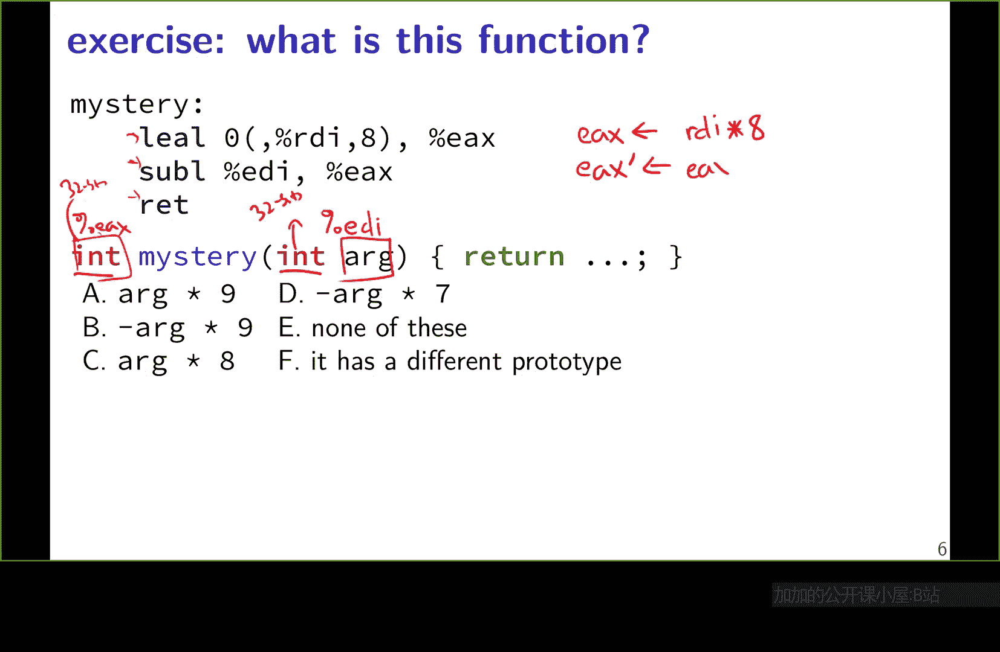

# 003：汇编语言（第二部分）⚙️

在本节课中，我们将要学习汇编语言中的字节序概念、AT&T语法回顾，并重点介绍一个名为 `LEA`（加载有效地址）的特殊指令。我们将通过具体的例子和练习来理解这些概念。

## 字节序回顾 🧩

上一节我们介绍了如何将多个字节片段组合成一个更大的数字。当我们需要将多个编号的字节片段组装成一个更大的数字时，必须决定组装的方式。我们主要使用**小端序**。这意味着数字的最低有效位（个位）存放在编号最小的字节片段中。

需要强调的是，字节序仅在我们处理由多个独立字节片段组成的数字时才相关。如果我写下的是一个完整的、未分割的数字，则不存在字节序问题。

## AT&T 汇编语法回顾 📝

接着，我们回顾了汇编语法，特别是本课程使用的 **AT&T 语法**。以下是其核心规则：

以下是AT&T语法的主要特点：
*   **操作数顺序**：目标操作数总是在指令的**最右侧**。公式为：`指令 源操作数, 目标操作数`
*   **寄存器表示**：寄存器名前始终带有**百分号 `%`**。如果没有百分号，则它是一个标签。
*   **立即数表示**：常量参数（立即数）前带有**美元符号 `$`**。
*   **内存寻址**：使用特定的语法表示内存位置，公式为：`位移量(基址寄存器, 索引寄存器, 比例因子)`。指令在执行内存访问前，会先计算这个有效地址：`有效地址 = 位移量 + 基址寄存器 + 索引寄存器 * 比例因子`



## 关于 `movl` 指令的澄清 💡



关于上节课的一个问题：如果执行 `movl` 指令从某个内存地址移动到32位寄存器，是否会读取多个字节？答案是**肯定的**。`movl` 中的 `l` 代表“长字”，即32位或**4个字节**。因此，该指令会从指定的起始地址开始，连续读取4个字节来构造一个数字。

## 引入 `LEA` 指令 🧠

现在，让我们来看看本节的新主题：`LEA` 指令，即“加载有效地址”。

**有效地址** 是我们在指令中用于访问内存的地址，也就是通过 `位移量(基址寄存器, 索引寄存器, 比例因子)` 公式计算出的结果。处理器本身就需要高效地计算这个地址。`LEA` 指令允许编译器或汇编程序员直接获取这个计算出的地址值，而不是用它去访问内存。

考虑以下 `mov` 指令：
```assembly
movl 4(%rax), %edx
```
这条指令会访问内存地址 `%rax + 4` 处的值。`%rax + 4` 就是它的**有效地址**。

而 `LEA` 指令的格式类似：
```assembly
leal 4(%rax), %edx
```
这条指令会**计算**有效地址 `%rax + 4`，但**不访问内存**，而是直接将这个计算出的地址值存入目标寄存器 `%edx` 中。因此，它的效果等同于 `%edx = %rax + 4`。



你可以将其类比为C语言中的 **`&`（取地址）运算符**，它获取一个内存位置的地址。



## `LEA` 指令的通用计算用途 ⚡





传统上，`LEA` 的参数代表一个内存位置，但它并不必须如此。无论 `%rax + 4` 是否是一个可用的内存地址，这条指令都会执行加法运算。因此，编译器经常利用 `LEA` 来执行普通的算术运算，因为它非常灵活。



例如：
```assembly
leal (%rax, %rax, 4), %edx
```
这条指令计算的有效地址是 `%rax + %rax * 4`，即 `%rax * 5`。它将结果存入 `%edx`，因此实现了 `%edx = %rax * 5` 的乘法运算。在许多x86处理器上，这可能是执行该乘法最高效的方式。

同样，你还可以用它来将两个值相加，并把结果存入第三个寄存器（这是单条 `add` 指令无法直接做到的），编译器也会这样使用它。



## 练习：理解 `LEA` 的功能 🧪

假设我们有一个用汇编编写的函数，其C语言原型如下：
```c
int example(int arg);
```
根据调用约定（我们稍后会详细回顾），参数 `arg` 存放在 `%edi` 寄存器中，返回值存放在 `%eax` 寄存器中（我们使用32位寄存器）。

以下是该函数的汇编代码：
```assembly
example:
    leal 5(%edi, %edi, 4), %eax
    ret
```
问题是：这个函数等价于什么C语言操作？

让我们分析其中的 `LEA` 指令：`leal 5(%edi, %edi, 4), %eax`。
它计算的有效地址公式为：`5 + %edi + %edi * 4`。
简化后得到：`5 + %edi * 5`，即 `5 * (%edi + 1)`。
这个计算结果被直接存入 `%eax` 作为返回值。

因此，这个函数等价于：
```c
int example(int arg) {
    return 5 * (arg + 1);
}
```

## 总结 📚

本节课中我们一起学习了：
1.  **字节序**：回顾了小端序在多字节数据组装中的应用。
2.  **AT&T语法**：巩固了其操作数顺序、寄存器与立即数表示法以及复杂内存寻址格式。
3.  **`LEA` 指令**：理解了“加载有效地址”指令的核心功能——计算内存寻址公式的结果但不进行内存访问。我们看到了它不仅用于获取地址，还被编译器巧妙地用于执行高效的通用算术运算（如乘加组合）。



通过练习，我们实践了如何解析包含 `LEA` 指令的汇编代码，并将其转换为高级语言逻辑。掌握 `LEA` 是理解编译器优化和编写高效汇编代码的重要一步。