# 004：编译流水线与C语言专题 🚀

在本节课中，我们将要学习汇编语言中的`LEA`指令、条件码的工作原理，以及如何将C语言中的`switch`语句转换为汇编代码。我们将从回顾上节课的内容开始，逐步深入到更复杂的转换策略。

## 回顾：LEA指令与条件码 ⚙️

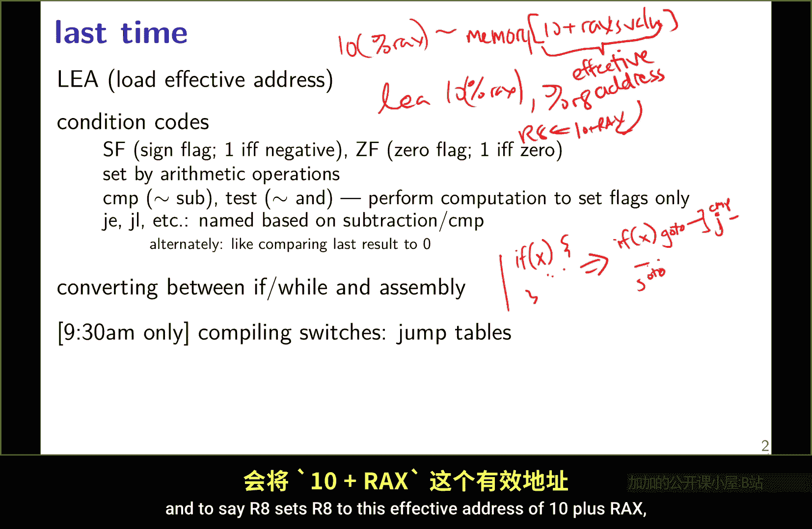

上一节我们介绍了`LEA`（加载有效地址）指令。这条指令看起来像是在访问一个内存位置，它使用了我们熟悉的语法来指定内存中的某个值，但实际上它并不进行内存访问。

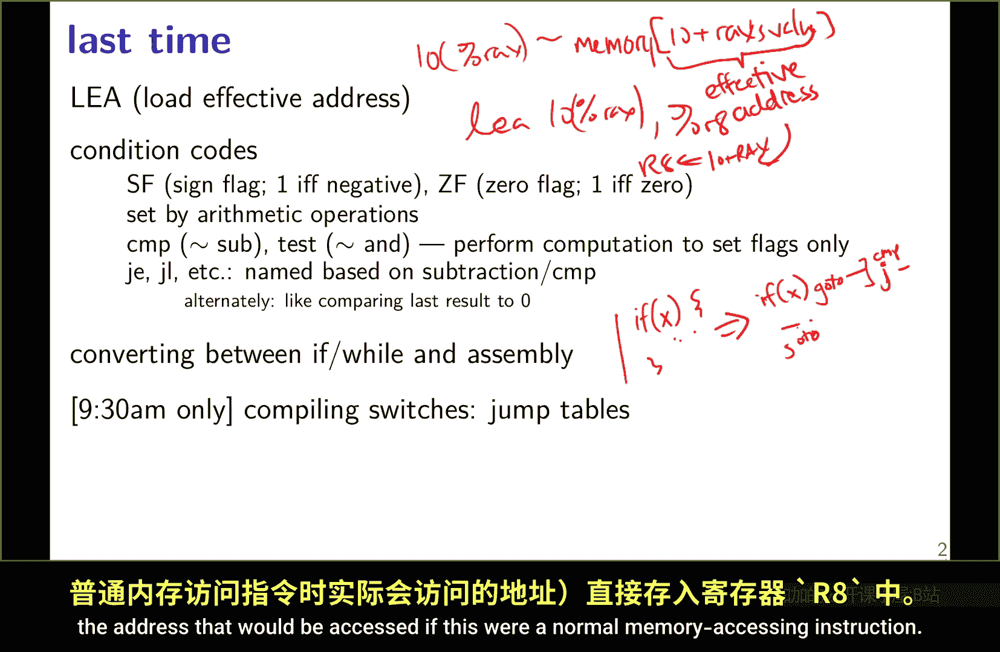

`LEA`指令的作用是计算一个内存地址，我们称之为有效地址，然后将这个地址放入目标寄存器中。例如，指令`LEA R8, [10 + RAX]`会将计算出的有效地址（即`10 + RAX`的值）设置到`R8`寄存器中。

如果这是一条普通的内存访问指令，这个地址就是将要被访问的地址。

接着，我们讨论了x86-64中条件是如何工作的。我们解决了在CS2150课程中留下的一个谜团：通常我们使用`CMP`（比较）和`JE`（跳转如果相等）这样的指令组合，但在`CMP`和`JE`之间，比较的结果是如何传递的呢？

我们了解到存在一组特殊的寄存器，称为**条件码**。其中对本课程最重要的两个是**符号标志位（SF）**和**零标志位（ZF）**，它们代表了上一次算术运算的结果。

虽然比较操作传统上不被视为一个有数值结果的算术运算，但我们知道`CMP`指令的实现方式实际上是执行一次减法运算，它只设置标志位，而不将结果存入目标寄存器。`TEST`指令与之类似，但它执行的是按位与操作。

因为比较操作在底层是减法，所以像`JE`（跳转如果相等）、`JL`（跳转如果小于）这样的指令，其名称是基于减法结果（以及因此产生的符号标志位和零标志位状态）来命名的。

另一种理解方式是将其视为与零进行比较。如果我们比较`RAX`和`RBX`，这实际上是一次`RAX - RBX`的减法。如果结果等于0，就意味着`RAX`等于`RBX`。对于小于和大于的判断也有类似的逻辑。因此，你可以将条件跳转指令（如`JE`、`JL`等）视为对上一次运算结果与零的比较。

了解了条件码以及条件跳转指令的工作原理后，我们可以思考如何将C代码转换为汇编代码。

## 从C代码到汇编代码的转换策略 🔄

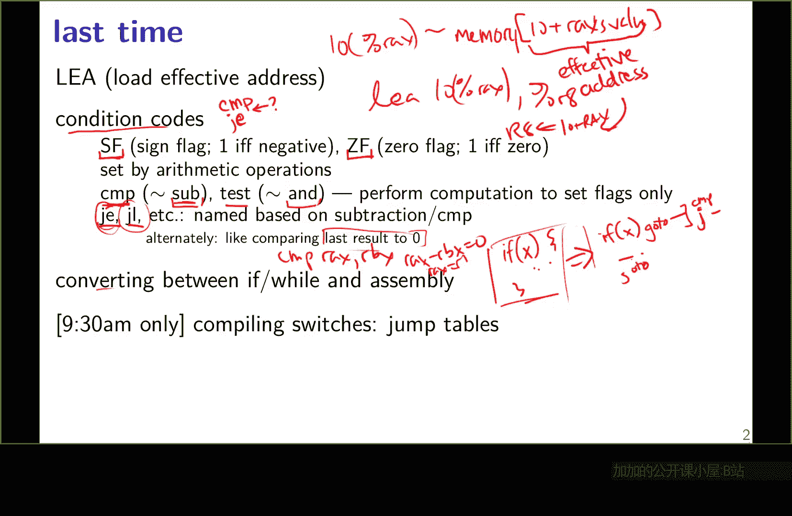

在CS2150课程中你可能已经做过类似的事情，尽管可能有一段时间了。我的方法是首先将C代码重写为一种形式，使其看起来更像汇编操作。

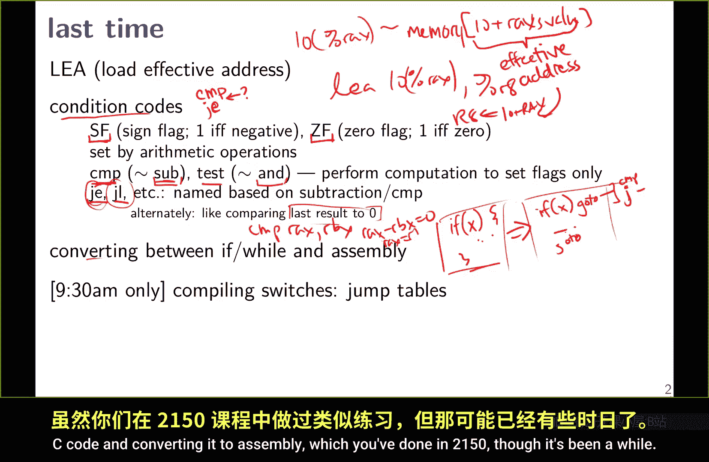

我将`if`语句转换为使用`if`和`goto`的形式。`goto`在C语言中是有效的。这种`if-goto`结构可以直接翻译为`CMP`和条件跳转指令，而`goto`本身可以直接翻译为`JMP`指令。

这种先将C代码重写为更简单的C代码的策略，是我将任何C代码转换为汇编代码的方法。同时，这也是思考反向翻译（从汇编到C）时需要考虑的思路。

关于上节课涵盖的这些主题，或者任何其他我现在应该讨论的内容，有问题吗？

好的。那么，今天我将从讨论如何将一种我们尚未研究过的C代码结构转换为汇编代码开始，这就是`switch`语句。它的转换不那么直接。

## 深入探讨：Switch语句的汇编转换 🧩

`switch`语句的转换之所以不那么直接，是因为实际上有多种方式可以在汇编中实现它。你可能会想知道，到底会发生哪种情况？

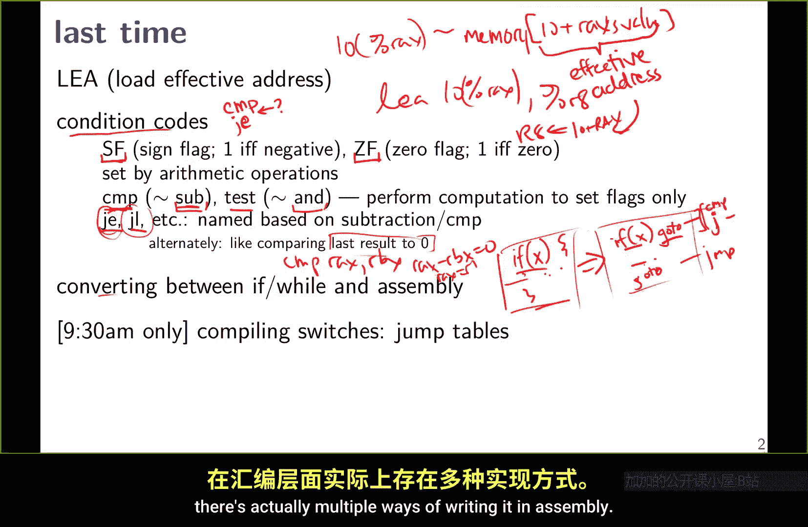

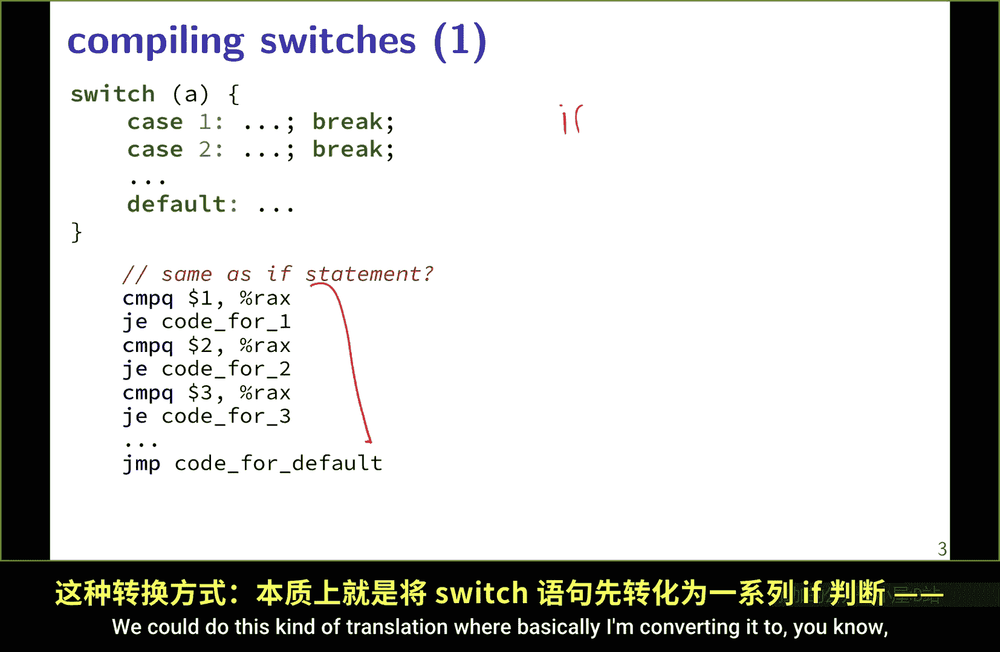

以下是几种可能的转换策略：

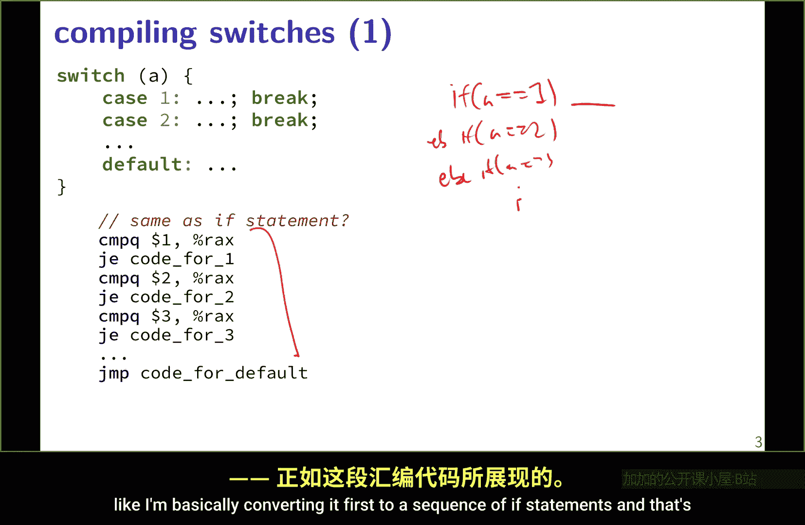

**策略一：转换为if-else链**
我们可以进行这种转换，基本上就是将`switch`语句转换为一连串的`if`语句。下面的汇编代码大致代表了这种思路。

**策略二：转换为二分查找**
假设我有一个包含100个`case`的`switch`语句。我可以将其转换为：首先检查值是否小于50，然后检查是否小于25，如此不断嵌套，并将各个`case`的代码放在相应的嵌套`if-else`语句中。这本质上是一种二分查找算法。我们可以为此编写汇编代码，下图展示了汇编代码的大致轮廓。

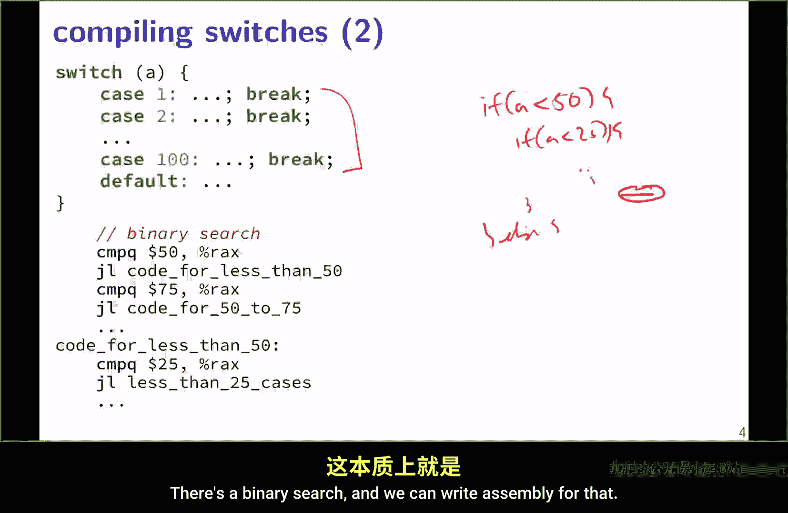

**策略三：使用跳转表**
还有另一种策略，即使用所谓的**跳转表**，这是我们之前没有见过的。

在这个版本中，首先确保索引值在有效范围内，然后使用一条特殊的跳转指令。这条指令我之前提到过，但我们还没有深入探讨。让我们来看看它是如何工作的。

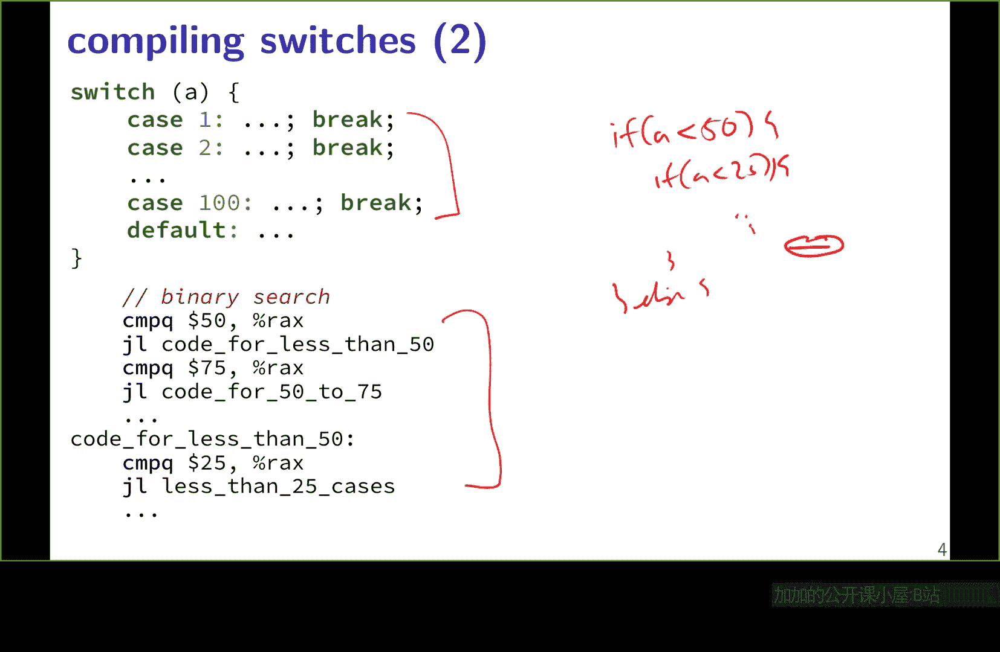

其核心思想是，我们有一个指向机器代码的指针表。表中的每一项都是一个指向机器代码的指针，具体来说，是指向对应`case`代码块的指针。通过这个表，我们可以直接查找到对应的表项并跳转到那里执行。这就是下面这条间接跳转指令所做的事情。

让我们详细分析一下。假设我们有这条间接跳转指令，并且`RAX`寄存器中存储着变量`a`的值。

我同时还有这个跳转表。它位于内存中的某个位置，假设其起始地址是`0x12500`。它是一个代码地址的列表。

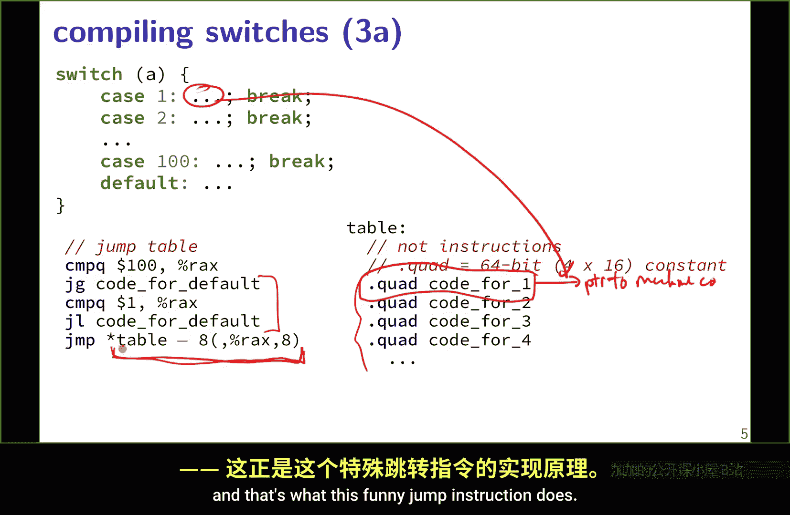

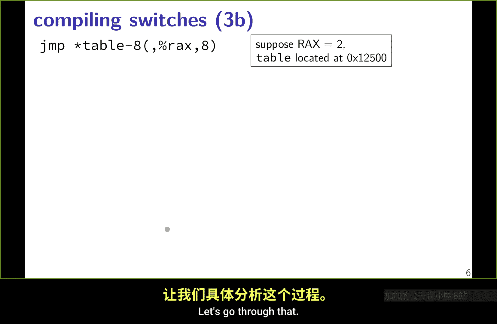

这里的每个代码地址都指向某处的机器代码，这些就是各个`case`对应的机器代码。

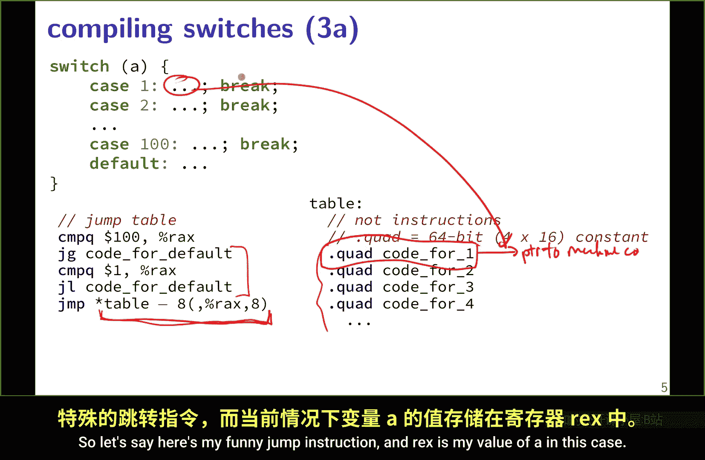

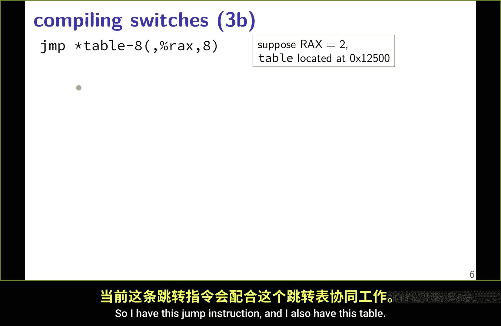

那么，如果`RAX`等于2，这条指令会做什么呢？我们来分析一下。

我们有一个位移量。这里的位移量是`table - 8`。汇编器为了方便，允许我们在简单的计算中使用标签。`table`是一个标签，它会被替换为`table`的地址（我们假设是`0x12500`）减去8。汇编器会为我们完成这个计算以得到最终的位移量。

然后，将这个位移量与我们的索引寄存器`RAX`乘以比例因子后的值相加。最终，我们得到地址`0x12508`。可以看到，由于减去了8，尽管`RAX`是2，我们却得到了表中的第二项（而不是第三项）。

这一项指向这里，即一个指向机器代码的指针。这里才是`case 2`的实际代码所在的位置。这条跳转指令将从内存中读取一个指针，然后跳转到该指针所指向的地址，下一条要执行的指令就在那里。

如果还有更多问题，我现在开始回答。首先回答一个问题：

**问：编译风格二（二分查找）和风格三（跳转表）是否只适用于特殊情况？**

**答：** 风格二是二分查找。我们可以采用这种二分查找策略，即使我们只有像`case 40`、`case 50`、`case 60`这样的不连续值。我们仍然可以先检查它是否小于或等于50。

---

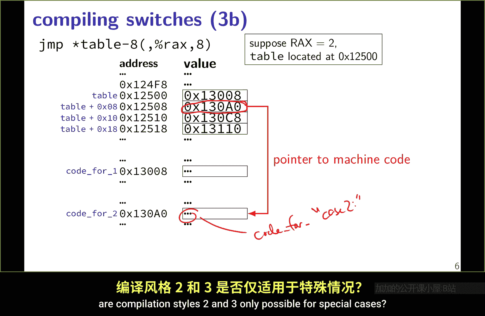

**本节课总结**

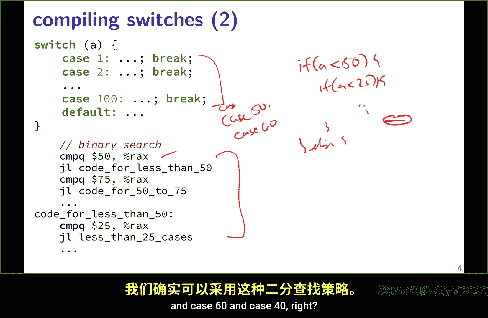

在本节课中，我们一起学习了：
1.  `LEA`指令用于计算有效地址而非进行内存访问。
2.  条件码（特别是`SF`和`ZF`）如何记录算术运算结果，以及`CMP`和`TEST`指令如何设置它们。
3.  条件跳转指令（如`JE`、`JL`）基于条件码状态进行决策。
4.  将C代码转换为汇编代码的策略，特别是将控制流结构先重写为`if-goto`形式。
5.  `switch`语句在汇编层面的多种实现策略，包括线性的`if-else`链、二分查找以及高效的**跳转表**实现。跳转表通过内存中的指针数组，允许根据索引值直接跳转到对应的代码块。