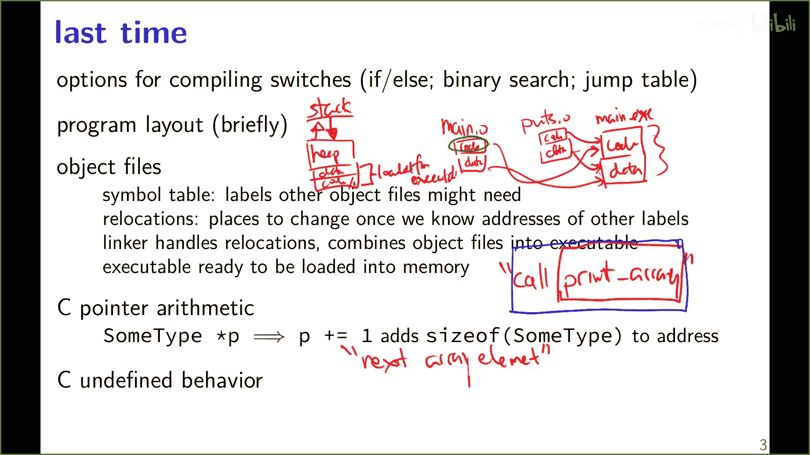
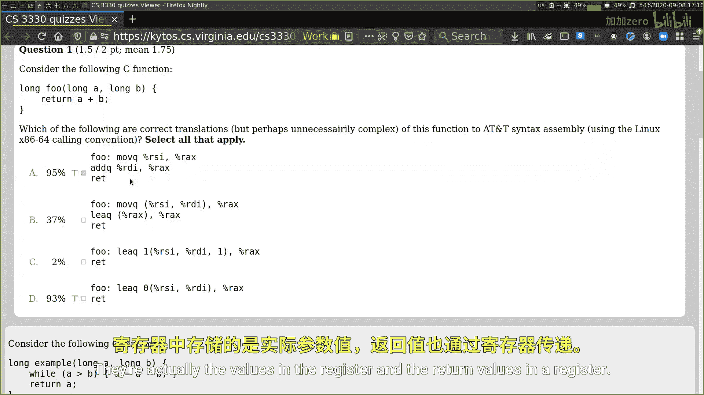

# 005：位运算与数据表示

在本节课中，我们将要学习位运算的基本概念、数据在内存中的表示方式，以及编译器如何处理这些操作。我们将从回顾上节课的内容开始，逐步深入到具体的位运算操作和数据表示细节。

## 概述

上一节我们介绍了编译开关语句的多种策略、程序在内存中的布局以及链接器如何将多个目标文件组合成可执行文件。本节中，我们来看看位运算（Bitwise Operations）以及数据在计算机中的底层表示，这是理解计算机如何操作数据的基础。

## 回顾：编译与链接过程

我们首先回顾了编译器处理 `switch` 语句的几种不同策略。与 `if-else` 语句相对直接的翻译不同，`switch` 语句的编译可能生成一连串的 `if-else` 链，或者采用一种独特的策略——跳转表（jump table）。编译器会创建一个指针数组，每个指针指向对应 `case` 的代码块，然后生成通过数组查找并跳转到相应地址的代码。

接着，我们探讨了程序加载到内存后的形态。在x86架构中，栈（stack）向低地址方向增长，堆（heap）向高地址方向增长，而程序本身的代码、数据和常量则从可执行文件中加载。

然后，我们深入了解了目标文件（object files）的工作原理。编译器将代码分块汇编成目标文件，链接器（linker）负责将这些目标文件合并成一个完整的可执行文件。在这个过程中，链接器需要处理不同代码块之间的引用关系，例如一个文件中的 `main` 函数调用另一个文件中定义的 `puts` 函数。它通过重定位（relocation）记录和符号表（symbol table）来解决这些未确定的地址引用。

关于上节课的测验题，有一个关键点：`call print_array` 指令本身在内存中的地址并不会被特别记录在可执行文件中。链接器将整个代码块视为一个整体进行复制和重定位，它并不关心其中单个指令的地址。

## 回顾：C语言指针运算与未定义行为

我们还复习了C语言中的指针运算。对指针进行加减操作时，地址的增减量会根据指针所指向类型的大小进行缩放，而不是简单地增减1个字节。例如，对于一个 `int*` 指针，`p+1` 实际上会将地址增加 `sizeof(int)` 个字节，以指向数组中的下一个元素。

同时，我们提到了C语言中的未定义行为（Undefined Behavior）。C语言标准并未明确规定某些操作的结果，例如有符号整数溢出（signed integer overflow）。即使根据二进制补码的规则，它似乎应该回绕（wrap around）到一个负数，但编译器并不保证会产生这种行为，甚至可能产生任意结果。

## 位运算基础

理解了数据如何存储和寻址后，我们现在来看看如何直接操作数据的二进制位。位运算允许我们在最底层对整数类型的数据进行精确控制。

以下是几种基本的位运算操作：

*   **按位与（AND）**：运算符为 `&`。只有当两个操作数的对应位都为1时，结果的对应位才为1。
    *   **公式**：`result_bit = a_bit & b_bit`
    *   **示例**：`0b1100 & 0b1010 = 0b1000`

*   **按位或（OR）**：运算符为 `|`。只要两个操作数的对应位有一个为1，结果的对应位就为1。
    *   **公式**：`result_bit = a_bit | b_bit`
    *   **示例**：`0b1100 | 0b1010 = 0b1110`

*   **按位异或（XOR）**：运算符为 `^`。当两个操作数的对应位不同时，结果的对应位为1。
    *   **公式**：`result_bit = a_bit ^ b_bit`
    *   **示例**：`0b1100 ^ 0b1010 = 0b0110`

*   **按位取反（NOT）**：运算符为 `~`。将操作数的每一位取反（0变1，1变0）。
    *   **公式**：`result_bit = ~a_bit`
    *   **示例**：`~0b1100 = 0b0011`（假设为4位）

*   **左移（Left Shift）**：运算符为 `<<`。将操作数的所有位向左移动指定的位数，右侧空出的位用0填充。
    *   **效果**：相当于乘以2的n次幂（对于无符号数或非负的有符号数）。
    *   **示例**：`0b0001 << 2 = 0b0100`（即 1 * 4 = 4）

*   **右移（Right Shift）**：运算符为 `>>`。将操作数的所有位向右移动指定的位数。对于无符号数，左侧空出的位用0填充（逻辑右移）；对于有符号数，通常用符号位填充（算术右移），但这取决于具体实现。
    *   **效果**：相当于除以2的n次幂并向下取整。
    *   **示例（无符号）**：`0b0100 >> 1 = 0b0010`（即 4 / 2 = 2）

## 数据表示：补码与字节序

计算机使用二进制补码（Two‘s Complement）来表示有符号整数。其优点是加法运算电路可以同时用于有符号数和无符号数。

**补码定义**：对于一个w位的整数，其补码表示的值x为：
*   如果最高位（符号位）为0，则其值就是后w-1位的无符号值。
*   如果最高位为1，则其值为 `-2^(w-1) + (后w-1位的无符号值)`。

另一个重要概念是字节序（Endianness），它决定了多字节数据（如int, long）在内存中的存储顺序。
*   **小端序（Little-endian）**：低位字节存储在低地址处。这是x86架构使用的格式。
*   **大端序（Big-endian）**：高位字节存储在低地址处。

例如，32位整数 `0x12345678` 在内存中的存储（从低地址到高地址）为：
*   小端序：`0x78, 0x56, 0x34, 0x12`
*   大端序：`0x12, 0x34, 0x56, 0x78`

## 总结

本节课中我们一起学习了计算机架构中关于位运算和数据表示的核心内容。我们回顾了程序从编译、链接到加载的完整生命周期，并深入探讨了指针运算的细节和C语言中未定义行为的概念。接着，我们系统学习了按位与、或、异或、取反、左移和右移这六种基本位运算及其用途。最后，我们理解了有符号整数在计算机中是如何通过补码表示的，以及字节序如何影响数据在内存中的布局。掌握这些底层知识，是理解和编写高效、可靠代码的基础。