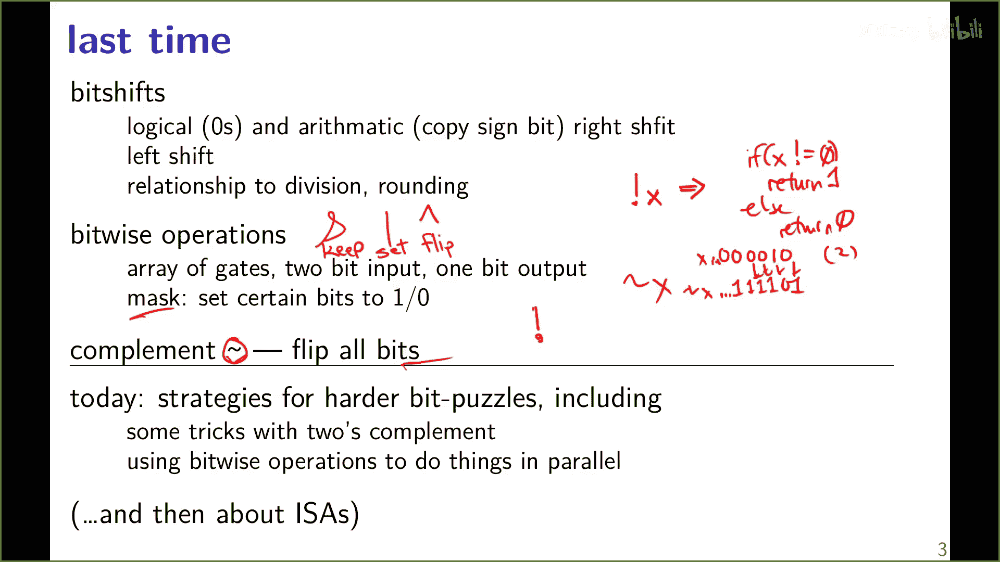
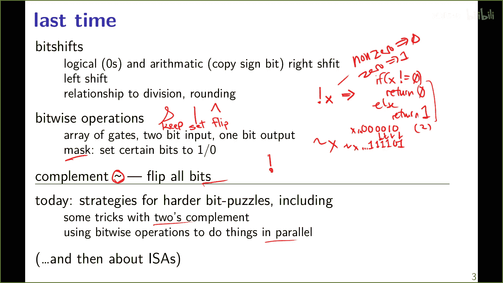
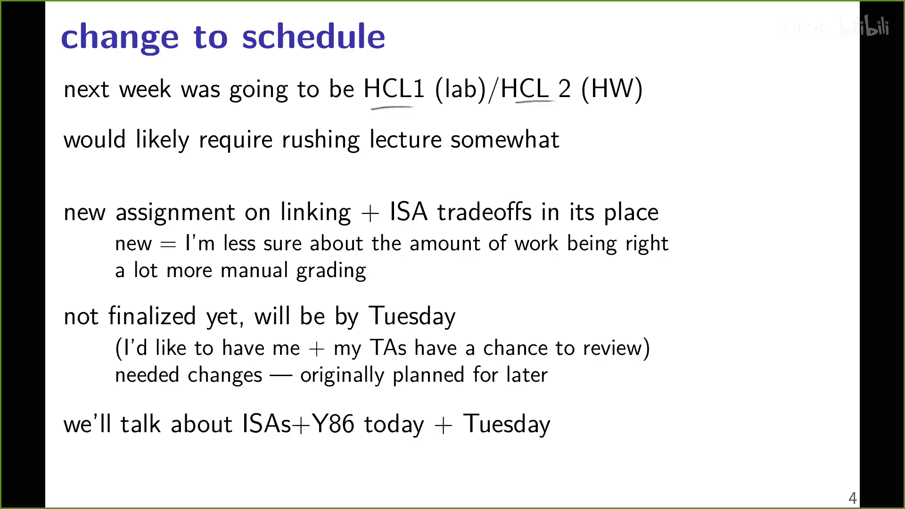
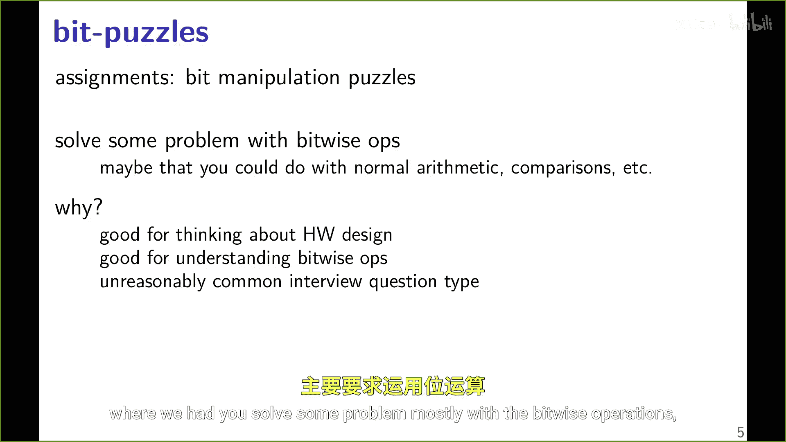

# 006：位运算（完结）与指令集架构 🧩

在本节课中，我们将要学习位运算的核心概念，并探讨如何系统性地解决更复杂的位操作谜题。我们将回顾移位运算，深入理解位逻辑运算，并学习一些高级技巧。

## 回顾：移位运算

上一节我们介绍了移位运算。在硬件中，比特由电平和导线表示。对于一个多比特的值，我们有一组导线。在这种方案下，提取和操作单个比特相对容易，但这并不会自然地暴露给软件。因此，我们讨论了硬件通常提供的、能让我们方便访问单个比特的操作，其中之一就是移位运算，它可以移动数字中的比特。

我们了解到，移位与乘以或除以2的幂次方存在关系。因为，如果在二进制数的末尾添加一个零，我们就把个位移到了二位，二位移动到了四位，以此类推，相当于乘以2。所以，移位与乘以或除以2的幂次方存在天然的联系。

对于右移（相当于除法），我们有两种选择来处理移出最低有效位后留下的额外比特。一种方法是逻辑右移，即移入零。另一种方法是算术右移，即复制符号位。逻辑右移接近无符号数的除法。算术右移接近有符号数的除法。对于左移，我们没有这个问题。我们总是移入零，并且它总是乘法，因为没有类似除法的舍入问题。

## 回顾：位逻辑运算

接着我们讨论了位逻辑运算。这些运算将单比特运算符应用于两个数字的每一个对应比特位。

我们以 **AND**、**OR** 和 **XOR** 作为这些运算符的例子。我们可以将这些运算视为对数字部分进行逻辑操作的方式，通过构造一个**掩码**来指示我们想要操作数字的哪些部分，并思考我们想要进行何种操作。

我们学到：
*   **AND** 运算：如果我们想保留某些比特，我们设置一个掩码来指定要保留哪些比特。公式：`result = value & mask`
*   **OR** 运算：如果我们想设置某些比特（无论它们之前是什么状态），使其变为1，OR运算可以做到。公式：`result = value | mask`
*   **XOR** 运算：如果我们想翻转某些比特，我们通过掩码指定要翻转的比特，并使用按位异或运算应用该掩码。公式：`result = value ^ mask`

我们还学习了单目运算符 **取反**，它只是翻转一个数字中的所有比特。公式：`result = ~value`

### 关于取反运算符的澄清

有一个问题：取反运算符 `~` 和逻辑非运算符 `!` 有什么区别？

在C语言中：
*   `!x` 等价于：如果 `x` 不等于0，则返回1；否则返回0。它不按比特工作，而是查看 `x` 的整个值。
*   `~x` 是翻转 `x` 的每一个比特。

例如，如果 `x` 等于2（二进制 `0010`），那么 `~x` 将得到 `1101`（假设为4位）。我们是在按比特操作。

逻辑非 `!` 的行为是：将非零值转换为0，将零值转换为1。

## 本节重点：系统化解决位操作谜题

现在，我们将把大部分时间花在讨论一些解决更复杂位操作谜题的策略上。你们在作业中已经看过一些，其中一些可能相当令人望而生畏。

我们将展示一些特定于谜题的技巧，以及一个关键思想：我们可以**并行执行操作**。如果我们用最自然的方式编写代码，可能会使用两个运算符，但实际上我们可以使用一个运算符同时完成这两项操作。我们将展示一个具体的例子，这个例子将揭示在此类问题中经常出现的一种模式。

但在开始之前，有一个课程安排上的说明。

## 课程安排调整（后勤通知）

根据课程进度，我们对作业和实验的安排进行了调整。原定下周进行的第一次高级实验和作业将稍后发布。一项关于指令集架构权衡的新作业已被提前，并已修改以移除我们尚未涉及的内容引用。作业和实验的截止日期保持不变，只是调整了它们所在的周次。

## 深入位操作谜题

现在，让我们深入探讨位操作谜题。你们在实验课中已经完成了一些位操作谜题。

我们将学习如何系统性地处理更复杂的挑战，包括利用位运算的并行性来优化操作。一个常见的模式是，通过巧妙的掩码设计和单次位运算，实现原本需要多个步骤才能完成的任务。这要求我们对数据的比特模式有清晰的认识，并能预见操作后的结果。

## 总结

本节课中，我们一起学习了位运算的核心知识。我们回顾了移位运算与乘除法的关系，以及逻辑右移和算术右移的区别。我们深入理解了AND、OR、XOR和取反这些位逻辑运算，并学习了如何用掩码来操作特定的比特位。最后，我们开始探讨系统化解决复杂位操作谜题的策略，特别是利用运算的并行性来优化代码。掌握这些基础是理解计算机底层数据表示和操作的关键。