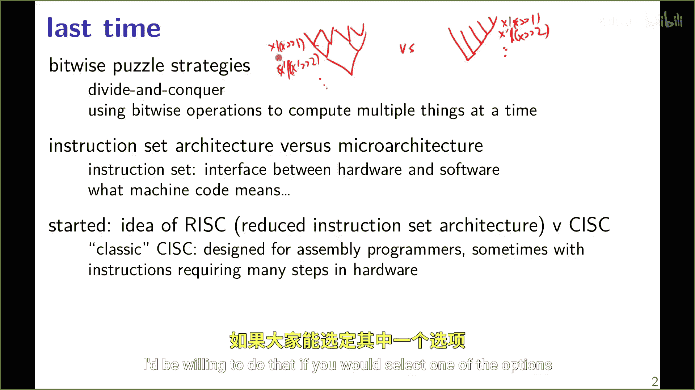
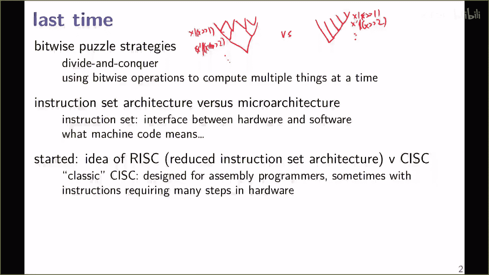
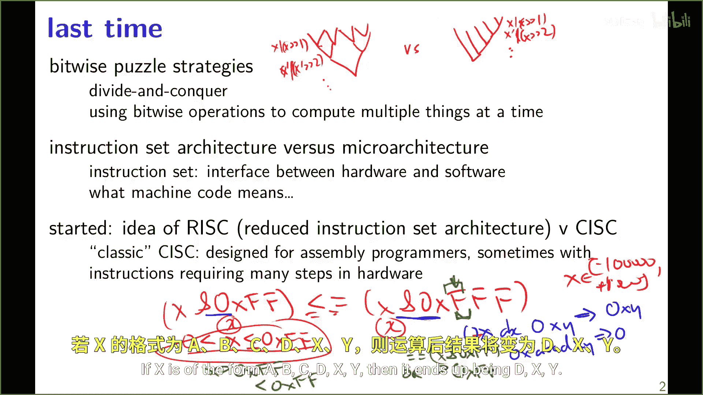

# 007：Y86指令集与位运算策略

在本节课中，我们将学习解决复杂位运算问题的策略，并深入探讨指令集架构（ISA）的基本概念，特别是RISC与CISC两种设计哲学的区别。

## 位运算问题解决策略

上一节我们介绍了解决位运算谜题的一些核心策略。本节中，我们来看看如何将这些策略应用于具体问题。

一个核心思想是：面对相对复杂的问题时，不应期望直接看出答案。首先应尝试寻找更简单的子问题。

以下是两种有效的分解方法：
*   **单比特分析法**：先思考问题在单个比特上是如何工作的。解决单比特问题后，再设法将解决方案扩展到多个比特。
*   **问题拆分法**：将问题拆分为两部分。一部分计算在某个条件为真时的答案（否则输出0），另一部分计算在另一个条件为真时的答案。最后将这两个子部分的答案通过**或**（OR）或**加**（ADD）运算组合起来。

通过这类方法，我们可以将复杂的位运算问题分解为更易处理的片段。

另一个要点是，位运算能够同时计算多个结果，有时甚至超出我们的直接需求。我们曾举过一个检查任何比特是否被设置的例子。

一种朴素的方法是：将前两个比特进行**或**运算，然后将结果与下一个比特进行**或**运算，如此重复。这样，我们需要为检查的每一个比特执行一次**或**操作。

然而，由于位级别的**或**运算实际上会同时处理所有比特对，朴素方法会执行大量冗余操作，效率低下。更巧妙的方法是，利用一次位运算就能得到多个比特位置上的结果，并确保我们以某种方式利用了这些额外的结果。这样，我们可以通过一次操作获得多个答案，从而节省了分别执行多次**或**操作的开销。

## 指令集架构（ISA）基础

在结束位运算的讨论后，我们转向了指令集。我首先介绍了**指令集架构**的概念，它定义了硬件与软件之间的接口。

一种理解方式是：它规定了机器码的含义。我们将有一些机器码，这些代码对应着某些汇编代码。机器码是硬件所看到的内容，我们需要明确定义其含义，这就是指令集架构的任务。一旦定义了一种机器码，我们会发现存在多种在硬件上实现它的方式。

这些不同的实现选择对应着不同的**微架构**。因此，尽管实现方式可能大相径庭，但只要机器码具有相同的含义，执行时就会产生相同的结果，这就是相同的指令集。

我们开始审视指令集，并思考其中的设计权衡。起初，我们关注一些非常基础的问题，例如：
*   为汇编程序员提供多少个寄存器？
*   机器码中指令的尺寸是多大？
*   指令接受多少个操作数？
*   操作数采用什么格式？
*   是否使用条件码？

## RISC与CISC设计哲学

随后，我们讨论了一个更高层次的设计问题，不再局限于细节，而是关于设计目标。我们提到，在早期，人们设计指令集主要是为了汇编程序员的便利，因此设计了众多精美但复杂的指令。这些指令在硬件上执行往往需要很多步骤。当时的理念是，更好的硬件应该提供更多这类方便好用的指令。

作为对这种理念的回应，出现了第二种设计哲学，称为**RISC**，即**精简指令集计算机**。其核心思想是：现在我们有了编译器，不再需要依赖提供丰富的汇编语言。我们希望确保为编译器提供生成高效代码所需的工具，并专注于为此提供正确的工具，即使这意味着程序体积更大、手写汇编代码更困难。

在继续深入讨论RISC与CISC之前，对上节课内容有任何疑问吗？

## 课堂问答解析

有一个关于测验的问题，询问是否可以讲解其中一道关于判断表达式是否恒真的题目。我们选择其中一项进行解析，而不是全部讲解。

题目是：对于任意整数`x`（正数或负数），表达式 `(x & 0xFF) <= (x ^ 0xFF)` 是否恒成立？

我们来分析一下。如果`x`始终是正数，这个问题会简单很多。

*   如果`x`是正数且在0到0xFF之间：
    *   左边表达式 `(x & 0xFF)` 的结果是 `x`。
    *   右边表达式 `(x ^ 0xFF)` 的结果也是 `x`（因为`x`的高位都是0，与0xFF异或后高位不变，低位取反，但在此范围内，`x`与`x`的低8位取反后再与自身比较，需要具体分析。实际上，当`x`在0-0xFF时，`x ^ 0xFF = 0xFF - x`，这通常小于或等于`x`吗？不一定，例如`x=1`，左边=1，右边=254，1 <= 254成立。但`x=0x80`时，左边=128，右边=127，128 <= 127不成立。因此，即使在正数范围内，该式也**非恒真**。原讲师此处的口头分析有误，我们根据逻辑进行校正）。
*   如果`x`是正数且大于0xFF：
    *   左边 `(x & 0xFF)` 的结果是`x`的低8位，值在0到0xFF之间。
    *   右边 `(x ^ 0xFF)` 的结果是`x`的高位不变，低8位按位取反。其结果肯定大于或等于`x`的低8位值吗？不一定，因为异或操作可能改变高位（如果`x`的高位与0的高位异或？注意0xFF是32位或64位下的0x000000FF，高位为0，所以`x ^ 0xFF`只影响低8位，高位与`x`相同）。因此，右边 = `x的高位部分 + (低8位取反)`。这不一定总大于左边的`低8位值`，因为左边只是低8位，而右边是一个完整的数，其值通常远大于左边的单个字节值（除非`x`的高位全为0）。但比较运算符`<=`比较的是整个整数值。例如`x = 0x100`（256），左边=0，右边=0x1FF（511），0 <= 511成立。但考虑`x`为负数时呢？

对于负数，关键点在于这两个**与**（AND）操作都会将符号位清零。因为0xFF的二进制是`...0000 1111 1111`，最高位是0，所以`x & 0xFF`的结果符号位一定是0，相当于得到了一个对应的非负数（`x`的低8位值）。同样，`x ^ 0xFF`也只影响低8位，符号位与`x`相同（因为0xFF符号位为0，异或后不变）。因此，对于负数`x`，`x ^ 0xFF`的符号位仍为1，结果仍为负数；而`x & 0xFF`的结果为非负数。一个非负数通常小于或等于一个负数吗？不，非负数（>=0）通常大于负数（<0）。例如，令`x = -1`（在32位补码中为0xFFFFFFFF）：
*   左边：`-1 & 0xFF = 0xFF`（即255）
*   右边：`-1 ^ 0xFF = 0xFFFFFF00`（即-256）
*   判断：`255 <= -256`？这显然不成立。

因此，该表达式**并非**恒真。原讲师在口头推导中对于正数情况的分析有瑕疵，且未深入考虑负数情况下的反例。通过这个具体的反例，我们可以明确得出结论。

---

本节课中，我们一起学习了分解复杂位运算问题的策略，理解了指令集架构作为软硬件接口的角色，并初步了解了RISC与CISC两种不同的指令集设计哲学。最后，我们通过一个测验题目的分析，巩固了位运算和整数比较的知识。