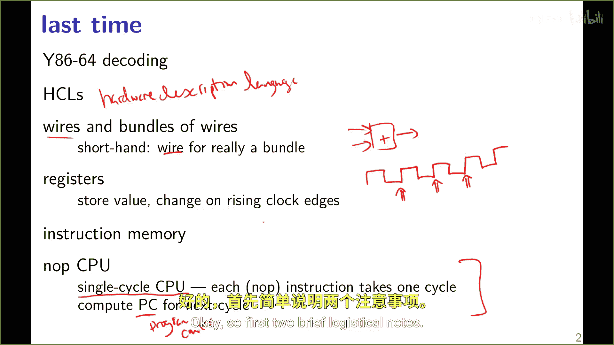
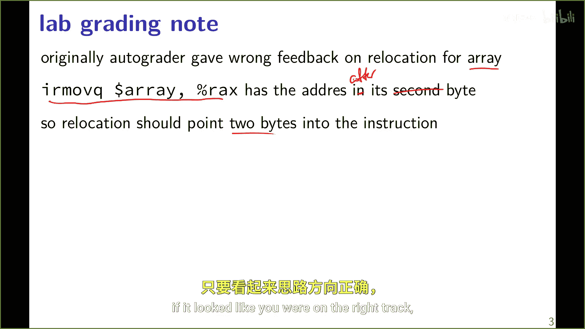
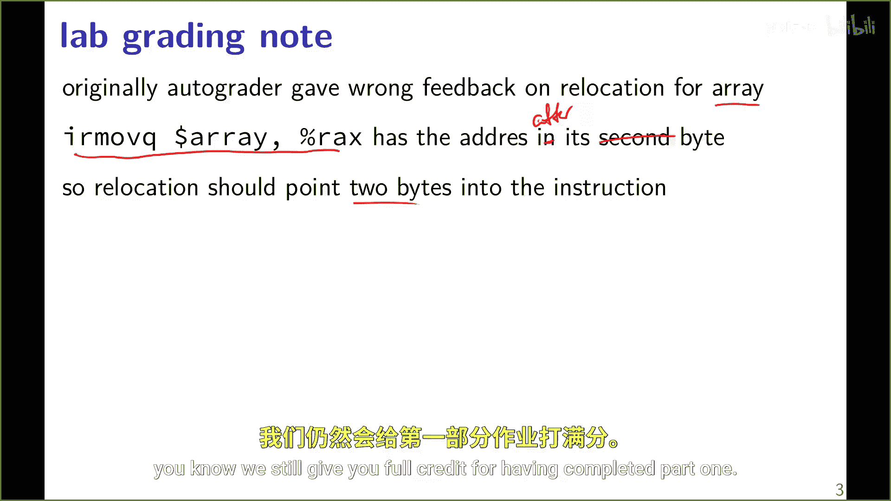
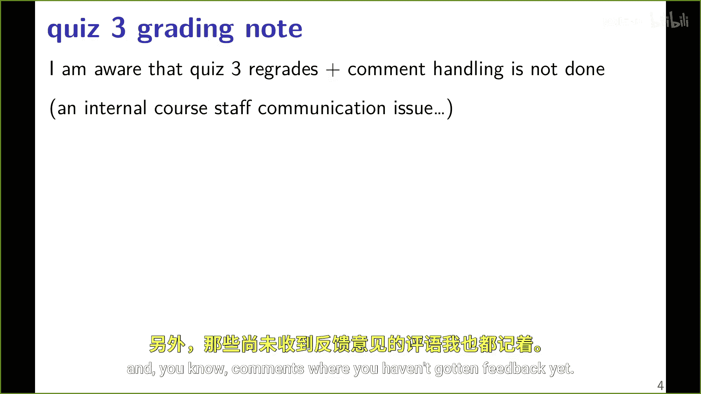
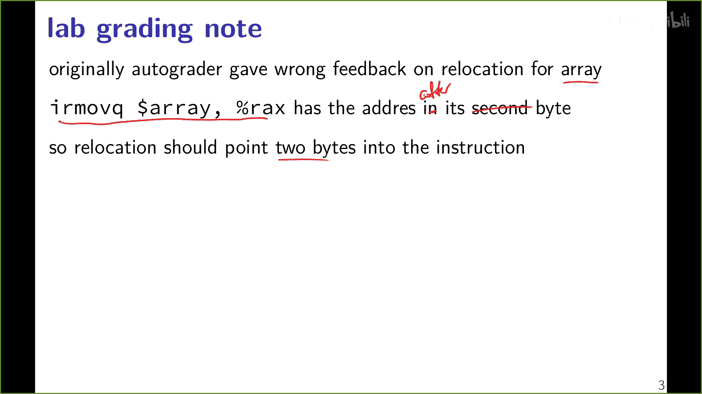
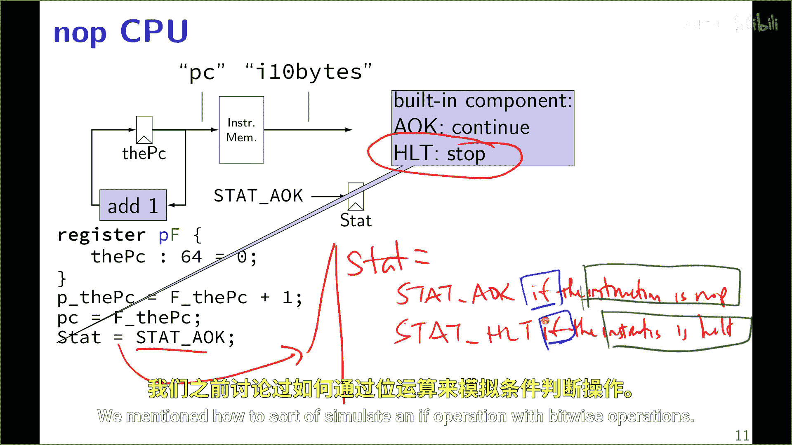

# 009：SEQ 第二部分 - 实现 HALT 指令 🚀

在本节课中，我们将继续构建我们的单周期 Y86-64 处理器。上一节我们介绍了指令解码和硬件描述语言的基本概念，并搭建了一个只能执行 `nop` 指令的简单CPU框架。本节中，我们将超越这个框架，学习如何实现 `halt` 指令，并探索在硬件电路中实现条件逻辑的方法。

## 回顾与目标 🎯

上一节我们设计了一个“单周期CPU”，每个指令在一个时钟周期内完成。我们假设所有指令都是 `nop`（空操作），因此处理器只是不断地将程序计数器（PC）加1，永不停止。这带来了一个问题：处理器无法告知模拟器何时停止运行。

本节课的目标是解决这个问题，为我们的CPU添加 `halt` 指令。这涉及到两个核心任务：
1.  如何根据当前执行的指令类型（是 `nop` 还是 `halt`）来产生不同的控制信号。
2.  如何在硬件电路中实现这种“如果...那么...”的条件逻辑。

## 实现条件逻辑：从“如果”到电路 🧠

在软件中，我们可以轻松地使用 `if` 语句。但在硬件电路中，所有连接都是物理的、持续存在的，我们不能使用传统的 `if` 语句。我们需要一种方法，让电路的输出能根据输入条件的不同而改变。

一种解决方案是利用我们之前学过的位操作技巧来模拟 `if` 操作。不过，在本课程使用的 HCLRS 硬件描述语言中，我们有更直接的工具。

HCLRS 提供了一个名为 `Mux`（多路选择器）的组件，它正是用来实现条件选择的。`Mux` 根据一个选择信号（`select`），从多个输入中选择一个作为输出。

其工作方式可以用以下伪代码描述：
```
输出 = 选择信号为真 ? 输入A : 输入B
```
或者更具体地，对于我们的 `stat` 信号（控制模拟器运行状态）：
```
stat = (指令是halt) ? HALT : AOK
```
这里，`AOK` 和 `HALT` 是 HCLRS 中预定义的常量，分别代表“继续运行”和“停止运行”。

因此，我们的任务就转化为：**生成一个能判断“指令是否为 `halt`”的信号，并将这个信号作为 `Mux` 的选择输入。**

## 识别 HALT 指令：解码过程 🔍

要判断指令是否为 `halt`，我们需要查看从指令内存中读出的指令字节。这需要我们回到指令解码的环节。



以下是 Y86-64 指令编码表的部分内容，它告诉我们如何识别不同指令：

| 指令 | 字节 0 | 字节 1 | 字节 2-9 |
| :--- | :--- | :--- | :--- |
| **halt** | `0` | `0` | |
| **nop** | `1` | `0` | |
| **rrmovq** | `2` | `0` | rA, rB |
| **irmovq** | `3` | `0` | V, rB |
| **rmmovq** | `4` | `0` | rA, rB, D |
| **mrmovq** | `5` | `0` | rA, rB, D |





通过观察上表，我们可以发现：
*   `halt` 指令的编码非常特殊：它的第一个字节（字节0）是 `0`。
*   其他指令的第一个字节都大于0。

因此，判断一条指令是否为 `halt` 的**条件**可以简化为：
```
指令的第一个字节 == 0
```
在电路中，这意味着我们需要将指令字节0的所有位进行“或非”操作（即，所有位都为0时输出1）。在 HCLRS 中，我们可以使用比较操作符 `==` 来实现这一逻辑。





## 整合到 CPU 设计中 ⚙️

现在，我们将上述两部分整合到我们上一节设计的CPU框架中。

我们需要修改的部分是产生 `stat` 信号的逻辑。原本它只是一个常量 `AOK`。现在，我们需要：
1.  从指令内存中获取指令的第一个字节（`icode`）。
2.  判断 `icode == 0` 是否成立，得到一个布尔值信号（例如 `is_halt`）。
3.  使用一个 `Mux` 组件，以 `is_halt` 为选择信号，在 `HALT` 和 `AOK` 两个常量之间选择输出作为 `stat`。

修改后的数据通路将具备根据指令类型决定处理器行为的能力。当执行到 `halt` 指令时，`stat` 信号变为 `HALT`，模拟器接收到这个信号后就会停止运行。

## 总结 📚

本节课中我们一起学习了如何为单周期CPU添加 `halt` 指令。我们主要完成了两件事：

1.  **引入了条件逻辑的实现方法**：我们学习了如何使用 `Mux`（多路选择器）在硬件电路中实现类似软件 `if-else` 的功能，这是构建复杂控制逻辑的基础。
2.  **完成了指令解码的关键一步**：我们通过分析指令编码表，找到了唯一标识 `halt` 指令的特征（字节0为0），并利用这个特征生成了控制模拟器停止的信号。



通过本节的实践，我们的CPU不再是一个只会盲目执行空操作的简单循环，而是能够根据程序内容做出不同响应的、更具实用性的处理器原型。在接下来的课程中，我们将利用类似的思路，实现更多样的指令和控制逻辑。