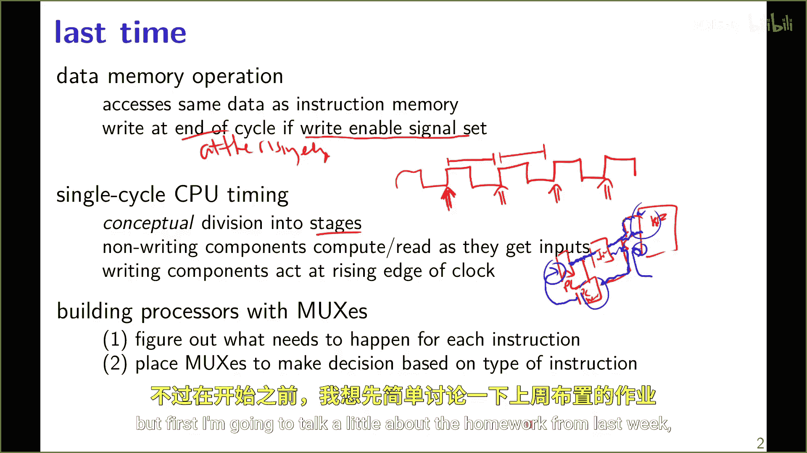
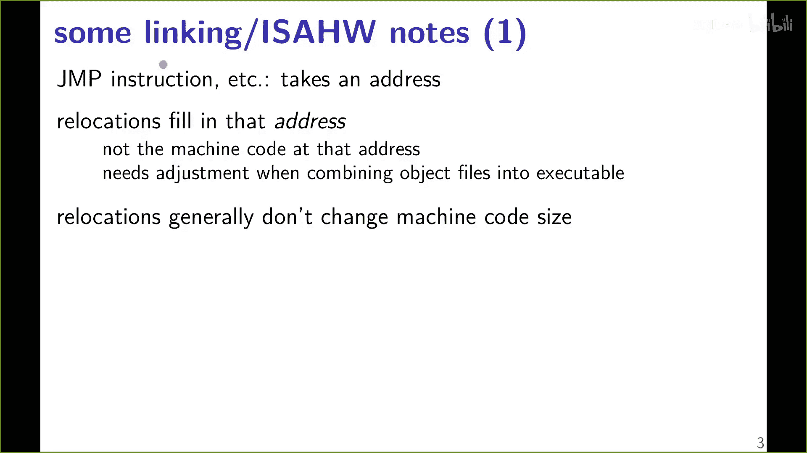
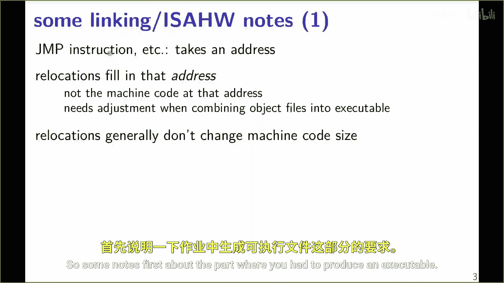
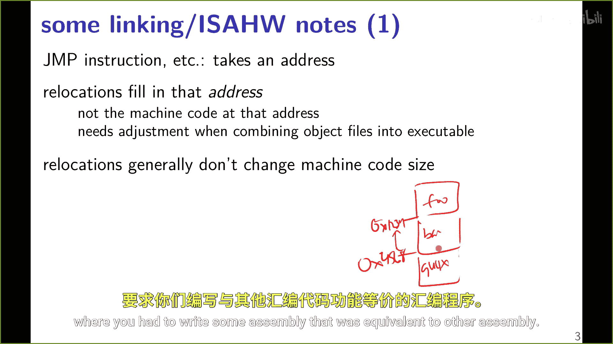
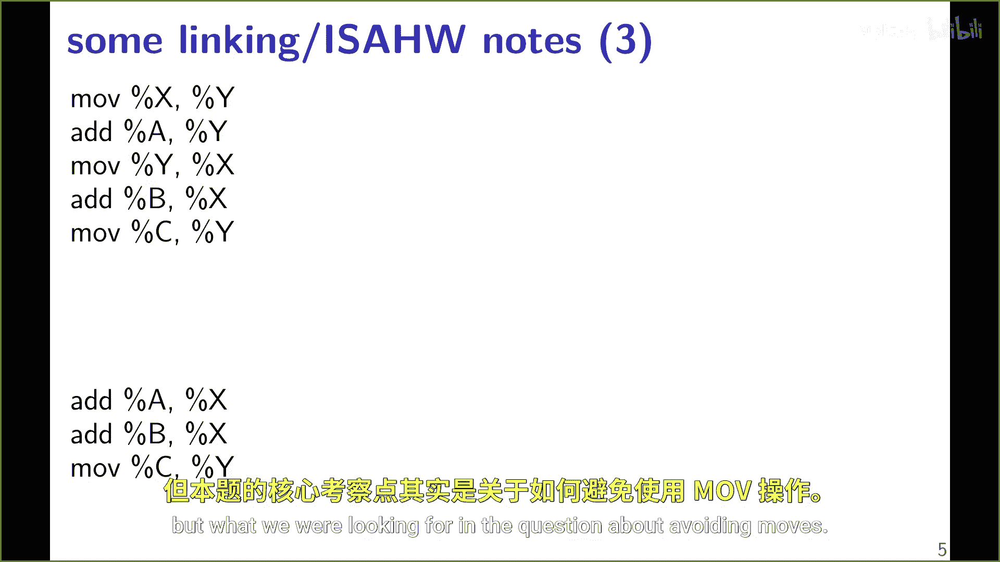

# 011：流水线初步

在本节课中，我们将继续学习单周期处理器的实现细节，并开始引入流水线的概念。我们将回顾上一节课讨论的关键组件，并探讨如何将它们组织起来执行不同类型的指令。最后，我们会简要回顾上周作业中的常见问题。

## 回顾单周期处理器组件

上一节我们介绍了用于实现单周期处理器的各个组件，特别是数据存储器。

与指令存储器不同，数据存储器具备写入数据的能力。我们需要一个控制信号来决定何时写入，这个信号被称为“写使能”信号。

与寄存器文件不同，数据存储器没有保留一个特殊地址值来表示“不写入”。它使用一个独立的信号来控制写入操作。

与我们见过的所有可写入组件（如寄存器文件和PC寄存器）一样，写入操作都发生在时钟周期的末尾，即时钟信号的上升沿。

在我们的单周期CPU中，有一个单一的时钟信号，其波形振荡。上升沿是写入操作发生的时刻。当PC寄存器被写入时，我们改变了当前执行的指令。因此，指令的实际计算过程发生在这些上升沿之间。

当PC因时钟上升沿而改变时，这个新值会传播到指令存储器。指令存储器经过一段延迟后，会计算出要输出的值。这些值会同时送到寄存器文件和其他地方（例如PC增量计算电路）。寄存器文件的读取和PC增量的计算可能同时发生，它们之间没有特定的先后顺序要求。

这就是为什么教科书将处理器划分为多个“阶段”时，目前这些阶段还是概念性的。真正决定操作顺序的是：对于可写入的组件，时钟信号决定了何时将输入端已存在一段时间的值（例如寄存器文件的写入数据）存储起来；对于其他计算或读取操作，则完全取决于它们何时收到输入值。收到输入后，经过一定的物理延迟，它们才会产生输出结果。

## 构建处理器的策略

在了解了所有组件的工作原理后，我们讨论了一种构建处理器的策略。

基本思路是：为了执行每种类型的指令，我们需要以特定的方式连接各个组件。不同指令的实现方式可能存在冲突。

例如，在实现所有移动指令时，所有移动指令都需要写入一个寄存器，但它们要写入的目标寄存器可能不同。因此，我们添加了多路选择器：对于需要写入RA的指令，将RA送到寄存器文件；对于需要写入RB的指令，则将RB送到寄存器文件。同样，对于要写入寄存器文件的值，我们也需要一个多路选择器，根据指令类型在不同可能的值之间做出选择。

这将是我们通用的策略。参考教科书划分的阶段对此很有帮助，因为我们可以说：这是每个阶段必须完成的部分。我们可以列出所有需要处理的指令，并枚举每条指令在每个阶段需要完成的操作，例如需要读取哪些寄存器。

今天开始我们会看一个具体的例子。

## 关于上周作业的说明

在进入今天的新主题之前，我先简要谈谈上周关于链接和ISA的作业。我已经开始批改，希望能在几周内（或更早）完成。

以下是关于作业中“生成可执行文件”部分的一些说明：

当我们思考链接过程时，我们所做的是填充诸如跳转和调用指令中的地址。这些指令需要一个地址（指向可执行文件中其他位置的某个目标）。在生成目标文件时，我们并不知道这个地址的具体值，重定位过程会负责填充这个地址，因为指令中编码的就是一个地址指针。指令本身并不包含来自其他位置的数据，它只是一个指向该数据的指针。

我看到了相当多的答案填充了“该地址处的内容”。虽然我们需要将那个地址处的内容放入可执行文件，但我们不会把它塞进一个函数调用的中间。函数调用指令的意思是“我想调用位于那里的函数”，我们不会把那个函数的代码嵌入到调用指令的位置。

另一个问题是，有些人想通过调整机器代码来改变某些内容的大小。这可能是因为没有意识到，在需要填入地址或8字节数据的地方（如`YD6`），我们必须确保大小合适。但一般来说，在链接时我们不会改变机器代码的大小。理论上这可以发生，但这会使链接过程变得非常复杂。

因为链接器通常的工作流程是：我们有若干个目标文件作为输入。链接器会决定它们在最终可执行文件中的布局。例如，它知道A部分将放在地址0x1234，B部分将放在地址0x4568，这个布局是基于各个部分的大小计算出来的。但如果某个部分的大小会根据重定位填充的内容而改变，那将非常麻烦和棘手。因此，链接器通常不改变机器代码的大小。确保为链接器预留正确大小的占位符（通过使用正确的指令模板）是汇编器的责任。

作业中有两个练习要求编写与给定汇编代码等价的汇编代码。

在其中一个练习中，我们要求用更简单的寻址方式重写一条指令。这条指令的计算过程是：取`RBX`的值乘以8，加上常数`0x1234`，然后用计算出的地址访问内存。

很多答案没有访问内存。他们正确地计算出了地址，但除了把地址放入`RCX`外，没有做任何其他操作。然而，原指令不仅仅是计算地址，它还要访问该地址处的内存并获取值。

另一个常见错误是：访问了一个与此地址相关的内存，然后进行了原指令中的部分运算。例如，访问某个地址的内存，然后将获取的值加上`0x1234`。实际上，所有这些计算都是为了得到要访问的内存地址，在内存访问之后并没有额外的计算。

在最后一个汇编翻译练习中，由于我没有给出限制（或许应该禁止使用`LEA`指令），存在很多实现方式。

## 总结

本节课我们一起回顾了单周期处理器的关键组件及其协同工作方式，理解了时钟信号如何协调写入操作。我们学习了通过多路选择器解决不同指令间资源冲突的通用设计策略，并开始借助教科书中的阶段划分来系统化设计。最后，我们分析了上周作业中关于链接过程和汇编翻译的常见理解误区，强调了指令语义的准确实现。下一节，我们将更深入地探讨处理器阶段的具体划分，并开始构建完整的处理器数据通路。