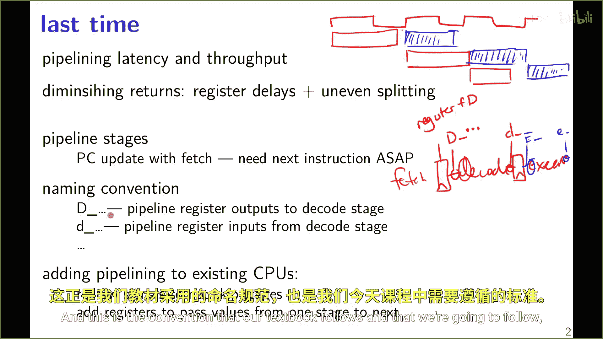
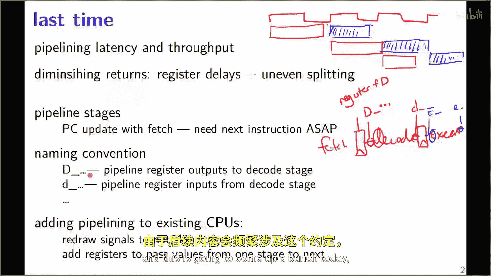
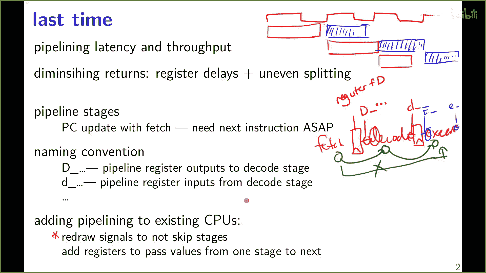
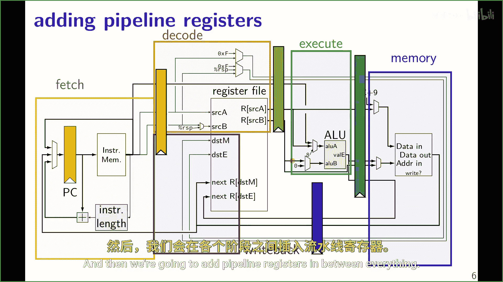
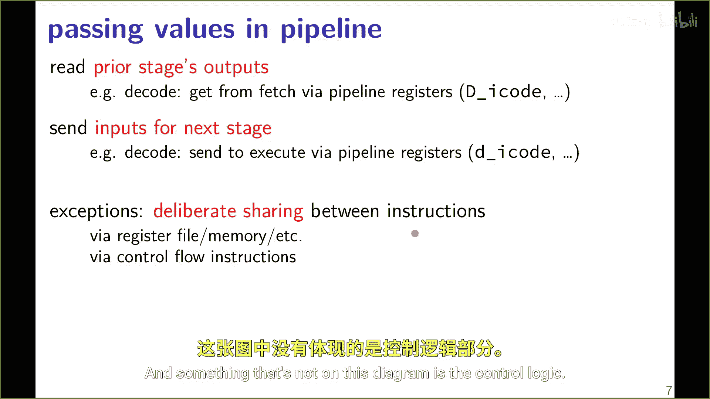
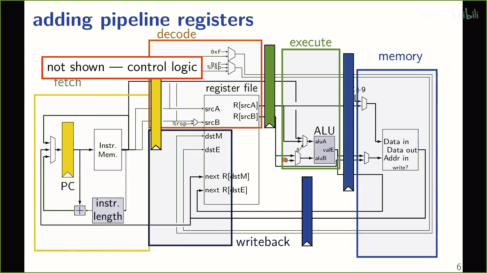
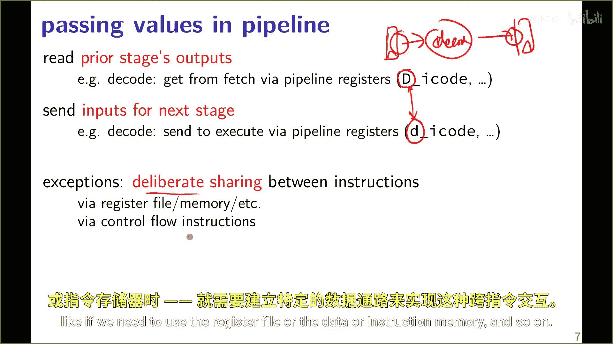

# 013：流水线设计（第二部分）🚀

在本节课中，我们将学习流水线处理器的设计细节，包括如何划分流水线阶段、如何插入流水线寄存器、以及如何遵循命名约定来编写各阶段的代码。我们还将探讨流水线设计中可能遇到的问题及其解决方案。

---

## 流水线回顾与设计挑战

上一节我们介绍了流水线电路的基本概念，以及如何通过添加流水线阶段来改变电路的延迟和吞吐量。我们提到，在单周期设计中，处理器在一个时钟周期内完成所有操作，而在流水线设计中，指令的执行被拆分到多个时钟周期中，每个周期完成一个阶段。

一旦指令完成其第一个阶段，我们就可以在该阶段中放入另一条指令。例如，如果我们的第一阶段使用指令存储器，我们可以先为第一条指令使用指令存储器，然后为第二条指令使用，依此类推。

然而，当我们这样做时，我们遇到了两个问题，这些问题使得流水线并不能简单地提高性能。

第一个问题是寄存器延迟。例如，在我们使用指令存储器后，我们需要将这些值存储在某个地方，以便下一阶段使用。我们通过寄存器传递这些值。这些寄存器并非没有成本，它们在物理上存储一个值需要一定的时间。这意味着，如果我们将原本在单周期设计中完成的工作分成两个阶段，每个阶段所需的时间并不会减半，而是会因为寄存器延迟而增加额外的时间，即使实际逻辑（我们所谓的“真正工作”）被均匀分割。

第二个问题是我们通常无法均匀地分割工作。计算或存储的本质不允许我们将原本需要100皮秒完成的工作均匀地分成两个50皮秒的部分。我们不得不做出一些妥协，这意味着某些阶段会比其他阶段更快，但我们只能设置一个统一的时钟周期时间。整个电路中，时钟上升沿之间的比率对所有人都必须相同。例如，我们的第一阶段在第二阶段空闲之前无法继续，我们的最后阶段在从第一阶段获得数据之前无法工作。因此，我们都需要以最慢阶段的时间为准进行妥协。

即使进行分割，与理想情况（例如，将工作分成三个阶段，意味着我们完成的工作量是三倍）相比，我们的性能也会进一步下降。这将导致吞吐量下降和延迟增加。因为当我们将这些工作分成三部分时，我们会因为寄存器延迟和等待其他阶段完成而增加额外的时间，从而增加了指令从开始到结束的实际时间。

---

## 流水线在处理器设计中的应用

在讨论了流水线的权衡之后，我们研究了如何将流水线应用于实际的处理器设计。我们做的一件事是采用了教科书中的阶段划分，并对其进行了一些调整。

教科书指出PC（程序计数器）更新是最后一步。如果你手动运行指令，这很合理：在弄清楚指令应该做什么之后，你才确定下一条要运行的指令是什么。但如果我们考虑流水线阶段，这就不太合适了，因为在我们完成指令的第一阶段后，我们希望同时开始第一条指令的下一阶段和下一条指令的第一阶段。

为了适应这一点，我们将PC更新与取指阶段合并，我们希望尽快计算下一条要运行的指令。我们提到这里有一个问题，我们将在下次课解决，而不是今天：如果我们无法确定下一条指令是什么怎么办？例如，如果我们有一个返回指令，关于下一条指令位置的信息我们无法立即获得。我们将在下次讨论这个问题。

一旦我们确定了我们的阶段划分，我们的主要想法是布局我们的处理器，并在各个阶段之间插入流水线寄存器。

我们采用了以下命名约定：在一个阶段内，例如取指阶段，我们会有寄存器。我们会说，进入一个阶段的输出用大写字母命名，遵循HLRS（硬件描述语言）的规范，因为我们在HLRS中用寄存器F声明这些输出。这些输出将被命名为大写D，而另一侧的输入（例如解码阶段）将被命名为小写d。对于执行阶段，输出将被命名为大写E，而进入内存阶段的输入将被命名为小写e。

这是我们的教科书遵循的约定，也是我们将要遵循的约定。这在今天的课程中会多次出现，这就是为什么我想确保我们清楚这个约定是如何工作的。

---

## 命名约定与代码编写规则

根据这个命名约定，我们的基本策略是：一旦我们划分了阶段，我们需要做一些额外的工作，重新绘制一些信号线，以确保值不会跳过阶段。我们总是希望值一步一步地从取指流向解码，再流向执行。我们将所有指令值放在一起。我们不能让某些值跳过一个阶段，因为那样我们会将来自两条不同指令的值混合在一起。除非我们知道为什么这样做，否则我们不想随意这样做。

添加这些寄存器后，我们将回顾流水线处理器的外观，讨论我们将遵循的一些规则，使用这些约定来编写各阶段的代码，然后看一些流水线步骤出错并给出错误答案的情况。我们将讨论为什么会这样，以及我们将如何修复它。

但在继续之前，关于我们上次涵盖的主题有什么问题吗？好的。

当我们上次结束时，我们说我们将采用我们的单周期处理器，找出阶段划分的位置。我们将修复这些情况：有些值从取指发送到解码（这是我们想要的），但有些值从取指发送到写回（这是我们不想要的），以及类似地从执行到内存与执行到写回的情况，通过重新绘制这些线。然后我们将在所有内容之间添加流水线寄存器。

这个图表上没有显示的是控制逻辑，我们需要小心处理。当谈到这些规则时，我希望你们思考控制逻辑。我们将确保在为一个特定阶段编写代码时，我们的代码将针对一个阶段。例如，对于解码阶段，我们将主要从流水线寄存器读取前一阶段的输出，并计算下一阶段的输入。

根据我们的命名约定，如果我们在解码阶段，我们应该使用以字母D开头的内容。对于执行阶段，类似的情况也成立。我们不这样做的情况是，我认为我们正在指令之间共享值。例如，解码阶段将从寄存器文件中读取，我们这样做是因为我们想从另一条指令获取值。但如果你不是试图从另一条指令获取值，那么使用不以阶段字母开头的内容可能是不好的。

关于这个想法有什么问题吗？是的。我们的阶段解码，是的。我们处理的是来自前一阶段输出的值，以及下一阶段的输入，除了我们试图设置以便与其他指令交互的情况，例如如果我们需要使用寄存器文件或数据/指令存储器。

---

## 总结

在本节课中，我们一起学习了流水线处理器设计的核心概念。我们回顾了如何划分流水线阶段、插入流水线寄存器，并遵循特定的命名约定来编写各阶段的代码。我们还探讨了流水线设计中可能遇到的问题，如寄存器延迟和工作分割不均，以及如何通过调整阶段和重新绘制信号线来解决这些问题。下一节课，我们将继续讨论如何处理无法确定下一条指令的情况，进一步完善我们的流水线设计。