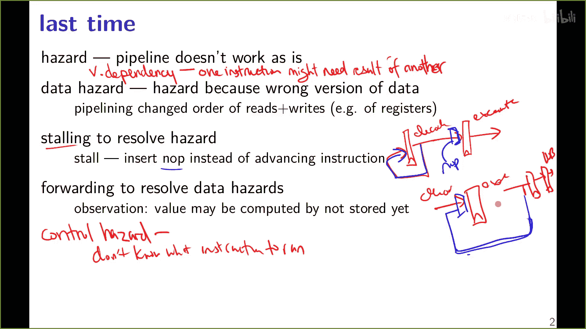
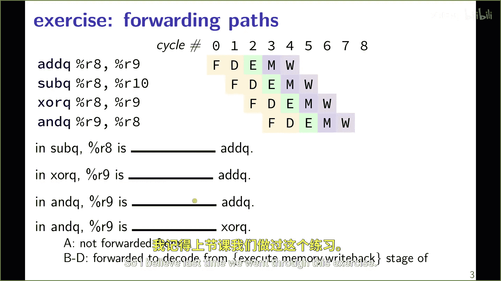
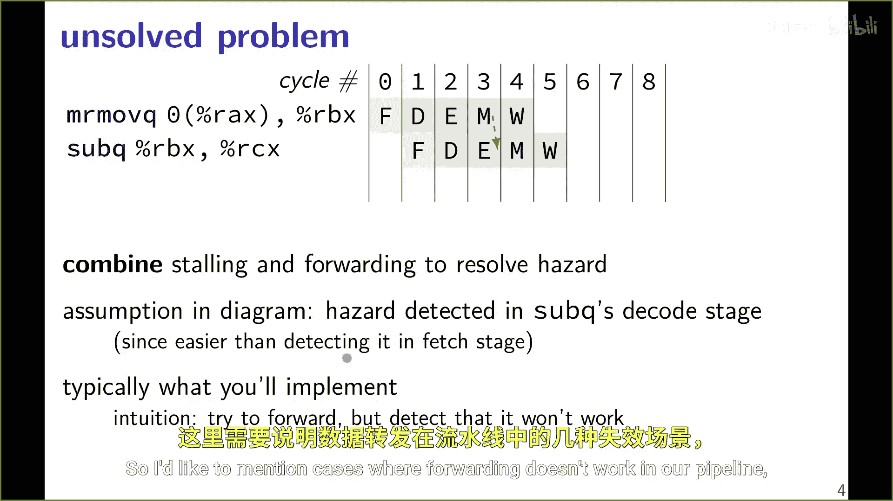
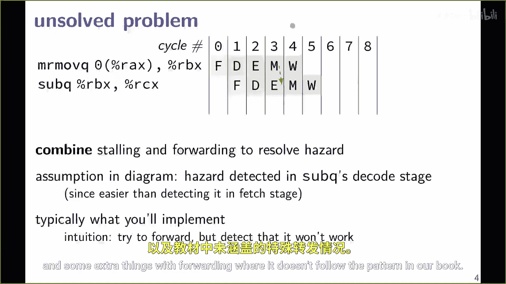
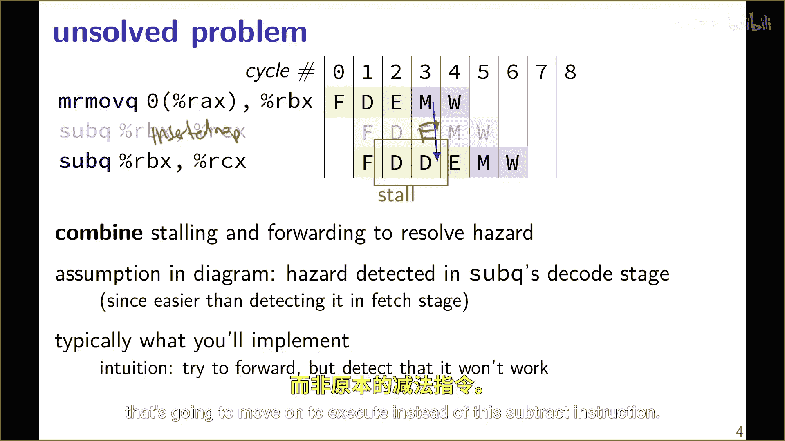

# 014：流水线处理（三）🚀

在本节课中，我们将学习流水线处理器中的**冒险**问题及其解决方案。我们将回顾数据冒险，并重点讨论一种无法通过转发解决的特定情况——**加载-使用冒险**。同时，我们也会简要提及控制冒险，为后续课程做铺垫。

上一节我们介绍了数据冒险的概念，并讨论了通过**转发**和**停顿**来解决这些问题。本节中，我们将深入探讨一个转发无法解决的特定情况，并分析其原因。

## 加载-使用冒险 🔄

以下是转发无法解决的一种情况，通常被称为**加载-使用冒险**。

考虑以下指令序列：
1.  `movq (rax), %rbx`  // 从内存加载数据到寄存器 `%rbx`
2.  `subq %rbx, %rcx`   // 使用 `%rbx` 的值进行减法运算

在流水线中，第一条指令（`movq`）在**内存阶段**结束时才计算出 `%rbx` 的值。然而，第二条指令（`subq`）在其**执行阶段**就需要这个值。



我们理想的转发路径是：将刚从数据内存中读出的值，直接绕过流水线寄存器，送到 `subq` 指令执行阶段的ALU输入端。







**公式表示转发需求：**
```
ALU输入 = 前一条指令内存阶段结束时的值
```

但是，这种转发路径是不可接受的。原因在于，它要求在一个时钟周期内完成**数据内存访问**和**ALU运算**。这实质上将执行阶段和内存阶段合并了，违背了流水线通过分割阶段来提高时钟频率的初衷。

**核心规则：** 可行的转发通常发生在流水线寄存器附近，仅增加一个多路选择器（MUX）来选择转发值，而不会显著延长关键路径。

由于无法通过转发解决，我们必须采用**停顿**。具体来说，当在译码阶段检测到这种冒险时，处理器会暂停 `subq` 指令，使其停留在译码阶段，同时向流水线中插入一个空操作（`nop`），直到 `movq` 指令将数据写回寄存器文件。



本节课中我们一起学习了**加载-使用冒险**，这是数据冒险中一种无法通过转发解决的特殊情况。我们分析了其根本原因在于所需数据尚未计算完成，且直接转发会破坏流水线设计。在这种情况下，唯一的解决方案是引入**停顿**，插入空操作指令，等待数据就绪。这提醒我们，转发虽好，但并非万能。下一节，我们将继续探讨控制冒险及其更优的解决方案。