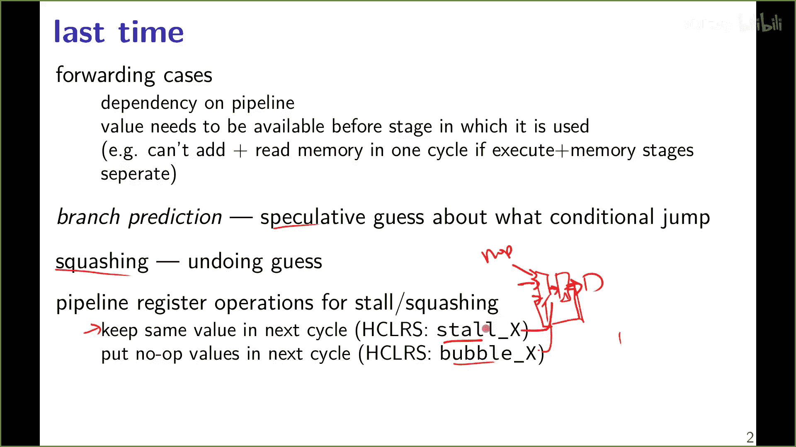
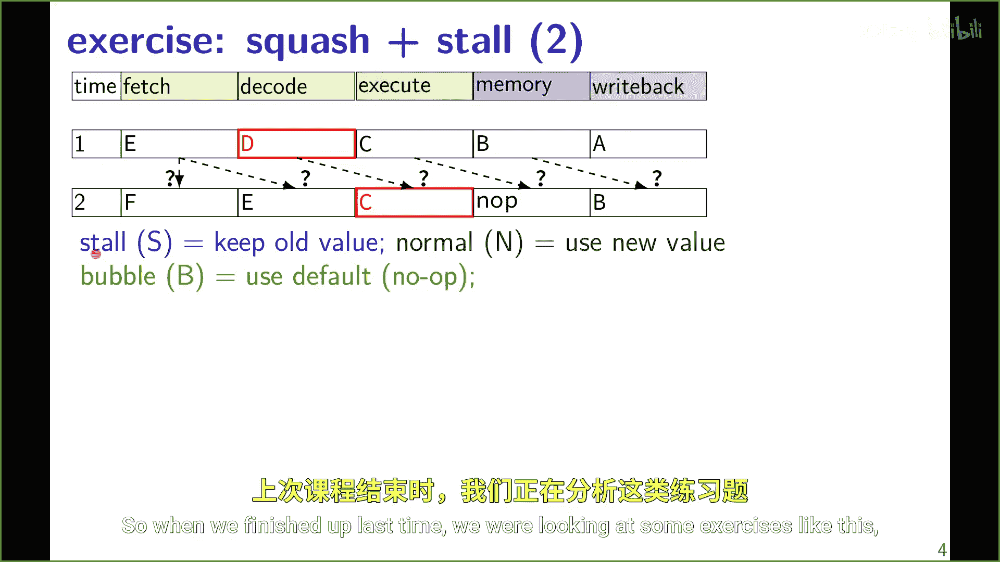
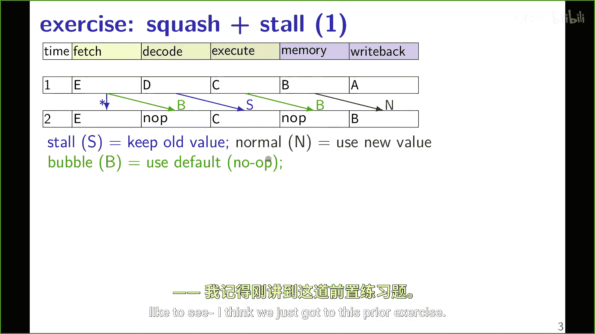
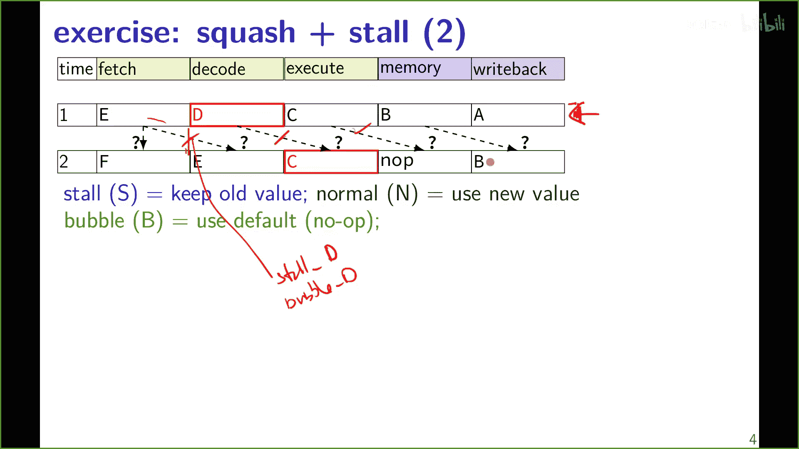
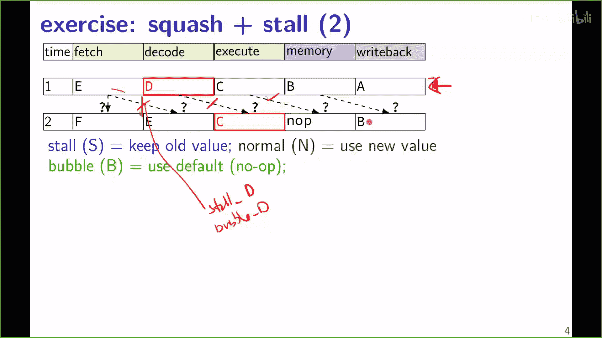
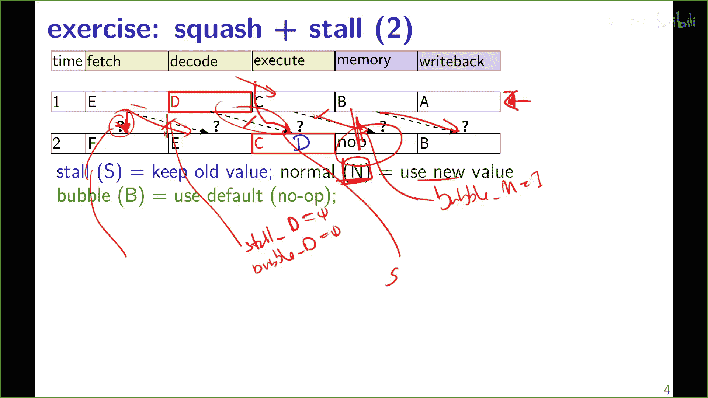

# 015：流水线4 - 缓存1 🚀

在本节课中，我们将继续学习流水线处理器中的冒险处理。上一节我们介绍了前递（Forwarding）和控制冒险（Control Hazards），本节我们将深入探讨如何在实际处理器中实现暂停（Stalling）和冲刷（Squashing）操作，并理解相关的控制信号。

## 回顾与引入

上一节我们讨论了前递策略，即在流水线中寻找所需数据，并尝试从正在计算该数据的指令处获取它。我们遵循一个核心规则：**值必须在被使用之前计算完成**。例如，我们不能在一个周期内计算一个值，然后立即用它来读取内存，因为这会破坏独立的执行（Execute）和访存（Memory）阶段的设计目的。

在讨论了前递之后，我们研究了另一种冒险类型——控制冒险。最典型的情况是条件跳转（Conditional Jump）。在我们的流水线处理器中，计算条件码的操作可能在我们需要根据这些条件码获取下一条指令之后才完成。我们的解决方案是进行**推测（Speculate）**：猜测条件跳转的结果。如果猜对了，流水线正常进行；如果猜错了，就需要进行**冲刷（Squashing）**，撤销错误的猜测并回到正确的指令。

我们还开始讨论暂停（Stalling），有时需要将暂停与前递结合使用。例如，对于返回指令（Return）造成的冒险，由于它从内存获取值，我们没有好的预测方法，因此需要暂停流水线。为了实现暂停和冲刷，我们需要在流水线寄存器上进行控制。

HCL RS 工具提供了实现这些功能的机制。主要有两点：
1.  **保持值不变**：我们需要一种方法，让流水线寄存器在下一个周期输出相同的值。例如，如果解码（Decode）阶段的寄存器需要保持当前指令不变，我们可以使用一个多路选择器（Mux）来选择当前输出值作为下一个周期的输入。HCL RS 内置了这个功能，其控制信号是 `stall`。
2.  **插入空指令（nop）**：当我们需要暂停流水线，或者推测错误需要撤销指令时，我们需要向下一阶段插入一个空操作（nop/bubble）。这意味着我们需要能够用空操作的值覆盖原本要进入流水线寄存器的值。HCL RS 通过 `bubble` 信号提供此功能，它会将寄存器输入设置为预定义的空操作值（通常对应处理器启动时未执行指令的状态）。

在深入探讨如何具体实现暂停和冲刷之前，我们先通过一个练习来巩固对 `stall` 和 `bubble` 信号的理解。

## 信号设置练习 💡

请看以下流水线状态图。假设初始时流水线中包含指令 A, B, C, D, E。我们的目标是在下一个周期（Time 2）让流水线状态变为 F, E, C, nop, B。

我们需要确定在 Time 1 周期，各个流水线寄存器（如 Fetch->Decode, Decode->Execute 等）的 `stall` 和 `bubble` 信号应如何设置，才能实现上述状态变化。

以下是分析过程：

首先，我们关注 Memory 阶段。我们的目标是在 Time 2 的 Memory 阶段插入一个 nop。因此，在 Time 1，我们需要设置 **Bubble M = 1**。这样，在下一个时钟沿，Memory 阶段的寄存器就会被填入 nop 值。

对于其他阶段，我们逐一分析：
*   **Fetch->Decode (F->D)**：正常情况下，指令 E 会从 Fetch 阶段进入 Decode 阶段。这正是我们想要的结果（Time 2 时 Decode 阶段为 E）。因此，我们既不需要暂停（Stall D = 0）也不需要插入空指令（Bubble D = 0），让流水线正常流动即可。
*   **Decode->Execute (D->X)**：正常情况下，指令 D 会从 Decode 阶段进入 Execute 阶段。但我们的目标是让 Time 2 的 Execute 阶段保持为指令 C。这意味着我们需要阻止 D 进入，并让 C 留在原地。**`stall` 信号的作用正是保持当前输出值不变**。因此，我们需要设置 **Stall X = 1**。我们不需要插入 nop（Bubble X = 0），因为目标是保留 C 而不是插入空操作。
*   **Execute->Memory (X->M)**：正常情况下，指令 C 会从 Execute 阶段进入 Memory 阶段。这符合我们的目标（Time 2 时 Memory 阶段本应为 C，但会被 Bubble M 覆盖为 nop）。对于 X->M 寄存器本身，我们不需要特殊操作，所以 Stall M = 0， Bubble M = 0（注意，Memory 阶段的 nop 是由 Bubble M 信号控制的，而不是 X->M 寄存器的 Bubble 信号）。
*   **Memory->Writeback (M->W)**：正常情况下，指令 B 会从 Memory 阶段进入 Writeback 阶段。这符合我们的目标。因此，Stall W = 0， Bubble W = 0。

总结信号设置如下：
*   **Stall D = 0, Bubble D = 0**
*   **Stall X = 1, Bubble X = 0**
*   **Stall M = 0, Bubble M = 1**
*   **Stall W = 0, Bubble W = 0**

关于程序计数器（PC）在此场景下的行为，以及当分支预测错误时如何修正 PC 值，我们将在本节课后续部分详细讨论。我们的教科书提到了使用 `stall` 信号来处理 PC，但我们需要更深入地研究其逻辑。

## 核心概念总结 🎯

本节课我们一起学习了流水线控制中两个关键操作的实现机制：
1.  **暂停（Stalling）**：通过设置流水线寄存器的 `stall` 信号为 1，可以使该寄存器在下一个周期保持输出当前值，从而阻止新指令进入该流水阶段。
2.  **冲刷/插入空指令（Squashing/Bubbling）**：通过设置流水线寄存器的 `bubble` 信号为 1，可以用一个预定义的空操作（nop）值覆盖原本要存入该寄存器的值，从而无效化该流水阶段中的错误指令。

理解 `stall` 和 `bubble` 信号如何作用于不同的流水线寄存器，是设计复杂冒险处理逻辑的基础。在接下来的课程中，我们将运用这些知识，来构建处理数据冒险和控制冒险的完整处理器控制单元。