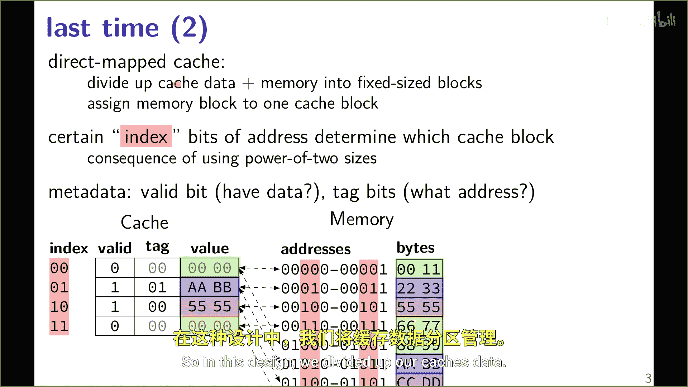
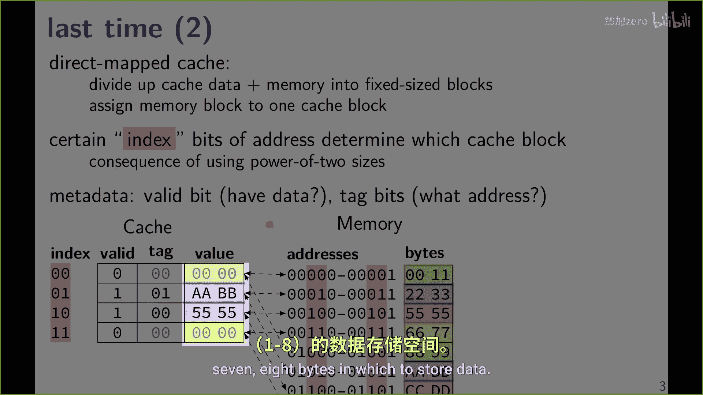
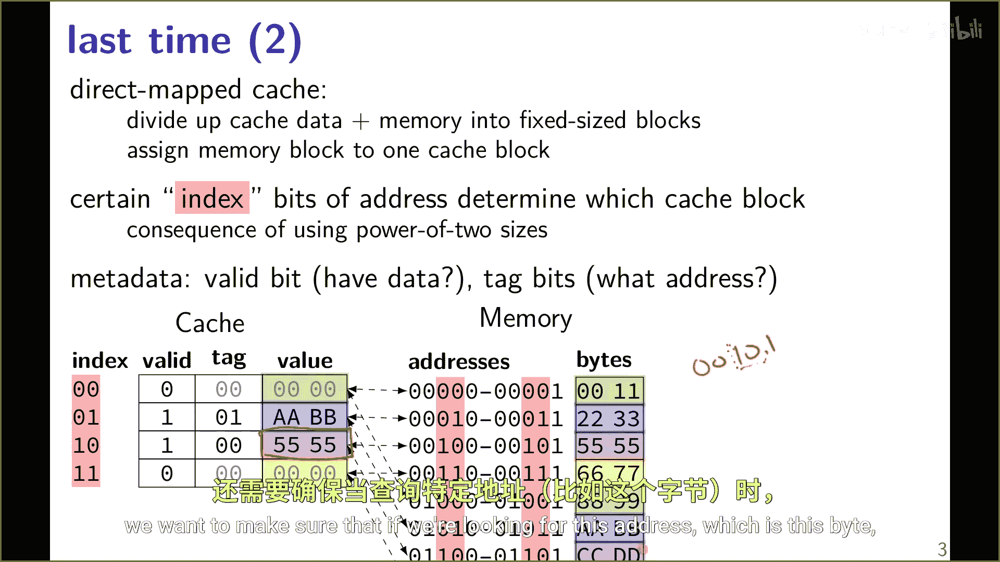
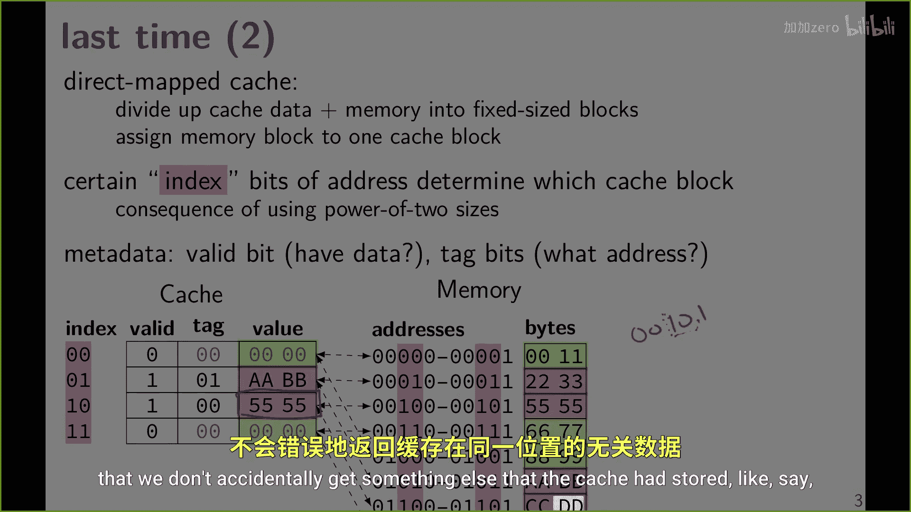
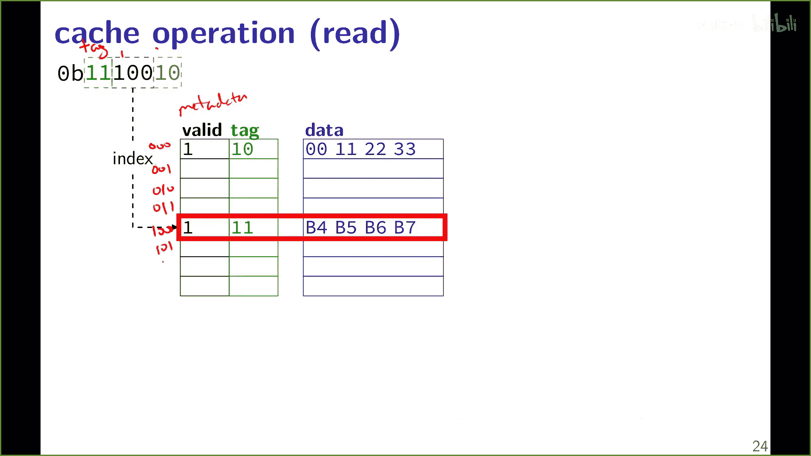

# 016：缓存（二）💾

在本节课中，我们将继续学习缓存的工作原理。上一节我们介绍了流水线处理器的控制逻辑，特别是暂停（stall）和气泡（bubble）信号。本节我们将深入探讨缓存的设计，特别是直接映射缓存（Direct-Mapped Cache）的硬件实现和工作原理。

## 缓存基础回顾

上一节我们提到，缓存是一种小而快的内存，它由大而慢的主存作为后备。我们的目标是让程序在大多数情况下都能快速访问内存，同时保持内存容量足够大。实现这一目标的关键在于程序具有**局部性**。

以下是两种主要的局部性类型：

*   **时间局部性**：如果一个程序访问了某个值（无论是指令还是数据），它很可能在不久的将来再次访问这个值。因此，即使缓存很小，只要它保存了最近访问过的值，程序就很可能在缓存中找到所需的数据。
*   **空间局部性**：如果一个程序访问了某个值，它很可能也会访问内存中相邻位置的值。这里的“相邻”通常指地址相近的值。这意味着缓存可以将相邻的数据块一起保存，从而提高缓存命中率，减少访问慢速主存的次数。

我们从一个简单的设计开始利用这些特性，即**直接映射缓存**。

## 直接映射缓存设计

在这个设计中，我们将缓存数据划分为固定大小的块。例如，假设我们有一个8字节的缓存，我们将其划分为4个块，每个块大小为2字节。

```
缓存块：
[块0] [块1] [块2] [块3]
```



同时，我们将主存也划分为相同大小的块（例如2字节/块）。每个内存块被**唯一地映射**到缓存中的一个特定块。这样，当我们寻找一个值时，只需要在缓存中检查一个确定的位置，这使得缓存的查找非常高效。



当我们使用2的幂次方作为块大小时，这种映射在硬件上实现起来非常简单。我们可以利用地址的一部分（称为**索引位**）来直接确定应该检查缓存的哪一行（哪个块）。这是因为使用2的幂次方大小进行交错映射时，地址的索引位部分正好对应缓存的行号。

## 缓存查找与元数据

我们有了快速定位缓存块的方法（使用索引位），但还需要确认缓存中存储的值是否就是我们想要的那个地址的值。为此，我们需要一些元数据。

以下是直接映射缓存中使用的元数据：

1.  **有效位**：缓存启动时，其中的数据是无效的（可能是随机的旧数据）。有效位初始为0，表示该缓存块没有存储有效数据。当有数据被加载到该缓存块时，有效位被设置为1。
2.  **标签位**：为了区分映射到同一个缓存块的不同内存块，我们使用地址中除索引位和块内偏移位之外的部分，称为**标签**。我们将这个标签与缓存块存储的标签进行比较。如果标签匹配且有效位为1，则说明缓存命中。

地址被划分为三个部分：
*   **标签**：用于唯一标识是哪个内存块存储在当前缓存行中。
*   **索引**：用于选择缓存中的哪一行。
*   **偏移**：用于在缓存块（数据块）内部定位具体的字节。

公式表示：`地址 = 标签位 + 索引位 + 偏移位`





## 硬件实现示意图

直接映射缓存的硬件实现可以概念化如下：

```
       地址输入
    ┌─────────────────┐
    │ 标签  │ 索引 │偏移│
    └─────────────────┘
            │
            ▼
    ┌───────────────┐
    │   索引解码器   │
    └───────────────┘
            │
            ▼
    ┌─────────────────────────────────────┐
    │  缓存存储阵列                          │
    │ 行号 │ 有效位 │ 标签   │       数据块      │
    │  0   │   V   │  Tag  │  [字节0, 字节1]  │
    │  1   │   V   │  Tag  │  [字节0, 字节1]  │
    │  2   │   V   │  Tag  │  [字节0, 字节1]  │
    │ ...  │  ...  │  ...  │      ...       │
    └─────────────────────────────────────┘
```

工作流程：
1.  输入一个内存地址。
2.  硬件提取出地址中的索引位，通过解码器选中缓存中的对应行。
3.  将该行存储的标签与地址中的标签位进行比较。
4.  同时检查该行的有效位是否为1。
5.  如果**标签匹配且有效位为1**，则缓存命中。接着使用地址中的偏移位从该行的数据块中取出具体的字节。
6.  如果标签不匹配或有效位为0，则缓存未命中，需要从主存中加载所需的数据块到该缓存行，并更新标签和有效位。

## 关于程序计数器更新的补充

上一节还提到了流水线中程序计数器更新的特殊处理。在单周期处理器中，下一条指令的地址可以立即计算出来。但在流水线中，对于条件跳转和返回指令，其目标地址需要等到该指令在流水线中执行到较后阶段才能确定。

教科书的解决方案是：在取指阶段的开始，使用一个多路选择器来决定下一个PC值。这个选择器可以在“来自流水线后段计算出的实际跳转地址”（用于纠正错误预测的条件跳转或处理返回）和“基于上次取指结果的预测PC”之间进行选择。此外，在处理流水线暂停时，还需要能够保持当前PC值不变。

## 总结



本节课我们一起深入学习了缓存的核心机制。我们回顾了利用程序**时间局部性**和**空间局部性**的原理，并详细分析了**直接映射缓存**的设计。我们了解了地址如何被划分为**标签、索引和偏移**三部分，以及如何使用**有效位**和**标签位**来完成缓存的查找和验证操作。最后，我们还通过硬件示意图直观地理解了缓存的工作流程。理解这些基础概念是学习更复杂缓存组织方式（如组相联缓存）的关键。