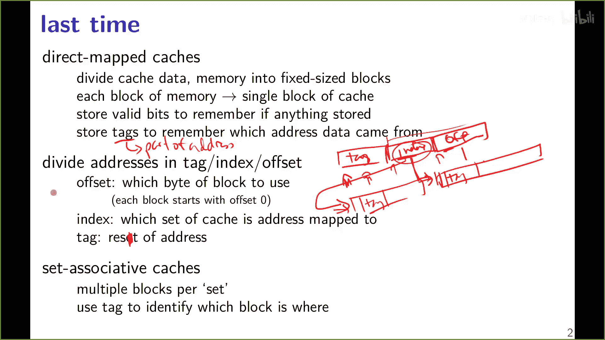
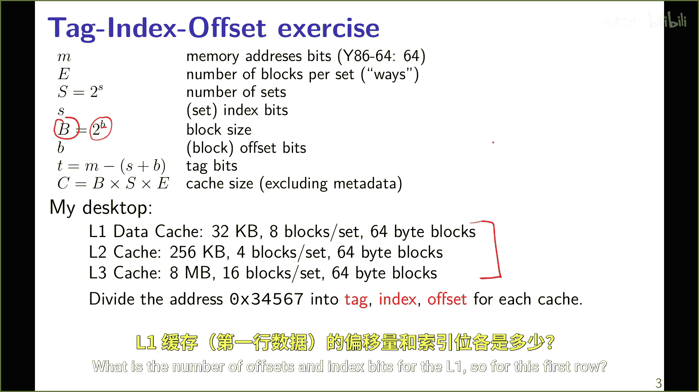
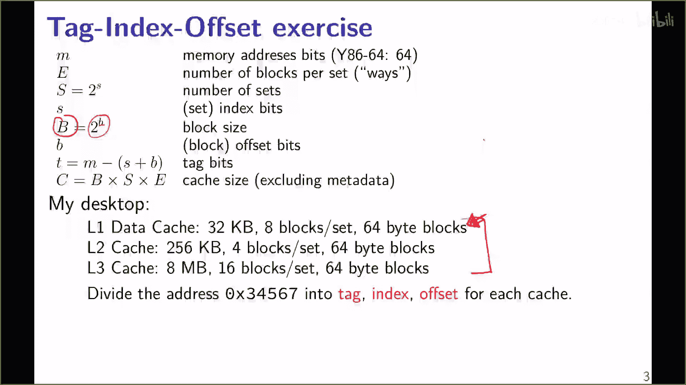
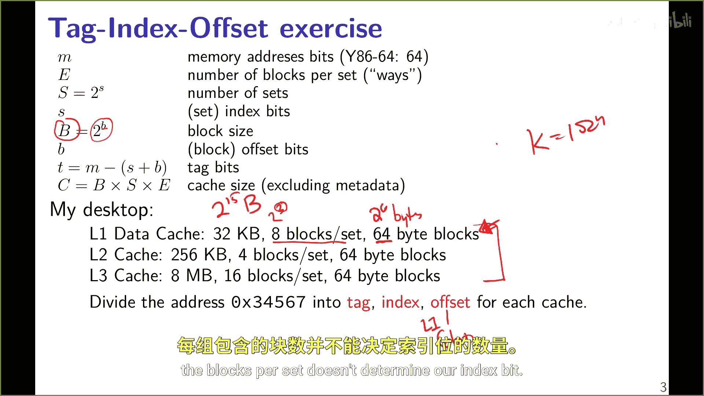
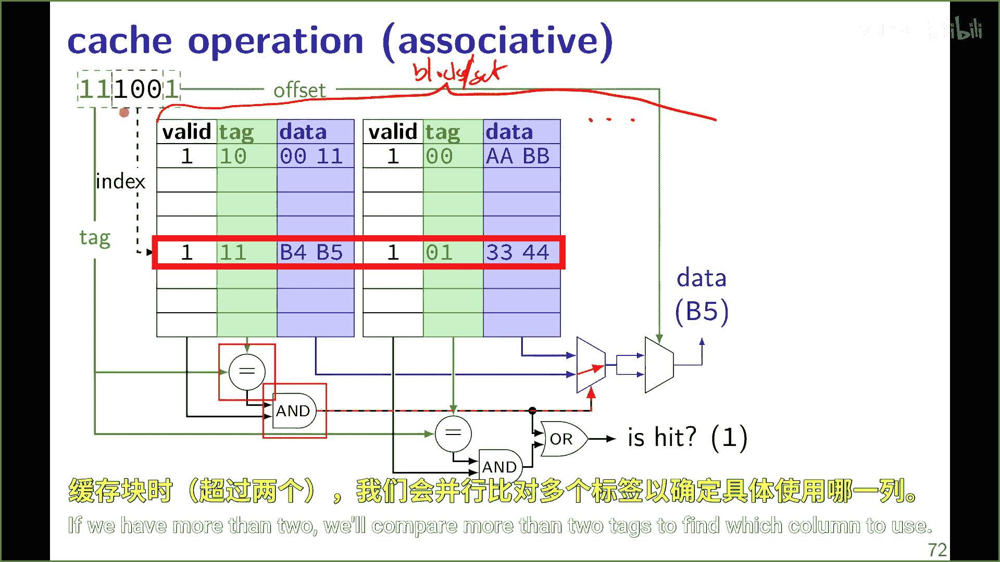

# 017：缓存（三）🚀

在本节课中，我们将继续学习缓存的设计，特别是从直接映射缓存过渡到组相联缓存。我们将探讨如何通过增加每个缓存组中的块数来减少冲突未命中，并学习如何计算缓存地址的各个组成部分。

---

## 概述

上一节我们介绍了直接映射缓存的基本原理。本节中，我们将看看直接映射缓存的一个主要问题——冲突未命中，并介绍组相联缓存作为解决方案。我们还将通过一个具体例子，学习如何计算缓存参数。

---

## 回顾直接映射缓存

上次我们首先完成了对直接映射缓存的讨论。

我们知道，缓存是一种小而快的内存，但它仍然是我们更大内存系统的一部分。

对于直接映射缓存，我们通过将缓存划分为一些固定大小的块，并以同样的方式划分内存来实现。

内存块大小相同，并且每个内存块被分配到缓存中的一个固定位置。

为了实现这一点，我们需要存储一些元数据。我们需要知道存储在缓存中的块的一些信息。

我们需要知道的一件事是，在系统启动时，缓存中实际上没有任何有用的数据。我们需要一个有效位来记住我们是否已经存储了任何数据。

当我们确实存储了数据时，每个内存块对应缓存中的一个块，但缓存中的每个块可以对应许多个内存块。

因此，它需要区分当前存储的是哪一个内存块。我们存储了地址的一部分作为标签，以记住原始地址是什么。

当我们使用这种直接映射缓存方案时，其查找过程如下：将输入地址分成几个部分。

我们有一个标签部分、索引部分和偏移量部分。

偏移量部分指示在块内的哪个位置。

我们设置块大小和块的数量，使得块的数量是2的幂，每个块的字节数也是2的幂。

这样，它们可以均匀地映射到一定数量的比特位。例如，如果我们有2字节的块，那么我们需要1位来确定是这两个字节中的哪一个（偶数地址是块的第一个字节，奇数地址是第二个字节）。

我们将其推广到4字节或8字节的块，在这种情况下，我们使用多个比特位来确定它是块中的第几个字节。

我们还需要确定我们在哪个“组”中。我们使用“组”这个术语，因为它将在我们的推广中出现。基本上，我们需要知道这个地址的数据有资格存储在缓存中的哪个位置。

我们使用偏移量之前的比特位来实现这一点。我们设法使组的数量是2的幂，这样我们就可以再次使用固定数量的比特位来确定地址映射到哪个组。

所有我们没有使用的比特位就是标签。我们只需要存储剩下的比特位，我们称之为标签。

对于直接映射缓存，当我们得到一个索引时，我们查看的是一个具有一个有效位和一个标签的块。

但我们发现，这存在一个问题：我们最终会有多个我们感兴趣使用的地址恰好映射到同一行。

---

## 引入组相联缓存

这个问题的解决方案是，我们可以在每个组中存储多个块。

也就是说，每行有多个块。我们仍然有一个索引来确定去哪一行，但现在我们有多个块需要检查。我们通过检查所有标签来找出我们的数据在哪里。

我们可以通过调整每个组中放置的块数来调整查找数据的复杂程度。

我相信这大致就是我们上次结束的地方。

---

## 练习：分析真实缓存

好了。我相信上次我们结束时是在做这个练习。

这里我有一堆公式，但这些只是表达一些知识，比如：如果我有特定大小的块，我只需要为每个部分分配不同的比特模式。所以，如果我的块有B字节，这意味着如果B等于2的b次方，那么我需要b个比特位作为偏移量。这些是来自我们教科书的公式，它们编码了所有这些知识，你可以使用这些公式，也可以不用。

我的问题是这样的：以下是我台式机缓存的统计数据。实际上，组相联缓存是你在真实机器中最常见的设计。

首先，我不确定我们上次是否讲到了这里，但让我们回顾一下。对于L1缓存（第一行），偏移量和索引位的数量是多少？

以下是缓存参数：
*   L1 数据缓存大小：32 KB
*   块大小：64 字节
*   相联度：8路（即每组8个块）

你可以使用这些公式，或者根据我们对组相联缓存的图示进行推理。

嗯，我可能应该提一下，2的幂的知识会有帮助。
*   64字节是2的6次方字节。
*   32千字节，请记住，在本课程中，我们始终用K表示2的幂，所以这是2的15次方字节。
*   8当然是2的3次方。

再给20秒左右时间思考。

好的，我们有一个相当一致的共识：我们应该有 **6位** 用于偏移量。

对于索引位的数量，我们有两个流行的答案：3和6。答案是3可能是因为你看到了“每组8个块”。这里确实有一个3。

但是，**每组块数并不决定我们的索引位数**。如果我们回想一下我们的组相联缓存图：

索引的数量决定了我们有多少行。每组中的块数是我们拥有的列数。

如果我们看索引，索引并不决定我们去哪一列，我们是间接地找出这一点。我们通过索引去到正确的行，然后比较标签。如果我们有超过两个标签，我们就比较超过两个标签以找到正确的列。

---

## 计算索引位数

要计算索引位数，我们需要知道总共有多少组。

我们知道：
1.  总缓存大小 = 组数 × 每组块数 × 块大小
2.  因此，组数 = 总缓存大小 / (每组块数 × 块大小)

代入数值：
*   总缓存大小 = 32 KB = 32768 字节
*   块大小 = 64 字节
*   每组块数（相联度）= 8

组数 = 32768 / (8 × 64) = 32768 / 512 = 64 组

因为64是2的6次方，所以我们需要 **6位索引** 来唯一标识这64个组。

因此，对于这个L1缓存：
*   **偏移量位数 (b)** = log₂(块大小) = log₂(64) = **6 位**
*   **索引位数 (s)** = log₂(组数) = log₂(64) = **6 位**
*   **标签位数** = 地址总位数 - (索引位 + 偏移位)。对于一个典型的32位地址，标签位 = 32 - (6+6) = **20 位**。

---

## 总结

本节课中，我们一起学习了：
1.  **回顾了直接映射缓存**：其通过索引直接映射地址到唯一缓存行的方式，以及由此可能引发的冲突未命中问题。
2.  **引入了组相联缓存**作为解决方案，它允许每个索引对应的组内存在多个缓存块，通过比较标签来定位数据，有效减少了冲突。
3.  **通过一个实际例子**，我们练习了如何根据缓存总大小、块大小和相联度来计算偏移量、索引和标签的位数。关键点是索引位由**缓存总组数**决定，而非直接由相联度决定。

理解这些地址划分和缓存组织结构，是理解CPU如何高效访问数据的基础。