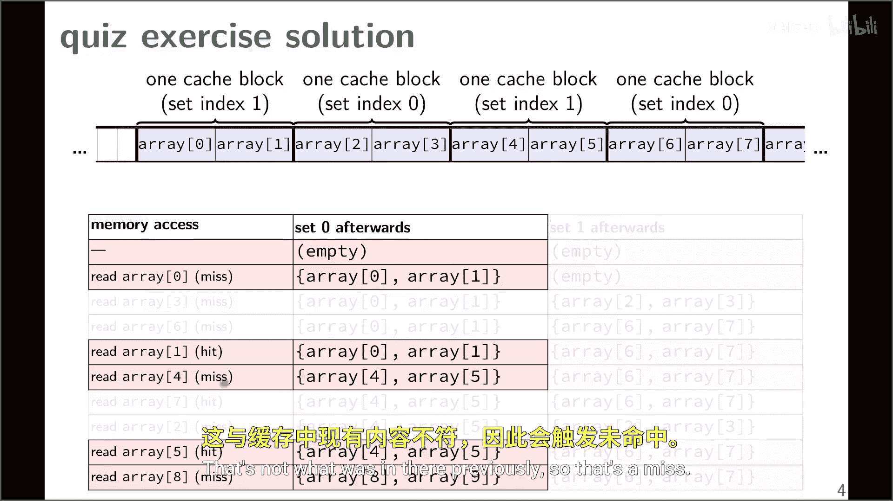
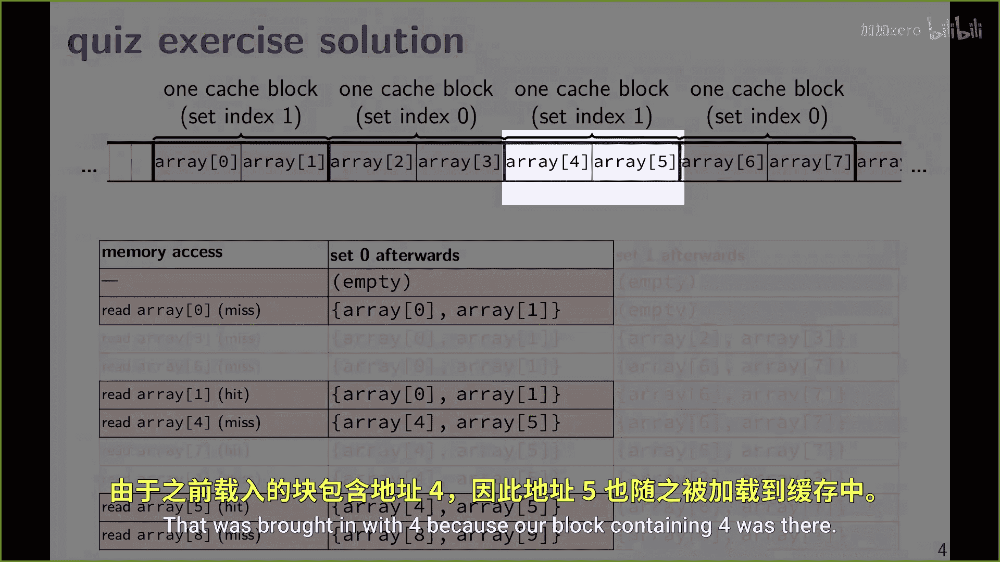
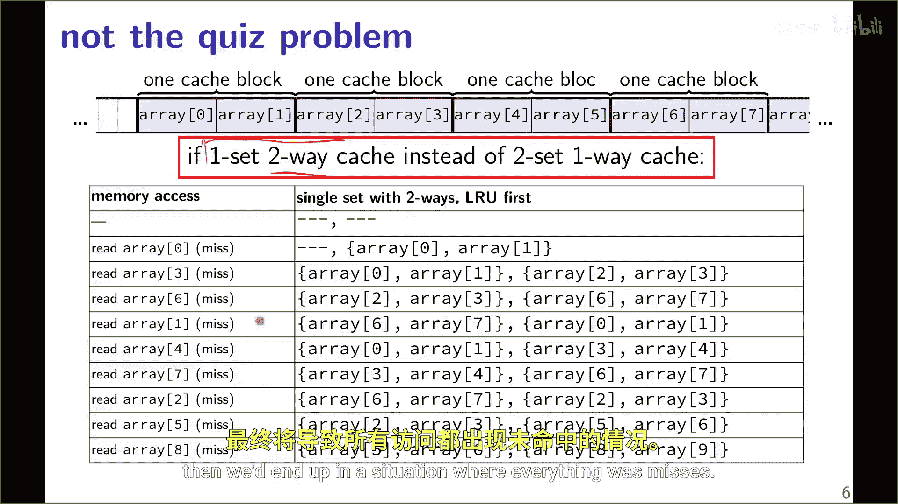

# 019：缓存性能分析 2 🔍

在本节课中，我们将继续学习如何分析程序的缓存性能。我们将通过具体的代码示例，学习如何计算缓存缺失，并理解缓存设计（如组相联度）对性能的影响。

上一节我们介绍了缓存设计中的权衡，以及评估缓存性能的公式。本节中，我们将通过分析具体的程序访问模式，来实际计算缓存缺失次数。

## 缓存访问与程序代码

为了将理论应用于实践，我们需要观察程序代码，并确定哪些部分会使用缓存。指令缓存的情况相对简单，所有机器码指令最终都需要通过它。但对于数据缓存，情况则更为复杂。

需要记住，数据缓存代表了处理器中的数据存储器。这意味着寄存器文件的访问独立于缓存，其速度恒定，不存在命中或缺失的问题。我们只需关注那些访问内存的指令。

在我们的Y86处理器中，诸如 `mov`、`push`、`pop`、`call`、`return` 等内存访问指令会使用数据缓存。

## 数据对齐与缓存块

在分析程序对数据缓存的访问时，我们意识到一个潜在问题：一个数据值可能跨越多个缓存块。例如，一个整数可能一部分在一个块中，另一部分在相邻块中。访问这样的值会非常慢，因为需要两次缓存访问。

编译器通过**数据对齐**来避免这种情况。它们将数据值安排在**2的幂次方**的地址上。由于缓存块大小总是2的幂，只要选择合适的对齐边界，就能确保单个值不会跨块存储。

## 计算缓存缺失的方法

处理了对齐问题后，我们开始通过分析C代码来尝试计算缓存缺失。一种精确的方法是：识别所有缓存访问，确定它们映射到哪个块和哪个组，然后模拟缓存的行为（类似于缓存实验中的做法）。

然而，对于实际大小的缓存，这可能非常复杂。因此，我们有一些简化的方法。

以下是简化分析的关键思路：

我们可以将访问按缓存组（即缓存的行）进行划分，然后分别分析每个组。这是因为，访问索引0的代码部分和访问索引1的代码部分永远不会相互干扰。因此，我们可以独立分析每个组的访问序列，分别计算缺失次数，最后再相加。

## 测验题解析

接下来，我们解析一道相关的测验题。题目描述如下：我们有一个数组，缓存块大小为2个数组元素，缓存共有2个组，并且是直接映射（即1路组相联）。访问序列为：0, 3, 6, 1, 4, 7, 2, 5, 8。

根据上述方法，我们按组单独分析。假设数组元素0映射到组0。

**对于组0的访问序列（元素0, 1, 4, 5, 8）：**
1.  访问0：初始为空，缺失。将块[0,1]载入组0。
2.  访问1：该值已在组0的块中，命中。
3.  访问4：当前组0中存储的是块[0,1]，不包含4，缺失。将块[4,5]载入组0。
4.  访问5：该值已在组0的块中，命中。
5.  访问8：当前组0中存储的是块[4,5]，不包含8，缺失。

因此，在组0中，共有3次缺失。

**对于组1的访问序列（元素3, 6, 7, 2）：**
1.  访问3：初始为空，缺失。将块[2,3]载入组1。（注意：块包含起始地址对齐的元素，访问3会载入其所在的块，即包含2和3的块）
2.  访问6：当前组1中存储的是块[2,3]，不包含6，缺失。将块[6,7]载入组1。
3.  访问7：该值已在组1的块中，命中。
4.  访问2：当前组1中存储的是块[6,7]，不包含2，缺失。将块[2,3]再次载入。

因此，在组1中，共有3次缺失。

总缺失次数 = 3（组0） + 3（组1） = 6次。

一个常见的混淆点是“2组缓存”与“2路缓存”。本题是**2组、1路（直接映射）**。如果是**1组、2路**的缓存并采用LRU替换策略，那么在这个访问序列下，结果会不同（可能导致更多缺失）。

本节课中，我们一起学习了如何将缓存性能分析具体化。我们理解了程序代码中哪些指令会访问数据缓存，认识了数据对齐的重要性，并掌握了通过按缓存组分离访问序列来计算缺失次数的简化方法。最后，我们通过一道测验题巩固了这些概念。掌握这些分析技能，对于理解和优化程序性能至关重要。