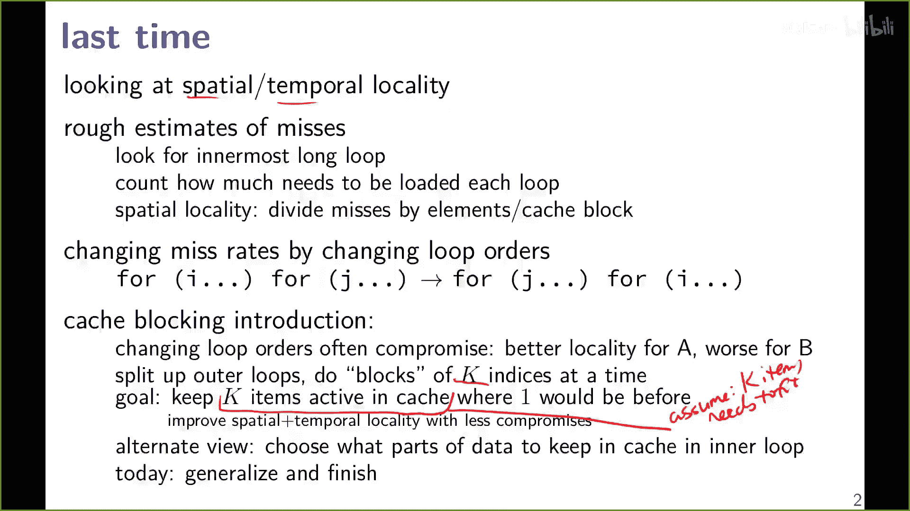
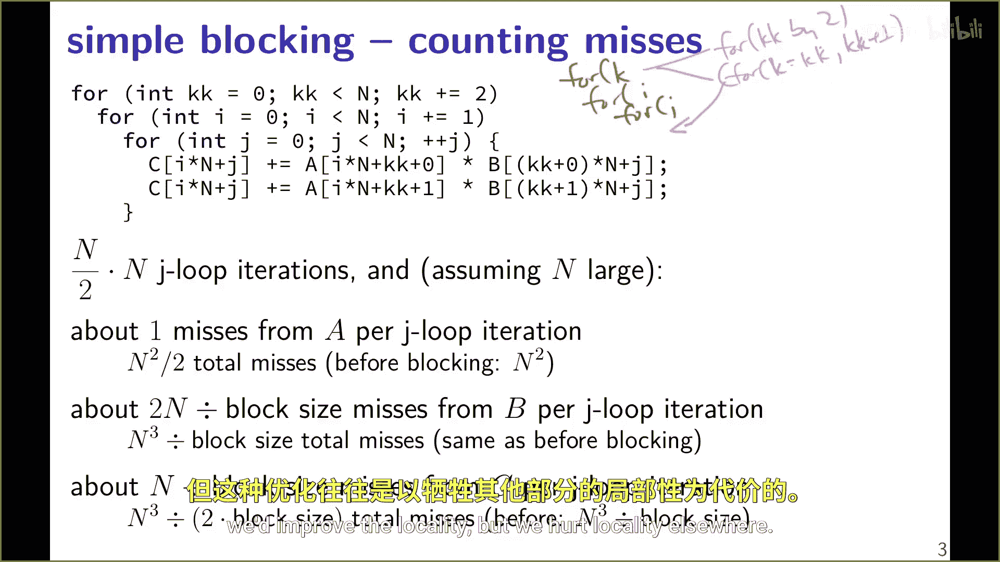
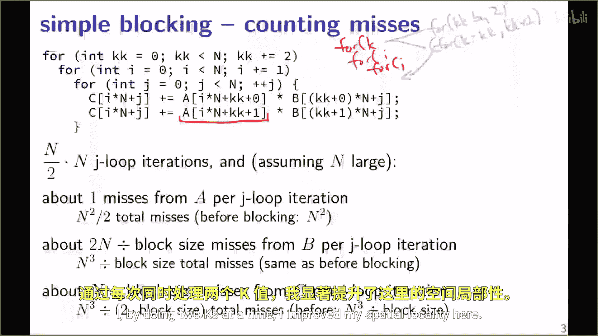
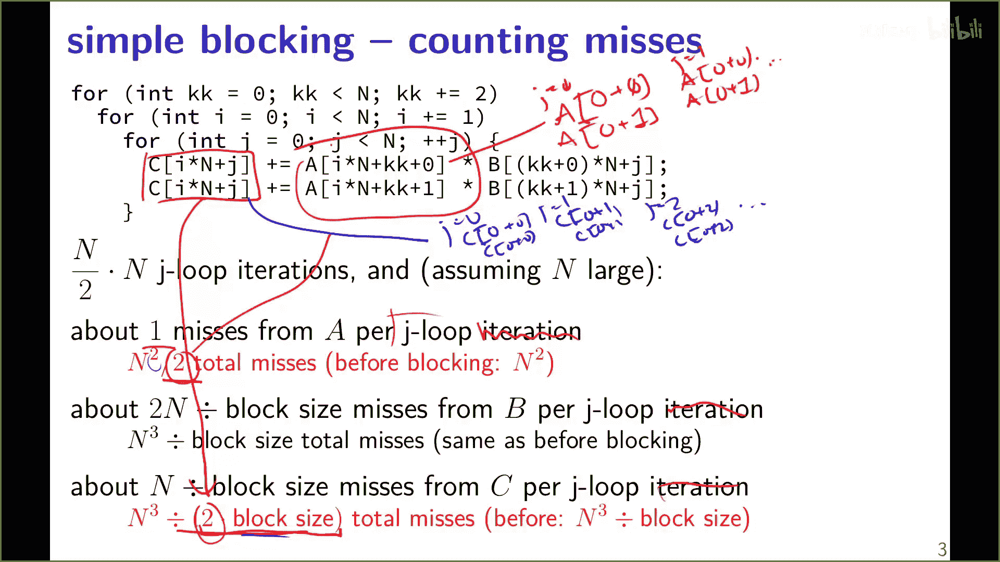

# 020：优化与乱序执行（一）🚀

在本节课中，我们将学习如何通过分析代码的局部性来优化缓存性能，并介绍一种名为“缓存分块”的实用技术。我们将从回顾上节课的内容开始，逐步深入探讨如何估算缓存未命中率，以及如何通过调整代码结构来提升性能。

## 概述

上节课我们讨论了超越详细模拟来评估缓存性能的方法。详细模拟需要检查每一次内存访问，确定其索引位，查看每个集合的内容，并以此计算未命中次数。这种方法虽然有效，但非常繁琐。因此，我们希望找到一种更实用的方法，来安排代码以更好地利用缓存。

我们的简化方法是寻找局部性：**空间局部性**（访问彼此靠近的数据）和**时间局部性**（重复使用相同的数据）。通过分析这两种局部性，我们可以粗略估计缓存未命中次数，这对于包含大量循环的典型代码尤其重要，因为这类代码的数据访问量大，缓存性能影响显著。

## 回顾：基于局部性的快速估算

我们的一种直觉是，观察运行次数最多的最内层循环，并估算需要加载的数据量（即可能的缓存未命中次数）。同时，我们考虑空间局部性：意识到我们将重用整个缓存块，因此能获得与缓存块大小成比例的性能收益。

这为我们提供了一种快速获取粗略估计的方法。为什么是粗略的？因为我们没有考虑诸如“如果两个数据具有相同的索引且该集合已满”之类的细节。我们只是进行快速近似，但这足以告诉我们，在两种代码安排方式中，哪一种可能更好。

我们通过一个常见的例子看到了这一点：在嵌套循环中，我们可以改变循环的顺序。我们进行相同的计算，只是顺序不同。通过比较局部性和对未命中率的估计，我们可以很好地猜测哪一种顺序更优。

## 循环顺序的权衡与缓存分块

然而，改变循环顺序有时是一种妥协：有时我们在改善一处局部性的同时，会损害另一处的局部性。我们希望能有一种折中的方法。

**缓存分块** 就是这样一种思想：我们不完全改变循环顺序，而是为外层循环处理**数据块**。这样，我们在估算未命中次数时，结果是我们会同时将 **K** 个数据项保留在缓存中（如果我们的块宽为 K），而不是一个。这从整体上改善了空间和时间局部性，其效果是仅改变循环顺序无法实现的。

为了使这种方法有效，我们有一个约束条件：假设 **K** 个数据项需要能放入缓存。这将是该技术的限制所在。

另一种理解方式是，通过选择块的大小，我们实际上是在选择在最内层循环中保留哪些数据。我们将在今天课程结束时探讨这一点，看看通用版本，并讨论如何选择这些数字（如块大小）。最终的答案是尝试一些值并测量性能，但我们希望先确定一个大致的范围，以免尝试过多的可能性而浪费时间。

在继续之前，大家对上节课的内容有什么问题吗？

---

## 深入分析缓存分块示例

上节课我们开始详细研究缓存分块及其对未命中次数的影响，看下面这个例子。这里，我最初有一个 `for i, for j, for k` 的三层循环。我通过拆分 `k` 循环进行了修改。

具体操作是：我将 `k` 循环拆分为一个步长为 2 的外层循环（`kk`）和一个处理连续两个 `k` 值（`kk` 和 `kk+1`）的内层循环。首先进行拆分，然后将拆分后的循环移到中间位置，最后展开循环以便更清楚地看到发生了什么。

这样做的好处是，我们以某种方式改善了一部分局部性，而如果仅仅改变循环顺序，我们可能在改善一处局部性的同时损害了另一处。通过一次处理两个 `k` 值，我在这里改善了空间局部性（访问两个相邻的 `k` 值），也在这里改善了时间局部性。

那么，对于数组 `B` 的访问，局部性是否变差了呢？看起来是的，`B` 的局部性确实变差了。但只要两个 `B` 的数据块能放入缓存，这就不是问题。我们只是需要在缓存中存储来自不同块的两个 `B` 的部分数据。虽然这比原来的局部性更差（空间和时间局部性都更差），但只要缓存能容纳，就不会造成大问题。

当我们进行未命中估算时，我们会说：好的，我现在每次加载 **2N** 个数据项，而不是 **N** 个。但是，因为我的循环迭代次数减半（步长为2），所以对于 `B` 来说，未命中次数大致相同。而对于 `A` 和 `C`，我们则有改善。我认为上节课的幻灯片中，我可能没有明确展示这一点，但确实存在改善：由于 `C` 的局部性改善，我们这里有一个因子 2 的收益；由于 `N` 的局部性改善，我们这里也有一个因子 2 的收益。这将带来净的性能提升，且提升幅度超过了仅改变循环顺序所能达到的效果。

关于这个结论有什么问题吗？

---

## 答疑：为何 A 和 C 的改善因子不同？

有一个问题是：为什么 `A` 和 `C` 的改善因子不同？具体是问，为什么 `A` 的公式中没有出现块大小因子 2？

我们来思考一下这里的访问模式。
对于 `A`：
*   在 `j=0` 时，我访问 `A[0+0]` 和 `A[0+1]`（假设内层处理两个k）。
*   然后对于 `j=1`，我再次访问 `A[0+0]` 和 `A[0+1]`。
*   对于所有 `j` 的迭代，我都在重复访问相同的那两个 `A` 的元素。
*   这意味着，在整个 `j` 循环的运行过程中，我预计总体上只会有一次未命中（为这两个元素加载缓存块）。

相比之下，对于 `C`：
*   当 `j=0` 且 `i=0` 时，我访问 `C[0+0]` 和 `C[0+0]`（写入）。
*   当 `j=1` 时，我访问 `C[0+1]` 和 `C[0+1]`。
*   当 `j=2` 时，我访问 `C[0+2]` 和 `C[0+2]`，依此类推。
*   我并没有一遍又一遍地重复访问相同的数据。每次 `j` 迭代都可能访问 `C` 中一个新的位置（除非步长和块大小恰好使得访问落在同一缓存行）。在我们的块大小为2的例子中，`C[0+0]` 和 `C[0+1]` 很可能在同一个缓存块，`C[0+2]` 和 `C[0+3]` 在下一个，等等。因此，对于 `C`，未命中次数与 `N`（数据大小）和块大小都有关，而 `A` 的未命中次数更少，因为它有极强的时间局部性。

---

## 总结

本节课中，我们一起学习了：
1.  如何利用**空间局部性**和**时间局部性**的概念，快速粗略地估算代码的缓存未命中率。
2.  改变**循环顺序**是一种优化手段，但有时会带来局部性改善与损害的权衡。
3.  **缓存分块**是一种更精细的优化技术，它通过在外层循环中处理数据块，旨在同时改善空间和时间局部性，其核心约束是块的数据总量需能放入缓存。
4.  我们通过一个具体的循环分块示例，分析了其对不同数组（`A`, `B`, `C`）访问局部性的影响，并理解了为何改善因子会因数据访问模式的不同而有所差异。

理解这些基本原理，能帮助我们在优化代码时做出更明智的初步决策，并为后续的实际性能测试确定合理的参数范围。