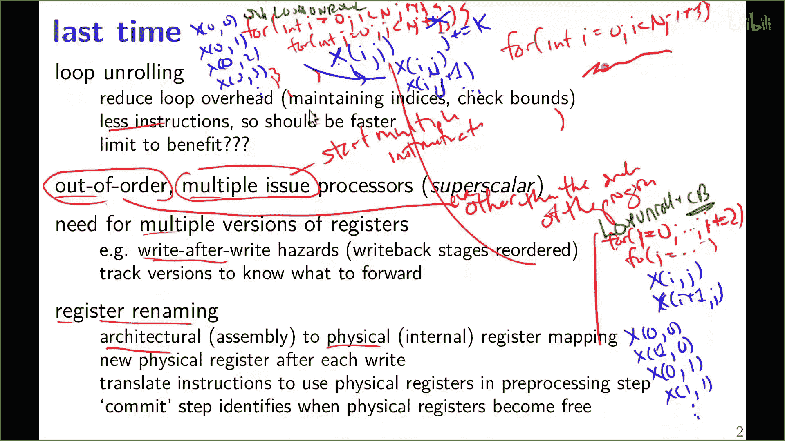
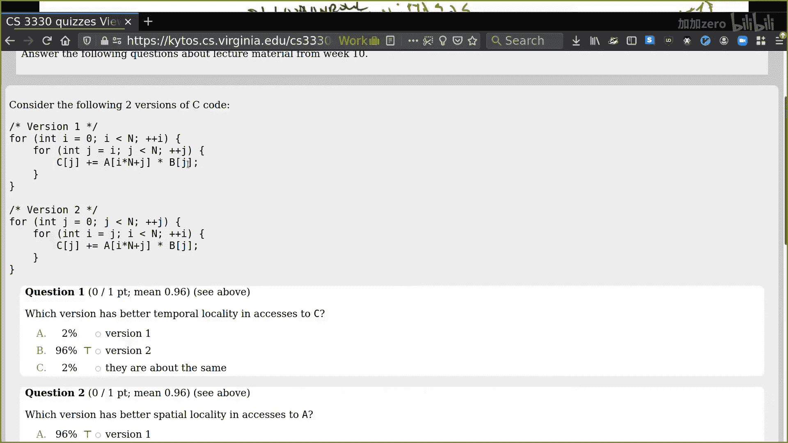

# 021：乱序执行与优化（第二部分）

在本节课中，我们将深入探讨处理器如何实现乱序执行，并理解它与循环展开等优化技术的关系。我们将从回顾上节课的内容开始，逐步构建对现代处理器内部工作机制的理解。

## 概述

上节课我们介绍了循环展开优化。本节我们将探讨处理器如何通过乱序执行和多发射技术来进一步提升性能，并解释为何循环展开的收益会达到瓶颈。

## 回顾：循环展开与性能瓶颈

上一节我们介绍了循环展开。这是一种通过复制循环体、减少循环控制开销来优化性能的技术。其核心思想是：在一个典型的循环中，大量指令用于管理索引、检查循环条件等“枯燥”部分。通过将循环步长增加（例如每次迭代处理两个元素），我们可以减少总的指令数量，从而期望获得更快的执行速度。

我们确实发现循环展开带来了速度提升，但也遇到了性能收益停滞的平台期。为了探究其原因，我们需要审视处理器的工作原理。

## 现代处理器：乱序执行与多发射

我们发现，现代处理器具备**乱序执行**和**多发射**的能力。
*   **多发射**意味着处理器可以同时启动和完成多条指令。
*   **乱序执行**意味着指令的执行顺序可能与它们在程序中的出现顺序不同。

这两个特性是我们之前学习的流水线处理器所不具备的。流水线处理器严格按照程序顺序执行指令，并且是单发射的——虽然多个指令的不同阶段可以重叠执行，但一次只能启动一条新指令，因此一次也只能完成一条指令。

当我们采用这种支持乱序执行的处理器时，我们突然需要跟踪寄存器的多个版本，这变得至关重要。

### 乱序执行带来的挑战

在流水线处理器中，我们通过简单的转发机制就能处理数据依赖。但在乱序处理器中，情况变得复杂。

例如，我们可能遇到两条指令都要写入同一个寄存器，但由于乱序执行，它们可能以不同的顺序完成。处理器需要记住最终应该保留哪个写入结果。这被称为“写后写”冒险，因为指令的重新排序导致了连续的写操作。

更普遍地说，当多条指令在不同时间写入时，我们需要知道应该转发哪个版本的值。我们不能像在流水线中那样，简单地认为“处于最近流水阶段的那个值就是我要的”。

### 解决方案：寄存器重命名

我们的解决方案是显式地跟踪指令的不同版本，以确定转发哪个值，以及（正如我们今天将看到的）决定可以执行哪些指令。

为此，我们引入了**寄存器重命名**的概念。其核心思想是将程序可见的**架构寄存器**映射到处理器内部大量的**物理寄存器**上。我们维护一个映射表来管理这种关系。

我们为每一次写操作分配一个新的物理寄存器，因此每个物理寄存器只保存一个特定版本的值。这个从架构寄存器名到物理寄存器名的转换在一个预处理步骤中完成。

同时，我们还需要进行额外的簿记工作。虽然我们没有深入细节，但在某个时刻，我们需要释放物理寄存器以供重用。这通过一个“提交”步骤来实现，在该步骤中，我们确定哪些指令已经真正完成，哪些值的版本不再被任何后续指令需要，然后释放这些物理寄存器。

## 本节重点：指令的调度与执行

在完成了寄存器重命名之后，我们现在要看看处理器是如何实际运行指令的，特别是如何实现“乱序”这一特性——即运行任何可以运行的指令，而不仅仅是按照程序顺序运行。

在继续之前，有任何关于上节课内容的问题吗？比如循环展开和缓存分块的区别？

### 答疑：循环展开 vs. 缓存分块

以下是循环展开与缓存分块的核心区别：

*   **循环展开**：不改变循环体所执行的操作顺序。它只是在一个外层循环迭代中，执行了多个原本属于内层循环迭代的操作。访问内存的顺序保持不变。
*   **缓存分块**：会改变循环的嵌套结构，从而显式地改变了数据访问的顺序。其目的是将数据访问模式限制在缓存的一小部分（一个“块”）内，以提升缓存命中率。

**举例说明**：
假设有嵌套循环访问数组 `X[I][J]`。
*   **原始顺序**：`X[0,0]`, `X[0,1]`, `X[0,2]`, ...
*   **仅循环展开**（内层J步长为2）：`X[0,0]`, `X[0,1]`（在一次内层迭代中完成），然后 `X[0,2]`, `X[0,3]`，... 访问顺序不变。
*   **循环展开+缓存分块**（同时改变I和J的循环）：可能先访问 `X[0,0]`, `X[1,0]`（改变了I），然后 `X[0,1]`, `X[1,1]`，... 访问顺序发生了改变。

简而言之，循环展开不改变访问顺序，而缓存分块会改变访问顺序以优化缓存使用。

### 快速答疑：测验题三

关于测验题三（涉及缓存未命中率的问题），简要解释如下：

题目询问对于数组 `B` 在版本1中的未命中次数。在给定的代码中，我们在内层循环中访问 `B[J]`，而 `J` 在每次内层循环迭代中都会变化。

`J` 的取值范围是多少？它从 `I`（平均值约为 `N/2`）递增到 `N`。因此，`J` 大约有 `N/2` 个不同的值。由于每次访问一个新的 `J` 值（假设缓存行大小等因素使得每次访问都可能导致未命中），那么对于 `B` 的未命中次数大约就是 `N/2` 次。

## 总结

本节课我们一起学习了乱序执行处理器的核心机制。我们回顾了循环展开的局限性，并引出了多发射和乱序执行的概念。为了应对乱序执行带来的数据依赖和寄存器版本管理问题，处理器采用了**寄存器重命名**技术，将架构寄存器映射到大量的物理寄存器上。我们还澄清了**循环展开**（不改变访问顺序）和**缓存分块**（改变访问顺序以优化缓存）的关键区别。理解这些底层机制，有助于我们理解高级优化技术为何有效以及其收益边界。