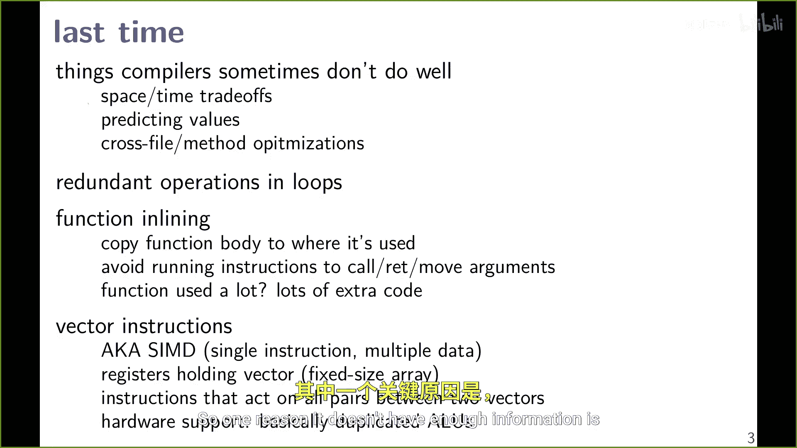
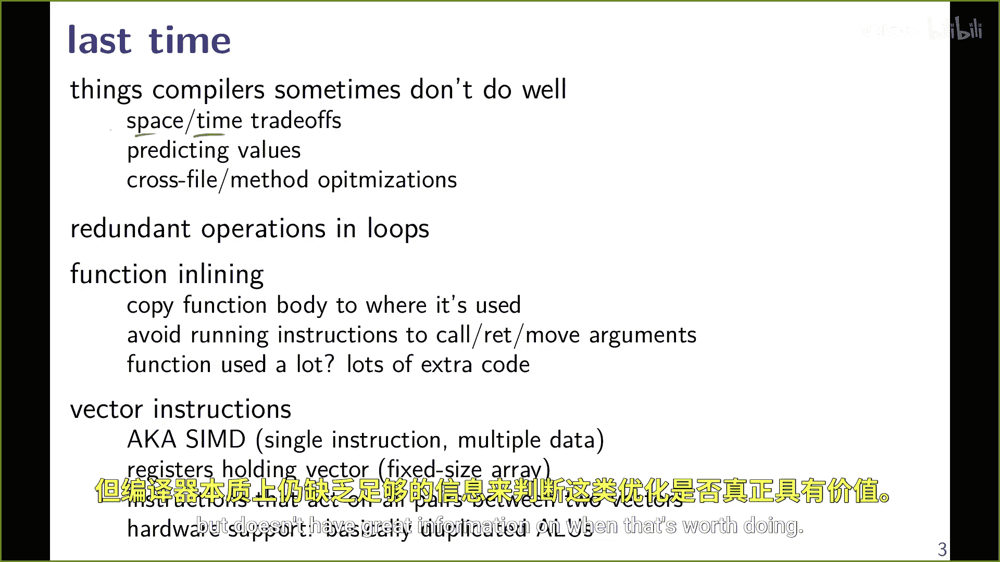
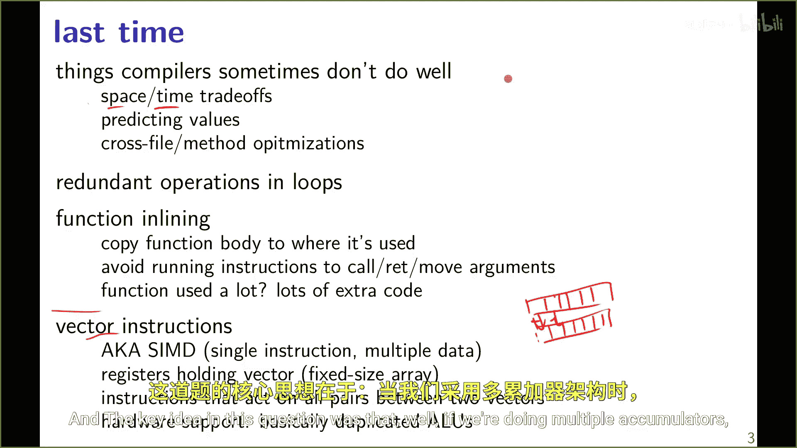
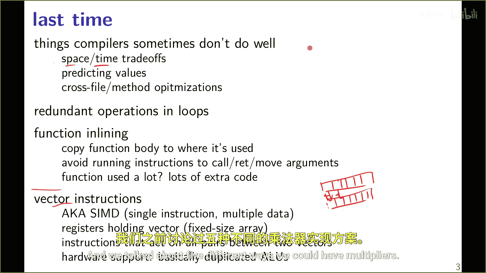
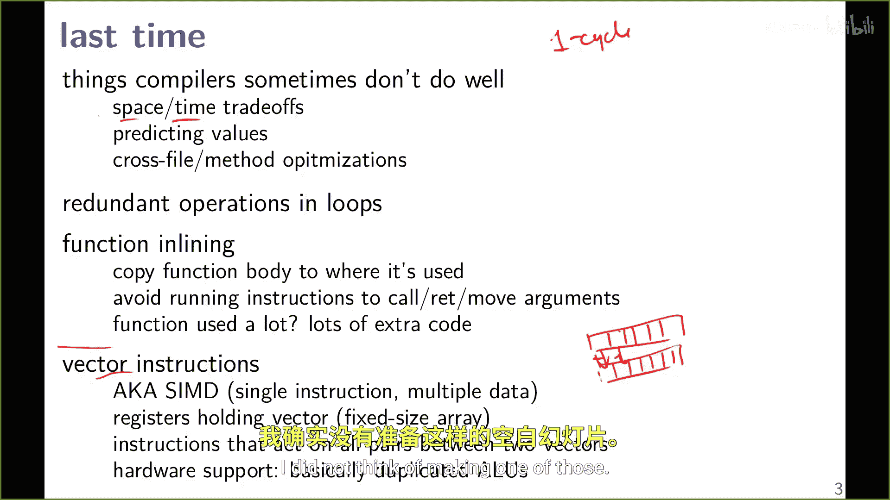
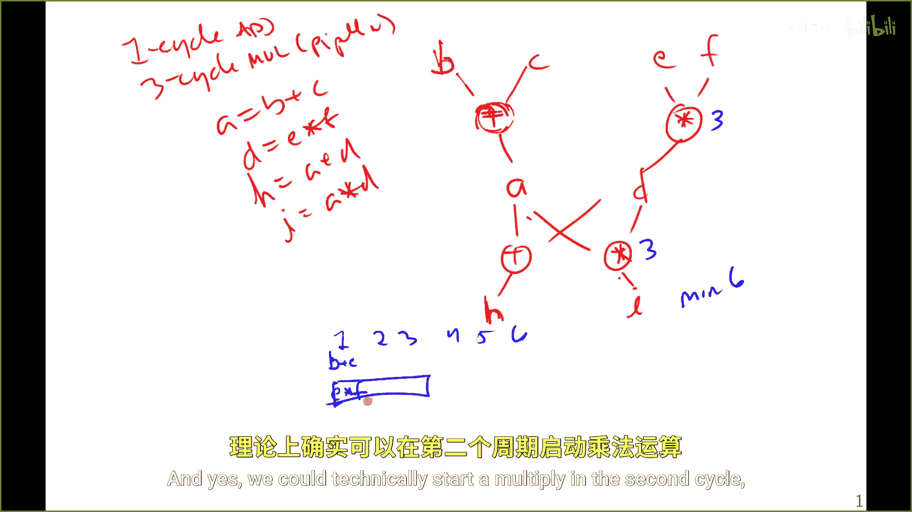

# 023：异常处理

在本节课中，我们将学习编译器优化的局限性，并回顾向量指令的概念。课程将首先探讨编译器在优化时面临的信息不足问题，然后总结上一讲中提到的几种优化技术，最后深入讲解向量指令的工作原理和优势。





上一节我们介绍了编译器优化及其面临的挑战，本节中我们来看看具体的优化技术及其局限性。

编译器有时无法很好地执行某些优化。大多数情况是因为编译器没有足够的信息来完成我们期望的所有优化。

编译器信息不足的一个原因是，许多优化需要在空间和时间之间进行权衡。例如，我们通过增加代码体积（如循环展开或缓存分块）来提升速度，但这在许多情况下并不划算。编译器通常没有足够的信息来判断何时进行这种权衡是值得的，尽管有时可以给它一些提示，但信息仍然有限。

使情况更复杂的是，编译器必须猜测典型值。它不知道循环会有多少次迭代，也不知道两个指针是否经常指向同一个数组。尽管如此，它必须生成能够正常工作且性能不至于太差的代码。

这意味着，除非我们采取一些措施鼓励编译器，否则我们讨论过的许多优化它不太可能自动执行。

另一个问题是，出于性能考虑，大多数编译器默认会避免跨文件和跨方法的优化。因为跨文件优化速度较慢，并且如果我们想进行跨文件优化，就无法使用之前讨论过的目标文件方案。

我们讨论了几种零散的优化技术。其中一点是，如果循环中存在冗余操作，编译器最好能只执行一次。但有时这不可能实现。我们举了一个调用 `strlen` 函数的例子，编译器需要进行大量分析，甚至是跨文件分析，才能确定该函数的返回值不会改变。类似的情况也可能出现，比如循环中存在某个比较操作，我们人类可以判断出每次结果都相同，但编译器无法确定。

另一个概念是函数内联。就像循环有索引维护和结束条件判断一样，函数调用也有按照调用约定传递参数、执行调用和返回的指令。我们可以选择将函数体直接复制到调用它的地方，从而在常见情况下节省指令。这通常是有益的，但编译器不会总是这样做，因为如果总是内联，程序会变得非常庞大，反而可能降低速度。然而，对于内部紧凑循环且函数体较小的情况，内联是值得的。编译器会尝试猜测这些情况，但可能无法完全猜对。

在讨论了函数内联之后，我们谈到了向量指令。其核心思想是，处理器可以提供一种指令，使得寄存器中不再只存储一个值，而是存储一个小型数组的值。为此，我们需要更大的寄存器，并提供指令来同时对两个寄存器中的所有值对进行操作。例如，一条加法指令可以同时完成八对数字的加法，而不是一对。

**向量加法伪代码示例**：
```cpp
// 标量加法
for (int i = 0; i < 8; i++) {
    c[i] = a[i] + b[i];
}

// 向量加法（概念性）
vector_add(c, a, b); // 一条指令完成8个加法
```

为什么这样做是值得的？虽然我们复制了算术逻辑单元（ALU），但我们并没有复制取指、指令调度（在乱序处理器中变得非常复杂）等所有逻辑。

今天我们将从完成向量指令的讨论开始。在开始之前，关于上一讲的内容有什么问题吗？



现在，我们来回顾一下测验中的问题。



测验第二题是关于使用多种乘法器设计进行多累加器优化的。这个问题的核心思想是，使用多累加器的目的是允许多个操作并行执行。

我们讨论了五种不同的乘法器设计方式。前两种方式一次只能执行一个乘法运算。因此，即使我们以不同的顺序安排乘法运算，一次也只能执行一个。在问题的假设下，这在我们最初的设计中（即不使用多累加器的原始循环中）是可以实现的。

其他几种设计能够同时执行至少10到100个乘法运算的不同部分，即可以同时处理不同乘法的部分。这正是多累加器变得有用的地方。因为我们可以开始一个乘法运算，然后在其结束之前（可能在同一个周期，如果我们有足够的乘法器；也可能稍晚一些）开始另一个乘法运算，从而获得性能优势。



有人要求回顾第一题和第四题。我们先看第一题。

第一题描述了一个单周期加法器和一个三周期、两级流水线的乘法器。题目要求对以下操作序列进行调度：
```
A = B + C
D = E * F
H = A + D
I = A * D
```
要解决这个问题，可以绘制数据流图。B和C输入加法运算产生A，E和F输入乘法运算产生D。然后，H由A和D相加得到，I由A和D相乘得到。

我们可以立即观察到，必须在执行A和D的乘法之前，先完成E和F的乘法。加法需要1个周期，乘法需要3个周期。因此，我们至少需要6个周期。这个周期数是可行的，因为我们可以这样调度：在第一个周期执行B+C，同时开始执行E*F（需要3个周期）。通过合理安排，我们可以在6个周期内完成所有计算。



本节课中我们一起学习了编译器优化的主要限制因素，包括信息不足和权衡判断困难。我们回顾了函数内联和向量指令这两种优化技术，并通过测验问题加深了对指令调度和并行执行的理解。理解这些概念有助于我们编写更高效的代码，并理解编译器自动优化的边界。