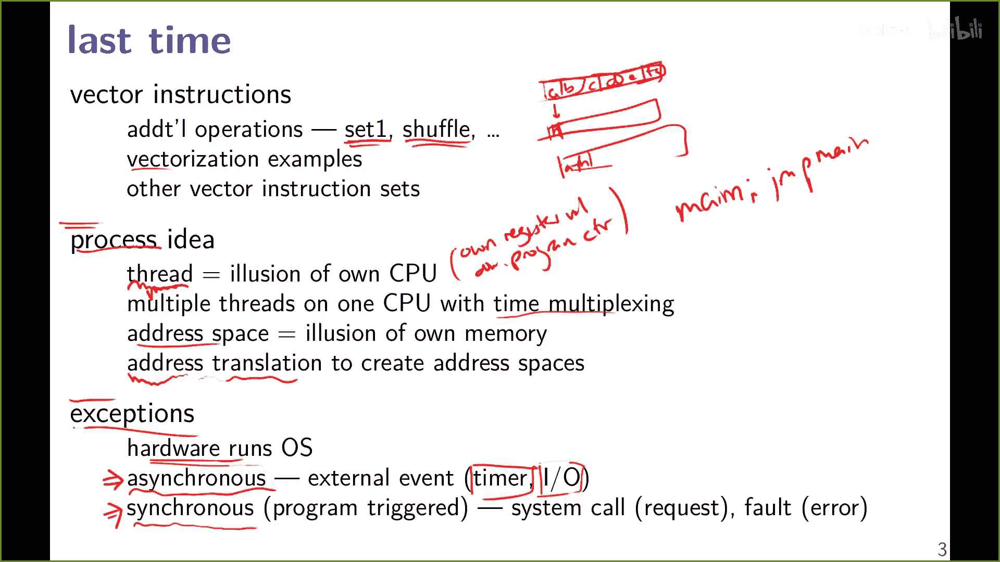
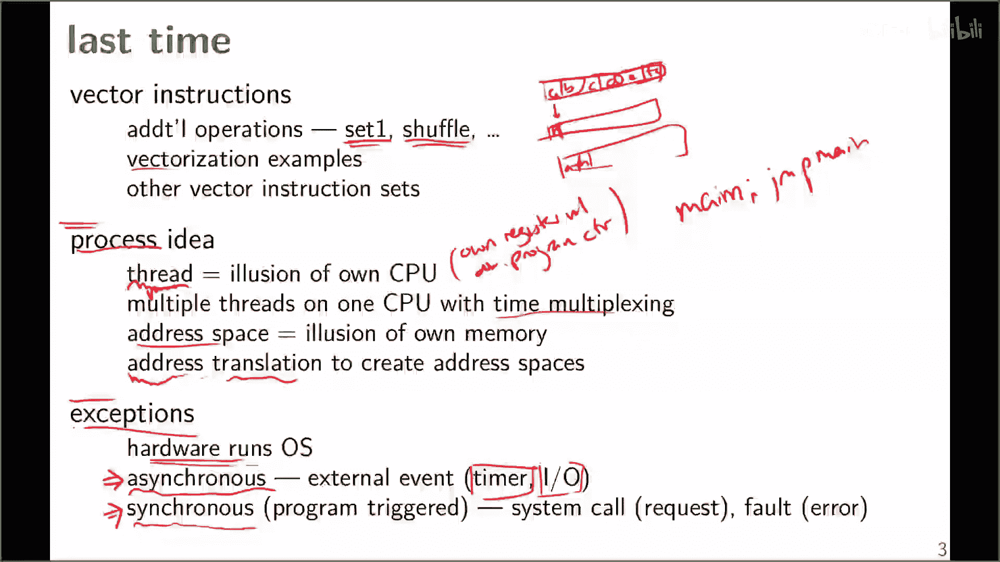
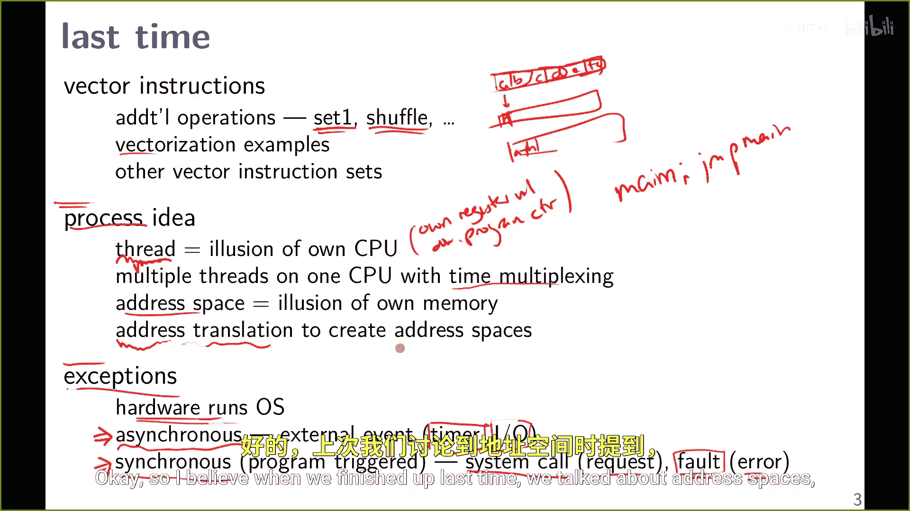
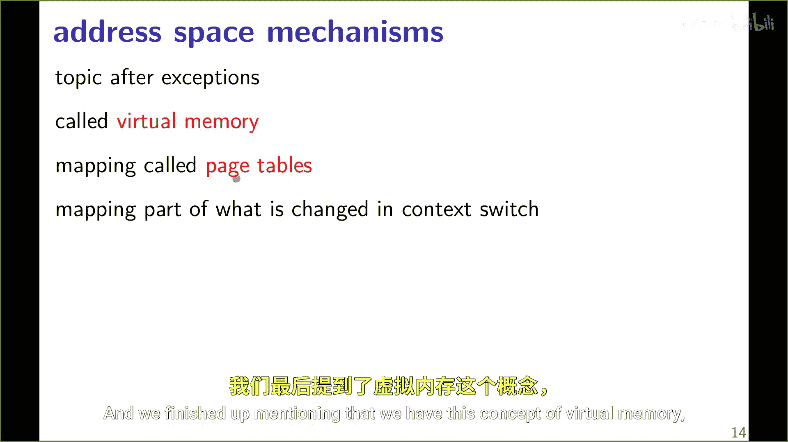
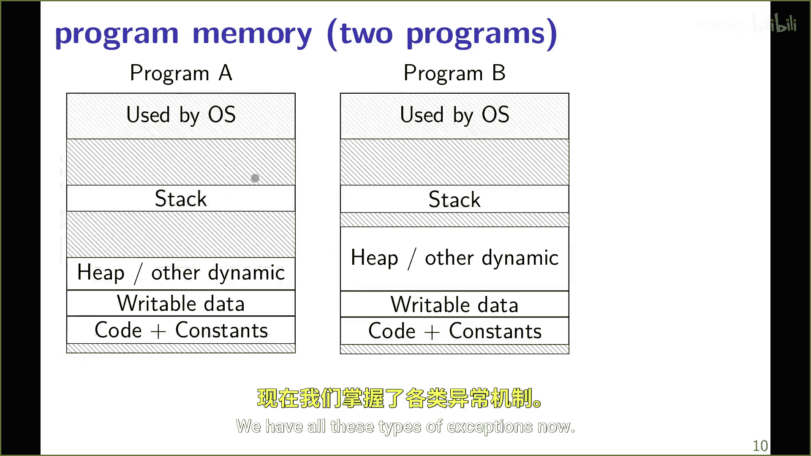
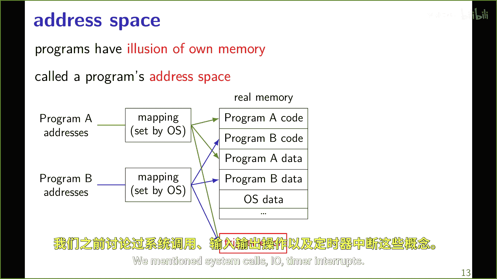

# 024：异常处理（完结）与虚拟内存入门 🚀

在本节课中，我们将学习异常处理机制的细节，并开始探讨虚拟内存的基本概念。我们将了解硬件如何响应不同类型的异常，以及操作系统如何利用这些机制来管理进程和保护系统资源。

上一节我们介绍了向量指令及其应用，并引入了进程的概念。本节中，我们将深入探讨异常处理的具体实现，并开始了解虚拟内存如何为每个进程创建独立的地址空间。

## 异常的类型与原因

我们提到，异常是硬件无需程序提示即可运行操作系统代码的机制。异常的发生原因可分为程序外部和内部。

以下是异常的主要类型：

*   **异步异常**：由程序外部事件触发。
    *   **定时器中断**：为了实现时间片轮转，让多个程序分享CPU，操作系统设置一个定时器。定时器到期时，会触发一个异常，使硬件转而运行操作系统代码，即使当前程序正在运行一个不包含跳转到操作系统指令的无限循环。
    *   **I/O事件**：例如按下键盘按键。由于键盘等I/O设备通常由所有程序共享，硬件不会直接决定将输入交给哪个程序。相反，它会触发一个异常来运行操作系统，由操作系统负责处理这个I/O事件并决定将其分发给哪个程序。
*   **同步异常**：由程序自身的执行直接触发。
    *   **系统调用**：这是程序主动向操作系统请求协助的方式。我们稍后会讨论为什么这必须通过异常机制实现，而不能只是一个普通的函数调用，原因与如何防止程序执行未授权操作有关。
    *   **故障**：当程序执行了不被允许的操作时触发。例如，在启用了地址转换的系统中，如果程序试图访问一段未被分配给它或不允许访问的内存，硬件就会触发一个故障异常，并运行操作系统。操作系统随后决定如何处理这个试图进行非法访问（或除以零等错误操作）的程序。

## 异常处理程序的运行

现在我们已经讨论了异常的类型，接下来谈谈硬件如何实际运行异常处理程序（即操作系统中处理异常的代码），以及需要哪些额外的硬件机制来防止程序干扰或破坏操作系统。

一个相关的问题是：同步/异步的术语是否与Web应用开发中的概念相关？在其他语境中，“异步”通常意味着不是由当前直接操作触发。在Web应用上下文中，如果某个动作由服务器触发，你可能也会称之为“异步”。这背后的核心理念是相似的（是否由当前工作直接触发），但应用场景非常不同。

## 地址空间与虚拟内存

我们之前提到了地址空间的概念。为了给每个运行中的程序提供它拥有独立内存的假象（例如，写入自己的栈不会影响其他程序的栈），我们使用了称为**地址转换**的机制。

地址转换通过让处理器将程序使用的每一个地址，都经由操作系统描述的一个映射关系进行转换，从而为每个程序创建一个独立的**地址空间**。这个创建独立地址空间假象的机制，就是我们即将开始讨论的**虚拟内存**。我们将在今天晚些时候开始讨论这个映射的具体形式，并在下周完成这部分内容。

---

**本节课中我们一起学习了**：异常的分类（异步与同步）、各类异常的具体触发场景（如定时器中断、I/O中断、系统调用和故障），以及异常处理的基本流程。我们还引入了虚拟内存和地址空间的核心概念，了解到地址转换是操作系统为每个进程提供独立、受保护内存视图的关键机制。下一讲我们将深入探讨虚拟内存的实现细节。