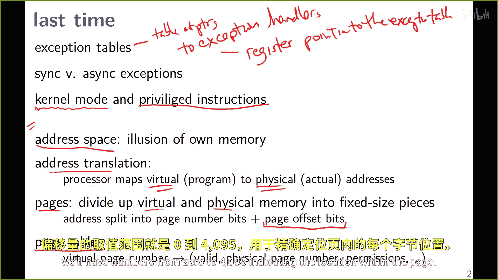
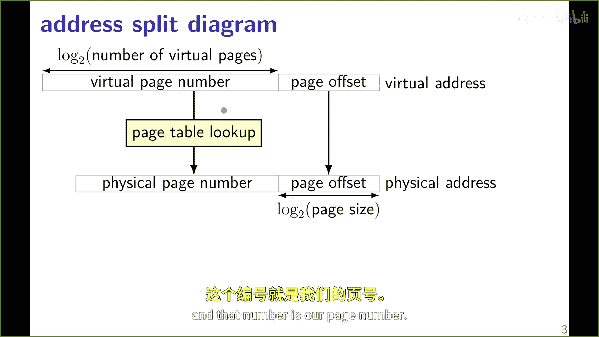
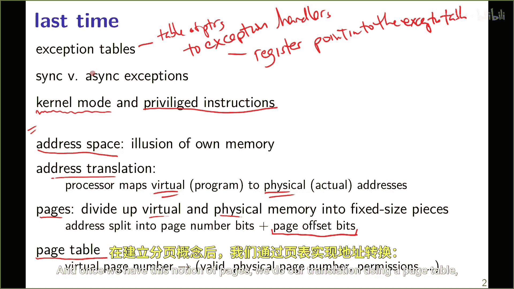
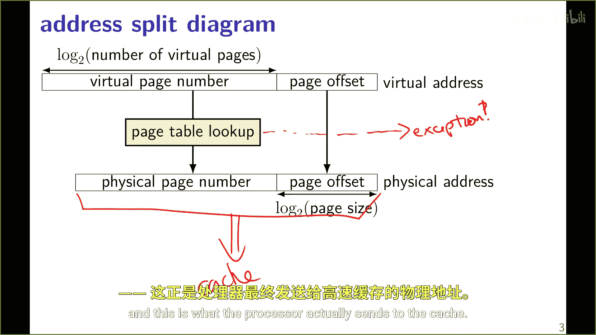
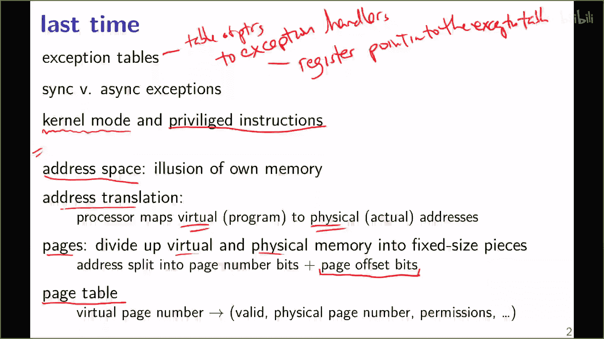
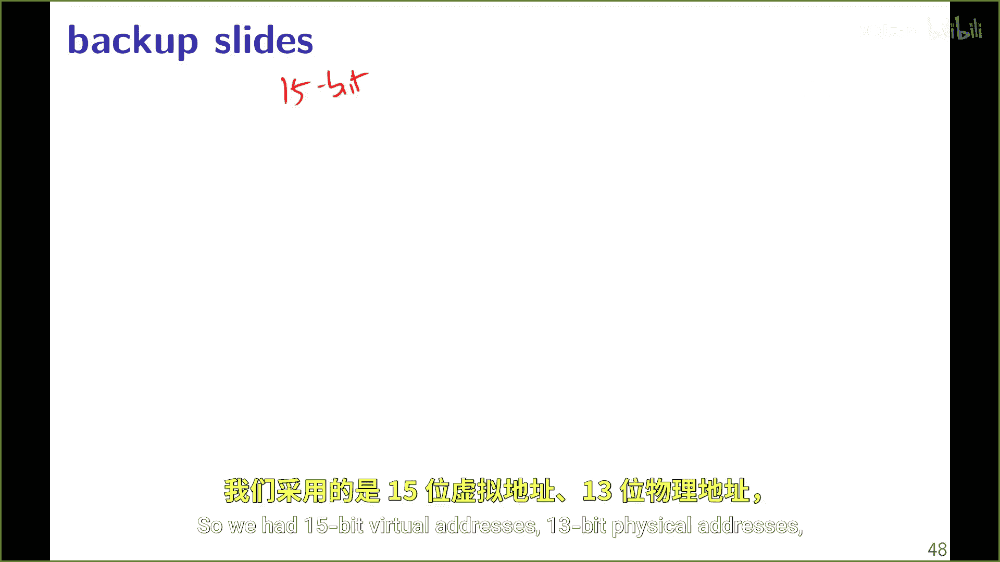

# 025：虚拟内存 2 🧠

在本节课中，我们将继续学习虚拟内存机制。上一节我们介绍了异常处理、内核模式以及地址空间的基本概念。本节中，我们将深入探讨实现地址空间的核心机制——地址翻译，特别是基于页表的虚拟内存系统是如何工作的。

## 回顾：异常与进程隔离

上一节我们介绍了异常处理。操作系统通过一个**异常表**来管理异常，这是一个指向不同**异常处理程序**的指针表。处理器通过一个由操作系统设置的寄存器来定位这个表。

我们还讨论了不同类型的异常，并引入了**特权指令**的概念。为了安全地在多个程序间共享机器资源，某些关键操作（如配置异常处理或进行I/O）被保留给操作系统执行。处理器通过**内核模式**和**用户模式**来跟踪当前权限。只有操作系统能运行在内核模式并执行特权指令；用户程序运行在用户模式，若尝试执行特权指令则会触发异常，交由操作系统处理。

这种模式切换与异常机制紧密结合：发生异常时，处理器切换到内核模式运行操作系统代码；当操作系统从异常处理程序返回并希望继续运行普通程序时，再切换回用户模式。

接着，我们探讨了**进程**的概念。进程提供了每个程序独占整个机器的假象，这包括通过时间片切换共享处理器。然而，内存也需要被共享。我们希望给每个程序一种错觉，即它拥有专属于自己的内存，这被称为**地址空间**。实现地址空间的通用机制是**地址翻译**。

## 地址翻译与页表

地址翻译的核心是一个由处理器使用、由操作系统设置的**映射**。这个映射将程序使用的地址（称为**虚拟地址**）转换为机器上实际的**物理地址**。通过为不同运行的程序设置不同的映射，操作系统可以为每个程序创建独立且互不干扰的内存视图，同时也能防止程序访问操作系统的内存区域。

我们使用一种称为**虚拟内存**的机制来表示这个映射，具体通过**页表**来实现。

### 分页的概念

为了有效地表示这个映射，我们需要将地址空间划分为块。我们不会为每个独立地址指定映射，而是指定这些大块，我们称之为**页**。我们将虚拟内存和物理内存都划分为这些固定大小的片段。实际上，我们不仅选择固定大小，还选择2的幂次方大小。这意味着我们可以将地址拆分为两部分。

假设我们的页大小是 4096 字节（即 2^12 字节）。那么：
*   **页内偏移**：表示在页内的具体位置。地址中用于表示这个位置的部分称为页内偏移位。对于 4096 字节的页，我们需要 12 位（0-11位）来表示偏移量，范围是 0 到 4095。
    *   公式：`页内偏移 = 虚拟地址[11:0]`
*   **页号**：地址中剩余的部分用于表示这是第几页。我们从头开始为页编号，这个编号就是页号。
    *   公式：`虚拟页号 = 虚拟地址[31:12]` （假设32位地址，页大小4KB）

### 页表的工作方式

一旦有了页的概念，我们就可以使用页表进行翻译。以下是翻译过程：

1.  处理器取出指令或数据访问使用的**虚拟地址**。
2.  将虚拟地址拆分为**虚拟页号**和**页内偏移**。
3.  使用虚拟页号作为索引，查询**页表**。页表是一个数组，每个可能的虚拟页号在表中都有一项条目。
4.  页表条目中可能包含：
    *   **有效位**：指示该虚拟页是否已映射到物理内存。
    *   **物理页号**：如果有效位为真，则此项给出了对应的物理内存中的页号。
5.  如果有效位为假，表示该虚拟页尚未分配物理页，处理器会触发一个**异常**（通常是缺页异常），交由操作系统处理。
6.  如果有效位为真，则取出**物理页号**。
7.  将**物理页号**与原始的**页内偏移**组合，形成最终的**物理地址**。
    *   公式：`物理地址 = {物理页号, 页内偏移}`
8.  处理器将这个物理地址发送给缓存或主存进行实际访问。

**关键点**：页内偏移在翻译过程中保持不变。这意味着，如果一个数据在虚拟页内的某个偏移位置，那么它在对应的物理页内的偏移位置是相同的。这简化了硬件设计，因为只需要翻译页号部分。

### 关于地址的常见问题

*   **虚拟地址从何而来？**
    当虚拟内存（页表）处于活动状态时，程序使用的**每一个**地址都是虚拟地址。这包括跳转指令的目标地址、指针引用的地址、栈指针的地址等。所有这些地址在由处理器使用前，都需要经过地址翻译。
*   **物理地址可以和虚拟地址相同吗？**
    可以，但这通常是一种巧合。如果页表查询后，得到的物理页号恰好等于输入的虚拟页号，那么翻译后的物理地址就会和虚拟地址相同。例如，虚拟页号1被映射到物理页号1。但通常操作系统会随意分配物理页，所以这种情况并不常见。

## 示例：计算页大小

假设一个系统具有以下参数：
*   虚拟地址位数：13位
*   物理地址位数：13位
*   页表条目数：32条

我们需要计算页大小。

**推理过程**：
1.  页表条目数（32）等于虚拟地址空间中可以有多少个不同的页。32 = 2^5，因此**虚拟页号**部分需要5位来表示（可索引0-31页）。
2.  虚拟地址总共有13位。既然其中5位用作虚拟页号，那么剩下的位数就是**页内偏移**的位数。
    *   页内偏移位数 = 总地址位数 - 虚拟页号位数 = 13 - 5 = 8位。
3.  页大小由页内偏移的寻址能力决定。8位可以表示 2^8 = 256 个不同的地址（偏移0到255）。
4.  因此，**页大小是256字节**。

**验证**：物理地址也是13位。页表映射的是页号。物理页号需要多少位？物理地址空间也被划分为256字节的页。13位地址空间总共有 2^13 字节 / 256 字节/页 = 32 页。所以物理页号也需要5位（2^5=32），这与虚拟页号位数匹配，页表条目中的物理页号字段为5位即可。页内偏移（8位）在翻译中保持不变。

## 总结

本节课中我们一起深入学习了虚拟内存的实现机制。我们回顾了通过异常和特权模式实现的操作系统保护机制。核心在于，**页表**提供了从**虚拟地址**到**物理地址**的映射，从而为每个进程创建了独立的地址空间。通过将地址划分为**页号**和**页内偏移**，并将映射粒度设定在页级别，我们得以高效、安全地共享物理内存。页内偏移在翻译过程中保持不变，简化了硬件设计。理解虚拟地址的来源以及页表查询的具体过程，是掌握现代计算机内存管理的基础。