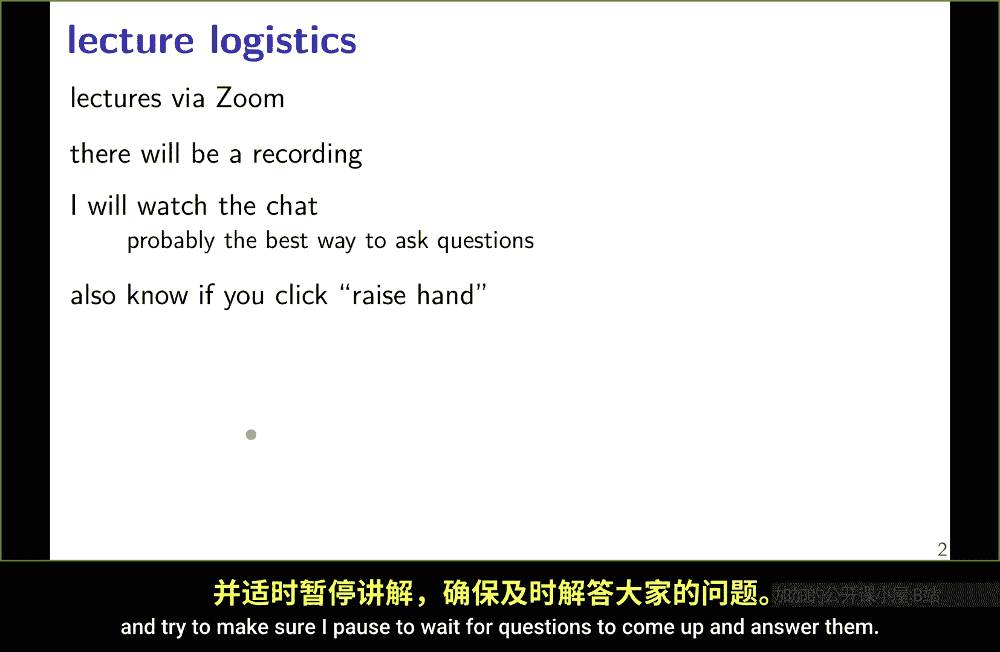
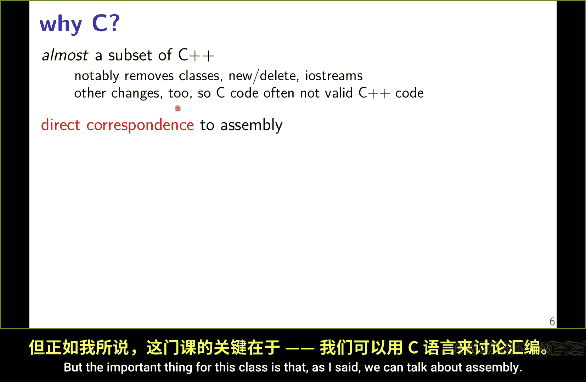
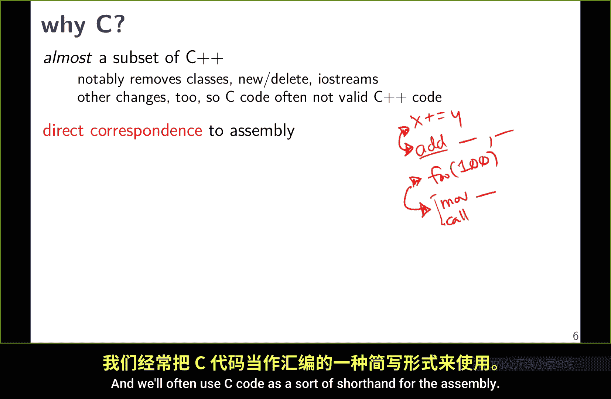
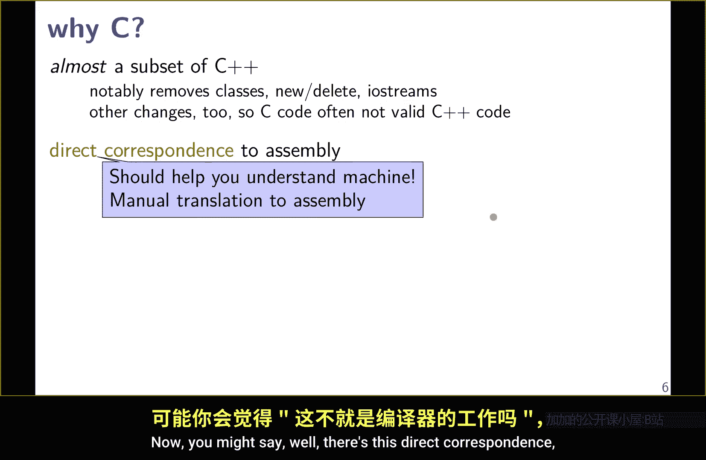
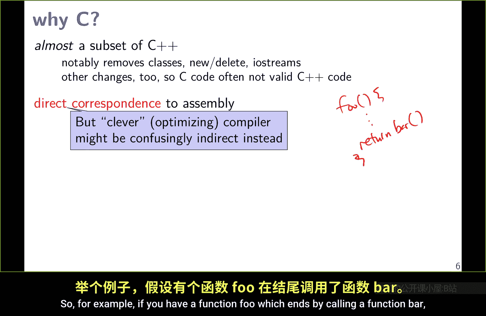
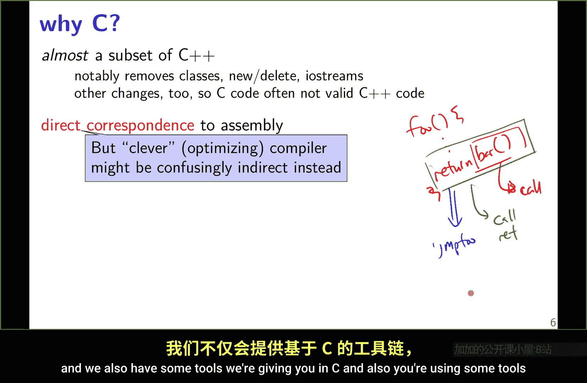
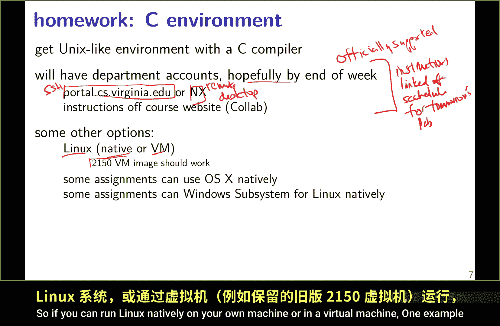
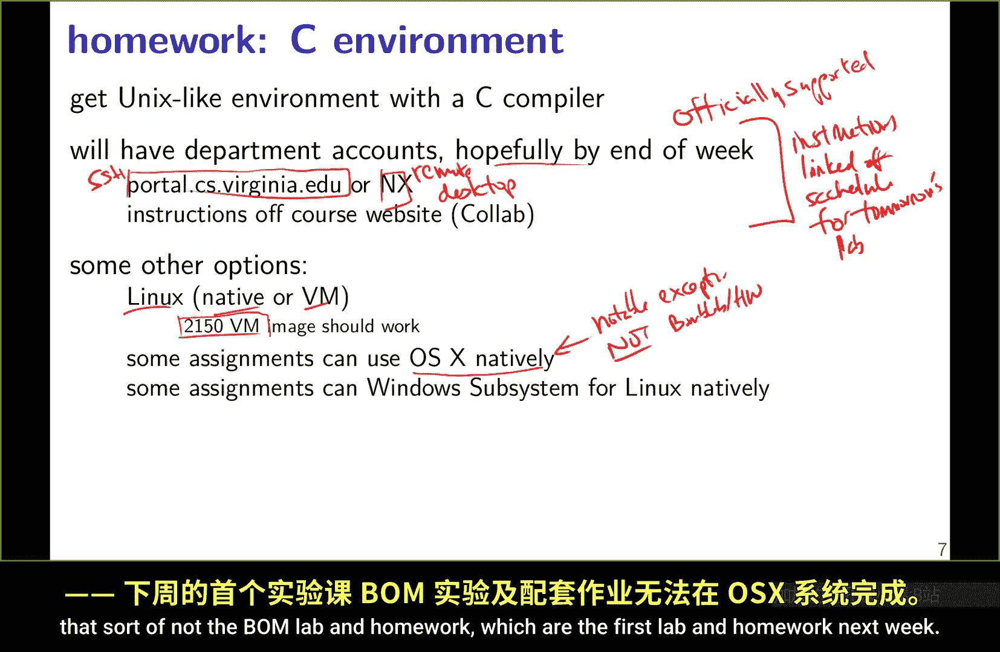
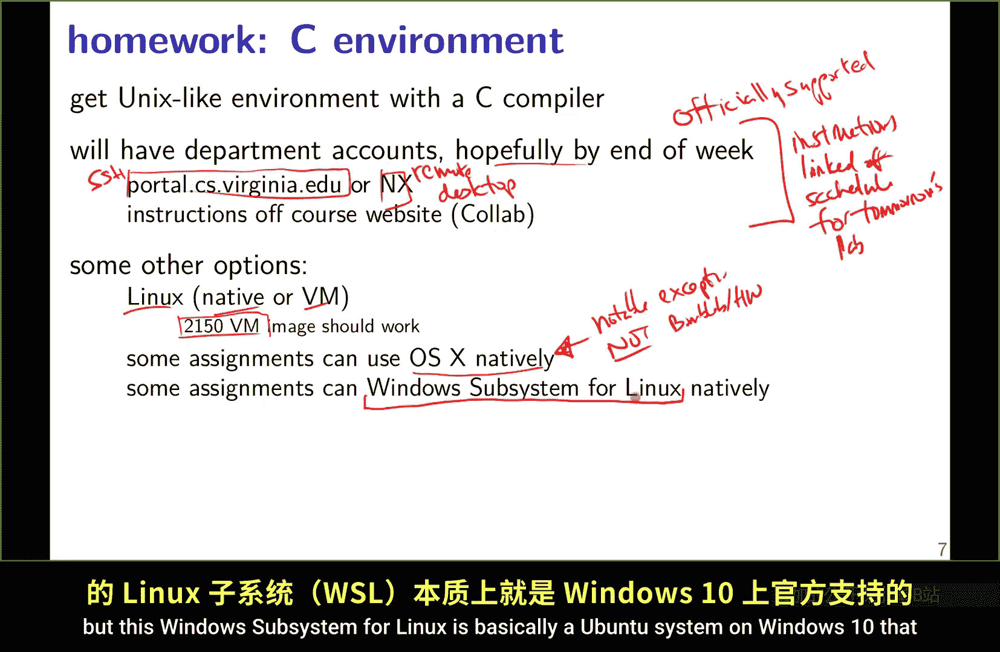
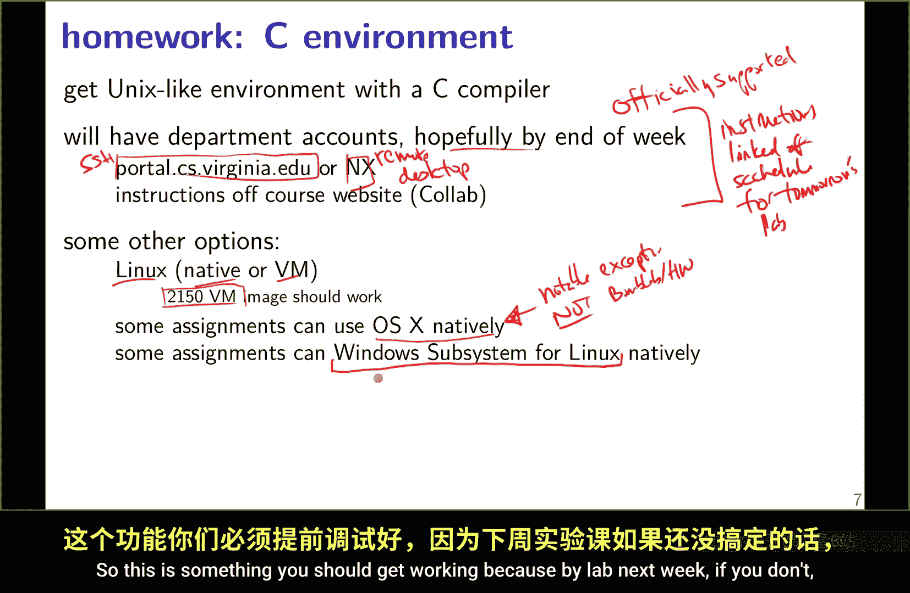

# 弗吉尼亚大学【中英⚡计算机架构｜CS3330 2020 Computer Architecture】 p01 P1 Course Introduction -BV1cKeGzqEuJ_p1-

Good afternoon so today we're starting see yes there's security computer architecture。

 I'm going to go over some lecture logistics quickly first go over the rest of the logistics later on after talking about what is this course action？

So lecture logistics， lectures are via Zoom， there will be a recording will be made available to you for questions。

 I will watch the chat and this is probably the best way to ask questions。

 I can also take questions if you click raise handles， see it。But for most questions。

 it's probably not。Worth dealing with the hassle of unmuting and all that。

So Jack primary way ask questions and I will watch it and try to make sure I pause to wait for questions to come up。

And answer that。So in this class we're going to talk about how hardware works and we're going to think of this as sort of layers of abstraction。

 you've kind of seen this before when we think about sort of like a high level programming language and like assembly and so on。

 and we're going to sort of go below assembly to sort of machine code you see in a preview of in 2150 that you may or may not remember and actually how we design hardware。

And we're going to talk a little bit about what we'll call for this class a high level language of C now。

You think about programming languages generally， you often say C is a low level language。

 but for our purposes， you know it's high level because we're really concerned about what the hardware is doing and there's kind of a whole bunch of steps between our C code and our machine code and eventually what the hardware does。

So I'm going say well， why are we ever going to use C in this class？

And why are we going to use it for So we're going to have some assignments much later on in the semester。

 we're going to have you write a bit of C code， We're going to talk a little about C。

 but we're mainly using it to actually talk about assembly。And like why are we doing that。

 it's not because C is a good language， I don't really like C as a language。

But you're already know mostly because it's almost a subset of C plus plus。

 and at some point in 2150， most of you knew C+ plus。And it's just simpler than that now。

 I say almost a subset， because if you take a large C program and try to compile it as a C++ program。

 probably won't work。But it's close enough that you're going to be able to understand it pretty well。

But the important thing for this class is that， as I said。

 we can talk about assembly that when we see a line of C code， you know x plus equals y。

 you know that sort of translates directly to in added instruction we have this direct correspondence where we can say here's the assembly that corresponds to that and this would it works so well in some other languages like in Python。

 if I write x plus equals y， there's a whole bunch of extra work that needs to go on because like what if it's a string and we're doing string conconation。

 we need all the things to figure that out and C generally not don't have those complications and we have sort of more complicated but still direct correspondences So if I have。

You know， a call to a function foo。If you vaguely remember your assembly from 2150， you know。

 that turns into a move for the argument。And a call， typically that's a direct correspondence。

It isn't the only way of necessarily writing。This call， but there's this straightforward way。

 and we'll often use see code as a sort of shorthand for the assembly because of that。

 because there's this manual translation and you know， talking about all the details of the assembly。

 all the extra instructions is kind of awkward and also we need to think about like what register do we put here and we don't really often care about those details。

 but we still have to talk about what's the hardware we're doing。

So we'll use C as a shorthand for that， assuming our C kind of goes directly into assembly。Now。

You might' say， well， there's this direct correspondent。

 so that's what my compiler does and it doesn't。

So compilers are sometimes clever， they absolutely can do this direct correspondence。

But they might be do something more intelligent， quote unquote， instead。

 because they think it's faster。 So， for example， if you have a function fo， which。Ends by calling。

A function bar。 I just told you that there's this direct correspondence where this call to bar would become。

You know， a call instruction。And the compiler could absolutely do that。But， that would mean。

That this。This whole。Return statement would become。You know， call and return。

And a compiler might take this clever shortcut and instead translate this into a jump tofoo。

Even though that's not the direct correspondence and there's all sorts of other tricks like that。

 So in this class when we're using C to explain things。

 we're not going to be concerned about these less direct ways of compiling the code。

 but I want you to be aware they exist because if you try to reason about what your C code is doing。

 you might run into cases where it doesn't make sense because the compiler isn't using the direct correspondence and we'll have some more concrete examples of this probably next week。

Now since we're using C and some assignments and we also have some tools we're given UN in C and also you're using some tools that sort of assume a UniX like environment。

 you need to do assignments in this class， a UniX like environment with a working C compiler。

 our primary supported way of doing this is department accounts which you should have by the end of next week。

 I think all of you should have an account， and this will give you SSH or remote desktop。

So this is H to Port。Or remote desktop via NX， there are instructions。Linked off。Schedule。For。

Tomorrow's lap。Llab and the lab won't be staffed just just do this on your own。

 some of you who joined the course latelate might not have accounts yet。

If your account was just created， you got an email。

 hopefully otherwise there's a password reset link in our instructions and if that works。

 have an account， it done， you don't。So this is the officially supported。By the course staff。So。

You knowWe can talk to our IT people and get them to fix things if this doesn't work and we'd prefer to do that。

 but many students are going to use other options， they prefer not to depend on the department infrastructure。

 So if you can run Linuxax say it natively on your own machine or in a virtual machine。

 one example is that if you have an old 2150 VM sitting around， that should just work。

That's fine。You can do most assignments in OSX natively， there's a notable exception。That。

Sort of not。The BoM Lab and homework， which are the first lab in homework next week。

That cannot be done in OSX， you actually need a Linux system because we give you a Linux program。

There's also a Windows 10 feature called the Windows substem for Linux。

 which students that had support had success with。So these are other options， as I said。

 our officially supported option is the department accounts， meaning that if there are four people。

Waiting。For office hours。You know， behind you and you're asking a TA to figure out why your VM isn't working。

 we're probably going to say use a department account。

 we're not going to sit down with you and figure out how to make the VM work。

 but if you can get it working on your own or somehow we have underutilized TAs。

 maybe we'll help you out or maybe you can just do it。So there's a question。

 is this Windows Subsystem for Linux， the Ubutu app， I'm not sure how it's marketed。

 but this Windows subsystem for Linux is basically a Ubutu system on Windows 10 that Microsoft officially supports。

So as I said students have had success with this in the past。

 I can't really help you because I don't use Windows。

 so like I'm just going to be googling things if you asking me how to set that up。

Maybe some of our TSR more knowledgeable。So this is something you should get working because。

By lab next week， if you don't， it will be kind of awkward because you'll be very hard。

