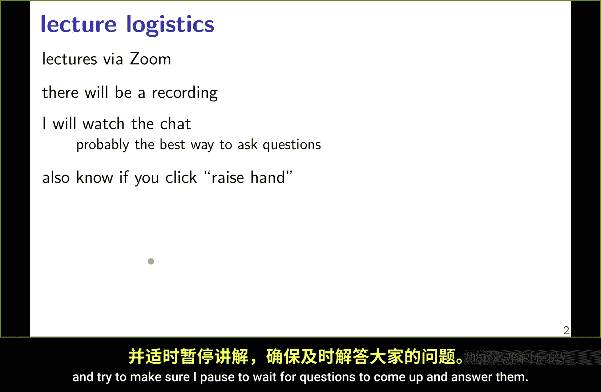
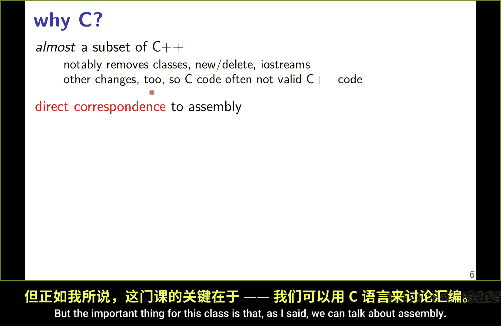
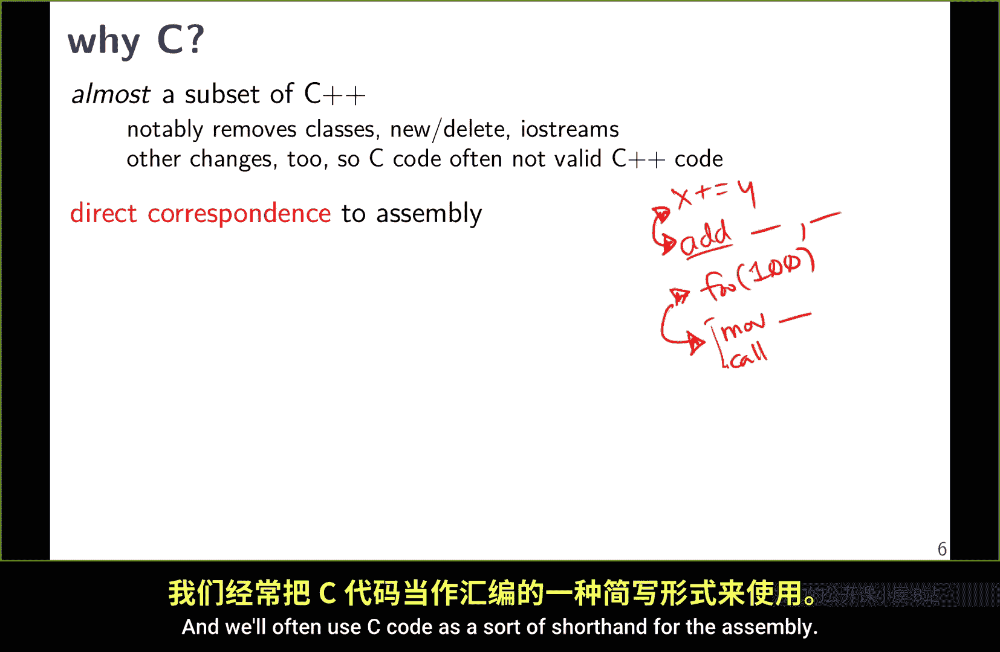
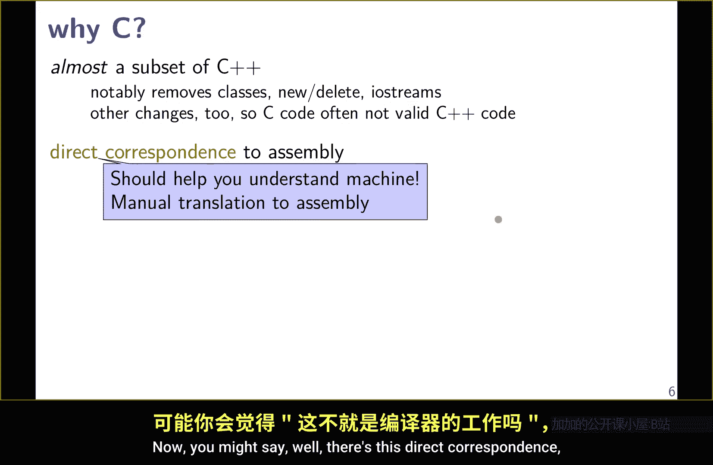
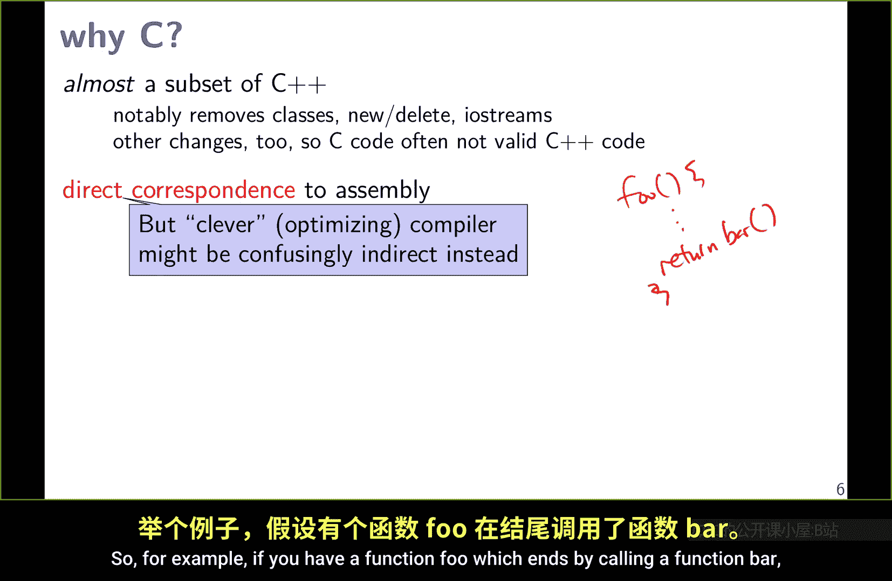
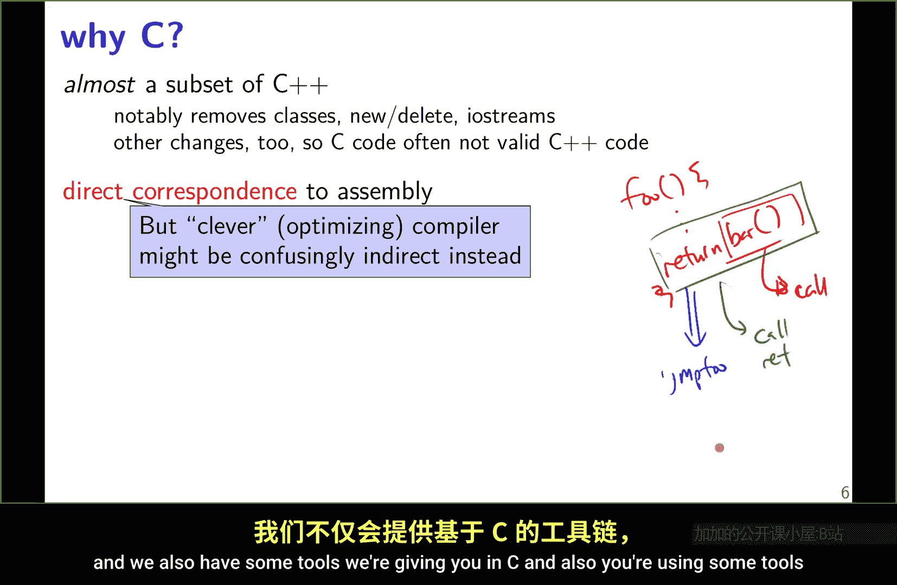
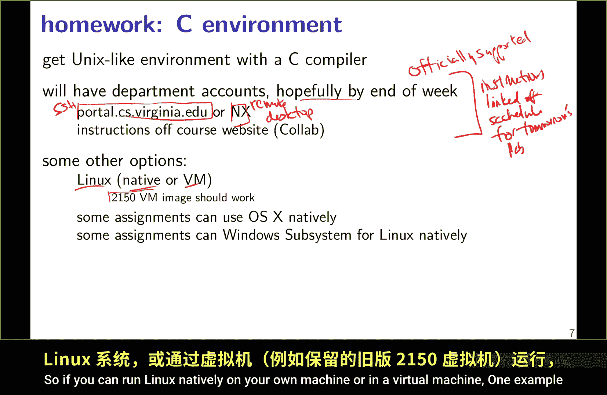
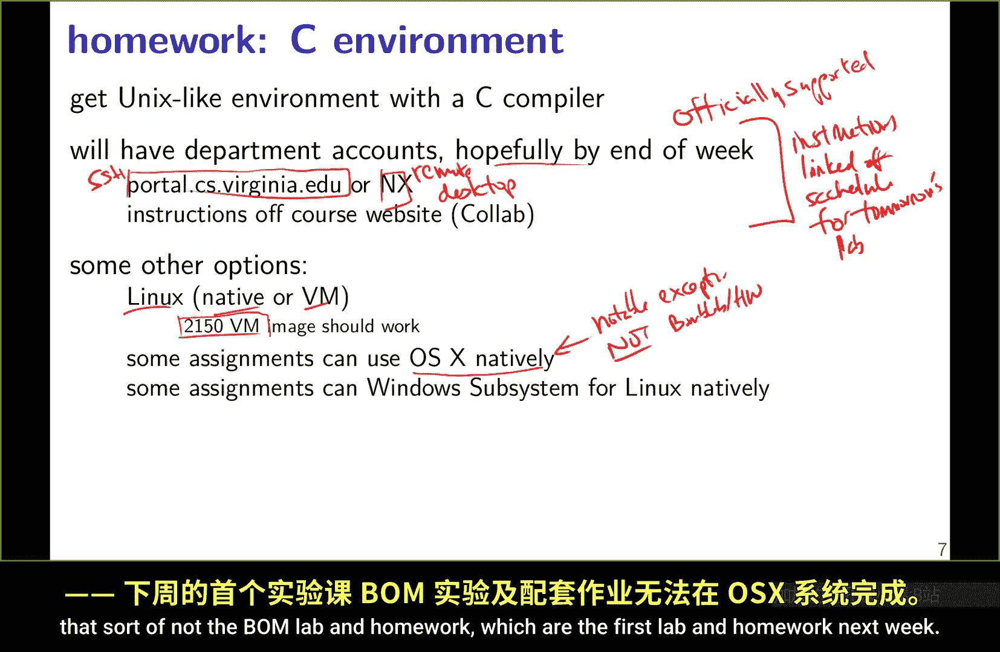
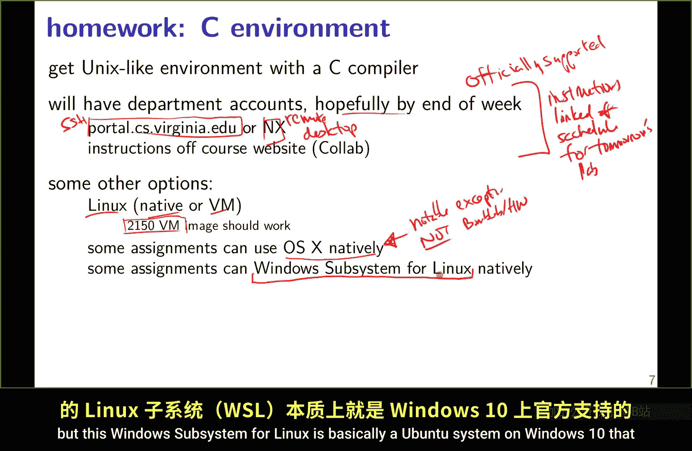
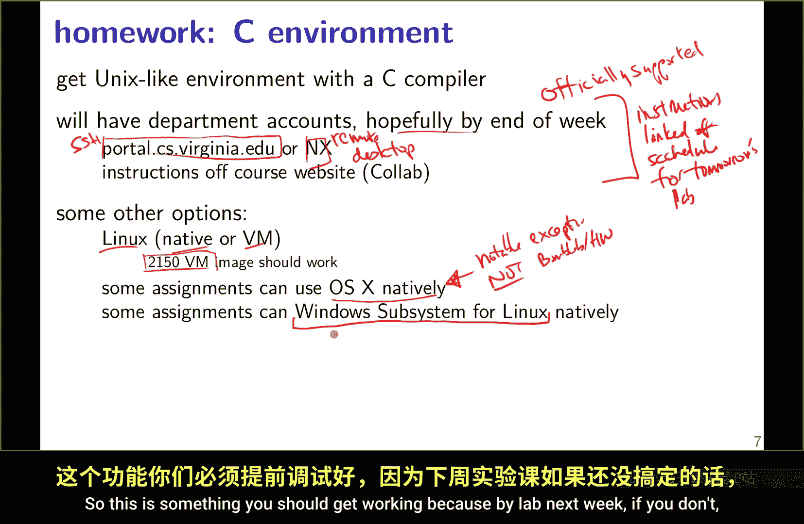

# 计算机架构：P1：课程介绍 🖥️

在本节课中，我们将学习计算机架构课程的基本介绍，包括课程形式、使用的编程语言以及完成作业所需的环境设置。

## 课程形式与提问方式

上一节我们介绍了课程概述，本节中我们来看看课程的具体形式。

讲座通过Zoom进行，会有录制视频供课后复习。提问的最佳方式是通过聊天功能，我会关注聊天内容并适时暂停以回答问题。你也可以使用“举手”功能提问，但对于大多数问题，使用聊天功能更为便捷。

## 课程核心：硬件与抽象层

在计算机架构课程中，我们将探讨硬件的工作原理，并将其视为一系列抽象层。你之前可能接触过高级编程语言和汇编语言等概念，本课程将深入到汇编语言之下的机器码层面，并讨论硬件的实际设计。

## 为何使用C语言？

你可能会问，为什么这门课程要使用C语言？以下是原因：

*   C语言在本课程中被视为一种“高级语言”，因为我们关注的是硬件行为，而C代码与最终的机器码和硬件操作之间存在多个转换步骤。
*   课程后期的作业会涉及编写少量C代码，但我们主要用它来讨论汇编语言。
*   C语言可以看作是C++的一个近似子集。由于你们大多在CS2150课程中学习过C++，因此理解C语言会相对简单。
*   最重要的是，C语言代码与汇编指令之间存在较为直接的对应关系。例如，一行C代码 `x += y` 通常直接对应一条加法指令。这种直接性使得用C语言来解释硬件层面的概念更加清晰。在其他语言（如Python）中，类似的语句可能涉及更多复杂的底层操作。

## C语言与汇编的对应关系

正如前文所述，C语言常作为汇编语言的简写。以下是一些对应关系的例子：

*   **简单运算**：C语句 `x += y` 通常直接翻译为类似 `add` 的汇编指令。
*   **函数调用**：C语言中的函数调用 `foo(a, b)` 通常对应一系列传递参数的 `mov` 指令和一条 `call` 指令。

我们使用C语言作为汇编的简写，是假设C代码能直接转换为汇编。这有助于我们聚焦于硬件操作，而无需纠结于寄存器的具体分配等细节。

## 编译器的优化

然而，需要明确的是，现代编译器并不总是进行这种直接的翻译。编译器为了生成更高效的代码（即“更快”的代码），会进行各种优化。

例如，如果一个函数 `foo` 在结尾处调用了另一个函数 `bar`，直接翻译会产生 `call bar` 后接 `return` 的指令序列。但编译器可能会进行“尾调用优化”，将其直接转换为跳转到 `bar` 的 `jump` 指令，从而节省栈帧操作的开销。

在本课程中，当我们使用C语言来解释概念时，通常不考虑这些非直接的编译优化方式。但你必须意识到它们的存在，因为在尝试通过C代码推理程序行为时，可能会遇到因编译器优化而导致与预期不符的情况。我们将在后续课程中看到更具体的例子。

## 作业环境要求

由于课程作业和工具链基于C语言和类Unix环境，你需要一个能正常工作的C编译器及类Unix环境来完成作业。

以下是几种可行的环境方案：

*   **系内账户（官方支持）**：这是课程官方支持的方式。你应该在下一周结束前拥有一个系内账户，可以通过SSH或远程桌面（如NX）访问。相关说明已链接在课程日程表中。如果遇到问题，课程工作人员可以协助联系IT部门解决。
*   **本地Linux环境**：你可以在自己的机器上原生安装Linux，或使用虚拟机（例如，如果你还保留着CS2150课程的虚拟机，它通常可以直接使用）。
*   **macOS系统**：大部分作业可以在macOS上完成。但请注意，下周的第一个实验（Bomb Lab）和作业无法在macOS上完成，因为它们需要运行一个特定的Linux程序。
*   **Windows 10的WSL**：Windows 10的“适用于Linux的Windows子系统”（WSL）是一个微软官方支持的方案，它本质上是在Windows内运行一个Ubuntu环境。过去有学生成功使用此方案。但请注意，课程工作人员可能无法提供深入的WSL技术支持。

**重要提示**：请务必在下周的实验课之前配置好你的开发环境。如果环境未能正常工作，完成作业将会非常困难。

## 总结

本节课中我们一起学习了计算机架构课程的基本框架。我们了解了课程将通过Zoom进行并鼓励使用聊天功能提问，明确了课程的核心是探索硬件抽象层。我们讨论了使用C语言作为教学工具的原因，即其与汇编语言有较直接的对应关系，但也指出了编译器优化可能导致的不直接对应情况。最后，我们详细说明了完成本课程作业所需的类Unix开发环境及其几种配置方案。请确保在下次课之前准备好你的编程环境。