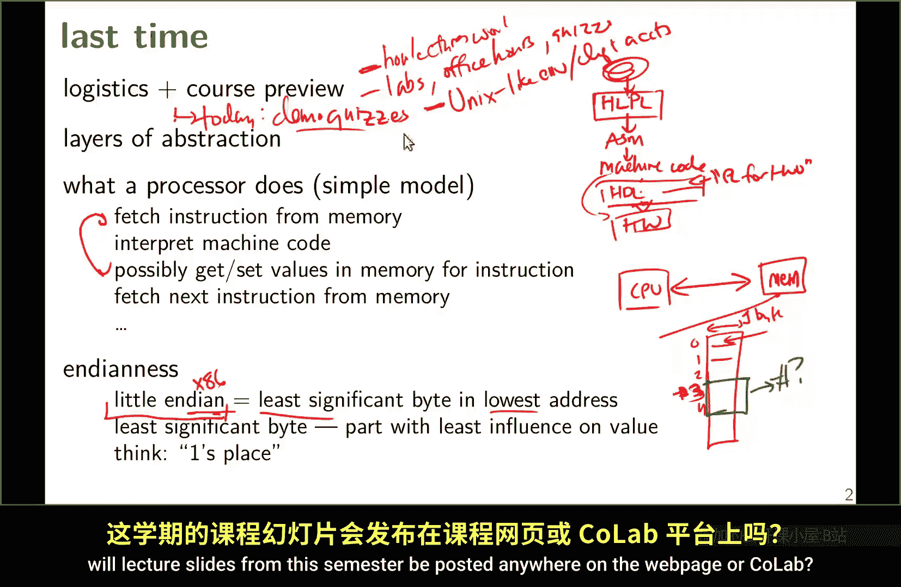
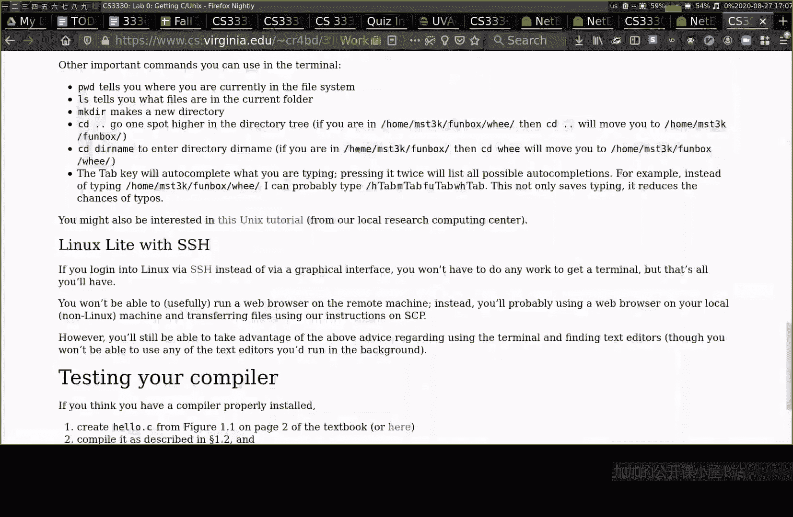
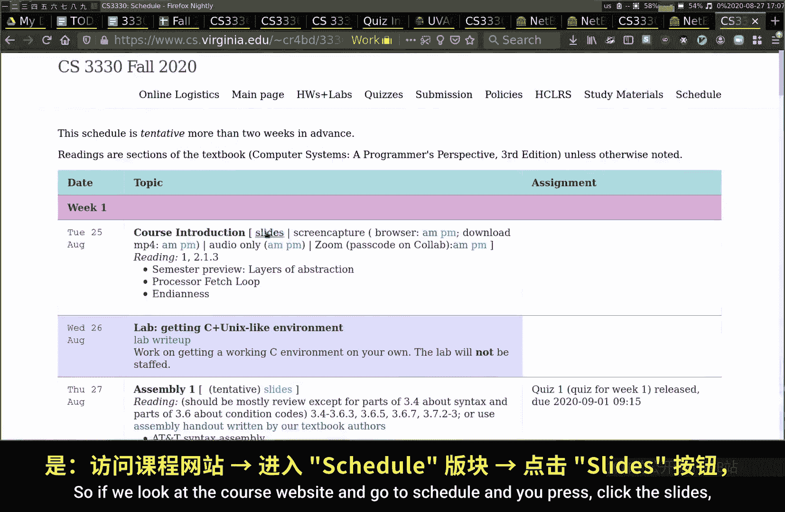
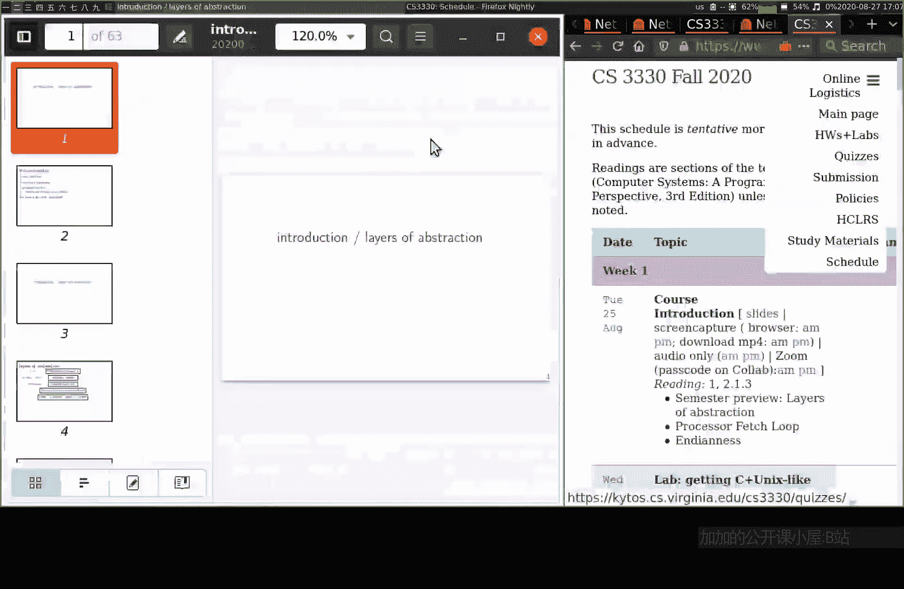
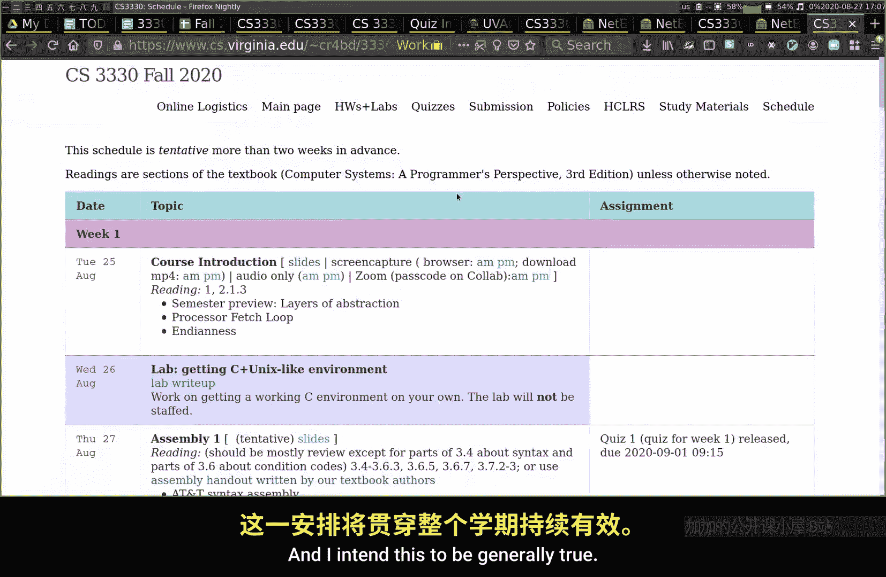
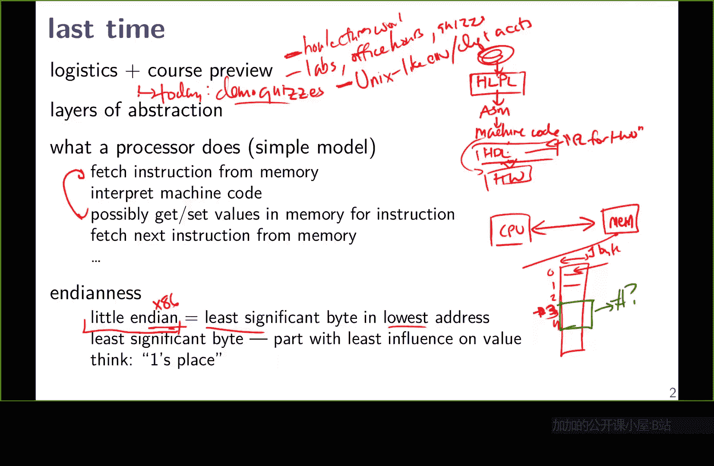
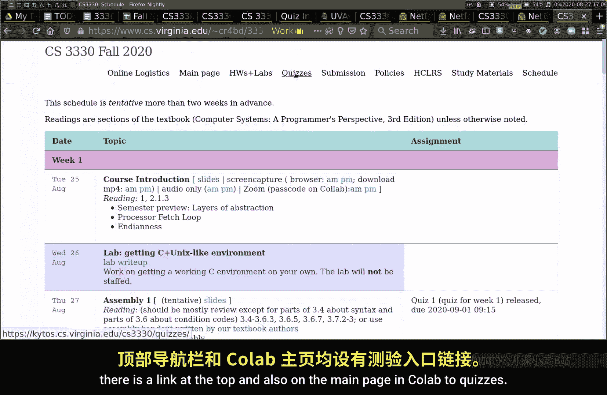
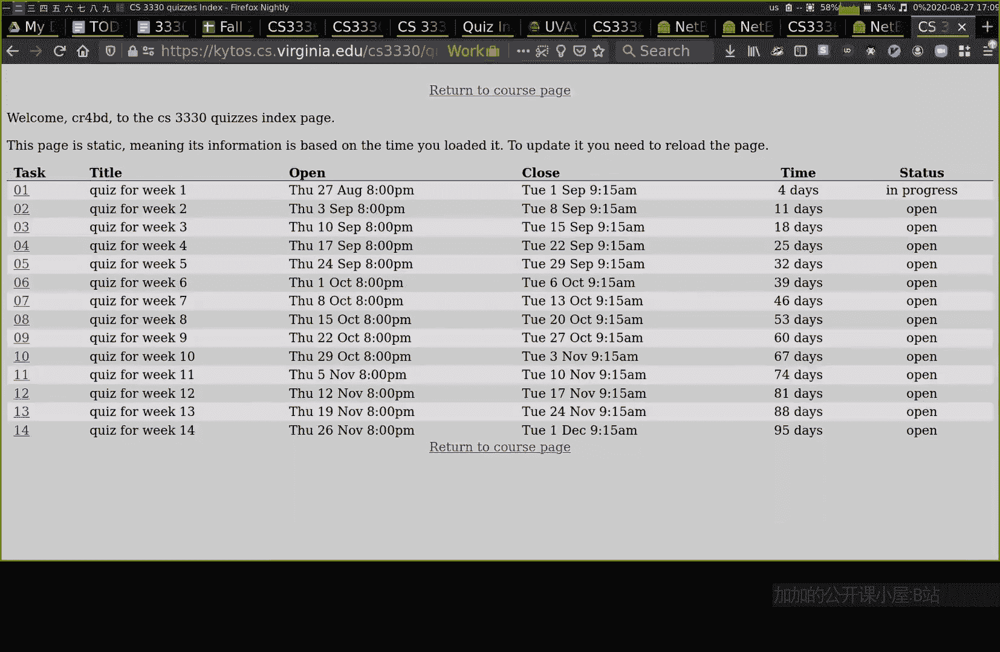
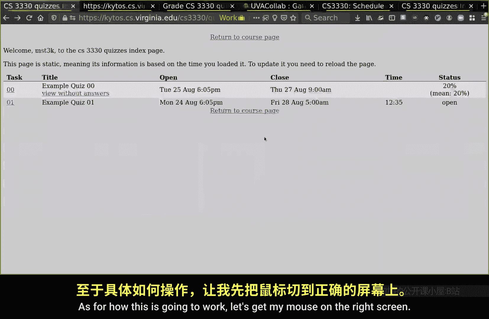

# 弗吉尼亚大学【中英⚡计算机架构｜CS3330 2020 Computer Architecture】 p02 P2 Assembly 1 -BV1cKeGzqEuJ_p2-

Good afternoon。So I'll start by talking about what we laid last time。

 So last time we went over our course logistics， so how lectures work will work。Labs， office hours。

And mentioning quizzes。So。企。Well， then。What quizzes look like as far as logistics are taking them。

Arm。Went over。There it is， Los。 So we also sort of started talking about our course material。

 doing a bunch of motivational stuff。 So this idea that we know， when we're talking about。Software。

 we've had this idea of layers of abstraction that you have sort of your。

Higher level programming language that compiles down into assembly and。You know。

 it's much more convenient to be programme at this higher level of abstraction than it is to actually be writing assembly all the time。

 And this assembly that's turned into machine code。And somehow。

 we build hardware that can interpret this machine code。 but we actually similar to。A。

Higher level programming languages have sort of hardware description languages， which is like a。

PL programming language for hardware。I we'll see you later。

 And that sort of some abstraction we're going to use to eventually figure out how do we build a processor。

 And if we're talking about building a processor， we need to know， well， what that is a processor。

 really， And we have this simple model that we have this CPU that was connected to memory The memory would have our storage。

 And the CPU would run this sort of。Loop here。Where we'd fetch an instruction from memory。

 which we said in our simple model the CPU did by telling memory， hey。

 what's at this address and we get some machine code And the hardware would somehow interpret that machine code and figure out what it's supposed to do。

 So we had an example where the machine code was this push instruction。

 which was supposed to add something to the stack。So can。Interpret that machine code based on。

You know what it means and if it's that' come to stack。

 we might need to talk to the memory again to say write something to memory based on the instruction。

And then after we've done with that， we fetchch the next instruction and repeat this process over and over again。

And this processor is just a piece of hardware， which has the logic for knowing what to send to memory to get the right instruction and knowing how to interpret that machine code and just do this over and over again。

SoThat's our simple idea of a processor and we alluded to， well。

 there's going to be multiple ways we can actually design a processor and for some of them this is kind of an oversimplified model that it might be the case that we don't just run one instruction run the next instruction and so on。

 it might be also be the case that we don't actually talk to memory all the time。

And we're going to look at those sort of optimizations that get away from the simple model and allow us to produce faster。

 more efficient hardware as part of this class。We're going to start out with this processors that actually work according to the simple model。

So then we got into sort of one technical topic， which is theoretically review from 2150。

 though a topic that a lot of people get confused by and or forget about Indianianness。

 So Indianianness was about an issue we had with the organization of memory。

 that our memory we said was this array of bytes。 so。We had a bunch of bites， so this here is。1 bite。

Add each of these bytes have an index。But often we wanted to get more than one byte from the memory。

 So the question is， if we get， say， two bytes from memory and when to interpret this as a number。

We have to make a choice about what do we do with those two bytes to get a single 16 bit？Number。

And the choice that we've arbitrarily made， because Intel arbitrarily made it。

Is that because X D6 chose little Indian。 we are little Indian。

 What does little Indian mean means the least significant by has the lowest address。

 So here the lowest address is 3。 So that's where the least significant bite is。 And you might say。

 what does least significant mean。You should think one's place， it's the the place in our number。

 which has the least effect on its value so that's。In this。

Fre place and we ended last time with kind an exercise that looked at some C code whose output depended a lot on the endingianness of the system that that we made this little ending choice。

 and I'll review that exercise in a bit。So before I move on to demoing quizzes and reviewing our endingianiness exercise。

 questions about logistics， about this simple processor model or other things we covered last time。

And I guess under logistics， I should also mention sort of a unX like environment。

And department accounts， that was another part of logistics you might have questions about。

So question， do we have to care about big Indian， we will never use big Indian。In this class。

second question is， when will office hours begin for the homework？

If you so the office hour calendar should be accurate。

 though we won't be having very many office hours before the first lab because there's probably not much demand and if you want to talk about the first lab and homework before it's assigned。

 we can do that。So a logistic question， will lecture slides from this semester be posted anywhere on the webpage or coab and the answer to that is。

Yes。

So if we look at the course website and go to schedule。

And you press， click the slides you will get。

The lecture slides。I intend this to be generally true。

Other questions on logistics， processor model， and so on。

We will not have video for lab the lab we will use Discord。

 Discord does support certain types of video like you can screen share on Discord。

 which might be useful for collaborating or talking to TAs。

But we're not going to try to use Zoom for that， mainly because。嗯。Trying to have multiple TAs。😡。

Were other members of the course staff managing a single Zoom call to help people is really just doesn't work。

Other questions。Okay。So first， I'll talk about。Quizes。

 I'll give show what our quiz system will look like。 So on the course website。There is。

A link。At the top and also on the main page and collab to quizzes。

You won't see， and they have an open date and a closed date。

So note the quizzes are start to be available， it's 8 pm of the lecture day。

 this means that after this lecture， I can make sure the quiz isn't asking about things we haven't covered。

😡，That's why there's so much time between the lecture and when the quiz opens and it closes at 9。

15 a。m before the 9 and 30 AMm lecture because I don't want people working on the quiz during the lecture when I might talk about the quiz。

あ。So that's sort of what the quiz website as for how this is going to work。

I now on the right screen， so here's my quiz demo page。

