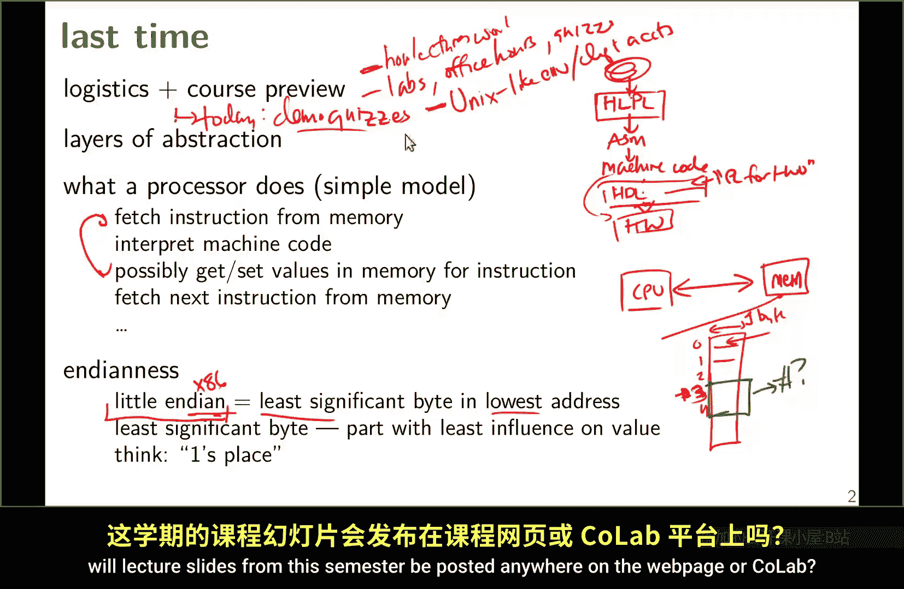
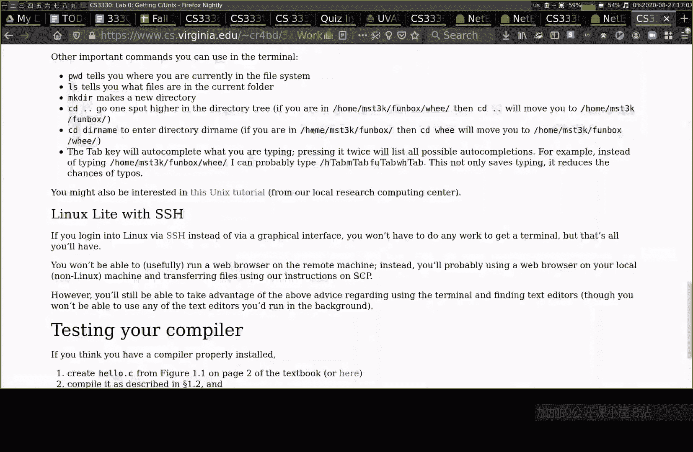
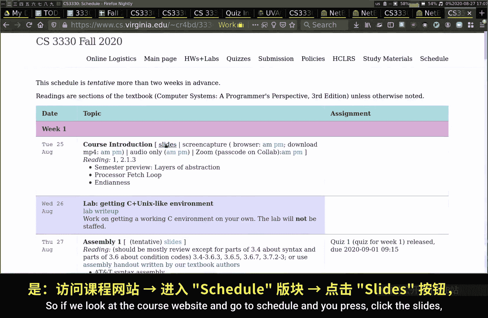
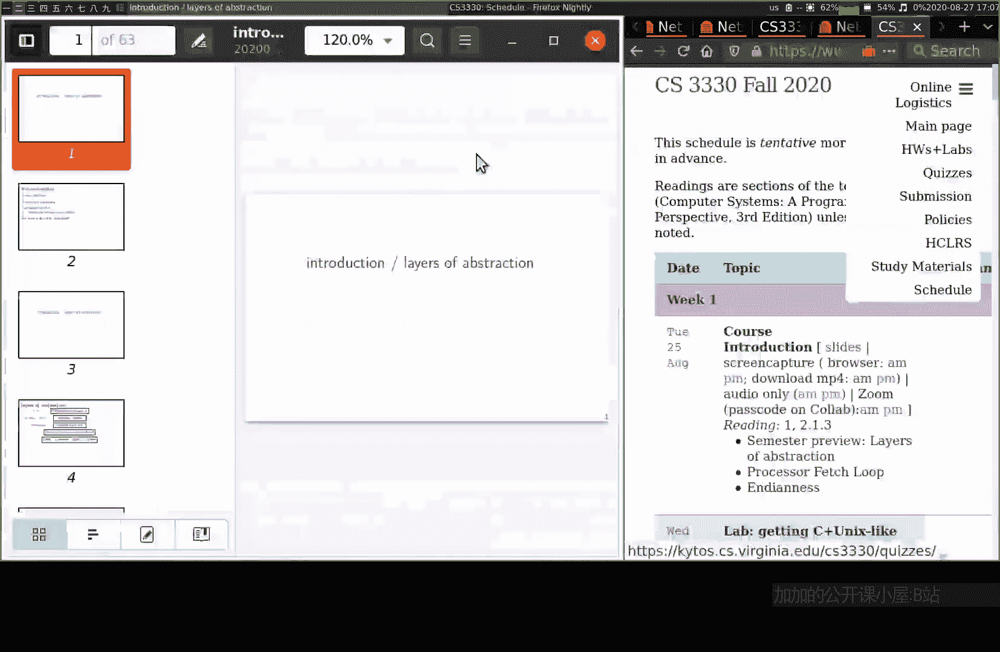
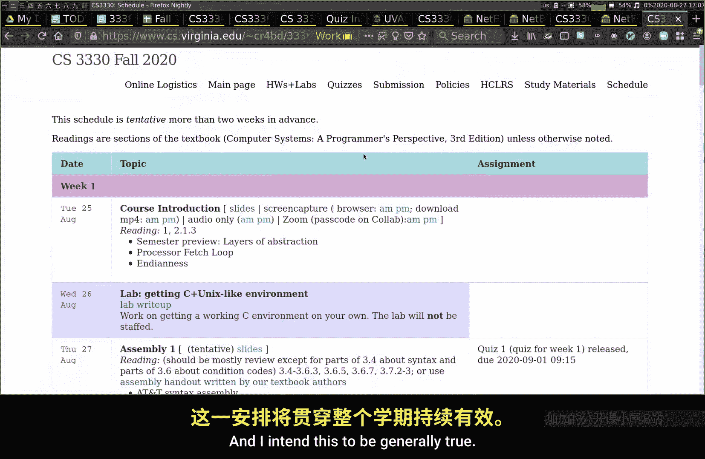
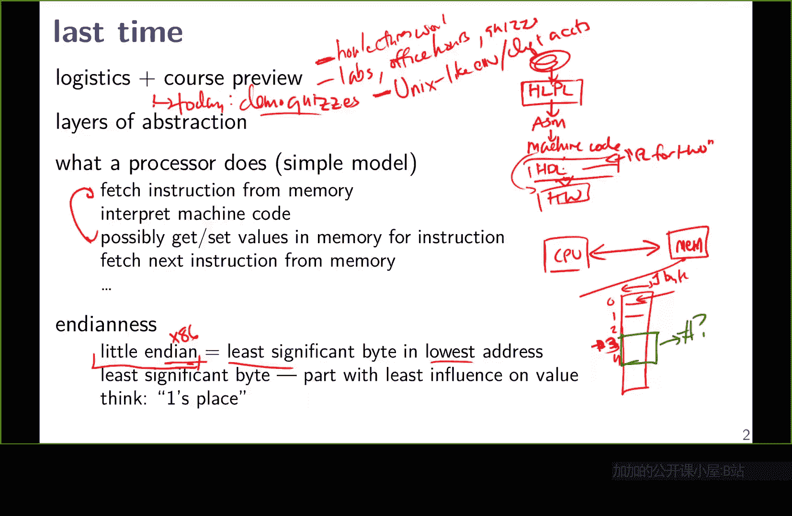
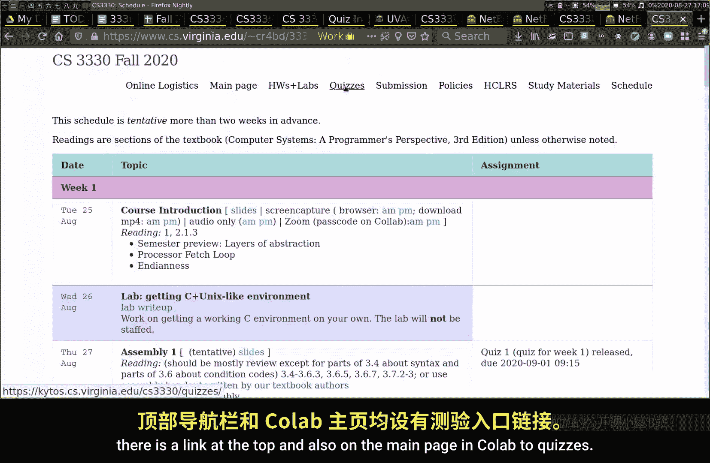
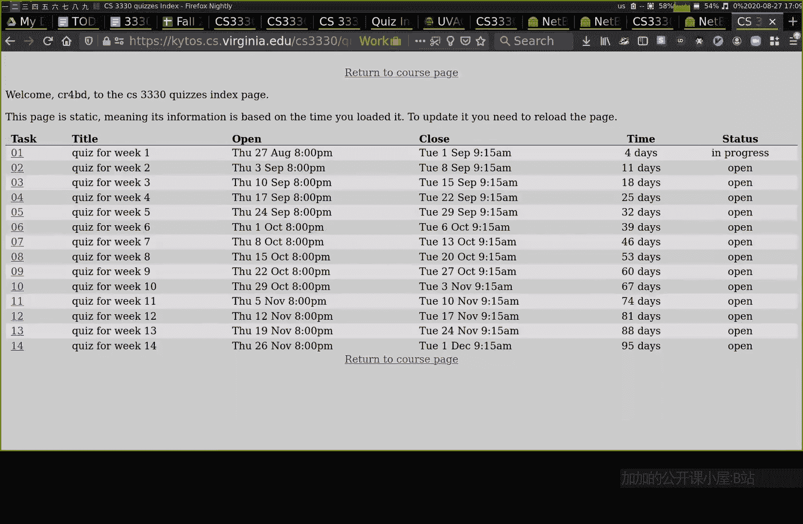
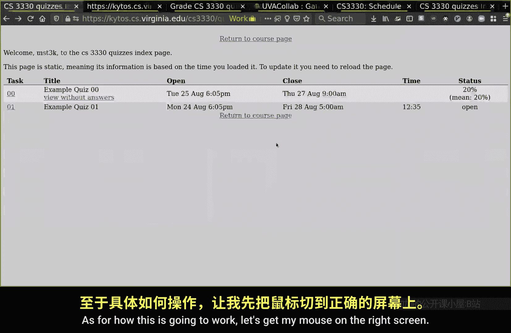

# 计算机架构：P2：汇编语言入门（第一部分）🚀

在本节课中，我们将回顾上节课的课程安排与核心概念，并深入探讨字节序（Endianness）这一重要主题。我们还将介绍课程测验的形式，并解答一些常见的后勤问题。

## 课程回顾与引言

上一节我们介绍了课程的后勤安排，包括讲座、实验和办公时间的形式，并提到了测验。我们也开始讨论课程的核心内容，做了一些动机性的介绍。

我们知道，在软件层面，存在**抽象层次**的概念。高级编程语言会被编译成汇编语言，而编写高级语言远比一直编写汇编语言方便。汇编语言再被转换成机器码，最终由硬件来解释执行这些机器码。类似地，硬件描述语言就像是硬件的“编程语言”，我们稍后会看到，这种抽象将帮助我们理解如何构建处理器。

要讨论构建处理器，我们需要知道处理器究竟是什么。我们有一个简单的模型：一个连接到内存的CPU。内存负责存储，而CPU则运行一个循环：从内存中**获取指令**，硬件解释该机器码以确定要执行的操作，然后可能再次与内存交互（例如写入数据），最后获取下一条指令并重复此过程。这个处理器就是一块知道如何与内存通信、如何解释机器码并不断重复此过程的硬件。

我们提到，实际上有多种设计处理器的方式。有些设计可能比这个简单模型更复杂，例如可能不会严格按顺序执行指令，或者不会频繁地与内存通信。本课程将探讨那些能脱离简单模型、让我们设计出更快、更高效硬件的优化方法。但我们将从这个符合简单模型的处理器开始。

## 深入字节序（Endianness）🔢

上一节我们进入了一个技术性主题——字节序。这在理论上是CS2150课程的复习内容，但很多人容易混淆或忘记。字节序是关于内存组织方式的问题。

我们的内存可以看作一个**字节数组**。每个字节都有一个索引（地址）。然而，我们常常需要从内存中获取超过一个字节的数据（例如，一个16位的数字）。这就产生了一个问题：当我们获取两个字节并想将其解释为一个数字时，我们如何排列这两个字节以得到一个正确的16位数？

我们（或者说，英特尔公司）任意选择了一种方式：**小端序**。这意味着**最低有效字节存放在最低的内存地址**。例如，在一个16位数中，代表“个位”（对数值影响最小）的字节会放在地址较小的位置。

上一节课我们以一个C代码练习结束，该代码的输出结果严重依赖于系统的字节序设置（我们选择了小端序）。稍后我们将回顾这个练习。

在继续演示测验和回顾字节序练习之前，大家对于后勤安排、这个简单的处理器模型或我们上节课涵盖的其他内容有什么问题吗？在后勤方面，我还应该提一下类Unix环境和系里账户，这也是后勤的一部分，你们可能会有疑问。

**问：我们需要关心大端序吗？**
答：在本课程中，我们**永远不会**使用大端序。

**问：关于作业的办公时间何时开始？**
答：办公时间日历应该是准确的。不过，在第一次实验布置之前，我们不会有太多办公时间，因为可能需求不大。如果你想在作业布置前讨论第一次实验和作业，我们可以安排。

**问：本学期的讲座幻灯片会发布在网页或Collab上吗？**
答：是的。如果你访问课程网站并进入“课程安排”页面，点击“幻灯片”链接，就能找到讲座幻灯片。我打算让这成为常态。

**问：实验课会有视频吗？**
答：实验课我们将使用Discord。Discord支持某些类型的视频功能，比如屏幕共享，这对协作或与助教交流可能有用。但我们不会主要使用Zoom，主要是因为让多位助教或其他课程工作人员管理一个Zoom会议来帮助大家，效果并不理想。

## 测验系统介绍 📝

接下来，我将介绍我们的测验系统会是什么样子。

在课程网站上，顶部、主页以及Collab中都有一个指向“测验”的链接。每个测验都有一个开放日期和截止日期。请注意，测验通常在**讲座日晚上8点**开放。这样安排是为了确保在讲座结束后，测验不会涉及我们尚未讲到的内容。测验在**下次上午9:30的讲座开始前15分钟（即上午9:15）** 关闭。我不希望有人在我可能讨论测验内容时，还在讲座期间做测验。

现在切换到右侧屏幕，这是我的测验演示页面。（*注：此处为演示描述，实际输出中不包含图片*）

---

本节课中，我们一起回顾了处理器的基础模型和抽象层次的概念，重点探讨了**字节序**（特别是小端序）对内存数据解释的影响。我们还了解了课程测验的后勤安排和访问方式。理解这些基础概念，特别是数据在内存中的表示方式，是后续学习汇编语言和计算机体系结构的关键第一步。