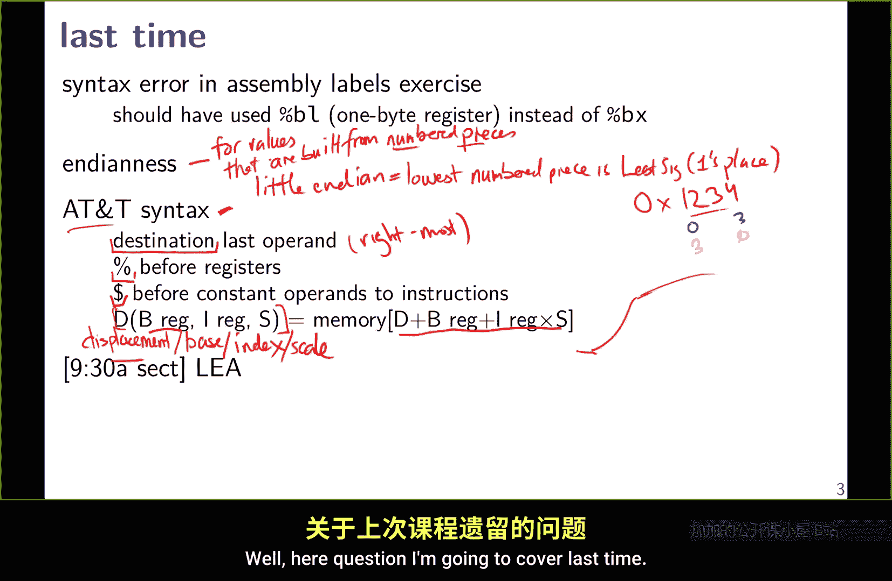
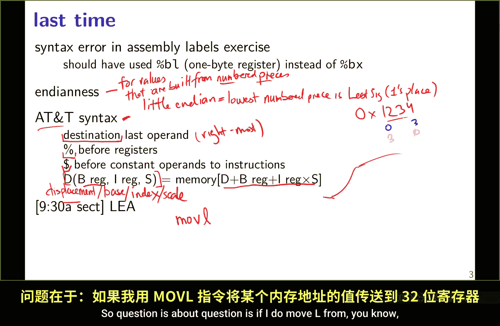
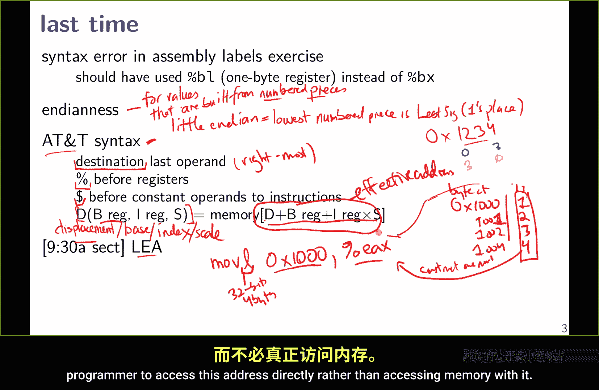
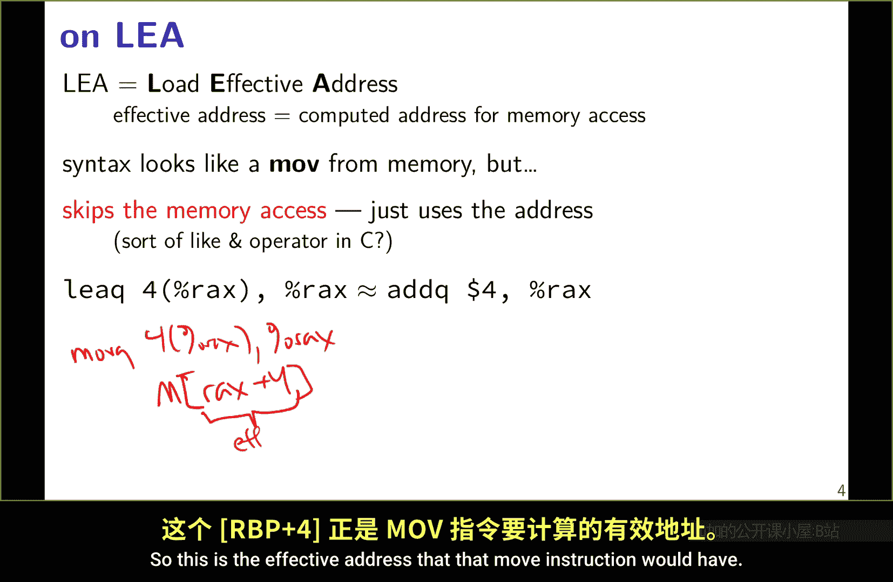
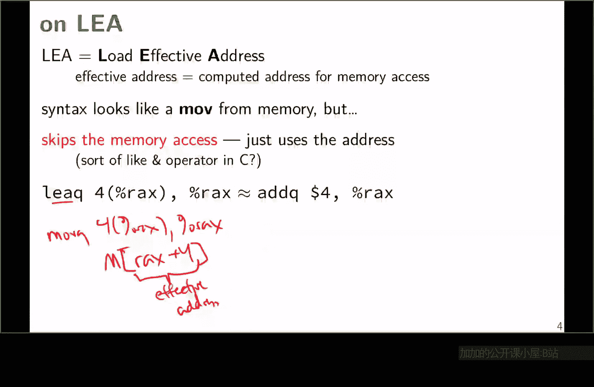
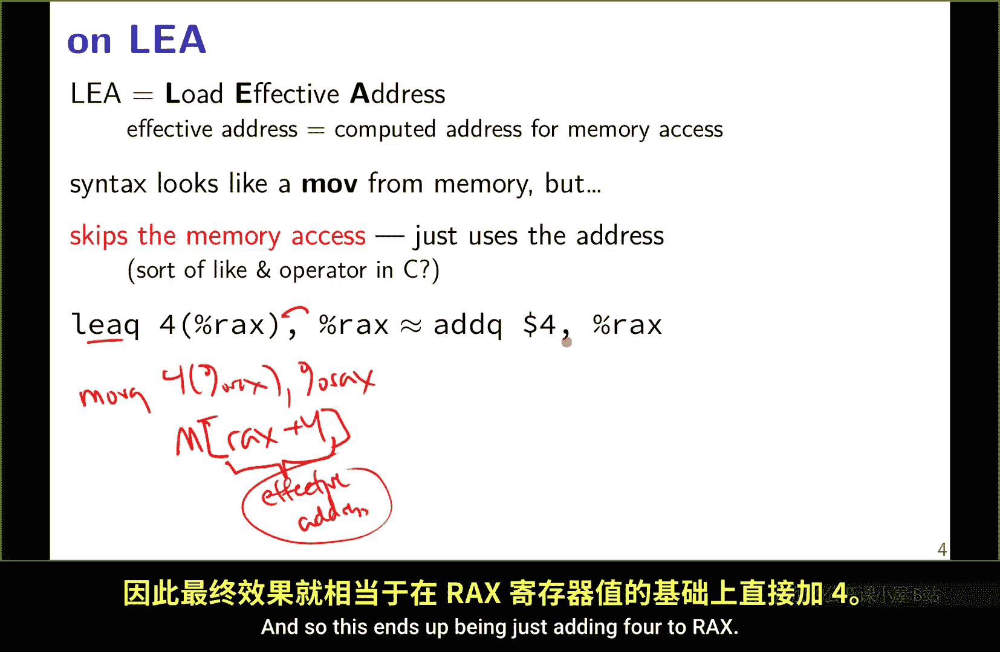
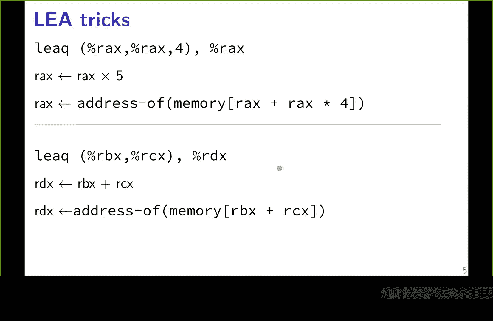
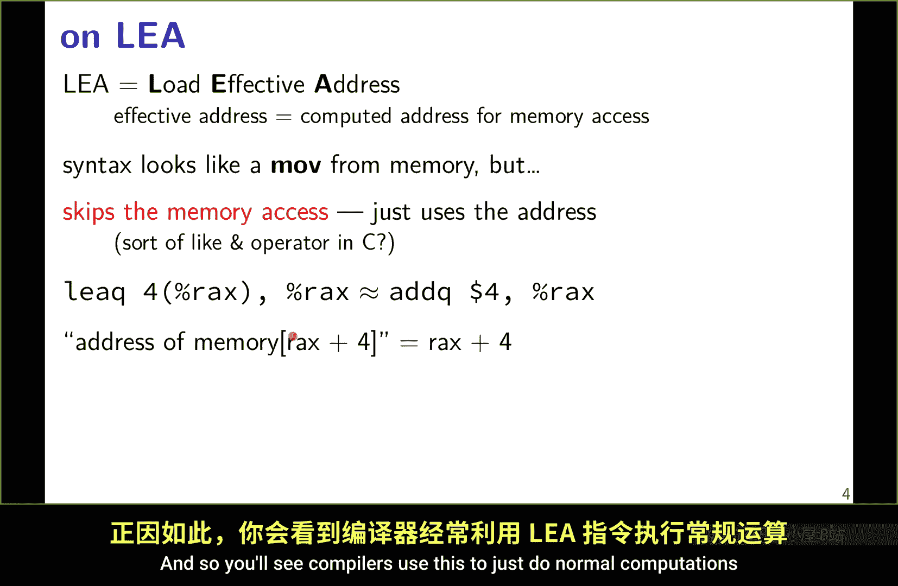
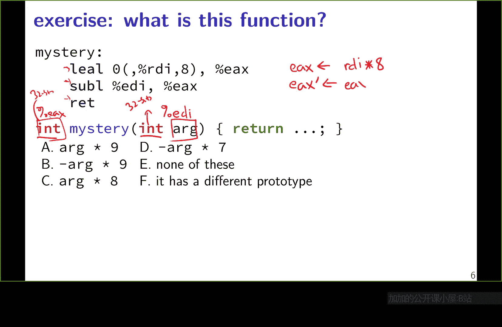

# 弗吉尼亚大学【中英⚡计算机架构｜CS3330 2020 Computer Architecture】 p03 P3 Assembly 2 -BV1cKeGzqEuJ_p3-

Good afternoon。So last time we started by reviewing ending this。

So this was the idea that when we had a value that was built from numbered pieces。

We had different parts that made one bigger number。

 we needed to decide how to assemble those pieces into the bigger number and what we said is that we're going to mostly use little Indianian and that means the lowest number of pieces where the ones places of our number。

I'm emphasizing that this is for numbered pieces when I write down a number。

 I'm just not going to say that this is in particular Indianness because。

 you know I could number this zero and this three。Or。Or this three in this zero and。

unless I do something like that， there's no eniness I've just written down the number as a whole unit that's not divided into pieces we need to assemble。

Then we looked at assembly syntax， both kind of doing a little review of assemblylies since many have you don't remember it very well and also going over  AT syntax。

 which is what we use for this class and in1 AT syntax。

 our destination was always the last the rightmost。Opper end in the instruction。

 we always used a percent sign before registers， if there wasn't a percent sign。

 it was a label instead。We use the dollar sign to indicate a constant argument to an instruction。

And we had this。F parameter syntax for representing a location and memory。

 the instruction will we retrieve。嗯。With。A displacement， a base register， an index register on scale。

 and we just do this formula as part of executing the instruction before we access memory。

Some questions on things we covered last time。Okay。So。Let's go on to our next topic。

 which we're going to Okay， well here question I cover last time。

So a question is。About。Question。sIf I do Mol from some memory location。

Into。Well。And 32 it register because that's what Muval means。Does it retrieve from。More than one by。

 and the answer is yes， because this means 32 Bs or  four bytes。We can't move。Four bytes。From。

Just one byte。 so if our memory if we know。If we know the by at， O X 1000 is know。

1 and the one at 1002 is2 sorry， 101 is2 and。1002 is three。

For then we're going to take all of these bytes。And construct one number。For this instruction。

Does that answer your question？Okay。Other questions。Okay。

 so that case I'll move on to our next topic， which is going to be about an instruction called LEA。

For load effective address， you might say what's an effective address。

 An effective address is a special name for。An address at which we would access memory in an instruction。

 So the result of the computation with our displacement based induction scale。

 that's an effective address。And。U。The effective address of instructions are something the processor already needs to build the compute efficiently and it turns out that they might be useful to the compile or you as an assembly programmer to access this address directly rather than accessing memory with it。

 so there's an instruction provided for that。

And that's what load Eive addressed us。You know， if we looked at a move instruction like this。X。

 this would。Access memory at RAX plus4。 So this is the effective address that that move instruction would have。

LEA says we're going to just compute that effective address。

 but rather than going on to access memory， we're just going to put it in the result。

And so this ends up being just adding four to RAX。

And。

You can also think of this kind of like the address of operator and C。

 like it's taking the address of this memory location and putting it in the results。

And though we're kind of this。Traditionally represents a memory location。

 It doesn't actually need to be used that way。 Like regardless of whether。You know。

 RAX plus4 is a location and memory we can use， this will still add4 to RAX。

And so you'll see compilers use this to just do normal computations because it's actually a pretty flexible instruction for that。

So for example， if I do this LEA instruction， if you know this memory location is RAX plus RAX times 4。

 which is RAX times 5。And。Because this is computing that address， putting it in there。

 this LEA instructions multiplying REX times 5， and it's probably the most efficient way of doing it on most X6 processors。

And so the compiler will use this， even if REX doesn't actually represent a memory location。It could。

 it might not。And similarly， you can do this to add two values and stuff the result in a third register。

Which is something you can't do with a single ad instruction and compiler might do that。

So questions on。What LEA does。So。Assuming there are no。Questions， let's go through this exercise。

 So here I have a function written in an assembly。And we'll review the calling convention in a bit。

 but the calling convention is like tells us， you know， if this is the C prototype for this function。

 where is Arg and where is the return value and the answer is that Arg is going to be an EDI。

And the return value is going to be in EAX。 I'm using the 32 bit registers because on the systems we care about Inus 32 bits。

So given that， I have the assembly for this function and its prototype。

 my question is like what is this equivalent to？好。So and to figure that out。

 you need to look at this LEA instruction here。Give you。Some time to look over that。

嗯。