# 弗吉尼亚大学【中英⚡计算机架构｜CS3330 2020 Computer Architecture】 p04 P4 Compilation Pipeline ⧸ selected C topics -BV1cKeGzqEuJ_p4-

Good afternoon。So last time， we started by covering the load effective address instruction。

And this instruction looks like it's accessing a memory location。

 It uses the same syntax we've seen to specify some value in memory。But it doesn't actually do that。

And what it does is that all this syntax。There's something， computes a memory address。

 we call that the effective address， load effective address just takes this and puts it in the destination of the load effective address instruction。

Something like LEA。Cha。R X。And to say R8 sets R8 to this effective address of 10 plus RAX。

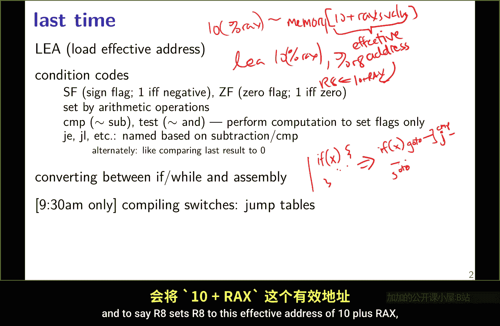

The address that。Would be accessed if this weret normal。

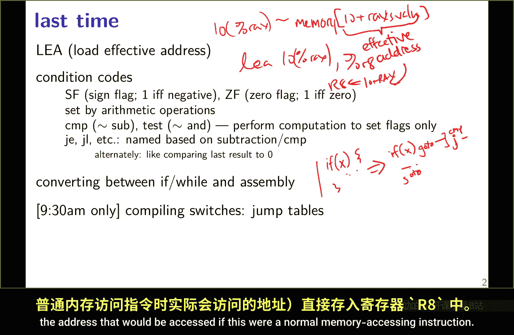

Memory accessing instruction。So then we talked about how。Conditions work in Exod 6。

 and we were solving the mystery of well。In 2150， we taught that you do something like a compare and a jump equal。

But， this means that。Between the compare and the junk equal。

 somehow the result of that comparison is being passed。

 and we learned that there's a special registers， these called the condition codes。

And they have different parts， and the two most important for this class are the sign flag and the zero flag。

 which represent the results of the last arithmetic operation。But of course， you know。

Our comparison we don't traditionally think of as an arithmetic operation with a numerical result。

But we've learned that the way that the comparer is implemented is that it's really a subtract operation which only sets the flags。

 we just don't put the results in the destination register。

 but we still set the flags and compute it。And the test instruction was similar。

 except it performs the Biwise and operation， which we'll learn about next week if you don't already know what that is。

And。😡，Because we have this comparing fraction that doesn is subtract， things like jump of equal。

 jump of less than our name based on what the result would be and therefore what our sign flag and zero flag would be for subtraction。

Another way we can view that is comparing to zero because if we compare RAX and RBX。

And this is really a subtraction， then if this REX minus RBx equals0， that means REX equals RBx。

And we'll find similar logic for less than and greater then。

 so you can think of it like comparing the last result to zero as far as what of jump if equal jump of less than and so on。

 do I use。So knowing how our condition codes work and therefore how our jump if equal jump of less than and so on work。

We can think about。Taking same， say， C code and converting it to assembly， which。

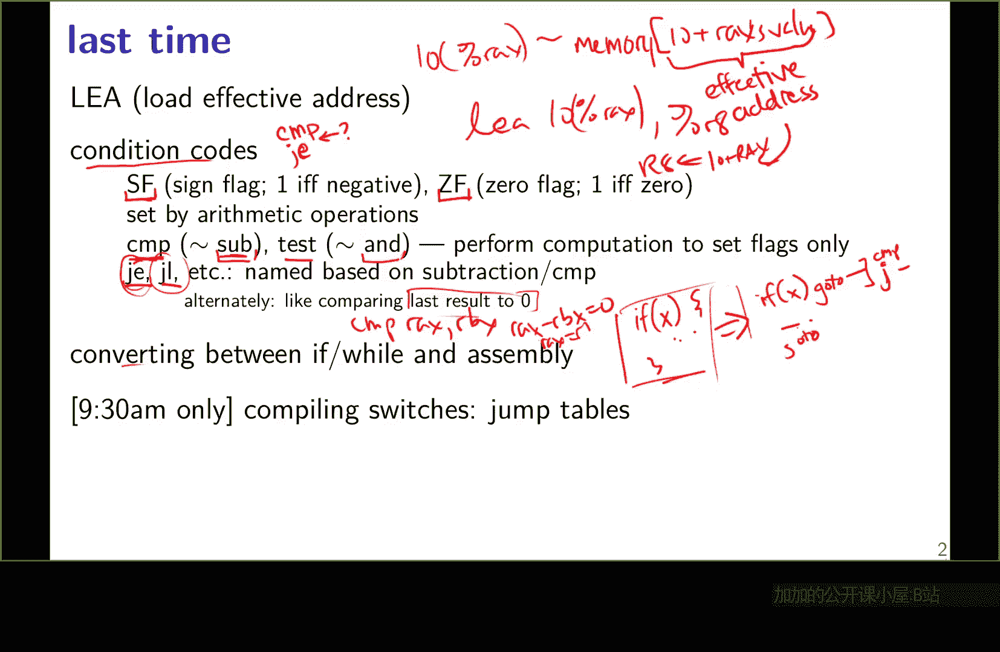

You've done in 2150， though it's been a while。

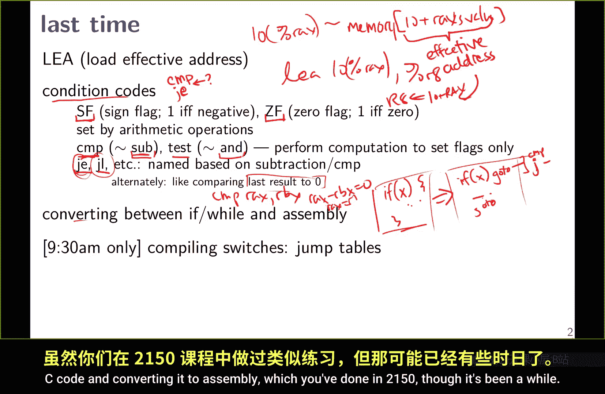

嗯。maybe not C code but taking writing an assembly and I'm just taking the approach of starting with C code and my approach is that I first convert my C code to C code where everything looks like an assembly。

Opereration， so I convert my if statements to if go to go to is in fact valid C。

 and conveniently this if go to， you know， we can translate directly to a compare and conditional jump。

😡，And I can translate it go to directly to a jump。And this sort of strategy of like first rewriting the C as simpler C is how I would go about converting any sort of C。

To assembly。And thinking about what the opposite translation might be if I need to do that。

So questions about these topics we covered last time。Or anything else I should be discussing now。

OutThe course。Okay。So then I'm going to start off today by talking about converting one type of C code that we haven't looked at to assembly。

 and this is one which is much less straightforward， which is switches。

 and the reason it's less straightforward。Because if you think about a switch statement。

 there's actually multiple ways of writing it and assemblysembling， and you might wonder well。

 which thing actually happens？

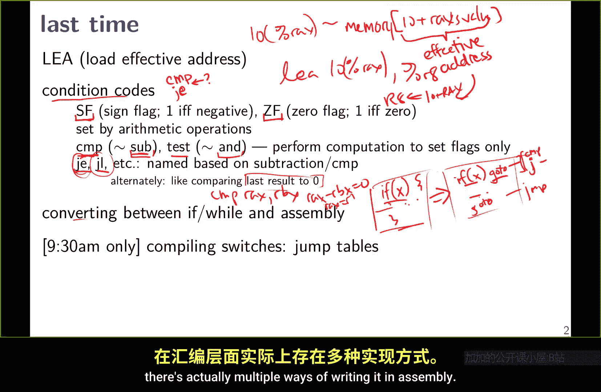

We could do this kind of translation where basically I'm converting it to。

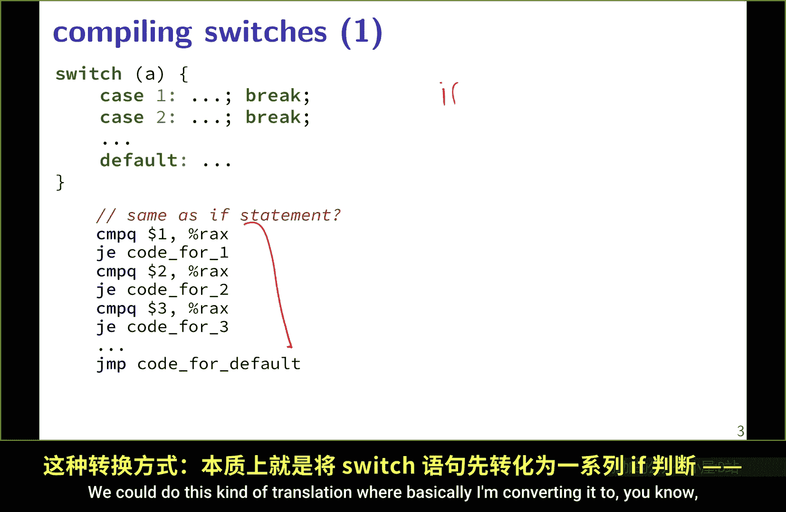

You know， if a equals one， if elses。A equals two， like I'm basically converting it first to a。

Sequence of if statements， and that's what this assembly code kind of represents。

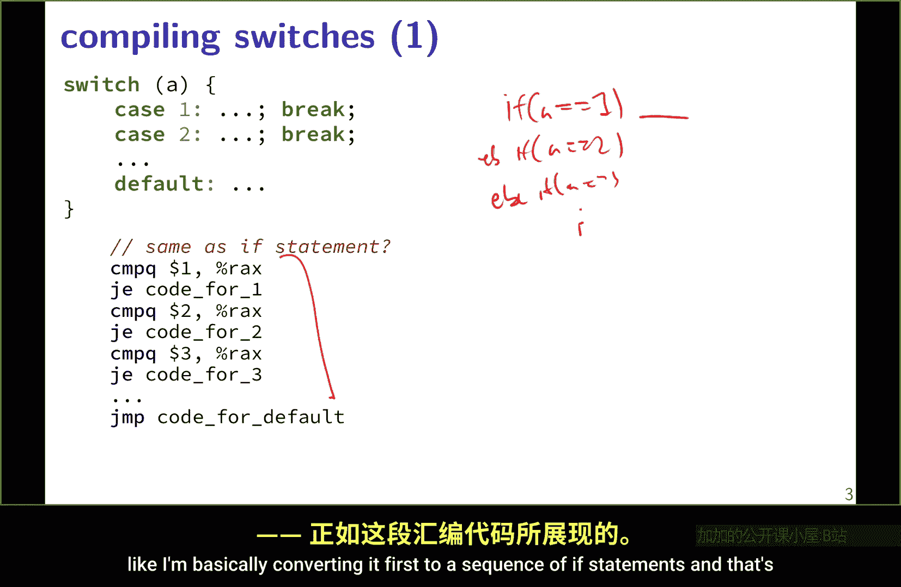

We could convert it to a binary search， so here I have my 100 case switch statement。

 I could convert it to， you know if a is less than 50 and if a is less than 25 and keep nesting it and have the code for the cases。

And he's nested you know if。

Else statements that there's a binary search。

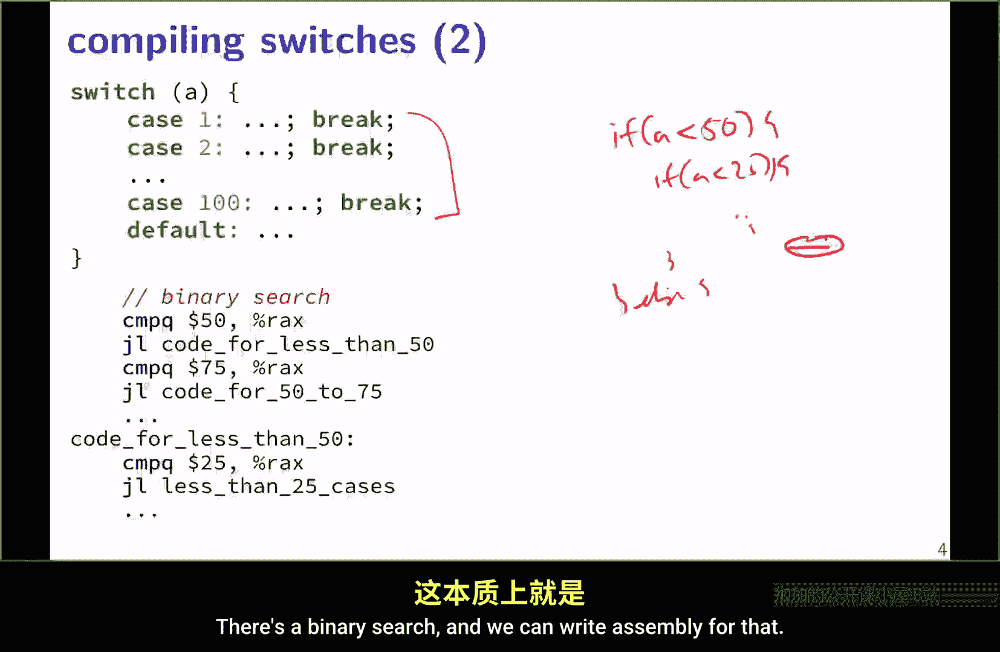

And we can write assembly for that。I this sort of pseudo basically the outline of what the assembly would look like。

 or if there's this other strategy， which is not something we've seen before where we use what's known as a junk table。

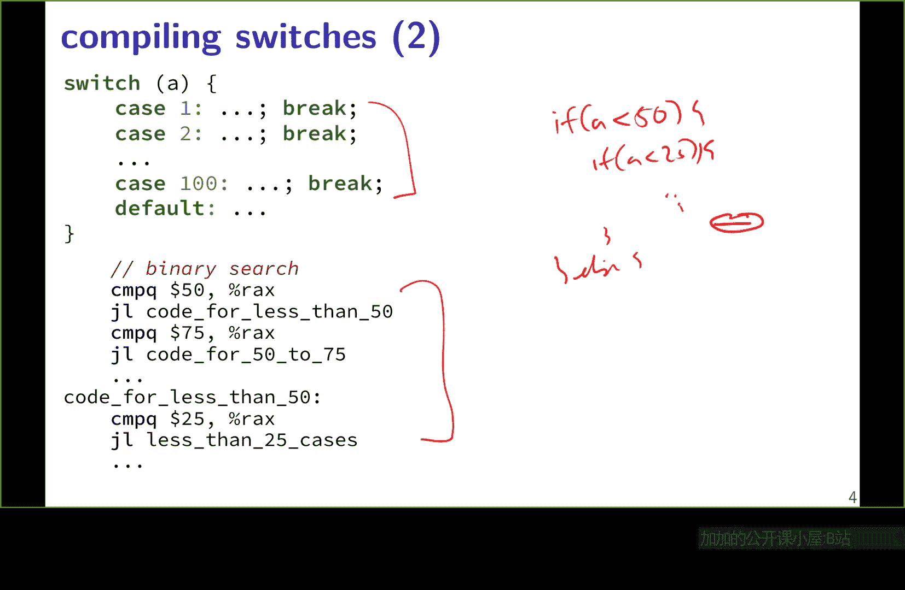

So。In this version， first， I make sure it's in bounds and then I use this funny jump instruction。

 which I did show you earlier， but like it is not something we've seen much。

 So let's go through like what is this。Doing。And the idea is we have a table here of pointers to machine code。

So this thing here is a pointer to machine code， and in this case。

 the machine code that corresponds to this case。The idea is that by having this table。

We're just going to look up an entry in this table and jump to there。 And that's what this。

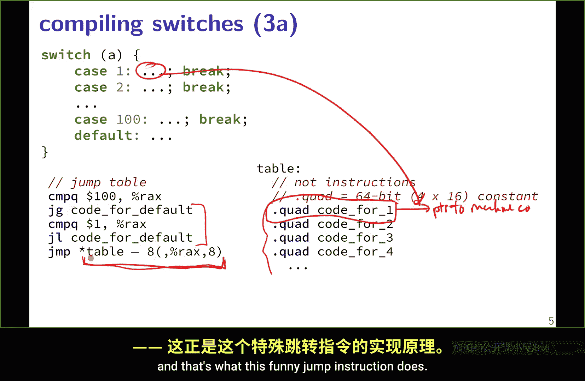

Finding jump instruction does。Let's go through that， so let's say here's my funny jump instruction。

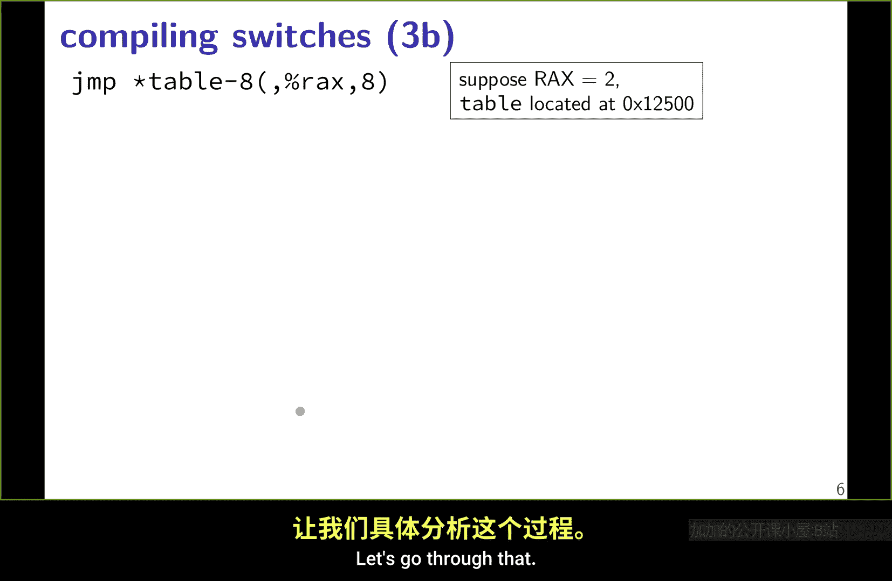

And RA X is。

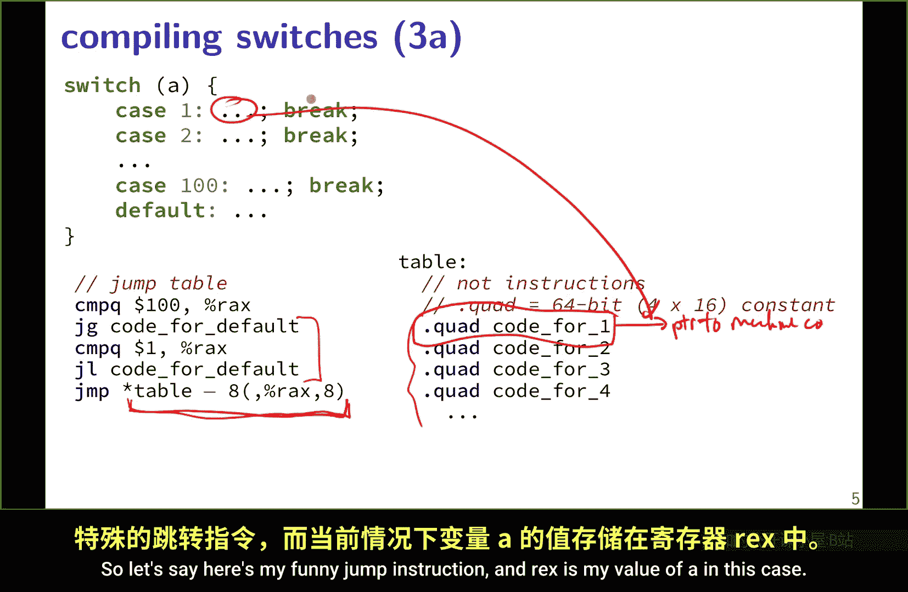

My value of a in this case。So。I have this jump instruction， and I also have this table。

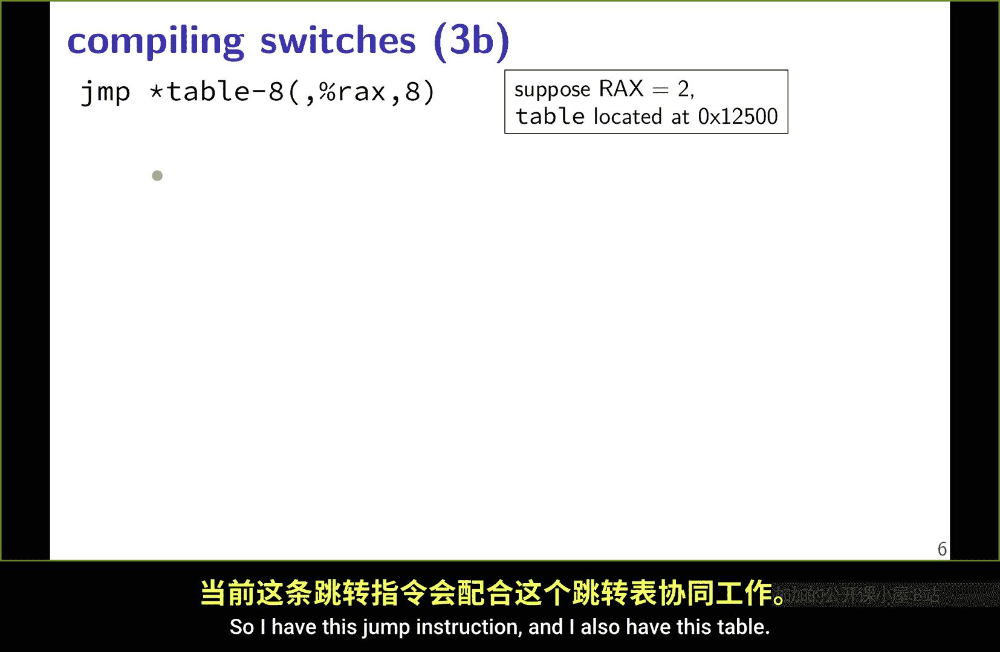

In my table， it's somewhere in memory， I'm saying hypothetically， it's out address 12，50。

0 hexagadecibel， and it's a list of code addresses。

So this code address here points to some machine code here， and this is the machine code。For。

Case one。Work小包。And what is this instructions is going to do。

 so let's think about what it does if RAX。Equals 2。In that case， we have our displacement。

So here my displacement is table minus8， the asemler for convenience allows us to use labels in very simple calculations like this。

 so table， remember it's a label it's replaced with the address of table。

 which we were assuming is 12500 minus8， the asemmbbller just does that computation for us to compute the displacement。

So we have that added to RAX， our index register。Times our scale。So this ends up being address 12508。

You can see the minus8 means we get。The second entry in the table。

 despite REX being two rather than the third。And that points to here。

 so that's a pointer to machine code， and here's where the code42 would actually be。To code。

 I guess I should say code for。Our。Case 2。It's actually there and that's where this will end up jumping so this jump instruction will read a pointer for memory and then after the jump instruction。

 where that pointer points is where the next instruction we execute will be。

So I'll start answering questions if there's more questions， please ask them。So I'll start with。

Question， arere compilation styles two and three only possible for special cases？

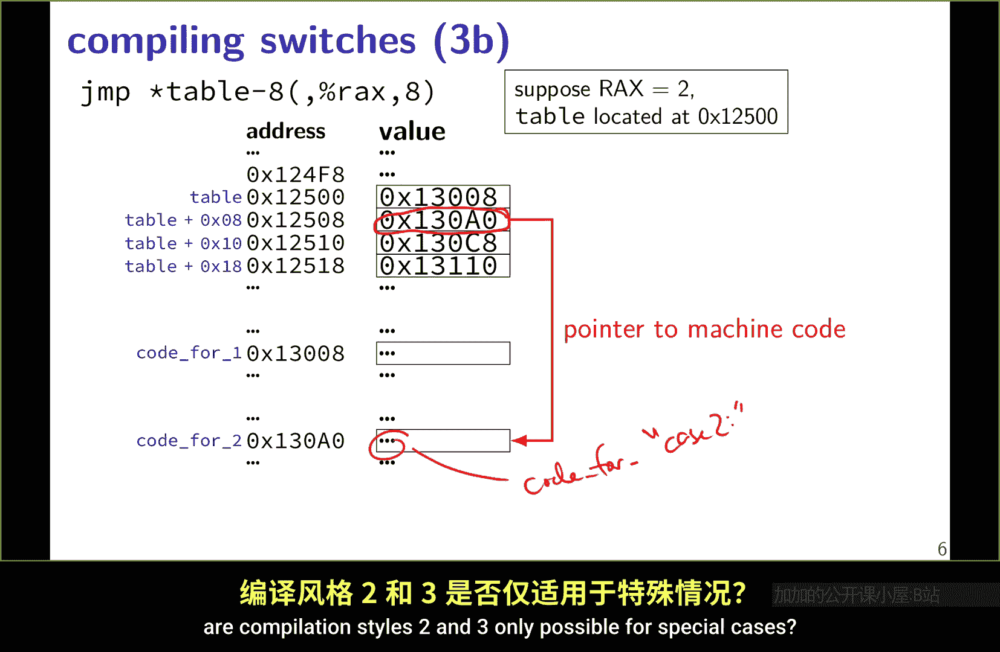

So。Style 2 was a binary search。 We could do this binary search strategy， if like we only had。

Like case 50 and case 60 and case 40， right， we could first check if it's less than or equal to 50。

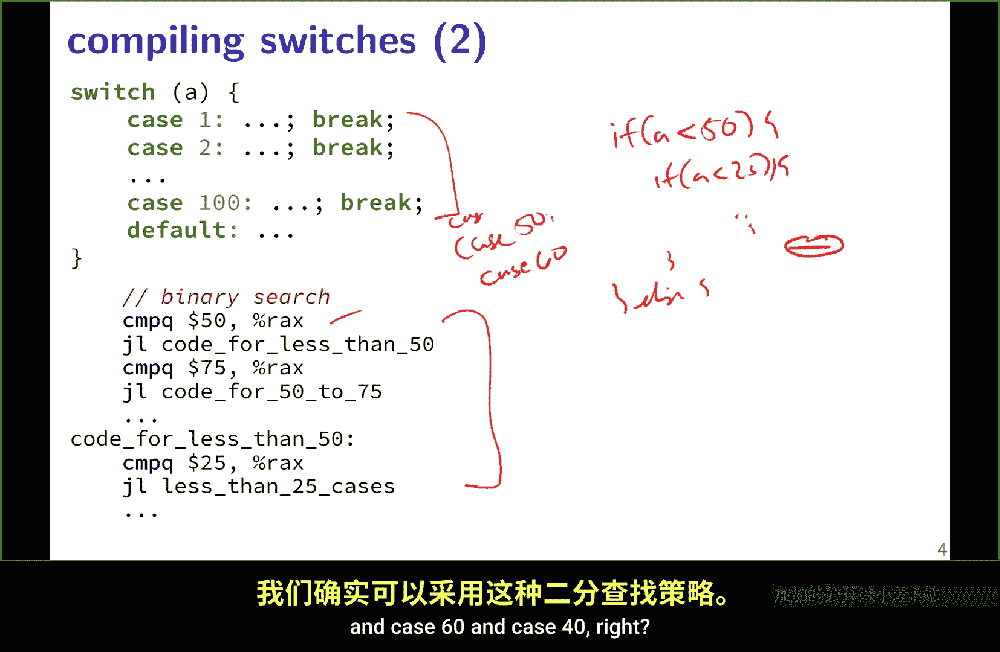