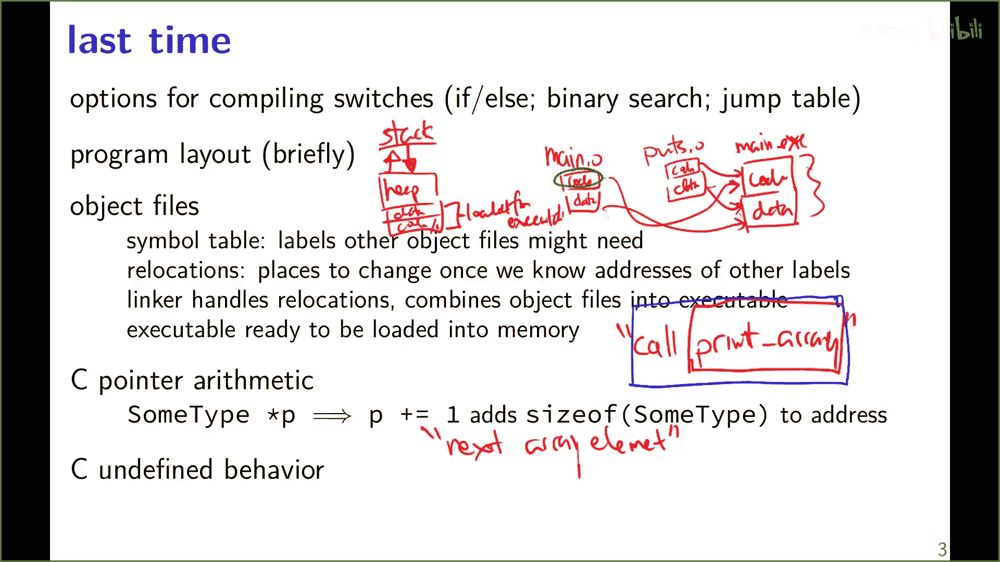
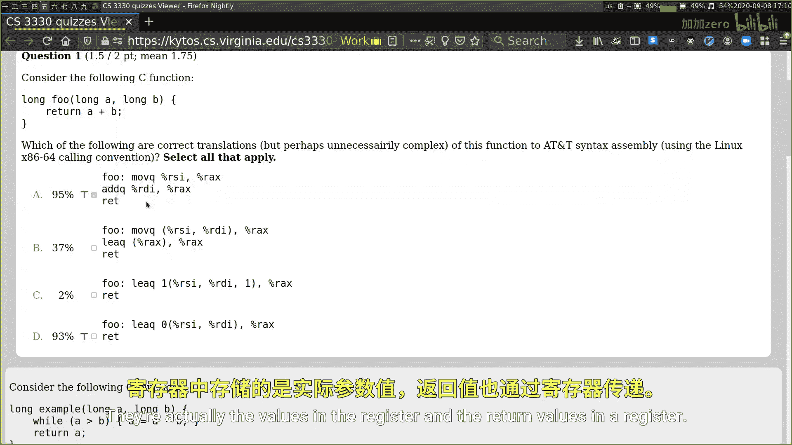

# 弗吉尼亚大学【中英⚡计算机架构｜CS3330 2020 Computer Architecture】 p05 P5 Bitwise -BV1cKeGzqEuJ_p5-

Good afternoon。So last time。We started out by。Reviewing options for compiling switches。

 And we mentioned that there were actually multiple things a compiler could do that were very different from each other。

 And this was unlike what we expected for things like if else。

Where there's like basically a couple very。Now。Direct translations into assembly with switches and compilers can generate a chain of it elses or like a binary search。

 where we have this strategy which is basically unique to switches。

Of a junk table where the compiler would make an array of pointers to the code for each case in the switch and。

Actually write code that an array look up and then jumps to the location it looks up。啊。

And that was sort of one case where unlike most of the other things and see where you know。

 the idea going from the C code to that assembly code is much less straightforward than it is for。

Other constructs we saw。Then we talk about， well we know about compiling and turning into assembly。

 what about the rest of the process？And one thing we need to think about is well when we load the program into memory。

 what does that look like and you kind of have seen this in 2150， we talked about。

 you we have a stack on X6 this grows down as in towards lower edge dress， we have a heap。

That grows up and we have our program。You know， it's data and code and constants。

And this stuff somehow gets loaded。From the executable。That's how our program looks in memory。

 then we explored well， this stuff that gets loaded from the executable。

 how do we actually produce stuff to be loaded from the executable？

And we delved into how object files work。 So with object files， we assemble code in multiple pieces。

 and somehow we put them all together into one big executable that combines all those pieces and。

When we do that， we have to deal with how those pieces are connected to each other。

 There's going to be places where we have a main function in one assembly file that calls a putis function that's defined in another file somehow we have to get that call to go to the right place and the way we did that with these object files is that the object file would have most of the machine code and data already put together and for the most part we just be copying that code in that data into the executable。

啊。But we'd have these places where we needed to fix up where we didn't know at the time we were producing this code for main。

 where putS would end up in this chunk of code。 So we would generate a relocation。

 a place where we would have to change that address later。

 and we need to figure out well where is put S and。That information wouldn't be in the code itself。

 but would be on the side in what we call a symbol table。

And the linker we learned is what's responsible for doing this process of taking these object files。

 putting them together into an executable and handling all these placeholders。

 and so on to produce something in an executable that's just ready to be loaded into memory。

So there's a question on the quiz， we asked， well， when we're doing this。

 if we have a call print array。Does the memory address for call print array end up in this executable？

And there's a subtlety here， which is that， well， the call instruction needs to contain the address of print array array。

 but that's not what the question was asking。 The question was asking。

About the address of call printer already， the address of this instruction。

And as far as the linker is concerned， the instruction is just part of。Some big。

 you know chunk of code here。 it just sees there's a big chunk of code。

 It doesn't need to write the address of pieces of that chunk of code。Anywhere， you know。

 just because they're separate instructions， all it knows is this is a bunch of machine code that I don't know what instructions are in it。

That's all that ceased。Does that answer your question？So after we talked about object files。

 we looked at some selected C topics， we reviewed， I hope。

 I don't know how well this is actually covered in 2150 these days， point torithmetic。

And we have this idea that we can do arithmetic， we can add and subtract from pointers and this doesn't work in a way where it just translates to actually changing the address directly。

 there's some scaling if we have a pointer to some type that's bigger than a byte adding one to it it's not going to add a byte。

 it's not going to increase it by one， it's going to increase it by the size of a type and the idea is that you know this is the next array。

If we had a pointer to an array of some types。And we also mentioned this idea of undefined behavior that we kind of learn see as。

 this is what the compiler does。There's multiple C compilers and they've come together to reon。

 this is what the C language is and there are parts of that they didn't specify and where they didn't specify。

 they've decided that even on the same compiler there's no requirement that they have consistent behavior they can do whatever they want when you're doing things which are of out of bound of the language we saw one example of that was signed into overflow that if you take a s number and increment it beyond the range that we can represent。

Now。There's no guarantees about what that does， even though when we learned about to's complement。

 we learned that it seems like that should just wrap around to a negative number。

So any other questions on these things we covered last time？

So a question of can I go over the quiz question on。The function flu that adds A and B together。嗯。

Probably。She。Let me pull up the quiz。Okay。

Put it on the screen I'm sharing。 So in this question we had。

This was asking you adding this and this adds A and B。😡。

And A and B are going to be an RSI and RDI because of the K convention。

 which I didn't expect you to'm rise， this is an open notes quiz， you can look it up。

So A is our straightforward translation， we use an a instruction and we put our results in RAX。

 we first move one of the values into RAX so it gets there。

And our second translation here uses the LEA instruction。

 which computes RSI plus RDI because that's what we compute if we were accessing memory before we access memory。

It doesn't matter that this is probably an invalid memory location because the LEA instruction just computes and address。

 it doesn't try to access it so we're not going to get a Se fault or anything like that because we're never going to try to actually get to that piece of memory。

嗯。Then we have this option here where we have a problem here where we compute this address RI+ RDI。

But we try to access it and that's not something which is done by this code。

 this code doesn't use A or B as a pointer。So it doesn't correspond。So the question。

 isn't a computing the memory address， I'm not sure what memory address you're talking about。Here。

A and B are integers and RSI and RDX， it's adding them together。In the C code。

 they don't represent memory addresses， though that doesn't mean they couldn't happen to have the same value as a valid memory address。

The brackets are not necessary is the question， so where which brackets？There's no brackets in A。

So I'm confused about why breakfast would be necessary。

I don't understand where you would think thered be。

Memory involved because A doesn't just uses registers， the arguments are passed in registers。

 they're not pointers to arguments， they're actually the values in the。

